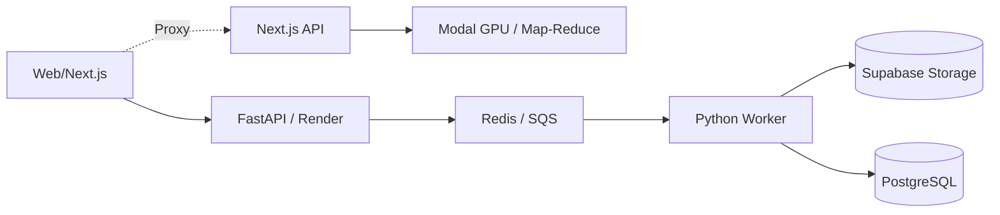

# 🎹 PianoFlow AI


**PianoFlow AI** is an advanced AI-powered platform that converts any piano audio, video link (YouTube/TikTok), or MIDI file into **synthesia-style tutorial videos**, **auto-generated sheet music**, and **simplified beginner-friendly arrangements**.

🌠 **Live Demo:** [pianoflow-jet.vercel.app](https://pianoflow-jet.vercel.app)

---

## ✨ Key Features

- ðŸŽ™ï¸  **Audio/Video → MIDI Transcription (Beta)**
  - Upload MP3/WAV or paste a YouTube/TikTok link.
  - Powered by a heavily optimized **Map-Reduce GPU Pipeline** on Modal (Transkun + Basic Pitch).
  - Processes a 3-minute song in under 40 seconds.
- 🎬 **Tutorial Video Rendering**
  - Synthesia-style falling-note MP4 generation.
  - Customizable colors, playback speed, and resolutions (720p/1080p).
  - Rendered asynchronously via backend workers.
- 🎼 **Automated Sheet Music**
  - Generates highly readable PDF & MusicXML files directly from transcribed or uploaded MIDI.
- 🎯 **Beginner Mode (Smart Simplification)**
  - Algorithmically simplifies complex MIDI files into "Easy" or "Very Easy" arrangements while preserving the core melody.
- ðŸ›¡ï¸  **Enterprise-Ready Architecture**
  - Supabase Auth (Email + Google), daily usage quotas, and isolated user workspaces.
  - Zero-egress storage proxying for secure, large-file uploads.

---

## ðŸ —ï¸  Architecture Overview

PianoFlow operates on a modern, decoupled serverless & containerized stack:



- **Frontend:** Next.js 15 (React 19), Tailwind CSS, Zustand, deployed on **Vercel**.
- **Backend API:** Python 3.12 (FastAPI, SQLAlchemy) deployed on **Render**.
- **Heavy GPU Inference:** Deployed on **Modal** (A10G/T4 GPUs) using a highly parallel Map-Reduce chunking strategy.
- **Database & Storage:** **Supabase** (PostgreSQL + S3-compatible Blob Storage).
- **Queueing:** **Upstash Redis** for job queues and rate-limiting.

---

## 💻 Run Locally

### 1. Prerequisites
- Node.js >= 20 & `pnpm`
- Python >= 3.12 & `uv` (Fast Python package installer)
- Docker & Docker Compose (for local DB/Redis)

### 2. Setup the Backend (API & Worker)
```bash
# Clone the repository
git clone https://github.com/nhatpro306/pianoflow-ai.git
cd pianoflow-ai

# Start local dependencies (Postgres & Redis)
docker-compose -f infra/docker/docker-compose.yml up -d

# Install Python dependencies using uv
uv sync

# Run database migrations
uv run alembic upgrade head

# Start the API server (Port 8000)
uv run uvicorn apps.api.app.main:app --reload

# Start the Worker (in a new terminal)
uv run python -m apps.worker.app.main
```

### 3. Setup the Frontend (Next.js)
```bash
# Install frontend dependencies
pnpm install

# Start the frontend development server (Port 3000)
pnpm --filter web dev
```

---

## 📚 Documentation Directory

The project documentation has been thoroughly audited and structured:

- [docs/CODE_ARCHITECTURE.md](docs/CODE_ARCHITECTURE.md): Deep dive into the backend and frontend structure.
- [docs/API.md](docs/API.md): API contracts, authentication, and endpoints.
- [docs/DEPLOYMENT.md](docs/DEPLOYMENT.md): Deployment guides for Render, Vercel, and Modal.
- [docs/DATABASE.md](docs/DATABASE.md): Schema design and database principles.
- [docs/ROADMAP.md](docs/ROADMAP.md): Future plans and completed milestones.

> *Note: Outdated plans and legacy specs have been archived to `docs/archive_plans/`.*

---

## ðŸ› ï¸  Recent Updates
- **Modal Map-Reduce Fix:** Handled 0-note silent chunks gracefully in parallel inference.
- **Daily Quota Optimization:** Lifted restrictive budgets and rate limits (429 errors).
- **Vercel Proxying:** Bypassed restrictive ad-blockers and CORS limits by implementing zero-egress Proxy routing via Supabase + Vercel.

---

**License:** Proprietary / Closed Source.
