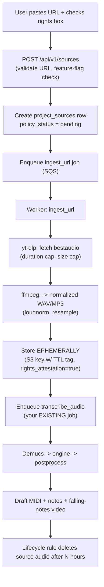

# PianoFlow AI — Audio→MIDI & Source-Ingestion Improvement Plan

**Date:** 2026-06-15
**Scope:** Improving transcription quality (audio→MIDI) and adding YouTube / Instagram / TikTok link→MIDI ingestion, mapped onto the existing monorepo.
**Status:** Plan / proposal. No code changed yet.

> This document was written after (a) verifying the external research report against primary sources and (b) reading the current codebase (`packages/music-core`, `apps/worker`, `apps/api`, `docs/`). Recommendations reference real files so they slot into the existing hexagonal architecture.

---

## 0. TL;DR — the four highest-leverage moves

1. **You already shipped the hard part twice.** The engine factory (`transcription/engine.py`) supports `basic_pitch` **and** `transkun`. Transkun (ISMIR 2024) is near-SOTA on MAESTRO and emits **pedal** — your `NoteData` schema v2 already has a `sustain` field that Basic Pitch leaves empty. The blocker is infrastructure, not code: the worker runs on an **EC2 t2.micro (CPU, ~1 GB RAM)**, where PyTorch transformer engines are impractical. **Fix the runtime, not the model.**

2. **Add a remote GPU engine adapter.** Keep Basic Pitch (ONNX, CPU) as the free/fallback engine. Add a `RemoteTranscriptionEngine` that calls a serverless GPU function (Modal or RunPod) running Transkun/ByteDance + Demucs. This is a clean ports/adapters addition — the factory pattern is already there.

3. **Insert a Demucs source-separation pre-pass.** Basic Pitch on a full band mix is the single biggest accuracy loss. Isolate the piano/target stem before transcription. This matters *most* for social-media audio, which is full-mix, loud, and compressed.

4. **Build URL ingestion as its own job behind feature flags, with compliance baked in.** Your own `10_MULTI_SOURCE_IMPORT.md` deliberately forbids auto-ripping. The path to a Songscription-style "paste link → MIDI" feature is a new `ingest_url` worker job (yt-dlp) that is gated, rate-limited, rights-attested, and stores source audio **ephemerally**. Details and trade-offs in Part B.

A meta-point that outranks all four: **wire up measurement first** (`transcription/evaluate.py` + `mir_eval` + a MAESTRO slice). Every change below should be judged by note-onset F1, not by ear.

> **Execution plan:** the task-by-task, Sonnet-executable breakdown for the **Vercel + Modal interview demo** and the **scale path** lives in [`DEMO_AND_SCALE_PLAN.md`](./DEMO_AND_SCALE_PLAN.md). This doc is the *why*; that doc is the *how/do-it*.

---

## 1. Where PianoFlow is today (code-grounded snapshot)

| Area | Current state | File(s) |
|---|---|---|
| Engine abstraction | `TranscriptionEngine` Protocol + `get_engine()` factory; engines: `placeholder`, `basic_pitch`, `transkun` | `transcription/engine.py` |
| Production engine | **Basic Pitch (ONNX, CPU)**. Amplitude→velocity (crude). librosa beat for tempo. Optional quantize. No pedal. **Speed traps: decodes audio twice (ONNX + a second `librosa.load` for tempo); ONNX model reloaded every job; threads untuned.** | `transcription/basic_pitch.py`, `beat.py` |
| Transformer engine | **Transkun** registered but not the default; needs PyTorch + GPU to be practical. **Speed traps: `device="cpu"` hardcoded (never uses GPU); model + checkpoint rebuilt/`torch.load`ed every job (no cache); always runs the redundant `librosa.load` tempo pass.** | `transcription/transkun.py` |
| Post-processing | Range clip, same-pitch merge, ghost-note drop. **No** hysteresis, **no** pedal, **no** velocity calibration. | `transcription/postprocess.py` |
| Note model | Schema **v2** with `sustain` (CC64) field — **ready for pedal**, currently unpopulated | `notes/model.py` |
| Hand split | Chord-aware middle-C split (decent); track-based when 2 tracks | `midi/hands.py` |
| Tempo/quantize | librosa beat + grid quantize (opt-in) | `transcription/beat.py`, `quantize.py` |
| Sheet/MIDI export | MusicXML + PDF + MIDI writers exist | `sheet/musicxml.py`, `sheet/pdf.py`, `midi/write.py` |
| Falling-notes video | FluidSynth (audio) + frame/layout/timeline + ffmpeg render job | `worker/app/video_encode.py`, `music-core/video/*`, `jobs/render_video.py` |
| Evaluation | `evaluate.py` exists (under-used) | `transcription/evaluate.py` |
| **URL ingestion** | **Not implemented in code** — only described in `docs/.../10_MULTI_SOURCE_IMPORT.md` | — |
| Worker runtime | **EC2 t2.micro, CPU only** | `infra/terraform`, `CLAUDE.md` |
| Rights gate | `transcribe_audio` refuses uploads without `rights_attestation` | `jobs/transcribe_audio.py` |

**Conclusion:** the music logic is in good shape and cleanly separated (music-core is pure, I/O lives in the worker). The two real gaps are (1) a runtime that can host a high-accuracy model and (2) URL ingestion. Everything in this plan is additive to the existing pattern.

---

## 2. Corrected model & competitor landscape

The external (Gemini) report is broadly directionally right, but several specifics were embellished or wrong. Verified facts below; corrections flagged.

### 2.1 Open-source engines (verified)

| Model | Architecture | Pedal? | Accuracy (MAESTRO) | Compute | License | Fit for PianoFlow |
|---|---|---|---|---|---|---|
| **Basic Pitch** (Spotify, ICASSP'22) | Tiny CNN + harmonic stacking; onsets/notes/pitch-bend heads; ~17K params, <20 MB | No | Moderate; instrument-agnostic, polyphonic | **CPU, real-time** | Apache-2.0 | **Keep** as free/CPU/fallback engine |
| **Transkun** (Yan, ISMIR'24) | Encoder-only non-hierarchical Transformer on low-time-res features | **Yes** | **SOTA F1 across all subtasks** (notes + pedal) | GPU recommended (PyTorch) | MIT | **Promote to default high-accuracy engine** (already in repo) |
| **ByteDance piano_transcription** (Kong et al., TASLP'21) | High-res ResNet regressing onset/offset times | **Yes** | Onset F1 **96.72%** (vs Onsets&Frames 94.80%); pedal onset F1 **91.86%** | GPU recommended (PyTorch) | Apache-2.0 | Strong alternative / ensemble option |
| **Onsets & Frames** (Magenta) | CNN + BiLSTM | Velocity | Strong, now surpassed | CPU/GPU | Apache-2.0 | Reference baseline only |
| **MT3 / YourMT3+** | T5 seq2seq (tokenized MIDI); YourMT3+ adds hierarchical attention + MoE | Multi-instr | SOTA *multi-instrument* | **GPU, heavy** | Apache-2.0 (MT3) | Phase 4 multi-instrument |
| **Demucs v4 / HT-Demucs** (Meta) | Hybrid Transformer U-Net (time+spectral) | — (separation) | Best open stem separation | GPU recommended | MIT | **Add as pre-pass** |
| **Spleeter** (Deezer) | U-Net on STFT | — (separation) | Faster, more bleed | CPU-OK | MIT | Cheap fallback separator |

> **Corrections to the external report:**
> - Basic Pitch input is **harmonic-stacked CQT-like** features, not plain CQT, and it has *no* pedal head.
> - "ByteDance takes ~200 hours on a GPU" refers to **training over a large dataset**, not inference. Inference on a 3–4 min song is **seconds to tens of seconds** on a modern GPU.
> - **MIROS** and **YourMT3+** are real (YourMT3+ = QMUL + Huawei, MLSP 2024; MIROS won the **2025 AMT Challenge**, using a MusicFM self-supervised conformer encoder). The "VPT / CHI 2026" reference could not be verified — treat as unconfirmed.
> - Cost-per-transcription estimates in the report (~$0.012–0.02) are about right; see Part D for verified 2026 GPU pricing.

### 2.2 Songscription (your benchmark) — what's actually public

Confirmed from press (MusicRadar, Music Ally, July 2025; $5M round Nov 2025 led by Reach Capital): a **proprietary Transformer** combining **speech-recognition sequence-learning** with music-AI research, trained on **licensed data from professional artists** (not web-scraped) — which is why it captures ornaments (trills, ties, mordents, staccato). It accepts **MP3/WAV/M4A uploads and YouTube / Instagram / TikTok links**, and outputs notation, tabs, MIDI, and a piano-roll. Instruments: piano, guitar, violin, flute, bass, trumpet.

**Takeaways for you:** (1) their moat is *licensed training data + notation modeling*, not a secret architecture — you can match the transcription layer with open models; (2) they do accept social links, confirming the feature is commercially viable (legal posture is theirs to own — see Part B); (3) their differentiator over you should be *your* falling-notes/Synthesia video, which you already have.

---

## 3. Part A — Audio→MIDI quality improvements

Ordered by impact-to-effort. Each maps to real files.

### A1. Tiered engine strategy + remote GPU adapter (highest impact)

**Problem:** the best engines you have (Transkun, and optionally ByteDance) need PyTorch + GPU; the worker is CPU t2.micro. **Solution:** don't put the GPU on the always-on worker — dispatch heavy transcription to a serverless GPU function and keep the result contract identical.

Add a new engine behind the existing factory:

```python
# transcription/engine.py — add to get_engine()
if name == "remote":
    from pianoflow_music.transcription.remote import RemoteTranscriptionEngine
    return RemoteTranscriptionEngine()
```

```python
# transcription/remote.py (new) — calls a Modal/RunPod endpoint; returns the
# SAME TranscriptionResult contract. music-core stays pure: the HTTP client is
# injected, no vendor SDK imported at module top-level.
class RemoteTranscriptionEngine:
    name = "remote_transkun_v1"
    def transcribe(self, audio_bytes, *, filename="", options=None) -> TranscriptionResult:
        # POST audio to GPU function; it runs (optional Demucs) -> Transkun/ByteDance
        # -> returns notes JSON + draft MIDI bytes. Map onto TranscriptionResult.
        ...
```

The GPU function (Modal example) runs Transkun/ByteDance and Demucs, returns notes + MIDI. Selection by tier/env:

- `TRANSCRIPTION_ENGINE=basic_pitch` → free tier, CPU, instant.
- `TRANSCRIPTION_ENGINE=remote` → pro tier, GPU, pedal + better timing.

This preserves your 12-factor "backend swapped by env" convention (like `STORAGE_BACKEND`/`QUEUE_BACKEND`).

### A2. Demucs source-separation pre-pass

Before transcription of any **full-mix** input (every social-media song), isolate the target stem. HT-Demucs (`htdemucs`) gives clean piano/other/vocals/bass/drums stems. Run it inside the same GPU function as the engine (one cold start, one GPU bill). For solo-piano uploads, skip separation (detect via a quick heuristic or a user toggle) to save cost.

Order: `audio → loudness/normalize (A6) → Demucs (target stem) → engine → postprocess`.

### A3. Sustain pedal (CC64) — populate the field you already have

`NoteData.sustain` exists and `midi/write.py` can emit it, but Basic Pitch can't detect pedal. Once Transkun/ByteDance is the engine, map its pedal events into `sustain=[{"time": s, "value": 0..127}]`. Effect: held notes ring correctly in playback, the FluidSynth render sounds real, and offsets stop getting truncated. This is one of the most *audible* quality wins.

### A4. Velocity calibration

Basic Pitch's `velocity = round(amplitude*127)` is compressed and source-dependent. Transkun/ByteDance regress real velocity. Add an optional **piece-wise linear / percentile normalization** in `postprocess.py` so dynamics aren't all clustered at mezzo-forte. Calibrate against MAESTRO velocities (you have ground truth there).

### A5. Onset/offset hysteresis + median smoothing

For frame-probability engines, replace single-threshold note gating with **dual-threshold hysteresis** (trigger at high prob ≈0.7, sustain until low prob ≈0.3) and **median-pool** the activation matrix to kill 1–2 frame flicker. Add as pure functions in `postprocess.py` next to `clean_notes`. (Basic Pitch already returns note events, so this mostly benefits the GPU engines if you consume their frame outputs.)

### A6. Preprocessing for messy / social audio

Social-media audio is loud, compressed, and noisy. Add a preprocessing step (ffmpeg in the worker, before the engine): `loudnorm` (EBU R128) for consistent levels, a 20–30 Hz high-pass to drop rumble, and resample to the engine's native rate. Optionally `noisereduce` for hiss. This measurably stabilizes onset detection on YouTube rips vs studio WAVs.

### A7. Hand-separation upgrade (optional)

`hands.py` is already chord-aware (cluster-preserving middle-C split) — good enough for v1. Upgrade path when you want cleaner two-staff notation: a cost-based / HMM voice assignment that respects playable hand span (≤ ~10th) and continuity, e.g. via `partitura`. Treat as a quality polish, not a blocker.

### A8. Beat / downbeat / quantization → cleaner MusicXML

The MIDI→MusicXML step is where notation looks "professional" or "noisy." Improve beat *and* downbeat tracking (consider `madmom`/`beat-this` over librosa), feed a stable tempo + downbeats into `quantize.py`, then into MusicXML. This is what makes the difference between Songscription-style readable notation and a wall of tied notes.

### A9. Measurement harness (do this first)

Flesh out `transcription/evaluate.py` with `mir_eval.transcription` (note onset F1, onset+offset F1, onset+offset+velocity F1) over a small **MAESTRO** validation slice. Add a `make eval` target. Now every change above is a measured delta, and you can publish honest accuracy numbers like the papers do.

---

## 4. Part B — YouTube / Instagram / TikTok → MIDI ("how could I do it")

You asked specifically how to build this. Below is the concrete technical design **plus** the compliance design — because the two are inseparable for a public SaaS.

### B0. The honest legal framing (read first)

I'm not a lawyer and this isn't legal advice — get a real review before enabling downloads in production. The facts you're designing around:

- **`yt-dlp` is a legitimate, actively maintained tool** (1,700+ sites incl. YouTube, Instagram, TikTok; daily updates as of 2026). It is not the problem.
- **Downloading from those platforms generally violates their Terms of Service**, and the underlying audio is usually **copyrighted**. Transcribing it produces a derivative work. Whether that's permissible depends on jurisdiction, ownership, and use — which is exactly why your own `10_MULTI_SOURCE_IMPORT.md` chose an anti-ripping stance.
- **Songscription does offer link ingestion**, so it's commercially done — but they carry that risk knowingly and (per their press) lean on licensed data and presumably a takedown process.

**The point isn't "don't build it." It's "build it so that you, not your users, are protected."** The design below makes the rights decision explicit, keeps source audio ephemeral, and gives you a takedown lever. I deliberately do **not** include techniques for evading platform anti-bot/rate-limit defenses — that crosses from "download tool" into "abuse," it's brittle, and it increases your legal exposure. If you need reliable scale, the sustainable paths are official APIs, licensed catalogs, or user-owned-content (OAuth) — noted in B5.

### B1. Architecture — a new `ingest_url` job (mirrors `transcribe_audio`)

It reuses everything you already have; the only new piece is "get bytes from a URL" before the existing transcription path.



### B2. `ingest_url` worker job — sketch

```python
# apps/worker/app/jobs/ingest_url.py (new) — same registry pattern as transcribe_audio
import subprocess, tempfile, uuid
from pathlib import Path
from app.jobs.registry import register

MAX_DURATION_SEC = 600     # cap: refuse >10 min
ALLOWED_HOSTS = {"youtube.com", "youtu.be", "instagram.com", "tiktok.com", "www.tiktok.com"}

@register("ingest_url")
def handle_ingest_url(payload: dict) -> None:
    # 0) feature-flag + host allowlist + per-user rate-limit checks (fail fast)
    # 1) yt-dlp: audio only, capped, into a temp dir
    with tempfile.TemporaryDirectory(prefix="pf-ingest-") as tmp:
        out = Path(tmp) / "src.%(ext)s"
        subprocess.run(
            ["yt-dlp", "-x", "--audio-format", "wav",
             "--match-filter", f"duration < {MAX_DURATION_SEC}",
             "--no-playlist", "--max-filesize", "100M",
             "-o", str(out), payload["source_url"]],
            check=True, timeout=300, capture_output=True,
        )
        # 2) ffmpeg loudnorm + resample (A6) -> normalized bytes
        # 3) storage.upload(ephemeral_key, normalized_bytes, "audio/wav")
        #    tag object for lifecycle deletion; set source row rights_attestation
        # 4) enqueue transcribe_audio for this project (existing path)
```

Notes: run `yt-dlp` as a **subprocess** (don't import it into music-core — keep the pure boundary), pin the version, cap **duration + filesize + timeout**, and `--no-playlist`. Capture `stderr` and surface a clean `IngestError` envelope like your storage adapters do.

### B3. API + DB (matches your existing plan)

Your `10_MULTI_SOURCE_IMPORT.md` already specs the table and routes — implement them now:

- `project_sources` table: `source_type, source_platform, source_url, source_external_id, source_title, source_author, source_thumbnail_url, source_duration_seconds, source_license_type, source_rights_attestation, source_policy_status`. Add `ingest_status`, `ephemeral_key`, `delete_after`.
- `POST /api/v1/sources/metadata` — validate + fetch oEmbed metadata (title/author/thumb/duration) **without** downloading. Cheap, safe, powers the preview card.
- `POST /api/v1/projects/from-source` — create project + enqueue `ingest_url` (only if download mode is enabled).
- Alembic migration for the new table; RLS so users only see their own sources.

### B4. Compliance & safety controls (the non-negotiables)

These are what turn "a ripping tool" into "a defensible product feature":

1. **Explicit rights attestation per source.** A required checkbox: *"I own this content or have permission to transcribe it."* Persist it with timestamp + user id + URL (you already gate `transcribe_audio` on `rights_attestation` — extend it to sources). This shifts the representation to the user and gives you an audit trail.
2. **Ephemeral source storage.** Store downloaded audio under a dedicated prefix with an **S3 lifecycle rule** (e.g., delete after 6–24 h). Keep only the **MIDI/notation** (the user's derivative), never redistribute the source audio. Your `cleanup_expired` job pattern already exists — extend it.
3. **Feature flags** (you already named them): `ENABLE_YOUTUBE_DOWNLOAD`, `ENABLE_TIKTOK_DOWNLOAD`, `ENABLE_INSTAGRAM_DOWNLOAD`, default **off**; reference-metadata mode stays the public default. This is the "feature-flagged, both modes" approach.
4. **Rate limiting + caps.** Per-user/day quota, duration cap (≤10 min), filesize cap, concurrency cap. Protects you from abuse and from hammering platforms.
5. **Takedown / DMCA process.** A documented contact + an admin action to purge a source and its outputs. Log source URL + attestation for every job.
6. **No anti-bot evasion.** Respect platform rate limits; on block, **fail gracefully and fall back to "upload the file you own."** Don't add residential-proxy rotation or CAPTCHA-defeat — that's the line between tool and abuse.
7. **ToS acceptance + clear UI copy.** Keep your existing reference-only copy for the default mode; add explicit consent language for download mode.

### B5. Sustainable scale paths (when link-ripping gets painful)

Direct downloading *will* fight you (platform changes, rate limits, legal letters). The durable alternatives, in order of safety: **user-owned content via OAuth** (YouTube/TikTok APIs for content the user actually owns) → **licensed / public-domain / Creative-Commons catalogs** → **user file upload** (your current, lowest-risk path). Design `project_sources.source_type` so all of these coexist behind one ingestion interface.

---

## 5. Part C — Model & infrastructure recommendations

### 5.1 Recommended engine stack

- **Free tier:** Basic Pitch (ONNX, CPU) — stays on the existing worker, instant, no marginal cost. Good enough for solo/clean input.
- **Pro tier (default quality target):** **Transkun** on serverless GPU, with **Demucs** pre-pass for full-mix input. Pedal + better timing + real velocity. Already in your repo.
- **Ensemble / "max accuracy" option:** run **ByteDance** alongside Transkun and reconcile (or pick per-input). Diminishing returns; only if you're chasing a published F1 number.
- **Phase 4 multi-instrument:** YourMT3+ for guitar/bass/vocals/strings, to approach Songscription's instrument coverage.

### 5.2 Best stack by priority

| Priority | Recommendation |
|---|---|
| **A. Highest accuracy** | Demucs (htdemucs) → Transkun **or** ByteDance on A10G/L4; hysteresis + pedal + velocity calibration; downbeat-aware quantization |
| **B. Lowest cost** | Basic Pitch on existing CPU worker for free tier; serverless GPU (RunPod) **scale-to-zero** only for pro jobs; CDN for video egress |
| **C. Fastest to ship** | You're already most of the way: promote Transkun behind a Modal function, keep the rest of the pipeline. ~2 weeks. |
| **D. Best open-source** | Transkun (MIT) + Demucs (MIT) + Basic Pitch (Apache-2.0) — all permissive, all in-repo or one `pip` away |
| **E. Commercial-grade** | Hexagonal worker + serverless GPU pool + S3 lifecycle + SQS DLQ + CloudWatch; tiered engines by plan; takedown tooling |

### 5.3 Why serverless GPU (not a GPU on the worker)

Your worker is an always-on t2.micro doing light orchestration. Transcription is **bursty and GPU-bound**. Putting a GPU on an always-on box means paying for idle silicon 24/7. A serverless GPU function (Modal / RunPod) **scales to zero** and bills per second of active compute — ideal until you have steady high volume. Your hexagonal design makes this a drop-in: the worker calls `RemoteTranscriptionEngine`, which calls the function.

---

## 6. Part D — Cost analysis (verified June 2026 pricing)

**Verified serverless GPU rates (June 2026):** Modal A10G **$1.10/hr** ($0.000306/s), A100-40 $0.001036/s, H100 $0.002778/s. RunPod **T4 $0.40/hr**, A10G **~$0.69/hr**, A100-80 $2.17/hr. Modal bills per-second with no idle charge; RunPod is cheaper per hour.

**Assumptions:** avg song ≈ 4 min; ~4 transcriptions/user/month; pro job = Demucs + Transkun ≈ **~60 s GPU** (≈ **30 s** without separation). Per-job GPU cost ≈ **$0.011 (RunPod A10G)** to **$0.018 (Modal A10G)** with separation; roughly half that without.

| Tier | Jobs/mo | GPU (RunPod A10G) | Storage + DB (S3 + Supabase) | Video egress* | Realistic total/mo |
|---|---|---|---|---|---|
| **100 users** | ~400 | ~$5 | ~$5–15 | ~$5 (CDN) | **~$15–40** |
| **1,000 users** | ~4,000 | ~$45–60 | ~$25–50 | ~$30–60 | **~$120–220** |
| **10,000 users** | ~40,000 | ~$450–600 | ~$150–400 | ~$150–400 | **~$1,000–2,500** |

\* **Egress is the sleeper cost.** A 3-min 1080p falling-notes MP4 is ~30–60 MB; at 10k users that's ~1–2 TB/mo. S3 egress (~$0.09/GB) ≈ $90–180/mo — **put videos behind CloudFront and cache aggressively**, or egress quietly becomes your biggest line item. The external report under-weighted this.

**Always-on vs serverless:** below ~5–8k steady jobs/mo, serverless GPU wins decisively. Above that, a reserved/spot GPU (EC2 g5/g6 or RunPod reserved) running near-saturation gets cheaper per job — revisit at the 10k tier.

---

## 7. Part E — Phased roadmap

Tied to your existing phase-scoped PR convention (`docs/ROADMAP.md`).

### Phase 1 — Quality on the current stack (no new infra) · ~1–2 wks
- A9 eval harness (`evaluate.py` + `mir_eval` + MAESTRO slice + `make eval`) — **do first**.
- A6 preprocessing (ffmpeg loudnorm / high-pass / resample) in the worker.
- A4 velocity calibration + A5 hysteresis/smoothing in `postprocess.py`.
- Baseline + after-numbers for onset F1.

### Phase 2 — GPU engine + separation · ~2 wks
- `RemoteTranscriptionEngine` adapter + Modal/RunPod function (Transkun + Demucs).
- A3 pedal → populate `NoteData.sustain`; verify in FluidSynth render.
- Tiered engine selection by plan (`basic_pitch` free, `remote` pro).
- Re-run eval; publish the accuracy delta.

### Phase 3 — URL ingestion (feature-flagged) · ~2 wks
- `project_sources` table + Alembic migration + RLS.
- `POST /sources/metadata` (oEmbed, safe default) and `from-source`.
- `ingest_url` worker job (yt-dlp subprocess, caps), ephemeral storage + lifecycle delete.
- Compliance: rights attestation, rate limits, takedown admin action, feature flags **off** by default; legal review before flipping any download flag on.

### Phase 4 — Scale & breadth · ongoing
- CloudFront for video egress; SQS DLQ + CloudWatch dashboards.
- YourMT3+ multi-instrument path (guitar/vocals/bass).
- A7 hand-separation upgrade (partitura) + A8 downbeat quantization for cleaner MusicXML.
- Reserved/spot GPU once volume is steady; caching of repeat transcriptions.

---

## 8. Open questions for you

1. **Download mode:** confirm you want Phase 3's download path enabled (vs reference-only) — and whether legal review happens before or gates that phase.
2. **Engine of record for pro tier:** Transkun (in-repo, MIT) vs ByteDance (Apache-2.0) — I'd start with Transkun and A/B against ByteDance via the eval harness.
3. **GPU provider:** RunPod (cheaper) vs Modal (per-second billing, nicer DX). Either fits the adapter.
4. **MAESTRO access** for the eval slice — confirm you can pull a few validation tracks locally.

---

## 9. Part F — Self-hosting (de-scoped)

Home-lab and RTX 3070 self-hosting was evaluated and de-scoped — the GPU backend is Modal serverless (see Part C/D); revisit a reserved/spot cloud GPU only at sustained high volume.

---

## 10. Part G — Free-tier MVP stack

Two free tiers neutralize the scariest costs: **Modal Starter ($30/mo credits ≈ ~27 hrs A10G ≈ ~1,600+ transcriptions, no card)** covers GPU transcription, and **Cloudflare R2 (10 GB, zero egress forever)** kills video bandwidth cost.

| Component | Best free option | What you get | Catch |
|---|---|---|---|
| GPU transcription | **Modal Starter** | $30/mo credits (~27 hrs A10G), 10 concurrent GPUs | cold starts; overage billed |
| Storage + video CDN | **Cloudflare R2** | 10 GB, 1M writes / 10M reads, **zero egress always** | 10 GB cap |
| Always-on worker/API | **Oracle Cloud Always Free** | ARM A1 — 2 OCPU / 12 GB (reduced from 4/24 on 2026-06-15), 200 GB disk, 10 TB egress | ARM; CPU only |
| Database | Supabase free / Neon | Postgres + auth; Neon scales to zero | ~500 MB cap |
| Queue | AWS SQS free | 1M req/mo always free | — |
| Web | Vercel Hobby / Cloudflare Pages | Next.js hosting | **Hobby = non-commercial** (Pro $20/mo to monetize) |
| Dev/eval GPU | Colab / Kaggle | free T4/P100 notebooks | **ToS forbids serving** — dev only |
| Public demo | HF Spaces ZeroGPU | ~5 min GPU/day | demo only |

**Recommended all-free MVP:** Vercel (web) + **Oracle A1** (FastAPI + SQS consumer worker, Basic Pitch CPU for free tier) + **Modal** (GPU Transkun+Demucs, pro path) + **R2** (audio/MIDI/video, zero egress) + Supabase/Neon (DB) + SQS. ≈ **$0/mo** at MVP volume; first costs appear only past Modal's $30 credits or R2's 10 GB.

**Highest-payoff change:** you're on AWS S3 today — its egress is the trap from Part D. **Move output/video storage to R2** so video serving is free at any volume.

**ToS guardrails (don't build on these):** Colab/Kaggle forbid backend serving; Vercel Hobby is non-commercial; do **not** multi-account to dodge free limits — all violate provider terms.

---

## 11. Part H — Home GPU (de-scoped)

Home-lab and RTX 3070 self-hosting was evaluated and de-scoped — the GPU backend is Modal serverless (see Part C/D); revisit a reserved/spot cloud GPU only at sustained high volume.

---

## 12. Part I — Transcription speed / latency (why "other apps" feel instant)

Speed has not been treated as a first-class axis in this repo — the plan optimizes accuracy and cost, but a user comparing PianoFlow to Songscription is reacting to **wall-clock latency**. The single dominant fact: PianoFlow runs **Basic Pitch ONNX on a burstable EC2 t2.micro (CPU)**. Competitors run **GPU model serving with a warm pool**. A 3–4 min song is **tens of seconds to minutes** on the current CPU box vs **seconds** on a GPU engine. The order-of-magnitude fix is GPU; everything else is a multiplier on top.

### I.1 Speed levers, ranked by impact-to-effort

| Lever | Speedup | Effort | Infra | File |
|---|---|---|---|---|
| **GPU engine** (Transkun/ByteDance on Modal serverless GPU) | **10–40×** | med | new | `transkun.py`, `remote.py` |
| Right-size worker off **t2.micro burstable** (CPU-credit throttling starves sustained inference) | 1.5–3× | tiny | config | `infra/terraform` |
| **Cache the model/session across jobs** (long-lived worker reloads it every job) | model-load per job | tiny | none | `basic_pitch.py`, `transkun.py` |
| **Kill the redundant `librosa.load` decode** (audio decoded twice per job) | 1.15–1.25× | tiny | none | `basic_pitch.py`, `beat.py` |
| **Tune onnxruntime intra-op threads** to the box's vCPUs | 1.2–1.5× | tiny | none | `basic_pitch.py` |
| **Modal keep-warm** / min-containers (kill cold start on the GPU path) | latency floor | tiny | config | `infra/modal` |
| **Skip Demucs for solo-piano** input (avoid +10–20 s separation) | avoid penalty | tiny | none | `pipeline.py` |

The free CPU wins (rows 2–5) compound to roughly **~2×** but do **not** change the order of magnitude — only GPU does that.

### I.2 The two free CPU bugs (no infra change)

1. **Audio is decoded twice per job.** `BasicPitchEngine.transcribe` calls `predict()` (decode + ONNX inference), then immediately calls `_estimate_beats` → `beat.estimate_tempo_and_beats`, which runs `librosa.load()` on the **same file again** plus beat-tracking DSP — solely to produce a BPM number that `midi_data.estimate_tempo()` already provides for free. Fix: prefer the free MIDI tempo estimate; only fall back to librosa when it is out of range, and run beat tracking on the already-decoded array instead of re-loading the file. `transkun.py` has the same trap and hits it **every** job because `_run_model` returns `bpm=0.0`, so the out-of-range fallback always fires.

2. **The model is reloaded on every job.** `get_engine()` returns a fresh engine each call, and `basic_pitch.predict` reloads the ONNX model per call; `transkun._run_model` rebuilds the `TransKun` module and `torch.load`s the checkpoint on every job. The worker is a long-lived consume loop, so the model/session should be built once and cached at module scope (or on the engine instance, reused across jobs). This removes the per-job model-load tax.

### I.3 The Transkun GPU bug (blocks the order-of-magnitude win)

`transkun._run_model` hardcodes `device = "cpu"`. Even on a Modal A10G, Transkun runs on CPU — defeating the entire reason to add a GPU engine. Fix: select `device = "cuda" if torch.cuda.is_available() else "cpu"`, move the model and input tensor to that device, and keep the model cached on-device across jobs (combined with I.2 #2). Pair with `torch.inference_mode()` and FP16 on GPU.

### I.4 Why GPU is the real answer

Basic Pitch is a tiny CNN tuned for CPU real-time, but its accuracy ceiling (no pedal, crude velocity) is the reason the plan moves to Transkun/ByteDance anyway — and those are **GPU-bound**. So the accuracy upgrade and the speed upgrade are the **same move**: put Transkun/ByteDance on a Modal serverless GPU (per Parts C/D), keep the model warm, and skip Demucs for solo-piano input. That is what makes "paste → notes in seconds" feel like the competition. Measure it: add a per-stage timing log (decode / separate / infer / postprocess) so latency is tracked alongside the `mir_eval` accuracy harness (A9), not guessed.

### I.5 Sequencing

The free CPU wins (I.2) ship **now** on the current stack with no infra change and should land before or alongside the eval harness. The GPU fixes (I.3) are prerequisites for the Phase 2 GPU engine — fix `device` and model caching in the same PR that promotes Transkun behind the Modal serverless GPU worker. Keep-warm and Demucs-skip are tuning passes once the GPU path is live.

---

## Appendix — Sources

Verified during research (2026-06-15):

- Songscription — [MusicRadar](https://www.musicradar.com/music-tech/most-musicians-cant-easily-find-notation-for-the-songs-they-actually-want-to-play-were-using-ai-to-close-that-gap-songscription-is-an-ai-powered-platform-that-converts-any-audio-file-into-notation-tabs-and-midi), [Music Ally](https://musically.com/2025/07/01/songscription-uses-ai-to-automate-sheet-music-transcription/), [songscription.ai](https://www.songscription.ai/)
- Basic Pitch — [Spotify Engineering](https://engineering.atspotify.com/2022/6/meet-basic-pitch), [GitHub](https://github.com/spotify/basic-pitch)
- ByteDance piano transcription — [arXiv 2010.01815](https://arxiv.org/pdf/2010.01815), [GitHub](https://github.com/bytedance/piano_transcription)
- Transkun — [GitHub](https://github.com/Yujia-Yan/Transkun), [arXiv 2404.09466](https://arxiv.org/html/2404.09466)
- YourMT3+ — [arXiv 2407.04822](https://arxiv.org/abs/2407.04822)
- MIROS / 2025 AMT Challenge — [OpenReview](https://openreview.net/pdf?id=NG187AZ71W)
- Demucs — [GitHub](https://github.com/facebookresearch/demucs)
- yt-dlp — [GitHub](https://github.com/yt-dlp/yt-dlp)
- GPU pricing — [RunPod pricing](https://www.runpod.io/pricing), [Modal pricing (CostBench)](https://costbench.com/software/ai-gpu-cloud/modal/)
- Visualization reference — Neothesia, PianorollVis.js, [WaveRoll (arXiv 2511.09562)](https://arxiv.org/pdf/2511.09562)


