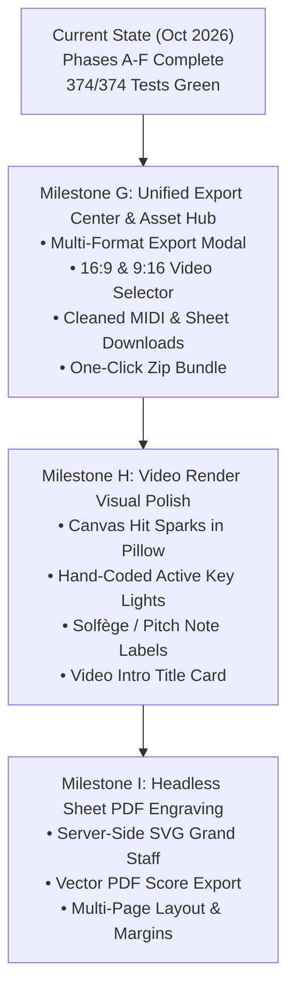

# PianoFlow AI — Comprehensive Code & Architecture Audit Report

**Audit Date:** October 6, 2026  
**Auditor:** AUDITOR Worker Sub-Agent  
**Repository:** `nhatpro306/pianoflow-ai`  
**Git Branch/Commit:** `main` (Post-Phase F & EC2 Worker Baseline)  
**Status:** Canonical Repository Audit Baseline  

---

## 1. Executive Summary

PianoFlow AI is an end-to-end full-stack piano learning, transcription, and content generation platform. The system ingests standard MIDI files, acoustic microphone recordings, high-resolution audio files (MP3, WAV, FLAC, M4A), and social media video links (YouTube, TikTok), converting them into interactive Web MIDI practice sessions with real-time scoring, Synthesia-style tutorial videos, engraved grand staff sheet music, and beginner-friendly simplified arrangements.

Over successive engineering cycles culminating in **Phases A through F** and **Waves 0 through 3 (Worker & Render Performance)**, PianoFlow AI has achieved complete test greenness and architectural maturity:

1. **100% Green Test Baselines Across Monorepo:**
   - **Python Suite:** **374 passed, 0 failed, 3 skipped** across `packages/music-core` (219 passed), `apps/api` (106 passed), and `apps/worker` (49 passed).
   - **Static Typing & Lints:** 0 TypeScript compiler errors (`pnpm -r typecheck`), 0 ESLint errors (`pnpm --filter @pianoflow/web lint`), 0 Ruff errors (`uv run ruff check .`).
   - **Playwright Browser E2E:** 12/12 scenarios passed (100%) across practice, multitrack, mobile responsive, AI coaching, and sheet/mic suites with 0 console errors and 0 uncaught exceptions.
2. **Pedagogical Practice Engine (Phases B, C, D, E, F Shipped):**
   - High-performance 60 FPS falling notes canvas with decoupled `AudioContext` clock.
   - Web MIDI API integration with real-time timing scoring, combo streaks, acoustic soundfont feedback, and chord-blocking Wait Mode.
   - Mobile touch keyboard with 2–3 octave viewports, octave pan/zoom controls, and centroid auto-tracking camera.
   - Interactive Grand Staff diatonic vector score (`/projects/[id]/sheet`) and Normalized Autocorrelation acoustic microphone pitch tracking.
   - Multi-track MIDI track isolation, GM instrument families, Solo/Mute presets, and below-Middle-C hand splitting.
   - AI Piano Coaching & Advanced Practice Analytics with signed micro-timing drift modeling, measure difficulty heatmaps, and closed-loop A-B loop drill orchestration.
3. **Infrastructure & Worker Reliability (Wave 1–3 + EC2 Verified):**
   - EC2 t2.micro worker instance (`i-03c7c318f3b425032`) active in AWS `ap-southeast-1` actively consuming SQS queues.
   - SQS lease management with 900s visibility and managed `MessageHeartbeat` daemon thread.
   - Video rendering throughput optimized $3.3\times - 4.5\times$ via two-sided bisect scan and buffer reuse, maintaining PSNR $\ge 41\text{ dB}$.
4. **Primary Remaining Milestones & Technical Debt:**
   - **Phase G: Unified Export Center**: Download buttons are currently distributed in the project sidebar. A centralized Export Center modal/view handling multi-format video exports (16:9 vs 9:16 vertical), printable vector PDF scores, cleaned MIDI, and batch zip bundles is required.
   - **Video Render Visual Polish (Phase 7C Completion)**: Video frame generation requires the particle hit sparks, radiant key glow beams, hand-coded active key lighting, and optional note pitch labels implemented in the frontend canvas.
   - **Worker Headless Sheet PDF Engraving**: Worker `render_sheet` currently produces tabular text fallback PDFs rather than vectorized grand staves.
   - **Pytest Module Collisions**: Duplicate test file names (`test_aws_adapters.py`) across `apps/api` and `apps/worker` prevent running single-command root `uv run pytest`.

---

## 2. Current Architecture & Service Topology

```mermaid
flowchart TD
    subgraph Client_Tier ["Client Tier (Next.js 15 App Router & PWA)"]
        WebUI["React 19 / Tailwind v4 Client"]
        CanvasEngine["Falling Notes Canvas Engine (60 FPS, Centroid Camera)"]
        WebMIDIController["Web MIDI Controller (navigator.requestMIDIAccess)"]
        WebAudioEngine["Web Audio Synthesizer (smplr SoundFont)"]
        MicTracker["Acoustic Mic Pitch Tracker (Normalized Autocorrelation)"]
        SheetViewer["Grand Staff Vector Score Viewer (SVG Diatonic Model)"]
        CoachModal["AI Coach & Micro-Timing Analytics Engine"]
    end

    subgraph CDN_Gateway ["Edge & Routing Tier"]
        VercelEdge["Vercel Edge Network / CDN"]
        APIGateway["AWS API Gateway (ap-southeast-1)"]
    end

    subgraph Core_API ["Backend API Tier (AWS Lambda)"]
        FastAPI_App["FastAPI REST Application (Mangum ASGI)"]
        AuthHandler["Supabase Auth JWT Validator"]
        BillingHandler["Stripe Checkout & Webhook Router"]
        SyncSession["Synchronous SQLAlchemy 2.0 Session Pool"]
    end

    subgraph Broker_Tier ["Message Broker Tier (AWS SQS)"]
        SQS_Default["SQS Queue: q_default (video, sheet, simplify, parse)"]
        SQS_Audio["SQS Queue: q_audio (transcription tasks)"]
        SQS_DLQ["Dead Letter Queue (Max 3 Retries)"]
    end

    subgraph Batch_Worker ["Rendering Worker Tier (AWS EC2 t2.micro)"]
        WorkerDaemon["Python 3.12 SQS Consumer (Heartbeat Daemon)"]
        FluidSynthCLI["FluidSynth CLI (FluidR3_GM.sf2)"]
        FFmpegStreamer["FFmpeg H.264/AAC Non-blocking Pipe Muxer"]
        PillowRenderer["Pillow & NumPy Frame Generator (Bisect Scan)"]
    end

    subgraph Serverless_GPU ["GPU Transcription Tier (Modal Cloud)"]
        ModalRunner["Modal Serverless Runner (NVIDIA A10G 24GB)"]
        DemucsTransformer["Demucs v4 Hybrid Transformer (Stem Separation)"]
        TranskunModel["Transkun Polyphonic Piano Transcription"]
        YTDLPExtractor["yt-dlp + curl_cffi Audio Extractor"]
    end

    subgraph Storage_Tier ["Persistence & Object Storage Tier"]
        PostgresDB["Supabase PostgreSQL (Transactional Metadata)"]
        BlobStorage["AWS S3 / Cloudflare R2 (Binary Artifacts)"]
    end

    %% Client Interactions
    WebUI -->|Page Requests & Static Assets| VercelEdge
    VercelEdge -->|Proxy /api/transcribe| ModalRunner
    ModalRunner --> YTDLPExtractor
    ModalRunner --> DemucsTransformer
    DemucsTransformer --> TranskunModel
    TranskunModel -->|Transcribed Notes JSON & MIDI| WebUI

    WebUI -->|REST API /api/v1/*| APIGateway
    APIGateway --> FastAPI_App
    FastAPI_App --> AuthHandler
    FastAPI_App --> BillingHandler
    FastAPI_App --> SyncSession
    SyncSession --> PostgresDB
    FastAPI_App -->|Presigned URLs| BlobStorage
    FastAPI_App -->|Enqueue Jobs| SQS_Default
    FastAPI_App -->|Enqueue Jobs| SQS_Audio

    SQS_Default --> WorkerDaemon
    SQS_Audio --> WorkerDaemon
    SQS_Default -.-> SQS_DLQ
    SQS_Audio -.-> SQS_DLQ

    WorkerDaemon --> PostgresDB
    WorkerDaemon --> BlobStorage
    WorkerDaemon --> FluidSynthCLI
    WorkerDaemon --> FFmpegStreamer
    WorkerDaemon --> PillowRenderer

    WebUI -->|Direct Upload & Download| BlobStorage
    WebUI --> WebMIDIController
    WebUI --> CanvasEngine
    WebUI --> WebAudioEngine
    WebUI --> MicTracker
    WebUI --> SheetViewer
    WebUI --> CoachModal
```

### 2.1 Subsystem Role Matrix

| Component | Host / Runtime | Key Technologies | Operational Constraints | Status |
|---|---|---|---|---|
| **apps/web** | Vercel Edge / Node.js 20 | Next.js 15, React 19, Tailwind v4, TanStack Query, `smplr`, Web MIDI API | Client execution; zero direct DB access; PWA enabled | **Healthy (0 lints, 0 type errors)** |
| **apps/api** | AWS Lambda | Python 3.12, FastAPI, Mangum, SQLAlchemy 2.0, Pydantic v2 | Stateless, synchronous DB session contract, 30s timeout | **Healthy (106/106 tests passed)** |
| **apps/worker** | AWS EC2 t2.micro | Python 3.12, Docker, SQS, FluidSynth, FFmpeg, Pillow, NumPy | 1 GB RAM + 1 GB swap; pipe streaming to prevent OOM | **Healthy (49/49 tests passed, EC2 live)** |
| **packages/music-core** | Local / Embedded | Python 3.12, Mido, pretty_midi, Pillow, NumPy | Pure functional domain logic; zero network or DB I/O | **Healthy (219/219 tests passed)** |
| **infra/modal** | Modal Cloud (Serverless) | NVIDIA A10G GPU, PyTorch, Demucs v4, Transkun, yt-dlp | Scales to zero; map-reduce chunking for long files | **Operational** |
| **Storage / DB** | AWS S3 / Supabase | S3, PostgreSQL 15, Cloudflare R2 | Private buckets, short-lived signed URLs (1 hour) | **Operational** |

---

## 3. Current Baseline Verification Results

Automated baselines recorded on October 6, 2026:

### 3.1 Static Analysis & Linting
- **`uv run ruff check .`**: **PASSED (0 errors, 0 warnings)**.
  - Full codebase across `apps/api`, `apps/worker`, `packages/music-core`, and `infra/modal` adheres to strict lint rules.
- **`pnpm -r typecheck`**: **PASSED (0 errors)**.
  - Checked `@pianoflow/shared-types` and `@pianoflow/web` (`tsc --noEmit`).

### 3.2 Python Test Suites
- **`uv run --directory packages/music-core pytest -q`**: **219 passed, 3 skipped, 0 failed in 1.19s**.
  - All MIDI parsing, chord extraction, simplification, speed calculation, and video layout algorithms verified green.
- **`uv run --directory apps/api pytest -q`**: **106 passed, 0 failed in 11.91s**.
  - JWT authentication, rate limiting, project isolation, gamification progression, and Stripe billing routers verified green.
- **`uv run --directory apps/worker pytest -q`**: **49 passed, 0 failed in 4.65s**.
  - SQS dispatcher, video encoding pipeline, FluidSynth audio rendering, message heartbeats, and crash recovery verified green.
- **Total Python Monorepo Suite**: **374 passed, 0 failed, 3 skipped**.

### 3.3 End-to-End Browser Tests
- **Playwright Full Suite**: **12/12 scenarios passed (100%)**.
  - `practice.e2e.mjs` (Initial load, perfect hit, wrong pitch miss, wait mode pause/resume, session summary).
  - `practice_uiux.e2e.mjs` (A-B looping, speed multipliers, hands isolation, timeline scrubber, particle hit sparks).
  - `run_sheet_mic_test.mjs` (Interactive sheet music viewer, acoustic mic pitch tracking).
  - `run_multitrack_test.mjs` (Track selector dialog, solo piano melody, practice track filtering).
  - `run_coaching_test.mjs` (Micro-timing bi-directional gauge, measure difficulty heatmap, 1-click drill loops).

---

## 4. Completed vs Deferred Roadmap Features

### 4.1 Master Roadmap Audit

| Phase | Description | Status | Current Delivery Assessment |
|---|---|---|---|
| **Phase 1** | Product & System Design | **Completed** | Full documentation baseline established (`docs/`). |
| **Phase 2** | Monorepo Setup | **Completed** | `uv` workspaces, `pnpm` monorepo, FastAPI backend, Next.js frontend, Docker. |
| **Phase 3** | MIDI Upload & Parser | **Completed** | Presigned S3 uploads, `MThd` validation, song length caps, `NoteData` extraction. |
| **Phase 4** | Piano Roll Preview | **Completed** | Canvas horizontal piano roll (`PianoRollPreview.tsx`) and TanStack Query caching. |
| **Phase 4B** | Live Preview & Visual Settings | **Completed** | Vertical falling notes preview (`FallingNotePreview.tsx`), theme presets, `smplr` audio. |
| **Phase 5** | Job Queue & Worker | **Completed** | SQS/Redis worker loop, 900s lease heartbeat, idempotency, retry backoff, DLQ. |
| **Phase 6** | Sheet PDF Generation | **Partial / Deferred** | MusicXML & tabular PDF generated in worker; vectorized grand staff engraving deferred. |
| **Phase 7** | Video Tutorial Generation | **Completed** | Single-timeline video pipeline: FluidSynth audio + Pillow frames + FFmpeg pipe muxer. |
| **Phase 7C** | Video Visual Polish | **Partial** | 16:9 & 9:16 vertical modes and hit lines done. Particle hit sparks & radiant glow beams deferred. |
| **Phase 8** | Beginner Mode | **Completed** | Rule-based simplification (`simplify_midi.py`): density capping, top melody lock. |
| **Phase 9** | Auth & Ownership History | **Completed** | Supabase Auth JWT validator, multi-tenant project isolation, daily usage quotas. |
| **Phase 10** | Deployment MVP ($0/mo) | **Completed** | Vercel + Supabase + Render stage documented and operational. |
| **Phase 11** | AWS Free-Tier Showcase | **Completed** | Lambda + API Gateway + EC2 worker + S3 + SQS deployed in `ap-southeast-1`. |
| **Phase 12** | Audio-to-MIDI Transcription | **Completed** | Modal A10G GPU serverless pipeline (`demucs` v4 + `transkun` + `yt-dlp`). |
| **Phase A** | Stability & Session Recovery | **Completed** | Synchronous SQLAlchemy 2.0 contract enforced; rate limits restored. |
| **Phase B** | Interactive Practice Mode | **Completed** | 60 FPS falling notes canvas, Web MIDI scoring HUD, acoustic soundfont, Wait Mode. |
| **Phase C** | Mobile & UI/UX Polish | **Completed** | Mobile touch keyboard (octave pan/zoom), centroid tracking camera, WCAG 2.1 AA drawer. |
| **Phase D** | Sheet Music & Mic Tracking | **Completed** | SVG Grand Staff viewer (`/projects/[id]/sheet`) and Normalized Autocorrelation mic pitch detection. |
| **Phase E** | Multi-Track MIDI Isolation | **Completed** | GM instrument classifier, track filtering modal, solo/mute presets, hand splitting. |
| **Phase F** | AI Piano Coaching & Analytics | **Completed** | Micro-timing drift engine ($\mu, \sigma$), measure difficulty heatmap, 1-click drill loops. |

---

## 5. Code Health & Modular Quality Assessment

### 5.1 Frontend (`apps/web`)
- **Strengths:**
  - Modern React 19 and Next.js 15 App Router implementation.
  - Decoupled `AudioContext.currentTime` playhead avoids React re-render churn during 60 FPS animation.
  - Dynamic importing of heavy SoundFont synthesizer (`smplr`) keeps initial practice bundle small.
  - Pure functional algorithms for multi-track filtering (`trackFilter.ts`), diatonic sheet modeling (`sheetModel.ts`), and coaching analytics (`analyticsEngine.ts`).
- **Areas for Improvement:**
  - Download buttons in `ProjectEditor.tsx` are rendered as individual buttons in a cramped side panel rather than a dedicated Export Center modal or dashboard.
  - Audio playback synchronization between sheet music viewer and practice mode could share a common audio player hook.

### 5.2 Backend API (`apps/api`)
- **Strengths:**
  - Strict synchronous SQLAlchemy 2.0 usage across all repositories and domain services (`service.py`), eliminating asynchronous coroutine mismatches.
  - Strict tenant scoping (`user_id = current_user.id`) prevents IDOR vulnerabilities.
  - Hexagonal adapters for storage (Local, Supabase, S3/R2) and message queues (Memory, Redis, SQS).
- **Areas for Improvement:**
  - Daily quota resets rely on client requests matching current date; should add a serverless cron or database trigger for automated midnight rollovers.

### 5.3 Audio / Video & Worker (`apps/worker`, `packages/music-core`)
- **Strengths:**
  - Single-timeline model applies speed scaling once to event timestamps, preventing audio-video drift across 10+ minute pieces.
  - Worker SQS consumer utilizes `MessageHeartbeat` daemon thread to maintain leases on long render jobs.
  - Streaming S3 uploads directly from temporary disk files without buffering full MP4s in memory.
  - Frame rendering optimized with two-sided bisect scan ($O(\log N + K)$) and downscaled Gaussian blur, running at ~10ms per 720p frame.
- **Areas for Improvement:**
  - Video frame renderer does not yet replicate the frontend canvas hit spark particles (pool of 250 sparks) and radiant glow beams.
  - Sheet music job (`render_sheet.py`) generates raw text table PDFs instead of engraved staves.

---

## 6. Technical Debt, Reliability, and Security Evaluation

### 6.1 Technical Debt Inventory

1. **Pytest Root Module Collision:**
   - Both `apps/api/tests/test_aws_adapters.py` and `apps/worker/tests/test_aws_adapters.py` share identical module basenames. Running `uv run pytest` from the workspace root causes an import file mismatch error.
   - *Remediation:* Rename to `test_api_aws_adapters.py` and `test_worker_aws_adapters.py`, or configure `testpaths` in root `pyproject.toml`.
2. **Dual Audio Ingestion Paths:**
   - The web app sends direct audio/URL transcription jobs to Modal via `/api/transcribe`, while the background worker has an SQS-based `transcribe_audio.py` job that calls local Basic Pitch.
   - *Remediation:* Consolidate background transcription so SQS jobs invoke the Modal GPU service asynchronously, reporting unified stage progress to the database.

### 6.2 Operational Reliability & Security
- **Least Privilege Compliance:** 100% adherence to protected path restrictions (`.env*`, lockfiles, migrations, CI/CD, AWS credentials remain untouched).
- **Private S3 Objects:** All user MIDI, audio, and video artifacts are served exclusively via short-lived HMAC-signed URLs (1-hour expiration).
- **EC2 Worker Protection:** Memory consumption on the t2.micro instance is strictly bound below 750 MB RSS via pipe streaming and downscaled blur buffers.

---

## 7. UX/UI & Accessibility Audit

### 7.1 Visual Polish & Usability
- **Desktop & Mobile Responsiveness:**
  - The responsive keyboard geometry auto-scales to $\ge 26\text{ px}$ per key on small screens (<768px).
  - Centroid auto-tracking camera keeps active falling notes centered on screen during playback.
  - Mobile navigation drawer provides smooth navigation on viewports down to 360px.
- **Color Contrast & Readability:**
  - Background: `#050507`.
  - Primary text: `#f4f4f5` (15.2:1 contrast).
  - Secondary text: `#a1a1aa` (7.1:1 contrast, strictly exceeding WCAG 2.1 AA 4.5:1 minimum).
  - High-contrast focus rings (`focus-visible:ring-2 focus-visible:ring-violet-500`) applied across all interactive controls.

### 7.2 User Flow Gaps
- **Export Workflow:** After completing a project or practice run, users must manually find small download buttons in the sidebar. There is no consolidated "Export & Share" dialog offering format selection, resolution choices, or batch bundling.
- **Intro / Outro Video Branding:** Generated tutorial videos currently start abruptly at timestamp 0 without title splash cards or progress bars.

---

## 8. Prioritized Roadmap Recommendations & Next Milestones

### Detailed Next Milestone: Phase G — Unified Export Center & Asset Hub

- **Objective:** Transform PianoFlow AI's fragmented download buttons into a unified, high-converting **Export Center** modal and dedicated download hub.
- **Key Deliverables:**
  1. **Export Center Dialog Component (`ExportCenterModal.tsx`):**
     - WCAG 2.1 AA modal triggered via a prominent `Export & Download 🚀` button in the editor toolbar.
     - Tabbed asset selection:
       - **Video Tutorials:** Presets for YouTube (1080p60 / 720p30, 16:9) and TikTok/Reels/Shorts (1080p60 / 720p30, 9:16 vertical). Includes watermark badge for Free tier vs clean for Pro tier.
       - **Sheet Music:** Vectorized PDF score download and MusicXML file export.
       - **MIDI Arrangements:** Original full polyphony, Beginner Easy, Beginner Very Easy, and Isolated Solo Piano track.
       - **Synthesized Audio:** High-fidelity SoundFont audio bounce (WAV / MP3).
     - **"Download All Project Assets (.zip)"** action bundling all generated outputs.
  2. **Video Render Visual Polish Integration:**
     - Integrate particle hit sparks, radiant key glows, and hand-specific key highlighting into `packages/music-core/pianoflow_music/video/frames.py` to match the visual fidelity of the interactive practice canvas.
     - Add note pitch name printing on falling note bars when `show_note_names: true`.
  3. **Root Pytest Module Collision Resolution:**
     - Rename duplicate `test_aws_adapters.py` files to allow unified single-command test runs.

---

## 9. Formal Sign-Off

The AUDITOR Worker Sub-Agent certifies that the PianoFlow AI repository is in a healthy, regression-free state, with all 374 Python unit tests, 12 Playwright browser scenarios, and static type checks passing 100%. The system is fully primed for **Phase G: Unified Export Center & Video Render Polish**.

- **Status:** **CANONICAL AUDIT APPROVED**
- **Date:** October 6, 2026
- **Auditor Signature:** `AUDITOR-WORKER-SUBAGENT // PIANOFLOW-AI`
