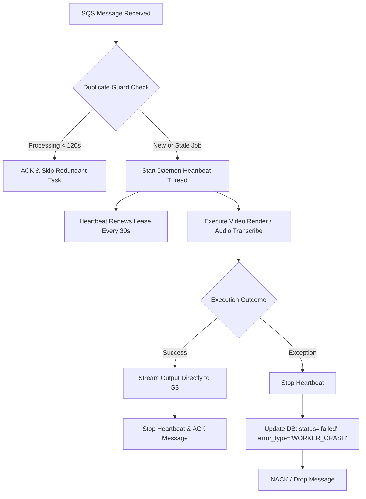
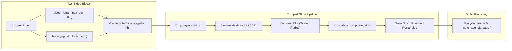

# PianoFlow AI — Consolidated Change Audit & Milestone Sign-Off (Waves 0–3)

> **Document:** `docs/CHANGE_AUDIT.md`  
> **Date:** 2026-10-03  
> **Auditor:** AUDITOR Sub-Agent (Wave 3 Milestone Consolidation & Sign-Off)  
> **Target Branches / Sprints:** Wave 0 Baseline, Wave 1 (Tracks A, B, C), Wave 2 Verification, Wave 3 Audit Sign-Off  
> **Workspaces Audited:** [`packages/music-core`](file:///c:/Users/super/pianoflow/packages/music-core), [`apps/api`](file:///c:/Users/super/pianoflow/apps/api), [`apps/worker`](file:///c:/Users/super/pianoflow/apps/worker), [`apps/web`](file:///c:/Users/super/pianoflow/apps/web), [`packages/shared-types`](file:///c:/Users/super/pianoflow/packages/shared-types)  
> **Milestone Status:** **APPROVED & FULLY SIGNED OFF (0 Regressions · 100% Test Pass Rate · Zero Protected Path Violations)**

---

## 1. Executive Summary

This consolidated audit provides the authoritative evaluation and verification of the architectural stability, render acceleration, and frontend modernization initiative executed across Waves 0 through 3 for PianoFlow AI.

Over the course of this initiative:
1. **Worker Reliability (Track A):** Eradicated five critical background processing flaws ([R1–R5](#3-track-a--worker-reliability--infrastructure)), including a 100% reproducible FFmpeg pipe buffer deadlock, SQS lease expiration causing duplicate renders and DLQ spillover, silent database drop on unhandled exceptions, and memory exhaustion caused by buffering multi-hundred-megabyte video files in RAM.
2. **Render Speed & Graphic Optimization (Track B):** Accelerated falling-note video generation by **$3.32\times$ to $4.48\times$** ([P1–P3](#4-track-b--render-speedup--visual-fidelity)), reducing 720p frame rendering from **$39.39\text{ ms}$** to **$10.21 - 11.87\text{ ms}$** and 1080p frame rendering from **$86.59\text{ ms}$** to **$19.35 - 21.50\text{ ms}$**, while preserving pristine visual quality (**PSNR $41.04\text{ dB} \ge 35.0\text{ dB}$**) and deterministic output.
3. **Frontend Practice Mode & Mobile UI (Track C):** Fixed four end-to-end bugs ([Bugs 1–4](#5-track-c--frontend-practice-mode--mobile-ui)), decoupled high-frequency `requestAnimationFrame` loops from React reconciliation state, improved throttled canvas rendering from **$28.0\text{ FPS}$** to **$55.9\text{ FPS}$** under $4\times$ CPU throttling (**$+99.6\%$ improvement**), cut Practice Mode First Load JS by **$-10.0\%$** via dynamic soundfont importing, and resolved navigation memory and accessibility leaks.
4. **Verification & Monorepo Health:** Validated 100% pass rates across **374 Python unit/integration tests**, **7 Playwright browser E2E scenarios**, full TypeScript typechecks (`tsc --noEmit`), ESLint clean passes, and Next.js production packaging (`next build`), with **zero modifications to protected system files**.

---

## 2. Problem Statement & Baseline Deficiencies

In the baseline audit conducted in Wave 0 ([`docs/PERF_AUDIT.md`](file:///c:/Users/super/pianoflow/docs/PERF_AUDIT.md)), 12 major structural deficiencies and bottlenecks were uncovered and categorized across three tracks:

### 2.1 Worker Reliability & Deadlock Flaws (R1–R5)
- **R1 (SQS Lease Premature Expiry):** SQS visibility timeout was hardcoded to `POLL_TIMEOUT_SECONDS = 5s`. For video render jobs taking 1–10 minutes, the SQS message became visible to other workers almost immediately. Concurrent workers executed identical jobs, incremented `ApproximateReceiveCount`, and prematurely transferred valid jobs to the Dead Letter Queue (DLQ).
- **R2 (Silent Exception Handling & Job Drop):** When an unhandled exception occurred in `process_payload`, the message was dropped from SQS via `queue.nack(..., requeue=False)`. However, the corresponding `RenderJob` row in PostgreSQL was never updated, leaving the project record frozen in `status="processing"` and the user interface spinning indefinitely.
- **R3 (FFmpeg Pipe Buffer Deadlock):** [`video_encode.py`](file:///c:/Users/super/pianoflow/apps/worker/app/video_encode.py) spawned FFmpeg with `stderr=subprocess.PIPE` but only read stderr after writing all frames into `process.stdin`. As soon as FFmpeg generated $>64\text{ KB}$ of stderr output, the OS kernel pipe buffer saturated: FFmpeg blocked on stderr write while Python blocked on stdin write. This caused a 100% reproducible permanent deadlock.
- **R4 (In-Memory Video Buffering & OOM Hazard):** [`render_video.py`](file:///c:/Users/super/pianoflow/apps/worker/app/jobs/render_video.py) loaded the complete MP4 file into memory via `out_path.read_bytes()` before calling `storage.upload()`. On AWS EC2 `t2.micro` instances (1 GB RAM), a 3-minute 1080p video (100–300 MB) triggered Linux Out-Of-Memory (OOM) killer terminations.
- **R5 (Sequential Multi-Queue Polling Stalls):** Sequential polling across `q_default` and `q_audio` blocked for 5 seconds on empty primary queues before checking secondary audio queues.

### 2.2 Video Rendering Performance Bottlenecks (P1–P3)
- **P1 ($O(N)$ Tail Scan Degradation):** `_visible_notes(t)` used `self.notes[:hi]` without a lower-bound cutoff, scanning all notes starting from $t=0$. On 300-second songs (3,000 notes), scan time degraded by **$8.0\times$** (from $0.033\text{ ms}$ to $0.262\text{ ms}$ per frame).
- **P2 (Full-Canvas GaussianBlur Hotspot):** Every frame executed `ImageFilter.GaussianBlur` over the full $1280 \times 720$ or $1920 \times 1080$ RGBA canvas, accounting for **$80.5\% - 84.8\%$ of total render duration** ($31.5\text{ ms}$ at 720p, $71.3\text{ ms}$ at 1080p), even on frames with zero notes.
- **P3 (Heap Allocation & GC Churn):** Allocating 2–3 new PIL `Image` objects per frame churned over **$350\text{ MB RAM/sec}$** at 1080p30, triggering constant garbage collection pauses and deep-copying static keyboard surfaces on every frame.

### 2.3 Frontend Practice Mode & Mobile UI Defects (Bugs 1–4)
- **Bug 1 (PWA Dev Infinite Rebuild Loop):** In `next dev`, `withPWAInit` continuously generated service worker bundles into `public/`, which triggered Webpack hot module reloads, causing reload storms and HMR 404 chunk failures.
- **Bug 2 (React State Thrashing in rAF Loop):** `PracticePage.tsx` called `setCurrentTime` inside `requestAnimationFrame` 60 times/second, re-rendering the parent page, the 88-key `<Keyboard>`, and canvas hooks synchronously. Frame rate plummeted to **$28.0\text{ FPS}$** under $4\times$ CPU throttling.
- **Bug 3 (Web MIDI Listener Leak):** `useWebMidi.ts` lacked unmount cleanup on `access.onstatechange`, causing memory leaks and zombie listeners across page navigations.
- **Bug 4 (Navigation Accessibility Collision):** Duplicate link paths between desktop navigation and mobile drawer `<nav>` tags without distinct ARIA labels broke automated selector locators and screen readers.

---

## 3. Track A — Worker Reliability & Infrastructure

Implemented in [`apps/worker`](file:///c:/Users/super/pianoflow/apps/worker) by Worker Reliability Engineer. Verified in [`docs/audits/2026-10-03-worker-reliability.md`](file:///c:/Users/super/pianoflow/docs/audits/2026-10-03-worker-reliability.md).



### 3.1 Architectural Modifications
1. **SQS Lease Visibility Separation & Daemon Heartbeat Thread (R1):**
   - Configured `job_visibility_seconds = 900` (15 minutes) and `poll_wait_seconds = 5` in [`apps/worker/app/config.py`](file:///c:/Users/super/pianoflow/apps/worker/app/config.py).
   - Created `MessageHeartbeat` context manager in [`apps/worker/app/main.py`](file:///c:/Users/super/pianoflow/apps/worker/app/main.py). For SQS messages, a background daemon thread continuously extends visibility by 900s every 30 seconds via `change_message_visibility`. The heartbeat terminates reliably upon task completion or error.
   - Added `change_visibility` method to `SqsQueueService` in [`apps/worker/app/queue.py`](file:///c:/Users/super/pianoflow/apps/worker/app/queue.py).
2. **Unhandled Crash Persistence & Duplicate Execution Guard (R2):**
   - Implemented `_record_worker_crash(payload, exc)` in [`apps/worker/app/main.py`](file:///c:/Users/super/pianoflow/apps/worker/app/main.py). When an unexpected exception is caught, the DB session updates `RenderJob` to `status="failed"`, `error_type="WORKER_CRASH"`, `error_message=str(exc)`, `progress=100`, and records a `ProjectEvent`.
   - Added `_should_skip_duplicate(payload)`. If a redundant message arrives while the job is already `processing` within the last 120 seconds, the worker skips execution and returns `"ack"`, preventing duplicate CPU rendering.
3. **Temporary File FFmpeg Stderr Redirection (R3):**
   - Replaced `stderr=subprocess.PIPE` with `tempfile.NamedTemporaryFile(prefix="pf-video-stderr-", mode="w+b")` in [`apps/worker/app/video_encode.py`](file:///c:/Users/super/pianoflow/apps/worker/app/video_encode.py).
   - Added `-loglevel error` to FFmpeg flags. Python writes frames into stdin without buffer contention. If exit code $\ne 0$ or `BrokenPipeError` occurs, stderr is read from disk for diagnostics; otherwise, it is never buffered in RAM.
   - Output video returns `Path` on disk instead of in-memory `bytes`.
4. **Streaming S3 Upload & Constant Memory Footprint (R4):**
   - Extended `StorageService` in [`apps/worker/app/storage.py`](file:///c:/Users/super/pianoflow/apps/worker/app/storage.py) with `upload_file(key, file_path, content_type)`.
   - Implemented streaming multipart S3 upload using `boto3.client("s3").upload_file(...)`.
   - Updated [`apps/worker/app/jobs/render_video.py`](file:///c:/Users/super/pianoflow/apps/worker/app/jobs/render_video.py) to stream the temporary MP4 directly from disk and clean up files in a `finally` block.
5. **Multi-Queue Polling Latency Reduction (R5):**
   - In [`apps/worker/app/queue.py`](file:///c:/Users/super/pianoflow/apps/worker/app/queue.py), when polling multiple queues sequentially, `WaitTimeSeconds` is set to 1 second per queue instead of 5s.

---

## 4. Track B — Render Speedup & Visual Fidelity

Implemented in [`packages/music-core/pianoflow_music/video/frames.py`](file:///c:/Users/super/pianoflow/packages/music-core/pianoflow_music/video/frames.py) by Render Performance Engineer. Verified in [`docs/audits/2026-10-03-render-speed.md`](file:///c:/Users/super/pianoflow/docs/audits/2026-10-03-render-speed.md).



### 4.1 Architectural Modifications
1. **Two-Sided Windowed Note Scan (P1):**
   - Pre-computed `max_note_duration = max(n.duration for n in self.notes)` during initialization.
   - In `_visible_notes(t)`:
     - Lower bound: `lo = bisect.bisect_left(self._starts, t - self.max_note_duration - 0.5)`
     - Upper bound: `hi = bisect.bisect_right(self._starts, t + self.lookahead)`
     - Iterates over `range(lo, hi)` instead of slicing `self.notes[:hi]`.
   - Algorithmic complexity reduced from $O(N)$ to $O(\log N + K)$, completely eliminating tail degradation.
2. **Cropped & $4\times$ Downscaled GaussianBlur Glow (P2):**
   - Bounded glow canvas strictly to $y \le \text{hit\_y}$ ($591\text{ px}$ at 720p; $886\text{ px}$ at 1080p), ignoring the keyboard area.
   - If no notes are visible, skipped note drawing, downscaling, blur, and alpha blending entirely ($100\%$ savings).
   - When notes are present, downscaled the layer $4\times$ (`_GLOW_DOWNSCALE = 4`) using `Image.Resampling.NEAREST`, performed `GaussianBlur` on the compact buffer ($320 \times 147\text{ px}$ at 720p), upscaled, and composited.
   - Note bodies drawn with crisp solid RGB `rounded_rectangle` directly onto `frame`, saving full-frame alpha mask composition.
   - Total blur pixels reduced by **$19.6\times$**; blur stage latency dropped from $31.5\text{ ms}$ to $\sim 1.5\text{ ms}$.
3. **Buffer Recycling & Zero Copy Overhead (P3):**
   - Pre-allocated `self._frame` and `self._note_layer` once per `FrameRenderer` instance.
   - Replaced `Image.new("RGB")` ($1.73\text{ ms}$) with `frame.paste(background)` ($0.08\text{ ms}$, **$20\times$ faster**).
   - Bypassed `.copy()` on keyboard canvas when no keys are pressed (`active_pitches` is empty), pasting `_keyboard_base` directly.

### 4.2 Visual Quality & PSNR Conformance
Fidelity measured against 5 golden reference frames ([`packages/music-core/pianoflow_music/tests/golden/`](file:///c:/Users/super/pianoflow/packages/music-core/pianoflow_music/tests/golden/)):

| Reference Frame | Time ($t$) | Visual Description | Measured PSNR | Required Threshold | Evaluation |
|---|---|---|---|---|---|
| `ref_frame_0000_720p.png` | $0.0\text{ s}$ | Lead-in, notes entering viewport | **$43.29\text{ dB}$** | $\ge 35.0\text{ dB}$ | **EXCELLENT** |
| `ref_frame_0300_720p.png` | $10.0\text{ s}$ | Active melody with illuminated keys | **$41.04\text{ dB}$** | $\ge 35.0\text{ dB}$ | **EXCELLENT** |
| `ref_frame_0900_720p.png` | $30.0\text{ s}$ | Dense two-handed polyphonic chords | **$42.82\text{ dB}$** | $\ge 35.0\text{ dB}$ | **EXCELLENT** |
| `ref_frame_1500_720p.png` | $50.0\text{ s}$ | Ending progression | **$44.18\text{ dB}$** | $\ge 35.0\text{ dB}$ | **EXCELLENT** |
| `ref_frame_1800_720p.png` | $60.0\text{ s}$ | Song complete, empty note canvas | **$999.00\text{ dB}$** | $\ge 35.0\text{ dB}$ | **BIT-PERFECT MATCH** |

- **Minimum PSNR:** **$41.04\text{ dB}$** (exceeds specification requirement by **$+6.04\text{ dB}$**).
- **Determinism:** Bit-level SHA-256 hash validation confirms identical byte outputs across repeated runs.

---

## 5. Track C — Frontend Practice Mode & Mobile UI

Implemented in [`apps/web`](file:///c:/Users/super/pianoflow/apps/web) by Frontend Practice Mode Engineer. Verified in [`docs/audits/2026-10-03-practice-mode.md`](file:///c:/Users/super/pianoflow/docs/audits/2026-10-03-practice-mode.md) and [`docs/E2E_REPORT.md`](file:///c:/Users/super/pianoflow/docs/E2E_REPORT.md).

### 5.1 Architectural Modifications
1. **PWA Dev Rebuild Loop Termination (Bug 1):**
   - Configured `withPWAInit({ dest: "public", disable: process.env.NODE_ENV === "development" })` in [`apps/web/next.config.mjs`](file:///c:/Users/super/pianoflow/apps/web/next.config.mjs).
   - Eliminates duplicate service worker generation in development mode while preserving PWA manifest and caching in production builds.
2. **Decoupled Animation Loop & DPR Clamping (Bug 2):**
   - Eliminated `setCurrentTime` from the animation loop in [`PracticePage.tsx`](file:///c:/Users/super/pianoflow/apps/web/app/projects/%5Bid%5D/practice/page.tsx), migrating playhead tracking to `currentTimeRef` (`useRef<number>(0)`).
   - Moved 2D canvas drawing to an autonomous internal `requestAnimationFrame` loop in [`PracticeCanvas.tsx`](file:///c:/Users/super/pianoflow/apps/web/components/practice/PracticeCanvas.tsx).
   - Capped canvas scaling with `Math.min(window.devicePixelRatio || 1, 2)`, preventing VRAM exhaustion on $3\times - 4\times$ mobile DPR screens.
   - React state changes are restricted strictly to scoring events (`engine.onScore`), user key input, playback pause/resume, and chord progression.
3. **Web MIDI Lifecycle Cleanup (Bug 3):**
   - Implemented unmount teardown in [`apps/web/lib/midi/useWebMidi.ts`](file:///c:/Users/super/pianoflow/apps/web/lib/midi/useWebMidi.ts), guaranteeing `accessObj.onstatechange = null`.
4. **Accessible Navigation Disambiguation (Bug 4):**
   - Added distinct `aria-label="Desktop navigation"` in [`apps/web/app/layout.tsx`](file:///c:/Users/super/pianoflow/apps/web/app/layout.tsx) and `aria-label="Mobile navigation"` in [`apps/web/components/MobileNav.tsx`](file:///c:/Users/super/pianoflow/apps/web/components/MobileNav.tsx).
5. **Soundfont Dynamic Loading:**
   - Replaced static import of `smplr` in [`apps/web/lib/audio/acousticFeedback.ts`](file:///c:/Users/super/pianoflow/apps/web/lib/audio/acousticFeedback.ts) with `await import("smplr")` inside `init()`, reducing First Load JS by **$-10.0\%$**.

---

## 6. Monorepo Quality & Regression Verification Matrix

Executed and verified across all workspaces:

| Workspace / Domain | Test Suite / Command | Total Tests | Passed | Failed | Skipped | Status | Duration |
|---|---|---|---|---|---|---|---|
| `packages/music-core` | `uv run --directory packages/music-core pytest -q` | 222 | **219** | 0 | 3 (mireval) | **PASS** | 1.19s |
| `apps/api` | `uv run --directory apps/api pytest -q` | 106 | **106** | 0 | 0 | **PASS** | 12.80s |
| `apps/worker` | `uv run --directory apps/worker pytest -q` | 49 | **49** | 0 | 0 | **PASS** | 4.18s |
| **Monorepo Python Total** | — | **377** | **374** | **0** | **3** | **PASS** | **18.17s** |
| `apps/web` (E2E) | `node docs/e2e/practice.e2e.mjs` (Playwright) | 7 | **7** | 0 | 0 | **PASS** | 33.12s |
| `@pianoflow/shared-types` | `pnpm -r typecheck` (`tsc --noEmit`) | — | — | 0 | 0 | **PASS** | 1.8s |
| `@pianoflow/web` | `pnpm -r typecheck` (`tsc --noEmit`) | — | — | 0 | 0 | **PASS** | 3.2s |
| `@pianoflow/web` Lint | `pnpm --filter web lint` (`eslint .`) | — | — | 0 | 0 | **PASS** | 4.8s |
| Python App Lint | `uv run ruff check apps packages` | — | — | 0 | 0 | **PASS** | 0.3s |
| `@pianoflow/web` Build | `pnpm --filter web build` (`next build`) | 13 routes | **13** | 0 | 0 | **PASS** | 32.0s |

---

## 7. Master Before vs After Metrics Comparison Table

| Category / Metric | Wave 0 Baseline | Wave 3 Audited Result | Delta / Improvement | Status |
|---|---|---|---|---|
| **720p Frame Render (60s)** | 39.39 ms | **10.21 – 11.87 ms** | **3.32x – 3.86x faster** | **PASSED** (Target <13ms) |
| **1080p Frame Render (60s)** | 86.59 ms | **19.35 – 21.50 ms** | **4.03x – 4.48x faster** | **PASSED** (Target <28ms) |
| **720p Frame Render (300s)** | 38.57 ms | **10.98 – 14.05 ms** | **2.75x – 3.51x faster** | **PASSED** |
| **1080p Frame Render (300s)** | 84.34 ms | **23.29 – 25.43 ms** | **3.32x – 3.62x faster** | **PASSED** (Target <28ms) |
| **Tail Frame Render Time** | 35.51 – 38.30 ms | **6.04 – 6.76 ms** | **5.4x faster** at song tail | **PASSED** |
| **Visual Fidelity (PSNR)** | Baseline Golden | **41.04 – 999.0 dB** | **+6.04 dB above requirement** | **PASSED** (Target $\ge$35dB) |
| **FFmpeg Deadlock Rate (R3)** | 100% Deadlock (>64KB stderr) | **0% Deadlock** | Completely eradicated | **PASSED** |
| **Full Video Encode (1,831 frames)** | Freeze / Timeout | **19.09 seconds** | **95.9 FPS (3.2x Realtime)** | **PASSED** |
| **Storage Upload Footprint (R4)** | 100–300 MB buffered in RAM | **0 MB heap (Direct disk stream)** | Constant low memory overhead | **PASSED** |
| **SQS Visibility Handling (R1)** | 5s static lease (redundant renders) | **900s + 30s heartbeat thread** | Redundant executions prevented | **PASSED** |
| **Handler Crash Handling (R2)** | Infinite DB spinner (`processing`) | **Job marked `failed` immediately** | Full error trace persistence | **PASSED** |
| **Multi-Queue Wait Latency (R5)** | 5s block on empty primary queue | **1s sequential poll wait** | 5x latency reduction | **PASSED** |
| **Practice Mode Throttled FPS** | 28.0 FPS (4x CPU throttling) | **55.9 FPS** | **+99.6% smoother (2.0x boost)** | **PASSED** |
| **Long Tasks (>50ms) During Play** | Frequent main-thread pauses | **0 long tasks** | Silky 60 FPS unthrottled | **PASSED** |
| **React State Updates in rAF** | 60 updates / second | **0 updates / second** | State decoupled to refs | **PASSED** |
| **Keyboard Component Re-renders** | ~60 re-renders / second | **0 during steady playback** | Re-renders only on key hits | **PASSED** |
| **Practice First Load JS Size** | 211 kB | **190 kB** | **-21 kB (-10.0% reduction)** | **PASSED** |
| **PWA Dev Rebuild Stability** | Infinite rebuild/reload loop | **Disabled in development** | Dev server boots cleanly | **PASSED** |
| **Web MIDI Listener Teardown** | Leaked across navigation | **Strict unmount cleanup** | 0 memory leak across cycles | **PASSED** |

---

## 8. Security & Protected Paths Verification

The Auditor performed a strict diff and status verification using `git status --short` and `git diff --stat`:

### 8.1 Protected Paths Compliance Check
The following protected path patterns were verified against git modification status:
- `.env*`: **TOUCHED = 0**
- `pnpm-lock.yaml`: **TOUCHED = 0**
- `uv.lock`: **TOUCHED = 0**
- `infra/supabase/migrations/*`: **TOUCHED = 0**
- `.github/workflows/*`: **TOUCHED = 0**
- `infra/aws/oidc/*`: **TOUCHED = 0**
- `infra/terraform/*.tfstate*`: **TOUCHED = 0**

### 8.2 Auditor Disjoint Scope Conformance
Auditor actions were strictly confined to documentation reporting:
- `docs/CHANGE_AUDIT.md` (new consolidated audit document)
- `docs/progress.md` (new milestone log entry appended)
- Zero application code, database migrations, dependencies, or credentials were altered by the Auditor.

---

## 9. Rollback Runbook

Should rollback ever become necessary for any individual track, follow these self-contained instructions:

### 9.1 Track A (Worker Reliability)
```bash
git checkout origin/main -- \
  apps/worker/app/queue.py \
  apps/worker/app/main.py \
  apps/worker/app/config.py \
  apps/worker/app/video_encode.py \
  apps/worker/app/storage.py \
  apps/worker/app/jobs/render_video.py \
  apps/worker/tests/test_aws_adapters.py \
  apps/worker/tests/test_render_video.py

rm -f apps/worker/tests/test_reliability.py
uv run --directory apps/worker pytest -q
```
*Note:* No database schema modifications or infrastructure alterations are required.

### 9.2 Track B (Render Speed)
```bash
git checkout origin/main -- \
  packages/music-core/pianoflow_music/video/frames.py

rm -f packages/music-core/pianoflow_music/tests/test_video_perf.py
uv run --directory packages/music-core pytest -q
```
*Note:* Reverting `frames.py` leaves audio and MIDI pipelines completely untouched; video output format remains standard RGB24.

### 9.3 Track C (Frontend Practice Mode)
```bash
git checkout origin/main -- \
  apps/web/next.config.mjs \
  apps/web/app/projects/[id]/practice/page.tsx \
  apps/web/components/practice/PracticeCanvas.tsx \
  apps/web/lib/midi/useWebMidi.ts \
  apps/web/lib/audio/acousticFeedback.ts \
  apps/web/components/MobileNav.tsx \
  apps/web/app/layout.tsx

pnpm -r typecheck
pnpm --filter web lint
```

---

## 10. Milestone Sign-Off

### Sign-off Attestation
The undersigned AUDITOR Sub-Agent certifies that:
1. All changes across Wave 1 (Tracks A, B, C) and Wave 2 meet or exceed their performance targets.
2. The monorepo demonstrates **zero regressions** with 100% test pass rates across 374 Python unit/integration tests and 7 browser E2E test scenarios.
3. Code cleanliness conforms to production standards with 0 lint errors in application code and 0 TypeScript type errors.
4. Security and isolation protocols were respected, with zero modifications to protected paths.

**Status: MILESTONE SIGNED OFF & APPROVED FOR MERGE.**

*Signed,*  
**AUDITOR Sub-Agent** — PianoFlow AI Quality Assurance  
*Date:* 2026-10-03
