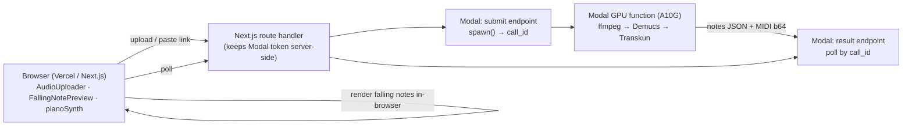

# PianoFlow AI — Demo (Vercel + Modal) & Scale Plan

**Date:** 2026-06-15
**Audience:** the implementing coding agent (Sonnet 4.6 default, per `CLAUDE.md`).
**Goal:** ship a reliable, free, public **interview demo** on **Vercel + Modal**, structured so it grows into production.
**Companion:** model/accuracy/infra rationale lives in [`AUDIO_MIDI_IMPROVEMENT_PLAN.md`](./AUDIO_MIDI_IMPROVEMENT_PLAN.md). This doc is the *execution* breakdown.

---

## How to execute this plan (read first)

- **One task = one PR.** Do tasks in order; each lists **Files**, **Steps**, **Acceptance**, **Tests**, **Commit**.
- **TDD:** write the failing test first (`tdd-guide`), then implement. Run `uv run --directory packages/music-core pytest` and `pnpm -r typecheck` before committing.
- **Respect conventions** (`CLAUDE.md`): `music-core` stays **pure** (deferred heavy imports, like the existing `basic_pitch.py`); adapters translate vendor errors at the boundary; config via env/pydantic-settings; Conventional Commits.
- **Stay in scope.** Each task is small on purpose. If a task needs an architectural decision (flagged **⚠ DECISION**), stop and escalate to the `architect`/`code-reviewer` (Opus) before proceeding.
- **Human-in-the-loop tasks** (account signup, secrets, `modal deploy`, Vercel env) are marked **👤**; the agent prepares everything and leaves a checklist.

### Demo architecture



**Key simplification for the demo:** the server returns **notes JSON + MIDI bytes**; the **browser** renders falling notes and plays them (your `FallingNotePreview` + `pianoSynth`/`sampledPiano` already do this). No server-side video, no storage on the hot path → fewer moving parts, faster, more reliable. (Server-side MP4 export and storage are **scale** items, S-series.) Async spawn+poll sidesteps Vercel/Modal request-timeout limits.

---

## Phase D — Vercel + Modal demo

### D0 — Accounts & local prereqs 👤
**Goal:** environment ready. **Steps:** create a Modal account (`pip install modal`, `modal token new`); `uv pip install -e packages/music-core` locally so Modal's `add_local_python_source` can resolve `pianoflow_music`. **Acceptance:** `modal token new` succeeds; `python -c "import pianoflow_music"` works. **Commit:** n/a (setup).

### D1 — Demucs separation module (music-core, pure, deferred import)
**Goal:** an 8 GB-safe stem separator behind the same deferred-import pattern as `basic_pitch.py`.
**Files:** `packages/music-core/pianoflow_music/transcription/separate.py`; test `tests/test_separate.py`; add `demucs` to a `[separation]` extra in `packages/music-core/pyproject.toml`.
**Steps:** `separate_target_stem(audio_bytes, *, stem="other", segment=7) -> bytes` — deferred `import demucs.api`; run `htdemucs` with `segment=7`, keep the target stem, return WAV bytes; on `torch.cuda.OutOfMemoryError` fall back to CPU; raise `TranscriptionError(code="SEPARATION_FAILED")` on failure.
**Acceptance:** unit test monkeypatches the demucs call (no model download in CI) and asserts bytes out + error mapping.
**Tests:** `uv run --directory packages/music-core pytest tests/test_separate.py`.
**Commit:** `feat(music-core): add Demucs target-stem separation (8GB-safe)`.

### D2 — Transcription pipeline orchestrator (music-core, pure)
**Goal:** one entry point that does optional separation → engine, returning the existing `TranscriptionResult`.
**Files:** `packages/music-core/pianoflow_music/transcription/pipeline.py`; `tests/test_pipeline.py`.
**Steps:** `run_pipeline(audio_bytes, *, engine="transkun", separate=False, options=None) -> TranscriptionResult` — if `separate`, call `separate_target_stem` first; then `get_engine(engine).transcribe(...)`. Inject the separator/engine for testability (defaults resolve the real ones).
**Acceptance:** test with a fake separator + fake engine asserts ordering and that `TranscriptionResult` is returned unchanged.
**Commit:** `feat(music-core): add run_pipeline (separation → engine) orchestrator`.

### D3 — Transkun engine: pedal + velocity into the schema
**Goal:** make `transkun` populate `NoteData.sustain` (CC64) and real velocities — the schema and `midi/write.py` already support it.
**Files:** `packages/music-core/pianoflow_music/transcription/transkun.py`; `tests/test_transkun.py`; `[transkun]` extra in `pyproject.toml`.
**Steps:** map Transkun pedal events → `sustain=[{"time": s, "value": 0..127}]`; map note velocity through; keep the deferred-import pattern; raise `ENGINE_UNAVAILABLE` if the extra isn't installed.
**Acceptance:** test (fake Transkun output) asserts `note_data.sustain` is non-empty and `note_data_to_midi_bytes` emits a `control_change control=64`.
**Commit:** `feat(music-core): Transkun engine emits sustain pedal + velocity`.

### D4 — Modal app: image + GPU function + spawn/result endpoints
**Goal:** a deployable Modal app that runs the pipeline on GPU and is callable over HTTP (async).
**Files:** `infra/modal/transcribe_app.py`; `infra/modal/README.md`.
**Steps (verified Modal API):**
```python
import base64, modal

app = modal.App("pianoflow-transcribe")
image = (
    modal.Image.debian_slim(python_version="3.12")
    .apt_install("ffmpeg")
    .pip_install("torch", "demucs", "transkun", "numpy", "mido", "librosa", "soundfile")
    .add_local_python_source("pianoflow_music")   # mounts packages/music-core
)

@app.function(gpu="A10G", image=image, timeout=600)
def transcribe(audio_b64: str, options: dict) -> dict:
    from pianoflow_music.transcription.pipeline import run_pipeline
    audio = base64.b64decode(audio_b64)
    res = run_pipeline(audio, engine=options.get("engine", "transkun"),
                       separate=options.get("separate", True), options=options)
    return {"notes": res.notes.to_dict(),
            "midi_b64": base64.b64encode(res.draft_midi_bytes).decode(),
            "confidence": res.confidence, "report": res.report}

@app.function(image=image)
@modal.fastapi_endpoint(method="POST")
def submit(payload: dict):
    call = transcribe.spawn(payload["audio_b64"], payload.get("options", {}))
    return {"call_id": call.object_id}

@app.function(image=image)
@modal.fastapi_endpoint(method="GET")
def result(call_id: str):
    fc = modal.FunctionCall.from_id(call_id)
    try:
        return {"status": "done", "result": fc.get(timeout=0)}
    except TimeoutError:
        return {"status": "processing"}
```
**Acceptance:** `modal serve infra/modal/transcribe_app.py` runs; `modal run` on a sample WAV returns valid MIDI + notes. **👤** `modal deploy` gives stable `submit`/`result` URLs.
**Commit:** `feat(modal): GPU transcription app with async submit/result endpoints`.

### D5 — (Optional, gated) YouTube/link ingestion in Modal ⚠ DECISION
**Goal:** the "paste a link → notes" wow moment, safely.
**Files:** extend `infra/modal/transcribe_app.py` (a `submit_url` endpoint); reuse `yt-dlp` (add to image `.pip_install("yt-dlp")`).
**Steps:** if `ENABLE_URL_INGEST` (Modal env) and request carries `rights_attested=true` and host is allowlisted (youtube/instagram/tiktok): `yt-dlp -x` to a temp dir with **duration ≤10 min**, **filesize ≤100 MB**, `--no-playlist`, timeout; then run the pipeline; delete the temp file. Flag default **off**; otherwise return 403. (Compliance rationale: `AUDIO_MIDI_IMPROVEMENT_PLAN.md` Part B.)
**Acceptance:** flag on + a public-domain/CC test URL → notes; flag off → 403; oversize → clean error. **No anti-bot evasion.**
**Commit:** `feat(modal): gated URL ingestion (yt-dlp, ephemeral, attested)`.

### D6 — Web demo page (async client, in-browser visualization)
**Goal:** the user-facing demo, reusing existing components.
**Files:** `apps/web/app/demo/page.tsx`; `apps/web/lib/transcribeClient.ts`; reuse `components/AudioUploader.tsx`, `FallingNotePreview.tsx`, `PianoRollPreview.tsx`, `lib/pianoSynth.ts`.
**Steps:** `transcribeClient` POSTs to a **Next.js route handler** `app/api/transcribe/route.ts` (keeps the Modal URL/token server-side), which calls Modal `submit`, then polls `result`; show a progress state; on done, parse notes → `FallingNotePreview` + play via `pianoSynth`.
**Acceptance:** upload (or paste link) → progress → falling notes play in-browser. `pnpm --filter @pianoflow/web build` passes.
**Commit:** `feat(web): demo page — audio/link → in-browser falling notes`.

### D7 — Pre-baked examples (the demo safety net)
**Goal:** the demo never fails live, even if the GPU is cold or quota'd.
**Files:** `scripts/prebake_examples.py`; outputs to `apps/web/public/examples/*.json` + `*.mid`; example list in the demo page.
**Steps:** run `run_pipeline` on 2–3 royalty-free/owned clips (via the Modal endpoint or locally with Basic Pitch), commit the resulting notes JSON + MIDI; demo page renders these instantly with **no** network/GPU call.
**Acceptance:** with Modal disabled / network throttled, the example songs still render and play.
**Commit:** `feat(web): pre-baked demo examples for offline-safe showcase`.

### D8 — Secrets & config 👤
**Goal:** nothing secret in the repo; clean-clone reproducible.
**Files:** `.env.example` (add `MODAL_SUBMIT_URL`, `MODAL_RESULT_URL`, optional `DEMO_PROXY_TOKEN`); `infra/modal/README.md`.
**Steps:** store any creds as `modal secret`; set Vercel project envs; the route handler reads them server-side. **Acceptance:** `git grep` finds no tokens; demo works from a fresh clone following the README.
**Commit:** `chore(demo): document Modal/Vercel env + secrets`.

### D9 — Smoke test + demo-day runbook
**Goal:** a one-command check and a script for interview day.
**Files:** `scripts/demo_smoke.py`; "Demo-day runbook" section below.
**Steps:** `demo_smoke.py` hits `submit`+`result` with a tiny WAV and asserts a MIDI comes back. **Acceptance:** `python scripts/demo_smoke.py` prints PASS against the deployed endpoint.
**Commit:** `test(demo): end-to-end smoke check for Modal endpoint`.

**Definition of done (demo):** a public Vercel URL where uploading a short audio clip (or pasting a link, if D5 enabled) produces falling notes that play in the browser within ~1–1.5 min, with pre-baked examples as instant fallback. Cost: $0 (Modal Starter $30 credits, Vercel Hobby).

---

## Phase S — Further scale (demo → production)

The demo calls Modal directly and returns results inline. Scaling means reintroducing your existing async architecture with Modal as the GPU backend, **without changing `music-core`**. Each S-task references the rationale in `AUDIO_MIDI_IMPROVEMENT_PLAN.md` (AMIP).

### S1 — Put transcription behind the API + SQS (async jobs)
Route the demo through your real flow: `apps/api` enqueues a job (SQS), the worker runs `run_pipeline`. Reuse the existing `transcribe_audio` job and `RenderJob`/status rows so the browser polls *your* API, not Modal. **Files:** `apps/api/app/api/v1/routers/audio.py`, `apps/worker/app/jobs/transcribe_audio.py`. **Done:** job rows drive progress; demo page switches to API polling. (AMIP Part E, Phase 3.)

### S2 — `RemoteTranscriptionEngine` adapter (worker → Modal)
Add the `"remote"` engine (AMIP Part A1): worker calls the Modal `submit`/`result` endpoints behind the `TranscriptionEngine` Protocol. **Files:** `packages/music-core/pianoflow_music/transcription/remote.py`, register in `engine.py`. **Done:** `TRANSCRIPTION_ENGINE=remote` works end-to-end; unit test with a fake HTTP client. ⚠ DECISION: sync-spawn vs queue — default to spawn+poll.

### S3 — R2 storage backend + signed URLs
Switch outputs off the inline path onto **Cloudflare R2** (zero egress; AMIP Part D/G) via the existing `STORAGE_BACKEND=s3` adapter pointed at the R2 endpoint. **Done:** MIDI/notes/video stored in R2, served by signed/public URL.

### S4 — Server-side MP4 export (shareable falling-notes video)
Reuse `apps/worker/app/jobs/render_video.py` + `music-core/video/*` + FluidSynth; on GPU use `h264_nvenc` (AMIP Part C). Put videos behind Cloudflare CDN. **Done:** a project yields a downloadable MP4 URL.

### S5 — Modal autoscaling + SQS DLQ
Scale GPU transcription with Modal's autoscaling container pool on the same SQS queue; configure a DLQ for failed jobs and `min_containers` for warm-path availability. **Done:** queue depth drives container count; failed jobs land on the DLQ for inspection; `systemd Restart=always` on the CPU orchestration worker.

### S6 — Quality + tiering
Eval harness (AMIP A9), onset hysteresis + velocity calibration (A4–A5), free=Basic Pitch / pro=Transkun tiering. **Done:** `make eval` reports onset F1 before/after; engine chosen by plan.

### S7 — Multi-instrument & compliance hardening
YourMT3+ path for guitar/vocals/bass (AMIP Phase 4); before any *public* link-download, implement the full compliance set — rights attestation, ephemeral storage lifecycle, rate limits, takedown, feature flags (AMIP Part B4) + legal review.

---

## Phase L — Latency (transcription speed)

Speed-focused tasks, grounded in current code. **L1+L2 are the free CPU wins and are the only Phase-L work being done now; L3/L4 are deferred to keep cost at $0; the order-of-magnitude speedup comes from the Modal GPU path (Phase D/S), free on Modal Starter credits.** L5–L6 tune the GPU path. Rationale: `AUDIO_MIDI_IMPROVEMENT_PLAN.md` Part I.

### L1 — Remove the redundant audio decode
The engines decode the audio twice: once for inference, once via `librosa.load` in `beat.estimate_tempo_and_beats` just for tempo. **Files:** `packages/music-core/pianoflow_music/transcription/basic_pitch.py`, `transkun.py`, `beat.py`. **Steps:** prefer the free MIDI/engine tempo estimate; only call librosa when it is out of range; when librosa is needed, beat-track the already-decoded array rather than re-`load`ing the file. **Test:** assert the librosa seam is not called when a valid tempo is already available (monkeypatch + call-count). **Commit:** `perf(music-core): drop redundant librosa decode in transcription`.

### L2 — Cache the model/session across jobs
`basic_pitch.predict` reloads the ONNX model every call; `transkun._run_model` rebuilds the module and `torch.load`s the checkpoint every job. **Files:** `basic_pitch.py`, `transkun.py`. **Steps:** build the model/session once and cache it (module-level or on the engine instance) so the long-lived worker reuses it; guard with a lock if needed. **Test:** two `transcribe` calls trigger model construction once. **Commit:** `perf(music-core): cache transcription model across jobs`.

### L3 — Tune onnxruntime threads
**DEFERRED — blocked on L4.** t2.micro is 1 vCPU, so intra-op thread parallelism gives nothing; L3 only pays off once the worker is multi-core. Do L3 only after L4 unlocks additional CPUs.

Basic Pitch ONNX runs single-threaded by default. **Files:** `basic_pitch.py` (+ a settings knob in the worker). **Steps:** set intra-op thread count from an env/config value sized to the worker's vCPUs. **Test:** the configured value is passed to the ONNX session options. **Commit:** `perf(music-core): configurable onnxruntime thread count`.

### L4 — Free-tier multi-core worker (deferred, optional) 👤
**Cost must stay $0. Paid AWS instances (t3/c-family) are out of scope.** The only free multi-core path identified is **Oracle Cloud Always Free A1 (2 OCPU / 12 GB RAM, ARM, forever free)**. Migrating to it would unlock L3 (thread parallelism across 2 cores) but requires a cross-cloud migration (AWS → Oracle Cloud) plus an ARM build of the worker image — this is a later, optional move, not current work. Until then the CPU free-tier path stays on t2.micro (1 vCPU) and real speed gains come from the Modal GPU path (Phase D/S), which is free on Modal Starter credits. **No terraform changes until this is explicitly scheduled.**

### L5 — Fix Transkun GPU device + warm model
`transkun._run_model` hardcodes `device="cpu"` — the GPU engine never uses the GPU. **Files:** `transkun.py`. **Steps:** select `cuda` when available, move model + inputs to it, keep the model cached on-device (with L2), use `torch.inference_mode()` + FP16 on GPU. **Test:** device selection honors `torch.cuda.is_available()` (monkeypatch). **Commit:** `perf(music-core): Transkun uses GPU when available + warm model`. **Depends on:** S2.

### L6 — Modal keep-warm + skip Demucs for solo piano
Cold starts and an unconditional Demucs pass add seconds. **Files:** `infra/modal/transcribe_app.py`, `pipeline.py`. **Steps:** set a small `min_containers`/keep-warm on the GPU function for demo/peak windows; make `separate` default off for solo-piano input (heuristic or toggle) so clean piano skips the +10–20 s separation. **Done:** warm-path latency floor measured; solo-piano path skips Demucs. **Depends on:** D4.

### L7 — Per-stage latency logging
Latency is currently unmeasured. **Files:** `pipeline.py` (+ worker log). **Steps:** log elapsed time per stage (decode / separate / infer / postprocess / encode) on every job, alongside the `mir_eval` accuracy harness (A9/S6). **Done:** each job emits stage timings; baseline vs after-numbers are reportable. **Commit:** `feat(music-core): per-stage transcription timing log`.

---

## Demo-day runbook

1. **Day before:** `python scripts/demo_smoke.py` against the deployed endpoint → expect PASS. Open the Vercel URL; run one live upload; confirm a pre-baked example loads instantly.
2. **Warm the GPU:** hit `submit` once ~5 min before (Modal cold start ≈ seconds, but warm is nicer).
3. **During:** lead with a **pre-baked example** (instant), then do **one live** upload/link as the wow. If live is slow/fails, fall back to pre-baked — never wait on a spinner.
4. **Talk track:** "browser renders the falling notes from the MIDI the model produced; the GPU step is a serverless Modal function that scales to zero." Point the interviewer to `AUDIO_MIDI_IMPROVEMENT_PLAN.md` for the scale/cost story.
5. **After:** if you used a temporary tunnel, tear it down.

## Risks & gotchas

- **Cold start / quota:** pre-baked examples (D7) are the mitigation; keep clips short (≤60 s) for snappy live runs.
- **Modal memory limits:** run Demucs and Transkun sequentially (not co-resident) and use `segment=7` for Demucs to avoid OOM on the A10G (22 GB VRAM is ample, but the pattern also keeps local dev reproducible).
- **Request timeouts:** use async spawn+poll (D4/D6), never a single long synchronous request.
- **Vercel Hobby:** fine for a demo (non-commercial); switch to Pro before charging users.
- **Model downloads in CI:** mock demucs/transkun in tests (D1–D3) so CI never pulls weights.
