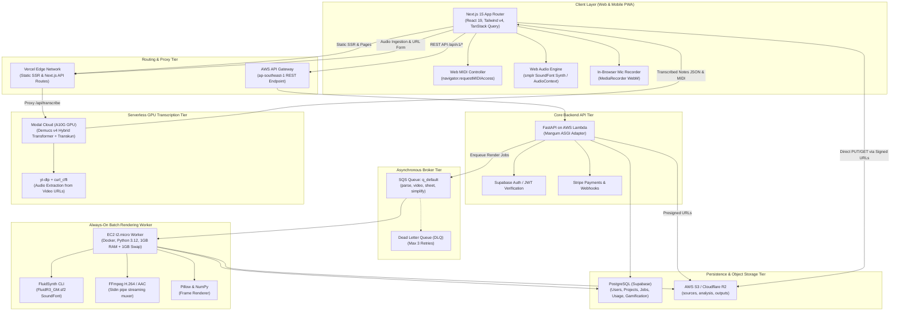
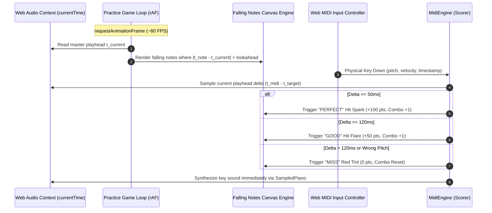

# PianoFlow AI — System Design & Architecture Specification

> Version: 2.0 (Post-Audit Full Architecture Baseline)  
> Scope: End-to-end system topology, sync model, rendering tiers, database contract, security, and observability  
> Last updated: October 2026  

---

## 1. System Architecture & Topology

PianoFlow AI is built on a decoupled, asynchronous, and cloud-native architecture. The system separates interactive user interfaces, low-latency API coordination, CPU-bound batch rendering, and heavy serverless GPU machine learning.

### 1.1 Architectural Topology Diagram



---

### 1.2 Subsystem Breakdown & Responsibilities

| Subsystem | Technology Stack | Core Responsibilities | Constraints / Forbidden Actions |
|---|---|---|---|
| **apps/web** | Next.js 15, React 19, Tailwind v4, TanStack Query, `smplr`, `next-pwa` | User interface, responsive layout, Falling Notes canvas engine, Web MIDI practice loop, in-browser audio recording. | **Must NOT** query DB directly or perform heavy CPU processing. |
| **apps/api** | FastAPI, Mangum, SQLAlchemy 2.0, Pydantic v2 | Request validation, auth verification, job dispatching, presigned URL creation, Stripe subscription handling, gamification progress tracking. | **Must NOT** parse large audio/MIDI files directly or execute long-running tasks. |
| **apps/worker** | Python 3.12, Docker, SQS Consumer | Consumes async jobs (`parse_midi`, `render_video`, `render_sheet`, `simplify_midi`), writes progress to DB, uploads artifacts to S3/R2. | **Must NOT** serve HTTP traffic or block on user interactions. |
| **packages/music-core** | Python 3.12, Pillow, NumPy, Mido, pretty_midi | Pure music algorithms: MIDI validation, parsing, chord-aware hand splitting, rule-based simplification, frame drawing. | **Must NOT** perform network I/O or access databases. |
| **infra/modal** | Modal serverless, PyTorch, Demucs v4, Transkun, yt-dlp | Polyphonic transcription, piano stem separation, URL audio extraction on NVIDIA A10G GPUs with map-reduce chunking. | Operates on-demand; scales to zero when idle. |
| **Persistence** | Supabase PostgreSQL, AWS S3 / Cloudflare R2 | Relational metadata (projects, jobs, usage, gamification) and binary blob storage (audio, MIDI, MP4, PDF, MusicXML, notes JSON). | Object storage is private by default; access via signed URLs. |

---

## 2. Database Session Contract (Synchronous Architecture)

> [!IMPORTANT]
> **Synchronous Session Contract:** `get_db()` in `apps/api/app/infrastructure/database/session.py` yields a standard **synchronous** `sqlalchemy.orm.Session`. All domain services, repositories, and API routers MUST interact with the database using synchronous SQLAlchemy 2.0 idioms.

### 2.1 The Architectural Contract

```python
# CORRECT: Synchronous domain operation
def record_practice_session(db: Session, user_id: UUID, project_id: UUID, score: int, accuracy: float) -> UserProgress:
    # 1. Synchronous statement execution
    stmt = select(UserProgress).where(UserProgress.user_id == user_id)
    progress = db.scalars(stmt).first()
    
    # 2. Domain logic & mutation
    if not progress:
        progress = UserProgress(user_id=user_id, total_xp=0, current_level=1)
        db.add(progress)
        
    earned_xp = int(score * (accuracy / 100.0) * 10)
    progress.total_xp += earned_xp
    
    # 3. Synchronous commit
    db.commit()
    db.refresh(progress)
    return progress
```

### 2.2 Strict Invariants
1. **Never use `await` on database operations**: Statements like `await db.execute(...)` or `await db.commit()` are fatal runtime bugs that crash worker processes and FastAPI request handlers with `TypeError: object Result cannot be used in 'await' expression`.
2. **Synchronous Dependency Injection**: Dependencies must be typed as `db: Session = Depends(get_db)`.
3. **Explicit Transaction Boundaries**: Every write path must explicitly commit (`db.commit()`) or roll back on error (`db.rollback()`), handled cleanly by the context-managed session generator.

---

## 3. Single-Timeline Synchronization Model

To eliminate audio-visual-input drift, PianoFlow AI enforces a **single canonical timeline** defined in absolute floating-point seconds.

```
Canonical Parsed Notes (seconds)
              │
              ▼  apply_speed: t_scaled = t_raw / speed_multiplier
     Master Scaled Timeline
              │
    ┌─────────┼─────────────────────────┬─────────────────────────┐
    ▼         ▼                         ▼                         ▼
Web Audio   Falling Notes Canvas   Web MIDI Input Loop       Worker Video Export
Clock       Animation              (Hit Detection Window)    (FluidSynth + FFmpeg)
```

### 3.1 Timing Coordinate System

1. **Tempo Flattening at Ingestion:**
   During MIDI parsing or audio transcription, all musical ticks, tempo changes, and time signatures are converted into an absolute timeline in seconds:
   $$\text{onset}_{\text{sec}}, \quad \text{offset}_{\text{sec}}, \quad \text{duration}_{\text{sec}}$$
2. **Speed Scaling:**
   When playback or practice speed changes (e.g., $0.5\times$ or $1.25\times$), timestamps are scaled purely via:
   $$t' = \frac{t}{\text{speed\_multiplier}}$$
   *Audio is re-synthesized at the new timestamps rather than time-stretching an audio file*, preserving note pitch, attack transients, and acoustic decay.

### 3.2 Browser Practice Mode Synchronization Loop

In the interactive browser practice mode, three real-time loops synchronize against the Web Audio clock:



### 3.3 Wait Mode State Machine

In **Wait Mode**, the song does not advance continuously. Instead:
1. The playhead advances normally until approaching the next unplayed note or chord onset $T_{\text{target}}$.
2. When $t_{\text{playhead}} \ge T_{\text{target}} - \epsilon$ (where $\epsilon \approx 10\text{ ms}$), the playhead freezes.
3. The system highlights the expected keys on the virtual keyboard in ghost outline mode.
4. Once the user strikes all required pitches on their MIDI keyboard:
   - The keys flash in full hand color.
   - The acoustic notes sound.
   - The playhead unfreezes and smoothly transitions to the next note event.

---

## 4. Multi-Tier Rendering Architecture

PianoFlow AI uses a tiered approach to visual and audio rendering, ensuring interactive responsiveness while minimizing compute cost.

```
┌────────────────────────────────────────────────────────────────────────┐
│                        TIER 1: REAL-TIME CLIENT CANVAS                 │
│  • Platform: Browser HTML5 2D Canvas (Next.js 15)                      │
│  • Frame Rate: 60 FPS (Hardware accelerated requestAnimationFrame)     │
│  • Audio: smplr SoundFont Synth via Web Audio API                      │
│  • Latency: Zero network latency, instant user interaction             │
│  • Use Case: Live song preview, interactive practice, Wait Mode        │
└───────────────────────────────────┬────────────────────────────────────┘
                                    │ Export / Heavy Job Trigger
                                    ▼
┌────────────────────────────────────────────────────────────────────────┐
│                        TIER 2: SERVERLESS GPU ML                       │
│  • Platform: Modal Cloud (NVIDIA A10G 24GB VRAM)                       │
│  • Models: Demucs v4 (Hybrid Transformer) + Transkun (CRF Polyphonic)  │
│  • Processing: Overlapping map-reduce chunking for long audio          │
│  • Turnaround: ~45 seconds for 3-minute mixed audio                    │
│  • Use Case: Mixed audio & YouTube/social link transcription           │
└───────────────────────────────────┬────────────────────────────────────┘
                                    │ Video / Sheet Export Job
                                    ▼
┌────────────────────────────────────────────────────────────────────────┐
│                     TIER 3: ASYNCHRONOUS CPU WORKER                    │
│  • Platform: AWS EC2 t2.micro (1GB RAM + 1GB Swap, Docker)             │
│  • Graphics: Pillow & NumPy frame drawing piped directly to FFmpeg     │
│  • Audio: FluidSynth CLI rendering FluidR3_GM.sf2 to WAV               │
│  • Encoding: H.264 High Profile (yuv420p) + AAC audio muxing           │
│  • Use Case: 720p/1080p MP4 tutorial video & OSMD/MusicXML exports     │
└────────────────────────────────────────────────────────────────────────┘
```

---

## 5. Asynchronous Job & Worker Architecture

### 5.1 Queue Partitioning

To prevent long-running video exports from starving fast validation and parsing tasks, queues are logically separated:

| Queue Name | Job Types Handled | Expected Duration | Concurrency / Worker Assignment |
|---|---|---|---|
| `q_fast` | `parse_midi`, `simplify_midi`, `generate_preview` | 1–5 seconds | High concurrency, instant execution. |
| `q_render` | `render_video`, `render_sheet` | 30–180 seconds | Throttled concurrency on EC2 worker to preserve 1GB memory. |
| `q_audio` | `transcribe_audio` (worker fallback) | Minutes | Dispatched to serverless GPU runner (Modal) or CPU fallback. |

### 5.2 Worker Memory Protection on EC2 t2.micro

To guarantee crash-free video rendering within a 1 GB RAM footprint:
1. **FFmpeg Stdin Pipe Streaming:** Video frames are generated sequentially in memory and streamed directly to `ffmpeg -f rawvideo ... -i -`. Frames are never written to disk as intermediate PNG sequences.
2. **Sliding-Window Note Visibility Index:** At frame $i$, the worker only iterates through notes active in the current viewport window ($O(\text{visible})$ rather than $O(\text{total})$).
3. **Explicit Garbage Collection:** After completing frame batch encoding and FluidSynth WAV generation, Python memory is explicitly reclaimed via `gc.collect()`.

---

## 6. Security & Authorization Design

1. **Authentication & Identity:**
   - Identity managed via Supabase Auth (JWT).
   - FastAPI inspects JWT claims on every protected endpoint, validating signature, issuer, and expiration.
2. **Multi-Tenant Data Isolation:**
   - Every database query for projects, files, jobs, and settings enforces `WHERE user_id = :current_user_id`.
   - Cross-user UUID lookups return `404 Not Found` (never `403 Forbidden`) to eliminate resource enumeration side channels.
3. **Direct-to-Storage Upload Protection:**
   - File uploads bypass the API backend entirely. The API issues short-lived, presigned upload URLs restricted by exact `Content-Length` bounds and server-generated UUID storage keys (`projects/{project_id}/uploads/{uuid}.mid`).
4. **Rate Limiting & Cost Guards:**
   - Tier-based daily caps tracked in `daily_usage` (uploads, render jobs, video seconds, transcriptions).
   - Middleware blocks abusive requests with HTTP `429 Too Many Requests` and a standard `Retry-After` header.

---

## 7. Observability & Telemetry

1. **Structured JSON Logging:**
   All logs across FastAPI and worker containers emit structured JSON with correlation IDs:
   ```json
   {
     "timestamp": "2026-10-03T11:20:00.123Z",
     "level": "INFO",
     "service": "worker",
     "event": "video.render.progress",
     "job_id": "9f1c2e34-5678-4321-abcd-ef0123456789",
     "project_id": "7ab0c1d2-3456-7890-abcd-ef0123456789",
     "progress": 65,
     "frame_batch": 1950,
     "memory_rss_mb": 412
   }
   ```
2. **CloudWatch Metrics & Alarms:**
   - Alarms configured for: DLQ message count $> 0$, worker CPU $> 85\%$ for 10 minutes, and API 5xx error rate $> 1\%$.
