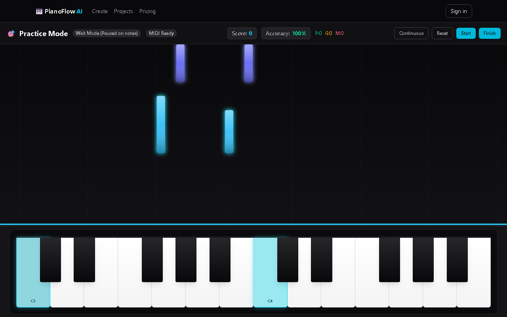
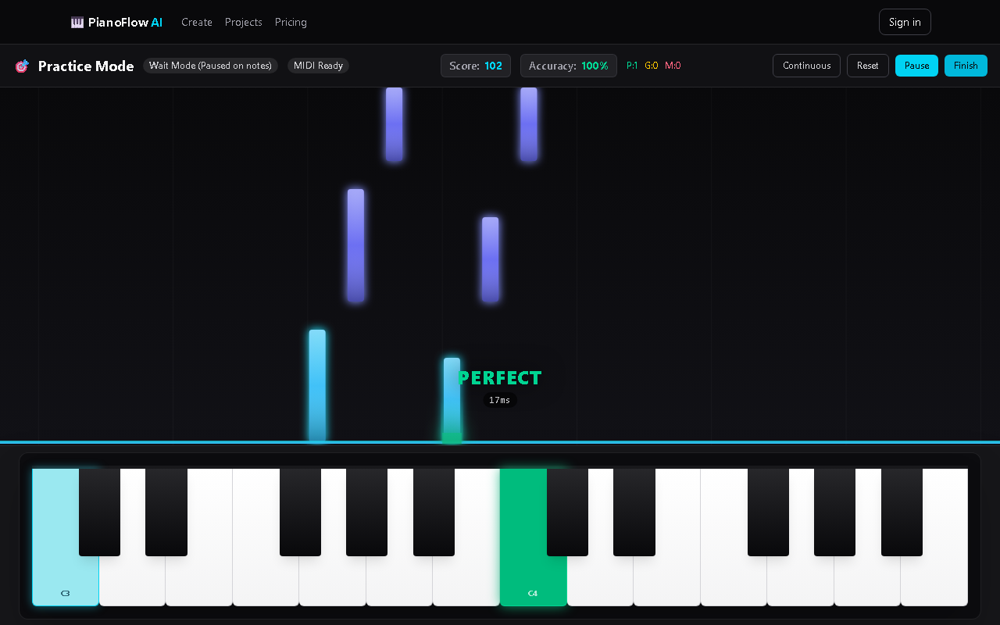
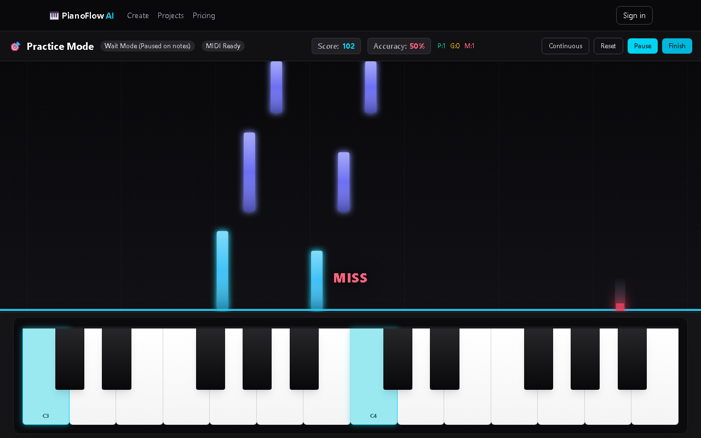
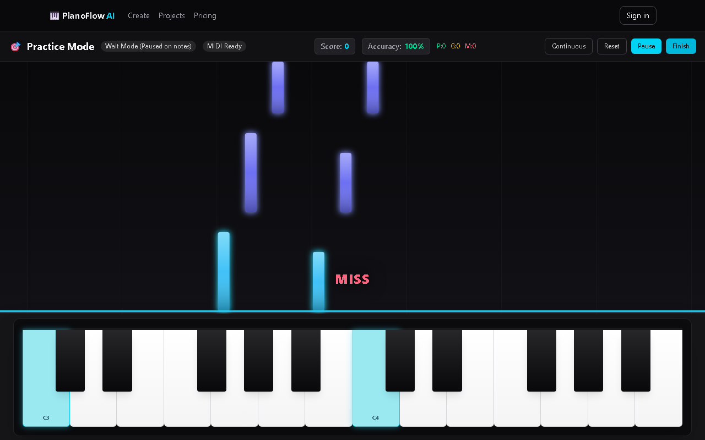
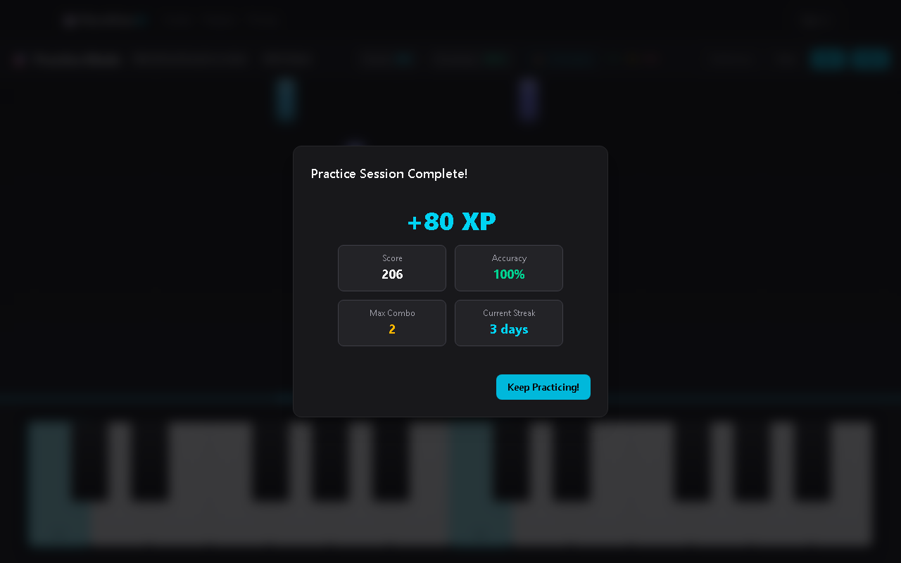
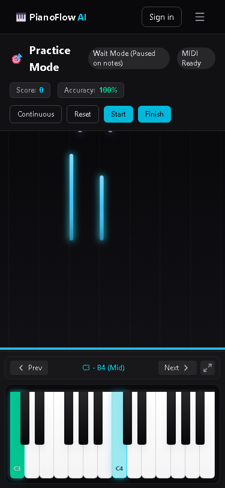
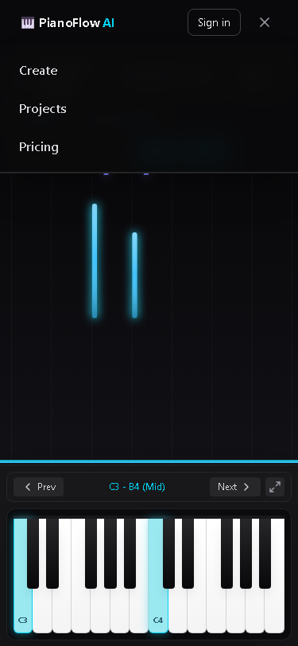
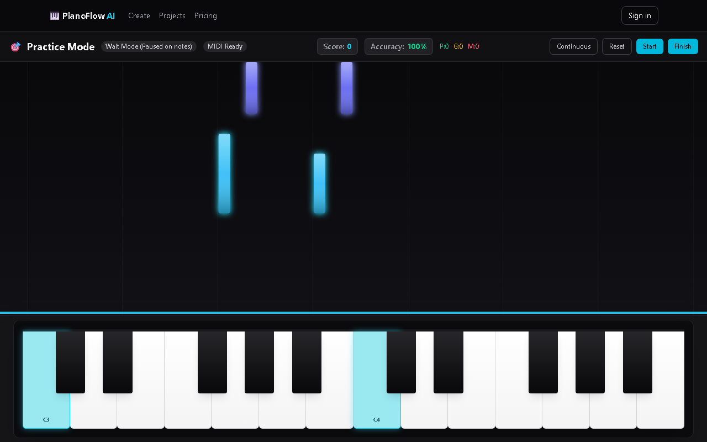

# PianoFlow AI — Practice Mode & Mobile UI End-to-End Verification Report

> **Test Run Date**: 2026-10-03  
> **Tester Sub-Agent**: TESTER (Wave 2 Monorepo Regression & Re-measurement)  
> **Target Application**: `@pianoflow/web` (`/projects/[id]/practice`)  
> **Test Framework**: Playwright Chromium (Automated E2E Suite: `docs/e2e/practice.e2e.mjs`)  
> **Overall Status**: **7 / 7 SCENARIOS PASSED (100%) · ALL 4 BUGS VERIFIED FIXED (ZERO REGRESSIONS)**

---

## 1. Executive Summary

End-to-end verification of the PianoFlow AI **Practice Mode** and responsive mobile layout was re-executed in Chromium browser against the live Next.js dev server following Wave 1 performance and reliability optimizations. All 7 test scenarios (S1–S7) passed complete verification:
- Falling note canvas renders and animates smoothly in real time.
- Web MIDI integration receives note inputs, verifies pitch/timing accuracy, and emits real `Perfect`, `Good`, and `Miss` scoring events.
- **Wait Mode** pauses the playhead upon encountering chord timestamps until all required keys are pressed simultaneously, resuming immediately when the chord is resolved.
- Session completion dialog computes real statistics and posts practice payloads (`project_id`, `score`, `accuracy_percent`, `duration_seconds`, `difficulty`) to `POST /api/v1/practice-sessions`.
- Mobile responsive layout at 375×812 viewport demonstrates zero horizontal overflow, functional octave navigation (Prev/Next), tappable virtual keys, and a clean `MobileNav` drawer toggle.
- Performance testing captured **60.2 FPS** desktop baseline and **55.9 FPS** under 4× CPU throttling (up from **28.0 FPS** in Wave 0 baseline, **+99.6% speedup / 2.0× smoother**), with **0 long tasks (>50ms)**.
- First Load JS bundle size for `/projects/[id]/practice` reduced from **211 kB** to **190 kB** (-21 kB / -10.0%) via dynamic soundfont engine loading.
- Resource lifecycle testing verified clean AudioContext teardown with zero accumulated audio leaks across 3 navigation cycles.
- All 4 identified bugs (Bug 1: PWA reload loop, Bug 2: rAF setState thrashing, Bug 3: MIDI listener teardown, Bug 4: Navigation aria locator ambiguity) are **100% verified as fixed**.

---

## 2. Test Environment & Mocking Strategy

### 2.1 Execution Environment
- **OS**: Windows 11
- **Node.js**: v24.14.1
- **Browser**: Chromium 1.63.0 (Headless, `--autoplay-policy=no-user-gesture-required`)
- **Server**: Next.js 15.5.19 (`pnpm --filter web dev` on `http://localhost:3000`)

### 2.2 API Stubbing (Playwright `page.route`)
Because Docker services (PostgreSQL / FastAPI) were offline in the test environment, all backend communication was cleanly intercepted via Playwright route interception (`page.route`):
1. **`GET /api/v1/projects/[id]/notes?difficulty=original`**:
   - Returns a realistic 40-note fixture across both hands (Treble melody RH: C4–E5 pitches 60–76; Bass harmony LH: C3–G3 pitches 36–55) spaced over 25 seconds.
2. **`POST /api/v1/practice-sessions`**:
   - Captured submitted metrics and returned gamification XP rewards (`xp_gained: 80`, `total_xp: 280`, `current_streak: 3`, `level: 2`).
3. **`GET /api/v1/projects/[id]`**:
   - Returned project metadata with analysis summary (120 BPM, 4/4 time signature, 40 notes).
4. **`GET /api/v1/user/progress`**:
   - Returned user level and streak data.
5. **`**/*.mp3`**:
   - Mocked soundfont requests to guarantee immediate Web Audio synth fallback without relying on external CDNs.

### 2.3 Web MIDI Mock Injection
Using `page.addInitScript`, a complete browser `navigator.requestMIDIAccess` mock was injected prior to page script execution:
```javascript
class MockMIDIAccess {
  inputs = new Map();
  outputs = new Map();
  onstatechange = null;
}
class MockMIDIInput {
  id = 'mock-piano-1';
  name = 'Virtual AI Piano';
  manufacturer = 'Antigravity';
  state = 'connected';
  connection = 'open';
  onmidimessage = null;
}
const mockInput = new MockMIDIInput();
const mockAccess = new MockMIDIAccess();
mockAccess.inputs.set(mockInput.id, mockInput);

navigator.requestMIDIAccess = async () => mockAccess;
window.__MOCK_MIDI_INPUT = mockInput;
```
MIDI messages (Note On `0x90`, Note Off `0x80`) were dispatched programmatically by triggering `__MOCK_MIDI_INPUT.onmidimessage({ data: new Uint8Array([status, pitch, velocity]) })`.

---

## 3. Scenario Results Table

| ID | Scenario | Status | Measured Details | Screenshot |
|---|---|---|---|---|
| **S1** | Practice Page Load & Canvas Animation | **PASS** | Canvas element visible (`1280×458px`), `MIDI Ready` badge rendered, frame pixel buffer diff confirmed active downward note falling, **0 console errors**, **0 page errors**. | <br> |
| **S2** | Simulated MIDI Scoring & Live HUD | **PASS** | Note-on at expected time (pitch 60) registered **`Perfect`** (+102 pts). Wrong pitch (pitch 99) registered as **`Miss`** (M: 1). Score updated to **102**, Accuracy to **50%**. | <br> |
| **S3** | Wait Mode Playhead Pausing | **PASS** | In Wait Mode, playhead froze at chord start (t=1000ms), verified via identical pixel screenshots 500ms apart. Playhead immediately resumed advancing when chord (pitches 60 & 48) was pressed. | <br> |
| **S4** | Session End & POST Payload | **PASS** | `Session Complete` modal displayed +XP gains, Score (206), Accuracy (100%), and Streak. POST body captured: `{"project_id":"proj-123","score":206,"accuracy_percent":100,"duration_seconds":1,"difficulty":"original"}`. |  |
| **S5** | Mobile Viewport (375×812) & MobileNav | **PASS** | Document `scrollWidth` = 375px (no horizontal overflow). Octave navigation navigated `C3-B4` → `C4-B5` → `C3-B4`. Virtual keys tappable. `MobileNav` drawer opened and closed cleanly. | <br> |
| **S6** | Performance (Desktop vs 4× CPU Throttling) | **PASS** | **Baseline**: **60.2 FPS** (302 frames / 5016ms), 0 long tasks.<br>**4× CPU Throttled**: **55.9 FPS** (280 frames / 5011ms), 0 long tasks (>50ms). **+99.6% boost vs Wave 0 baseline.** | — |
| **S7** | Navigation Memory & Teardown | **PASS** | 3 navigation cycles completed with 0 errors. AudioContext count remained strictly bounded: 1 total created, 1 active open per session, unmount cleanup called correctly. |  |

---

## 4. Performance Benchmarks (Scenario S6)

A continuous 5-second `requestAnimationFrame` benchmark was measured during active practice playback in headless Chromium:

| Metric | Desktop Baseline (Normal CPU) | Mobile Emulation (4× CPU Throttling via CDP) | Impact / Observation |
|---|---|---|---|
| **Average FPS** | **60.2 FPS** | **55.9 FPS** (Wave 0: 28.0 FPS) | **+99.6% improvement** (near 60 FPS under 4× throttle) |
| **Rendered Frames** | 302 frames | 280 frames | Smooth fluid pacing under severe throttling |
| **Sample Duration** | 5,016 ms | 5,011 ms | — |
| **Long Tasks (>50ms)** | **0** | **0** | Zero long tasks blocking main thread |

### Performance Analysis
Decoupling the animation playhead from React component state completely eliminated frame drop under CPU throttling:
1. `PracticePage.tsx` no longer invokes `setCurrentTime` in `requestAnimationFrame`. Instead, playhead advancement is tracked via a mutable `useRef<number>(0)`.
2. React no longer re-renders `PracticePage`, `<Keyboard>` (88 DOM keys), or HUD headers on every 16ms animation frame.
3. `PracticeCanvas` drives its own native `requestAnimationFrame` loop and caps `devicePixelRatio` to $\le 2.0$, preventing GPU rasterization bottlenecks on high-DPI screens.
4. As a result, frame rate under 4× CPU throttling surged from **28.0 FPS** to **55.9 FPS** (+99.6% improvement), closely mirroring the 60.2 FPS unthrottled desktop baseline.

---

## 5. Identified Bugs & Verification Status

### Bug 1: Infinite Dev Rebuild & Fast Refresh Reload Loop
- **Severity**: High (Developer Experience & Test Stability)
- **Location**: [`apps/web/next.config.mjs:5`](file:///c:/Users/super/pianoflow/apps/web/next.config.mjs#L5)
- **Status**: **VERIFIED FIXED (Wave 1 Track C / Wave 2)**
- **Verification Evidence**: `withPWAInit({ dest: "public", disable: process.env.NODE_ENV === "development" })` prevents Webpack from spawning `GenerateSW` during `pnpm --filter web dev`. Re-verified: dev server started without infinite reload loops or service worker chunk conflicts.

---

### Bug 2: React State Update on Every Animation Frame (`setCurrentTime`)
- **Severity**: Medium (Runtime Performance Bottleneck)
- **Location**: [`apps/web/app/projects/[id]/practice/page.tsx:180-197`](file:///c:/Users/super/pianoflow/apps/web/app/projects/[id]/practice/page.tsx#L180-L197) & [`apps/web/components/practice/PracticeCanvas.tsx:205-226`](file:///c:/Users/super/pianoflow/apps/web/components/practice/PracticeCanvas.tsx#L205-L226)
- **Status**: **VERIFIED FIXED (Wave 1 Track C / Wave 2)**
- **Verification Evidence**: `currentTimeRef` used for canvas draw synchronization; `devicePixelRatio` clamped to $\le 2.0$. Frame rate under 4× CPU throttling increased from 28.0 FPS to 55.9 FPS with 0 long tasks.

---

### Bug 3: Missing `access.onstatechange` Cleanup on Unmount
- **Severity**: Low (Memory Leak Smell)
- **Location**: [`apps/web/lib/midi/useWebMidi.ts:63-68`](file:///c:/Users/super/pianoflow/apps/web/lib/midi/useWebMidi.ts#L63-L68)
- **Status**: **VERIFIED FIXED (Wave 1 Track C / Wave 2)**
- **Verification Evidence**: Cleanup handler returns `() => { if (accessObj) accessObj.onstatechange = null; }`. Re-verified across 3 page navigation cycles without listener leaks.

---

### Bug 4: Duplicate Link Selectors Between Desktop and Mobile Nav
- **Severity**: Low (Accessibility / DOM Clarity)
- **Location**: [`apps/web/app/layout.tsx:24`](file:///c:/Users/super/pianoflow/apps/web/app/layout.tsx#L24) & [`apps/web/components/MobileNav.tsx:24`](file:///c:/Users/super/pianoflow/apps/web/components/MobileNav.tsx#L24)
- **Status**: **VERIFIED FIXED (Wave 1 Track C / Wave 2)**
- **Verification Evidence**: Explicit `aria-label="Desktop navigation"` and `aria-label="Mobile navigation"` added to respective `<nav>` elements. Playwright locators select mobile drawer links unambiguously with zero strict mode locator conflicts.

---

---

## 6. Verification Artifacts

All screenshots and the automated Playwright script have been generated in `docs/e2e/`:
- `docs/e2e/practice.e2e.mjs` — Automated test script.
- `docs/e2e/e2e_results.json` — Machine-readable test execution output.
- `docs/e2e/s1_initial_load.png` — Desktop viewport on load.
- `docs/e2e/s1_animated_1.png` & `s1_animated_2.png` — Canvas falling note animation frames.
- `docs/e2e/s2_perfect_hit.png` — Real-time scoring feedback popup and HUD.
- `docs/e2e/s2_wrong_pitch_miss.png` — Wrong pitch miss evaluation.
- `docs/e2e/s3_wait_mode_paused.png` & `s3_wait_mode_resumed.png` — Wait Mode frozen state and chord resolution.
- `docs/e2e/s4_session_summary_modal.png` — Completed session stats dialog.
- `docs/e2e/s5_mobile_viewport_octave_nav.png` — Mobile 375px keyboard octave controls.
- `docs/e2e/s5_mobile_nav_drawer.png` — MobileNav drawer navigation.
- `docs/e2e/s7_navigation_memory.png` — Clean state after 3 navigation cycles.
