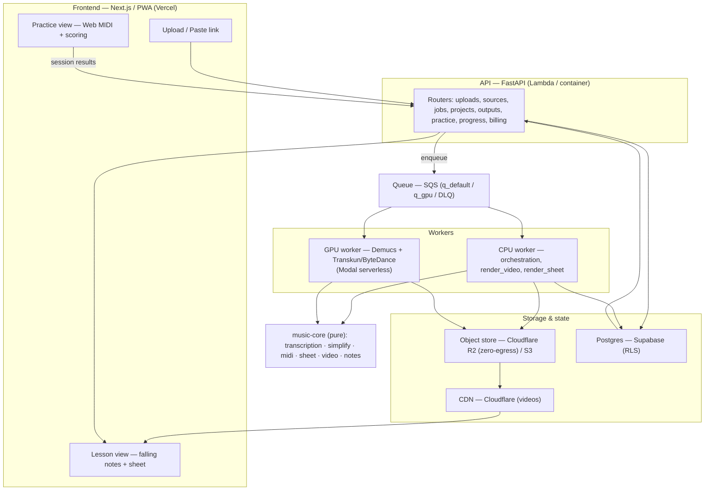
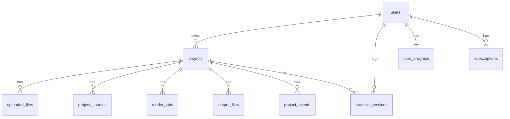
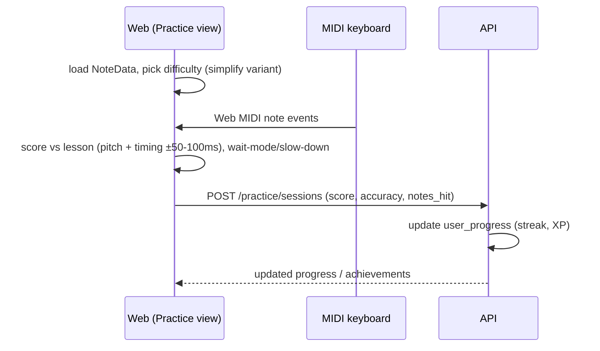

# PianoFlow AI — Master Plan & System Design

**Date:** 2026-06-15
**Purpose:** The single consolidated view — product vision, target system design, data model, flows, and one unified roadmap — tying together the three deep-dive plans.

| Deep-dive | Covers |
|---|---|
| [`AUDIO_MIDI_IMPROVEMENT_PLAN.md`](./AUDIO_MIDI_IMPROVEMENT_PLAN.md) | Transcription quality, source ingestion (YouTube/IG/TikTok), models, cost, Modal serverless GPU, free tier |
| [`DEMO_AND_SCALE_PLAN.md`](./DEMO_AND_SCALE_PLAN.md) | Vercel + Modal interview demo (Sonnet-executable tasks) + scale path |
| [`PIANO_LEARNING_COMPETITIVE_PLAN.md`](./PIANO_LEARNING_COMPETITIVE_PLAN.md) | Market analysis + learning-product features |
| This doc | System design + unified roadmap across all of the above |

> Read alongside the as-built docs: [`architecture.md`](./architecture.md), [`CODE_ARCHITECTURE.md`](./CODE_ARCHITECTURE.md), [`DATABASE.md`](./DATABASE.md). This is the **forward-looking target**; those describe today.

---

## 1. Vision & positioning

**PianoFlow turns any song into a piano lesson you can actually play — at your level.** Paste a link or upload audio → get falling-notes + sheet music + MIDI → practice with real-time feedback, with the arrangement auto-simplified to your skill.

The wedge (see competitive plan): every rival (Simply Piano, Flowkey, Synthesia, Yousician, Skoove…) is a **fixed licensed library + feedback loop + gamification**, and all hit the "the song I want isn't here" ceiling. PianoFlow's moat is the **generation engine** (transcription + `simplify`) that removes the library entirely. The work ahead is to wrap that engine in the **learning loop** the market expects.

Three product pillars, three engineering threads:
1. **Generate** — audio/URL → high-quality MIDI/sheet/falling-notes (transcription subsystem).
2. **Adapt** — auto-simplify any song to a difficulty level (simplify subsystem).
3. **Practice** — real-time feedback, scoring, progress, gamification (learning subsystem).

---

## 2. Target architecture



**Principles (unchanged from `CLAUDE.md`):** hexagonal ports/adapters; `music-core` is pure (zero I/O); backends swapped by env (`STORAGE_BACKEND`, `QUEUE_BACKEND`, `TRANSCRIPTION_ENGINE`); adapters translate vendor errors at the boundary; 12-factor config. The GPU worker is a **drop-in adapter** — the same `TranscriptionEngine` contract, running on Modal serverless.

---

## 3. Components & responsibilities

| Component | Responsibility | Status / change |
|---|---|---|
| `apps/web` | Upload/link UI, lesson view, **practice view (new)**, progress UI | Add practice + Web MIDI + difficulty selector |
| `apps/api` | Validate, persist, enqueue; **sources + practice + progress + billing routers (new)** | Add routers + migrations |
| `apps/worker` (CPU) | Orchestrate jobs, video/sheet render, **`ingest_url` (new)** | Add ingestion + dispatch to GPU |
| **GPU worker (new)** | Demucs separation + Transkun/ByteDance transcription | Modal serverless                              |
| `packages/music-core` | Pure logic: transcription, **separation (new)**, **pipeline (new)**, simplify, midi, sheet, video | Add `separate.py`, `pipeline.py`, `remote.py`; Transkun pedal |
| `packages/shared-types` | JSON Schemas + TS + Pydantic; **practice/session schemas (new)** | Extend |
| Storage | Object store → **Cloudflare R2** (zero egress) + CDN | Migrate outputs/video off S3 |
| DB | Supabase Postgres + RLS; **+ sources, practice_sessions, user_progress** | Migrations |

---

## 4. Subsystems

### 4.1 Transcription (Generate)
Tiered engines behind the `get_engine()` factory: **Basic Pitch** (ONNX, CPU, free tier) and **Transkun/ByteDance** (GPU, pro tier, with sustain pedal + velocity). A **Demucs** pre-pass isolates the target stem for full-mix audio. Heavy models run on the GPU worker (Modal serverless), never the always-on box. Quality is measured by an `mir_eval` harness on a MAESTRO slice. → **`AUDIO_MIDI_IMPROVEMENT_PLAN.md` Parts A, C.** Latency is a first-class axis: the same GPU move that raises accuracy also makes transcription feel instant, and several free CPU wins (no double-decode, cached model, tuned threads) ship before any infra change. → **`AUDIO_MIDI_IMPROVEMENT_PLAN.md` Part I.**

### 4.2 Source ingestion (Generate inputs)
Inputs: MIDI/audio upload, and (feature-flagged) YouTube/Instagram/TikTok links via a gated `ingest_url` worker job (yt-dlp → ffmpeg → ephemeral object → existing `transcribe_audio`). Compliance is first-class: rights attestation, ephemeral source deletion, rate limits, takedown, no anti-bot evasion. → **`AUDIO_MIDI_IMPROVEMENT_PLAN.md` Part B.**

### 4.3 Learning (Adapt + Practice)
**Adapt:** expose `simplify/rules.py` as graded variants (Beginner/Intermediate/Original) of any song. **Practice:** real-time **Web MIDI** input scored against the lesson `NoteData` (accuracy + timing), wait-mode, slow-down, hands-separate, looping; **gamification** (streaks/XP/progress). Mic-based feedback (reusing the transcription engine) covers iOS/acoustic later. → **`PIANO_LEARNING_COMPETITIVE_PLAN.md` Part 5.**

### 4.4 Infrastructure (Run)
**Demo:** Vercel (web) + Modal (GPU, free $30/mo) + R2 + Supabase — async spawn/poll, pre-baked examples. **Production:** Modal serverless GPU (autoscaling, scale-to-zero); R2 + CDN for zero-egress delivery. → **`DEMO_AND_SCALE_PLAN.md` + `AUDIO_MIDI_IMPROVEMENT_PLAN.md` Parts C/D.**

---

## 5. Data model

Existing tables (per `apps/worker/app/db.py`) already anticipate the roadmap: `users.plan` (freemium hook), `output_files.expires_at` (ephemeral), `uploaded_files.rights_attestation` (rights gate).



| Table | Key fields | Status |
|---|---|---|
| `users` | id, email, **plan** (free/pro), display_name | exists |
| `projects` | id, user_id, name, source_type, status, analysis_summary, transcription_*_path, deleted_at | exists |
| `uploaded_files` | id, project_id, kind (midi/audio), storage_key, **rights_attestation**, duration, sample_rate | exists |
| `render_jobs` | id, project_id, job_type, status, progress, attempt/max_attempts, error_*, queue_name | exists |
| `output_files` | id, project_id, job_id, kind, storage_key, content_type, **expires_at** | exists |
| `project_events` | id, project_id, job_id, event_type, payload, request_id | exists |
| **`project_sources`** | source_type, platform, url, external_id, title, author, thumbnail, duration, license_type, **rights_attestation**, policy_status, ingest_status, **ephemeral_key**, **delete_after** | **new** (ingestion) |
| **`practice_sessions`** | id, user_id, project_id, difficulty, score, accuracy_pct, timing_pct, notes_total, notes_hit, duration_sec, created_at | **new** (learning) |
| **`user_progress`** | user_id, streak_days, last_practice_date, xp, daily_goal_min | **new** (gamification) |
| **`subscriptions`** | user_id, provider, status, plan, current_period_end | **new** (billing; complements `users.plan`) |

All new tables get Alembic migrations + Supabase **RLS** (users see only their own rows).

---

## 6. API surface (target)

| Group | Endpoint | Purpose |
|---|---|---|
| Uploads | `POST /uploads` · `POST /uploads/{id}/validate` | presign + validate audio/MIDI (with rights attestation) |
| Sources | `POST /sources/metadata` · `POST /projects/from-source` · `GET /projects/{id}/sources` | link metadata (safe default) + gated ingest |
| Jobs | `POST /projects/{id}/transcribe` · `GET /jobs/{id}` | enqueue + poll progress |
| Projects | `GET/POST/PATCH /projects` · `GET /projects/{id}` | CRUD + notes/outputs |
| Outputs | `GET /outputs/{id}` | signed URL (MIDI/sheet/video) |
| **Practice** | `POST /practice/sessions` · `GET /practice/sessions` | record/replay scored sessions |
| **Progress** | `GET /me/progress` | streak, XP, goal, mastery |
| **Billing** | `POST /billing/checkout` · `POST /billing/webhook` | plan upgrade (free→pro) |

---

## 7. End-to-end flows

### 7.1 Generate a lesson (upload or link → playable content)

```mermaid
sequenceDiagram
    participant W as Web
    participant A as API
    participant Q as SQS
    participant G as GPU worker
    participant C as music-core
    participant S as R2/DB
    W->>A: upload audio OR paste link (+rights attest)
    A->>S: create project / project_sources
    A->>Q: enqueue (ingest_url? then transcribe_audio)
    Q->>G: deliver job
    G->>G: (yt-dlp if link) → ffmpeg preprocess → Demucs stem
    G->>C: get_engine("transkun").transcribe()
    C-->>G: NoteData (notes + sustain) + draft MIDI
    G->>C: simplify → graded variants
    G->>S: store MIDI/notes/sheet/video; update job/project
    W->>A: poll GET /jobs/{id} → ready
    A-->>W: lesson (falling notes + sheet)
```

### 7.2 Practice a lesson (real-time feedback)



(Web MIDI: Chrome/Edge/Firefox/Android; Safari/iOS fall back to mic-based or follow-along.)

---

## 8. Unified roadmap

One sequence across all three plans. **Every item is additive** — new modules behind the engine factory, new jobs in the registry, new tables via additive migrations, new UI on new routes — so the current app keeps working at each step.

| Phase | Theme | Key work | Detail ref |
|---|---|---|---|
| **0 — now** | Demo + measure | Vercel+Modal demo; eval harness; audio preprocessing; per-stage latency log | DEMO `D0–D9`; AMIP `A6`, `A9`; AMIP Part I; DEMO `L7` |
| **1** | Engine quality | GPU Transkun+Demucs, sustain pedal, velocity; free/pro tiering; CPU speed fixes (drop double-decode, cache model, threads); GPU device fix | AMIP `A1–A4`; DEMO `S2`; DEMO `L1–L5`; AMIP Part I |
| **2** | Learning core | Practice view (slow-down, hands-separate, loop); auto-difficulty via `simplify` | LEARN `P1`, `P3` |
| **3** | Feedback + ingestion | Web MIDI scoring + wait-mode; gated URL ingestion | LEARN `P2`; AMIP `B` |
| **4** | Engage + monetize | Streaks/XP/progress; freemium ($10–13/mo); R2+CDN                    | LEARN `P4`,`P6`; AMIP `D`,`G`     |
| **5** | Scale | Multi-instrument (YourMT3+); PWA/mobile; mic feedback; observability | AMIP Phase 4; LEARN `P7` |

---

## 9. Cross-cutting concerns

- **Security** (per project rules): rights attestation on every ingested source; Supabase **RLS** on all user data; least-privilege creds for the GPU worker (R2 bucket + SQS queue only); secrets in env/secret manager, never the repo; no platform anti-bot evasion. Destructive actions logged via `project_events`.
- **Config:** 12-factor; `STORAGE_BACKEND` / `QUEUE_BACKEND` / `TRANSCRIPTION_ENGINE` swap by env; feature flags (`ENABLE_*_INGEST`, `ENABLE_PRACTICE`) default safe.
- **Testing:** pytest across `music-core`/api/worker; `mir_eval` accuracy harness on MAESTRO; **mock heavy models (Demucs/Transkun) in CI** so it never downloads weights.
- **Observability:** `render_jobs` + `project_events` for status/audit; SQS DLQ; CloudWatch/structured logs.
- **Compatibility:** `NoteData` is schema-versioned (v2 adds `sustain`); migrations additive; adapters keep the same error envelope across the boundary.

---

## 10. Non-breaking integration strategy

How all of the above lands in the repo **without destabilizing what runs today**:

1. **Docs first (this stage).** The four plan docs are pure additions — zero code, config, dependency, or schema change. Build, tests, and deploy are untouched.
2. **New code is additive, never in-place rewrites.** New engines register in the existing `get_engine()` factory; new jobs register via `@register(...)`; new endpoints are new routers; new UI is new routes. Existing `basic_pitch` path and current flows stay the default until a flag flips.
3. **Optional dependencies stay optional.** Heavy libs (torch/transkun/demucs/yt-dlp) live in extras and on the GPU worker image — not in the API/Lambda or the always-on worker. `music-core` import stays cheap (deferred imports, like `basic_pitch.py` today).
4. **Additive migrations only.** New tables (`project_sources`, `practice_sessions`, `user_progress`, `subscriptions`); no column drops/renames. Reversible Alembic revisions.
5. **Feature-flagged rollout.** Practice, URL ingestion, and the GPU engine each ship behind a flag, default off, enabled per-environment after its tests pass.
6. **Green at every commit.** One task = one PR with tests (per `DEMO_AND_SCALE_PLAN.md`); `uv run pytest` + `pnpm -r typecheck` must pass before merge.

---

## 11. Cost summary (verified June 2026)

- **Demo / 1-user:** ~$0 — Modal Starter ($30/mo credits), Vercel Hobby, R2 (10 GB, zero egress), Supabase free.
- **Production GPU:** Modal serverless GPU (~$0.011–0.018/transcription on A10G; Modal Starter $30/mo credits covers MVP, autoscaling to zero when idle).
- **Egress:** R2 zero-egress + CDN removes the video-bandwidth trap.
- **Scale (~10k users):** ~$1–2.5k/mo, dominated by GPU + storage/egress (mitigated by R2 + CDN). Detail: AMIP Parts D, G.

---

## 12. Doc index & immediate next step

- **System design + roadmap:** this doc.
- **Engine/ingestion/cost/self-hosting:** `AUDIO_MIDI_IMPROVEMENT_PLAN.md`
- **Demo deploy + scale (executable tasks):** `DEMO_AND_SCALE_PLAN.md`
- **Market + learning features:** `PIANO_LEARNING_COMPETITIVE_PLAN.md`

**Recommended first build:** Phase 0 — the Vercel+Modal demo (`DEMO_AND_SCALE_PLAN.md` `D1–D3` are pure `music-core` additions with mockable tests; nothing else in the repo changes).
