# PianoFlow AI — Master Engineering Execution Plan

> Version: 1.0 (Master Blueprint)  
> Status: Authoritative Architecture & Execution Baseline  
> Author: ARCHITECT Worker Sub-Agent  
> Date: October 2026  

---

## 1. Executive Summary & Core Principles

PianoFlow AI is an all-in-one piano learning, transcription, and content creation platform. It converts standard MIDI files, acoustic microphone recordings, high-resolution audio files, and YouTube/social video links into Synthesia-style tutorial videos, interactive Web MIDI practice sessions with real-time scoring, engraved grand staff sheet music, and beginner-friendly simplified arrangements.

### 1.1 Non-Negotiable Architectural Principles

1. **The API Never Does Heavy Work:** FastAPI on AWS Lambda orchestrates metadata, validates requests, and dispatches tasks. Heavy batch video rendering, SoundFont synthesis, and sheet generation run on background workers via SQS; heavy ML transcription runs on serverless A10G GPUs via Modal.
2. **Synchronous SQLAlchemy Session Contract:** The backend session generator (`get_db()`) yields a standard synchronous `sqlalchemy.orm.Session`. All domain services and API routers must use synchronous SQLAlchemy 2.0 methods (`db.scalars(stmt)`, `db.commit()`). Asynchronous calls (`await db.execute`) are prohibited.
3. **Single Canonical Timeline Sync Model:** A single absolute timeline (in floating-point seconds) derived at parse time drives video frame rendering, FluidSynth SoundFont synthesis, Web Audio playback, falling notes canvas animation, and Web MIDI hit detection. Speed scaling ($t' = t / \text{speed\_multiplier}$) re-renders events rather than stretching audio files, eliminating audio-visual-input drift.
4. **Hexagonal Port / Adapter Architecture:** All external infrastructure dependencies (object storage, message broker, database, audio synthesis) sit behind strict Python `Protocol` interfaces, enabling zero-code-change transitions between local development, staging, and AWS production.
5. **Privacy & Security by Design:** Object storage buckets are strictly private. All file uploads and downloads execute via short-lived presigned URLs. Multi-tenant queries enforce strict `user_id` scoping; non-existent or cross-user resource requests return `404 Not Found`.

---

## 2. System Topology & Infrastructure Architecture

```mermaid
flowchart TD
    subgraph Client_Layer ["Client Tier (Next.js 15 App Router & PWA)"]
        WebUI["React 19 / Tailwind v4 Client"]
        CanvasEngine["Falling Notes Canvas Engine (60 FPS)"]
        WebMIDIController["Web MIDI Controller (navigator.requestMIDIAccess)"]
        WebAudioEngine["Web Audio Synthesizer (smplr SoundFont)"]
        MicRecorder["Acoustic Mic Recorder (MediaRecorder WebM)"]
    end

    subgraph CDN_Gateway ["Edge Routing Tier"]
        VercelEdge["Vercel Edge Network / CDN"]
        APIGateway["AWS API Gateway (ap-southeast-1)"]
    end

    subgraph Core_API ["Backend API Tier (AWS Lambda)"]
        FastAPI_App["FastAPI REST Application (Mangum ASGI)"]
        AuthHandler["Supabase Auth JWT Validator"]
        BillingHandler["Stripe Checkout & Webhook Router"]
    end

    subgraph Broker_Tier ["Message Broker Tier (AWS SQS)"]
        SQS_Fast["SQS Queue: q_fast (parse, simplify)"]
        SQS_Render["SQS Queue: q_render (video, sheet)"]
        SQS_DLQ["Dead Letter Queue (Max 3 Retries)"]
    end

    subgraph Batch_Worker ["Rendering Worker Tier (AWS EC2 t2.micro)"]
        WorkerService["Python 3.12 Queue Consumer (Docker)"]
        FluidSynthCLI["FluidSynth CLI (FluidR3_GM.sf2)"]
        FFmpegStreamer["FFmpeg H.264/AAC Pipe Muxer"]
        PillowRenderer["Pillow & NumPy Frame Generator"]
    end

    subgraph Serverless_GPU ["GPU Transcription Tier (Modal Cloud)"]
        ModalRunner["Modal Serverless Runner (NVIDIA A10G 24GB)"]
        DemucsTransformer["Demucs v4 Hybrid Transformer (Stem Separation)"]
        TranskunModel["Transkun Polyphonic Piano Transcription"]
        YTDLPExtractor["yt-dlp + curl_cffi Audio Extractor"]
    end

    subgraph Storage_Tier ["Persistence & Storage Tier"]
        PostgresDB["Supabase PostgreSQL (Transactional Metadata)"]
        BlobStorage["AWS S3 / Cloudflare R2 (Binary Artifacts)"]
    end

    %% Client Flows
    WebUI -->|Page Requests & Ingestion Form| VercelEdge
    VercelEdge -->|Proxy /api/transcribe| ModalRunner
    ModalRunner --> YTDLPExtractor
    ModalRunner --> DemucsTransformer
    DemucsTransformer --> TranskunModel
    TranskunModel -->|Transcribed Notes JSON & MIDI| WebUI

    WebUI -->|REST Calls /api/v1/*| APIGateway
    APIGateway --> FastAPI_App
    FastAPI_App --> AuthHandler
    FastAPI_App --> BillingHandler
    FastAPI_App --> PostgresDB
    FastAPI_App -->|Presigned URLs| BlobStorage
    FastAPI_App -->|Enqueue Fast Jobs| SQS_Fast
    FastAPI_App -->|Enqueue Render Jobs| SQS_Render

    SQS_Render --> WorkerService
    SQS_Fast --> WorkerService
    SQS_Render -.-> SQS_DLQ

    WorkerService --> PostgresDB
    WorkerService --> BlobStorage
    WorkerService --> FluidSynthCLI
    WorkerService --> FFmpegStreamer
    WorkerService --> PillowRenderer

    WebUI -->|Direct Upload / Download| BlobStorage
    WebUI --> WebMIDIController
    WebUI --> CanvasEngine
    WebUI --> WebAudioEngine
    WebUI --> MicRecorder
```



### 2.1 Subsystem Role Matrix

| Component | Host / Runtime | Key Technologies | Operational Constraints |
|---|---|---|---|
| **apps/web** | Vercel Edge / Node.js 20 | Next.js 15, React 19, Tailwind v4, TanStack Query, `smplr`, Web MIDI API | Client execution; no direct DB connections. |
| **apps/api** | AWS Lambda | Python 3.12, FastAPI, Mangum, SQLAlchemy 2.0, Pydantic v2 | Stateless, sync database session, max 30s timeout. |
| **apps/worker** | AWS EC2 t2.micro | Python 3.12, Docker, SQS, FluidSynth, FFmpeg, Pillow, NumPy | 1 GB RAM + 1 GB swap; pipe streaming to prevent OOM. |
| **packages/music-core** | Local / Embedded | Python 3.12, Mido, pretty_midi, Pillow, NumPy | Pure functional domain logic; zero I/O or network calls. |
| **infra/modal** | Modal Cloud (Serverless) | NVIDIA A10G GPU, PyTorch, Demucs v4, Transkun, yt-dlp | Scales to zero when idle; chunked map-reduce processing. |
| **Storage / DB** | AWS S3 / Supabase | S3, PostgreSQL 15, Cloudflare R2 | Private buckets, short-lived signed URLs (1 hour). |

---

## 3. Database Schema & Data Models

### 3.1 Relational Architecture

The transactional schema is normalized for fast relational queries, while all variable-length musical event lists live in object storage:

```sql
-- Users (Mirrored from Auth Provider)
CREATE TABLE users (
    id              UUID PRIMARY KEY DEFAULT gen_random_uuid(),
    email           TEXT UNIQUE NOT NULL,
    display_name    TEXT,
    plan            TEXT NOT NULL DEFAULT 'free',
    created_at      TIMESTAMPTZ NOT NULL DEFAULT now(),
    updated_at      TIMESTAMPTZ NOT NULL DEFAULT now()
);

-- Projects
CREATE TABLE projects (
    id                  UUID PRIMARY KEY DEFAULT gen_random_uuid(),
    user_id             UUID NOT NULL REFERENCES users(id) ON DELETE CASCADE,
    name                TEXT NOT NULL,
    source_type         TEXT NOT NULL DEFAULT 'midi_upload',
    status              TEXT NOT NULL DEFAULT 'created',
    analysis_summary    JSONB,
    preview_image_key   TEXT,
    transcription_status TEXT,
    draft_midi_path     TEXT,
    transcription_notes_json_path TEXT,
    transcription_confidence_json_path TEXT,
    transcription_report_json_path TEXT,
    created_at          TIMESTAMPTZ NOT NULL DEFAULT now(),
    updated_at          TIMESTAMPTZ NOT NULL DEFAULT now(),
    deleted_at          TIMESTAMPTZ
);
CREATE INDEX idx_projects_user ON projects(user_id, created_at DESC) WHERE deleted_at IS NULL;

-- Render Settings (1:1 with Project)
CREATE TABLE render_settings (
    id                  UUID PRIMARY KEY DEFAULT gen_random_uuid(),
    project_id          UUID NOT NULL UNIQUE REFERENCES projects(id) ON DELETE CASCADE,
    version             INTEGER NOT NULL DEFAULT 1,
    resolution          TEXT NOT NULL DEFAULT '720p',
    fps                 INTEGER NOT NULL DEFAULT 30,
    speed_multiplier    REAL NOT NULL DEFAULT 1.0,
    difficulty          TEXT NOT NULL DEFAULT 'original',
    show_note_names     BOOLEAN NOT NULL DEFAULT true,
    show_keyboard       BOOLEAN NOT NULL DEFAULT true,
    theme_preset        TEXT NOT NULL DEFAULT 'classic',
    colors              JSONB NOT NULL DEFAULT '{}',
    piano_sound         TEXT NOT NULL DEFAULT 'concert_grand',
    volume              REAL NOT NULL DEFAULT 0.8,
    reverb              TEXT NOT NULL DEFAULT 'light',
    glow_intensity      REAL NOT NULL DEFAULT 0.6,
    note_fall_speed     REAL NOT NULL DEFAULT 1.0,
    keyboard_size       REAL NOT NULL DEFAULT 1.0,
    updated_at          TIMESTAMPTZ NOT NULL DEFAULT now()
);

-- Render Jobs
CREATE TABLE render_jobs (
    id                  UUID PRIMARY KEY DEFAULT gen_random_uuid(),
    project_id          UUID NOT NULL REFERENCES projects(id) ON DELETE CASCADE,
    user_id             UUID NOT NULL REFERENCES users(id),
    job_type            TEXT NOT NULL,
    status              TEXT NOT NULL DEFAULT 'queued',
    progress            SMALLINT NOT NULL DEFAULT 0,
    progress_message    TEXT,
    settings_snapshot   JSONB,
    settings_version    INTEGER,
    attempt             SMALLINT NOT NULL DEFAULT 0,
    max_attempts        SMALLINT NOT NULL DEFAULT 3,
    error_type          TEXT,
    error_message       TEXT,
    queue_name          TEXT NOT NULL DEFAULT 'q_default',
    broker_message_id   TEXT,
    created_at          TIMESTAMPTZ NOT NULL DEFAULT now(),
    started_at          TIMESTAMPTZ,
    finished_at         TIMESTAMPTZ
);
CREATE INDEX idx_jobs_project ON render_jobs(project_id, created_at DESC);
CREATE INDEX idx_jobs_status ON render_jobs(status) WHERE status IN ('queued', 'processing');

-- Output Files
CREATE TABLE output_files (
    id              UUID PRIMARY KEY DEFAULT gen_random_uuid(),
    project_id      UUID NOT NULL REFERENCES projects(id) ON DELETE CASCADE,
    job_id          UUID NOT NULL REFERENCES render_jobs(id) ON DELETE CASCADE,
    user_id         UUID NOT NULL REFERENCES users(id),
    kind            TEXT NOT NULL,
    storage_key     TEXT NOT NULL,
    content_type    TEXT NOT NULL,
    size_bytes      BIGINT NOT NULL,
    metadata        JSONB,
    expires_at      TIMESTAMPTZ,
    created_at      TIMESTAMPTZ NOT NULL DEFAULT now()
);
CREATE INDEX idx_outputs_project ON output_files(project_id, created_at DESC);
CREATE INDEX idx_outputs_expiry ON output_files(expires_at) WHERE expires_at IS NOT NULL;

-- Gamification & User Progress
CREATE TABLE user_progress (
    id                  UUID PRIMARY KEY DEFAULT gen_random_uuid(),
    user_id             UUID NOT NULL UNIQUE REFERENCES users(id) ON DELETE CASCADE,
    total_xp            INTEGER NOT NULL DEFAULT 0,
    current_level       INTEGER NOT NULL DEFAULT 1,
    current_streak      INTEGER NOT NULL DEFAULT 0,
    last_practice_date  DATE,
    created_at          TIMESTAMPTZ NOT NULL DEFAULT now(),
    updated_at          TIMESTAMPTZ NOT NULL DEFAULT now()
);

-- Practice Sessions
CREATE TABLE practice_sessions (
    id                  UUID PRIMARY KEY DEFAULT gen_random_uuid(),
    user_id             UUID NOT NULL REFERENCES users(id) ON DELETE CASCADE,
    project_id          UUID NOT NULL REFERENCES projects(id) ON DELETE CASCADE,
    score               INTEGER NOT NULL,
    accuracy_percent    REAL NOT NULL,
    created_at          TIMESTAMPTZ NOT NULL DEFAULT now()
);

-- Subscriptions (Stripe)
CREATE TABLE subscriptions (
    id                  UUID PRIMARY KEY DEFAULT gen_random_uuid(),
    user_id             UUID NOT NULL UNIQUE REFERENCES users(id) ON DELETE CASCADE,
    stripe_customer_id  TEXT,
    plan_id             TEXT NOT NULL,
    status              TEXT NOT NULL,
    current_period_end  TIMESTAMPTZ,
    created_at          TIMESTAMPTZ NOT NULL DEFAULT now(),
    updated_at          TIMESTAMPTZ NOT NULL DEFAULT now()
);

-- Daily Usage Quotas
CREATE TABLE daily_usage (
    id              SERIAL PRIMARY KEY,
    user_id         UUID NOT NULL REFERENCES users(id) ON DELETE CASCADE,
    date            DATE NOT NULL DEFAULT CURRENT_DATE,
    uploads         INTEGER NOT NULL DEFAULT 0,
    render_jobs     INTEGER NOT NULL DEFAULT 0,
    video_seconds   INTEGER NOT NULL DEFAULT 0,
    transcriptions  INTEGER NOT NULL DEFAULT 0,
    CONSTRAINT uq_daily_usage_user_date UNIQUE (user_id, date)
);
```

### 3.2 Canonical Notes Storage Layout

Full note events are stored in object storage as compressed JSON (`schema_version: 2`) under `projects/{project_id}/notes/v{n}.json`:
```json
{
  "schema_version": 2,
  "bpm": 120.0,
  "tempo_map": [{"time": 0.0, "bpm": 120.0}],
  "time_signature": "4/4",
  "duration_sec": 182.4,
  "tracks": [{"index": 0, "name": "Acoustic Grand Piano", "note_count": 842}],
  "sustain": [{"time": 0.5, "value": 127}, {"time": 2.1, "value": 0}],
  "notes": [
    {
      "id": 0,
      "pitch": 60,
      "name": "C4",
      "velocity": 85,
      "start": 0.5,
      "end": 1.2,
      "duration": 0.7,
      "channel": 0,
      "track": 0,
      "hand": "R"
    }
  ]
}
```

---

## 4. API Contracts & Core Endpoints

Base URL: `/api/v1`  
Authorization: `Authorization: Bearer <Supabase_JWT>`

### 4.1 Project & Upload Pipeline
- `POST /api/v1/projects`: Creates a project container.
- `POST /api/v1/projects/{id}/uploads`: Issues a signed S3 upload URL.
- `POST /api/v1/projects/{id}/uploads/{upload_id}/confirm`: Verifies uploaded file magic bytes and enqueues `parse_midi` on `q_fast`.
- `GET /api/v1/projects/{id}`: Returns project metadata, settings, active jobs, and outputs.
- `GET /api/v1/projects/{id}/notes`: Retrieves parsed notes JSON.

### 4.2 Settings & Job Execution
- `PATCH /api/v1/projects/{id}/settings`: Updates render parameters (colors, speed, resolution, theme); bumps settings version.
- `POST /api/v1/projects/{id}/jobs/render-video`: Freezes settings snapshot and enqueues MP4 export on `q_render`.
- `POST /api/v1/projects/{id}/jobs/render-sheet`: Enqueues sheet music engraving job.
- `POST /api/v1/projects/{id}/jobs/simplify`: Enqueues rule-based beginner simplification.
- `GET /api/v1/jobs/{job_id}`: Polls active job progress (0–100%) and status messages.

### 4.3 Practice Mode & Gamification Endpoints
- `GET /api/v1/user/progress`: Fetches cumulative XP, player level, daily streak, and last practice date.
- `POST /api/v1/practice-sessions`:
  - Request: `{"project_id": "...", "score": 24500, "accuracy_percent": 95.5}`
  - Logic: Synchronously verifies session, computes earned XP, recalculates player level, checks/advances daily streak, and commits to PostgreSQL.
  - Response: Updated `UserProgress` object and XP award breakdown.

### 4.4 Stripe Subscription Endpoints
- `POST /api/v1/stripe/checkout-session`: Generates Stripe Checkout redirect session with frontend success/cancel URLs.
- `POST /api/v1/stripe/webhook`: Synchronous handler for Stripe webhook events (`checkout.session.completed`, `customer.subscription.updated`, `customer.subscription.deleted`).

---

## 5. Client Architecture, Sync Model & Game Loop

### 5.1 Single-Timeline Synchronization
1. **Clock Authority:** The browser's `AudioContext.currentTime` serves as the authoritative playhead clock $t_{\text{playhead}}$, immune to requestAnimationFrame jitter or tab throttling.
2. **Speed Scaling:**
   $$t' = \frac{t_{\text{canonical}}}{\text{speed\_multiplier}}$$
3. **Falling Note Geometry:**
   $$y(t) = y_{\text{hit\_line}} - (t'_{\text{note\_start}} - t_{\text{playhead}}) \times v_{\text{fall}}$$
   Notes reach the hit line exactly when $t_{\text{playhead}} = t'_{\text{note\_start}}$.

### 5.2 Interactive Practice Mode Engine (`MidiEngine`)

```typescript
// Timing classification thresholds
const TIMING_PERFECT_MS = 50;
const TIMING_GOOD_MS = 120;

export function evaluateMidiHit(
  midiPitch: number,
  midiTimestamp: number,
  expectedNotes: Note[],
  playheadSec: number
): HitResult {
  const currentMs = playheadSec * 1000;
  // Match active unplayed target notes matching pitch within 150ms window
  const target = expectedNotes.find(
    n => n.pitch === midiPitch && Math.abs(n.start * 1000 - currentMs) <= 150
  );

  if (!target) return { type: "MISS", deltaMs: 0 };
  
  const deltaMs = Math.abs(target.start * 1000 - currentMs);
  if (deltaMs <= TIMING_PERFECT_MS) {
    return { type: "PERFECT", points: 100, deltaMs, target };
  } else if (deltaMs <= TIMING_GOOD_MS) {
    return { type: "GOOD", points: 50, deltaMs, target };
  } else {
    return { type: "MISS", points: 0, deltaMs, target };
  }
}
```

### 5.3 Wait Mode State Machine

In **Wait Mode**:
1. When the playhead reaches an unplayed note/chord onset ($t_{\text{playhead}} \ge T_{\text{target}} - 0.010\text{ s}$), the clock pauses.
2. The virtual keyboard displays target keys in ghost outline.
3. The player strikes the physical MIDI keys:
   - If the struck pitch matches: key turns solid hand color, acoustic piano sample sounds, note is marked played.
   - Once all pitches in the current chord are struck, the clock unpauses and resumes to the next event.

---

## 6. UI/UX Design System & Mobile Keyboard Specifications

### 6.1 Theme & Accessible Design Tokens
- **Backdrop:** `#050507` (deep dark).
- **Surfaces:** `#09090b` (cards), `#18181b` (elevated dropdowns), `#27272a` (borders).
- **Text:** `#f4f4f5` (primary, 15.2:1 contrast), `#a1a1aa` (secondary, 7.1:1 contrast, strictly exceeding WCAG 2.1 AA 4.5:1 requirement).
- **Hand Palette:** Right Hand Violet (`#7c3aed`), Left Hand Cyan (`#22d3ee`), Active Glow (`#8b5cf6`), Hit Flash (`#ffffff`).

### 6.2 Mobile Responsive Keyboard (Octave Pan & Zoom)
- **Viewport Windowing:** On screens `<768px`, rather than rendering all 88 keys at 3px width, the keyboard displays a window of 2–3 octaves (e.g., $C3$ to $C5$, ~20 white keys, 18px width each).
- **Controls:** Flanked by persistent touch controls: `[◄ Octave]` and `[Octave ►]`.
- **Gesture Support:** Horizontal touch pan to slide across keys; pinch-to-zoom to expand or reduce the visible octave range.
- **Auto-Tracking Camera:** During playback and practice, the canvas viewport automatically pans to keep the active note cluster centered.

### 6.3 Mobile Navigation Drawer
- On viewports `<768px`, horizontal top navigation links collapse into an accessible slide-over sheet drawer (`MobileNavDrawer.tsx`).

---

## 7. Phased Implementation Tasks & Verification Gates

```
Phase A (P0): Stability, Rate Limiting & Test Recovery
      │
      ▼
Phase B (P1): Interactive Practice Mode & Gamification Engine
      │
      ▼
Phase C (P2): Mobile Responsiveness, Keyboard Pan/Zoom & UI/UX Polish
      │
      ▼
Phase D (P3): Interactive Sheet Music Engraving (OSMD)
      │
      ▼
Phase E (P4): Transcription Pipeline Consolidation & Stem Isolation
      │
      ▼
Phase F (P5): AI Piano Coaching & Advanced Practice
      │
      ▼
Phase G (P6): Unified Export Center & Video Tutorial Polish
      │
      ▼
Phase H (P7): Interactive Demo Experience & Classical Song Library Showcase
      │
      ▼
Phase I (P8): Professional Grand Staff Vector PDF Engraver & Sheet Music Polish
      │
      ▼
Phase J (P9): Beginner Mode Simplification Engine & Dynamic Difficulty Practice
      │
      ▼
Phase K (P10): Smart Metronome Engine, Tap Tempo & Audio Waveform Auditioning
      │
      ▼
Phase L (P11): Project Dashboard Real-Time Search, Filtering, Sorting & Repertoire Hub
```

### Detailed Execution Matrix

| Phase | Priority | Target Subsystems | Primary Action Items | Verification Command |
|---|---|---|---|---|
| **Phase A** | **P0** | `apps/api`, `packages/music-core`, `apps/web` | 1. Convert `gamification/service.py` and `routers/stripe.py` to synchronous SQLAlchemy 2.0.<br>2. Reactivate rate limiting in `rate_limit.py` (`if current >= cap:`).<br>3. Fix PyTorch autocast mock in `test_transkun.py`.<br>4. Fix Stripe checkout redirect URLs to frontend.<br>5. Fix web linter errors. | `uv run ruff check .`<br>`uv run pytest`<br>`pnpm -r typecheck` |
| **Phase B** | **P1** | `apps/web`, `apps/api` | 1. Mount falling notes canvas into `/projects/[id]/practice`.<br>2. Wire `MidiEngine` scoring (replace `Math.random()`).<br>3. Implement Wait Mode game loop.<br>4. Add Web Audio feedback on MIDI key strike.<br>5. Persist practice session metrics & award XP. | `pnpm --filter @pianoflow/web test`<br>Playwright practice E2E test |
| **Phase C** | **P2** | `apps/web` | 1. Implement Mobile Piano Keyboard Octave Viewport with pan/zoom.<br>2. Implement responsive mobile navigation drawer.<br>3. WCAG 2.1 AA accessibility contrast and ARIA focus pass.<br>4. Add dark/light theme toggle. | Mobile viewport Playwright tests & axe-core accessibility audit |
| **Phase D** | **P3** | `apps/web`, `apps/worker` | 1. Embed OpenSheetMusicDisplay (OSMD) for client-side SVG grand staff rendering.<br>2. Synchronize score cursor with playback playhead.<br>3. Generate printable PDF sheet music. | Visual regression tests on rendered staves |
| **Phase E** | **P4** | `infra/modal`, `apps/api`, `apps/worker` | 1. Unify Modal GPU and worker SQS transcription schemas.<br>2. Expose real-time transcription stage progress (stem separation, onset detection).<br>3. Add multi-track MIDI separation. | Transcription benchmark on held-out MAESTRO dataset |
| **Phase F** | **P5** | `packages/music-core`, `apps/web` | 1. Implement rhythm drift analysis (rushing/dragging metrics).<br>2. Generate measure difficulty heatmaps.<br>3. Implement automated targeted loop recommendations. | Algorithmic unit tests in `packages/music-core` |
| **Phase G** | **P6** | `apps/web`, `packages/music-core`, `apps/api`, `apps/worker` | 1. Build Unified Export Center Hub (`ExportCenterModal.tsx`) with 4 categories (Video, Sheet, MIDI, Audio).<br>2. Implement hand-colored key lighting (RH violet `#7c3aed`, LH cyan `#22d3ee`), note pitch labels, and radiant hit glow in `frames.py`.<br>3. Rename duplicate `test_aws_adapters.py` files to unique basenames to resolve root pytest import mismatch. | `uv run pytest`<br>`pnpm -r typecheck`<br>`pnpm --filter @pianoflow/web test` |
| **Phase H** | **P7** | `apps/web` | 1. Create canonical classical song presets (`apps/web/lib/demoSongs.ts`) for Für Elise, Clair de Lune, Gymnopédie No. 1, and Canon in D.<br>2. Replace dead `/demo` redirect with interactive showcase (`apps/web/app/demo/page.tsx`) mounting 4 modes (Visualizer, Practice, Sheet Music, AI Coaching) + Export Hub launcher.<br>3. Add Hero CTA button ("Explore Demo Library ✨") in `apps/web/app/page.tsx`.<br>4. Build Playwright E2E test suite (`tests/demo_showcase.spec.ts`) capturing screenshots to `docs/e2e/demo/`. | `pnpm --filter @pianoflow/web test tests/demo_showcase.spec.ts`<br>`pnpm -r typecheck` |
| **Phase I** | **P8** | `packages/music-core`, `apps/worker`, `apps/web` | 1. Build pure Python vector Grand Staff PDF engine (`pianoflow_music/sheet/engraver.py`) emitting standard ISO 32000-1 (PDF 1.4) binary streams without external dependencies.<br>2. Support US Letter multi-page layout, Treble/Bass staves, clefs, time signatures, rotated elliptical noteheads, diatonic step mapping, and dynamic ledger lines.<br>3. Update worker job `render_sheet.py` tagging metadata `"source": "vector_grand_staff_engraver"`.<br>4. Expose high-res vector PDF downloads in `ExportCenterModal.tsx`, `SheetMusicViewer.tsx`, and `/demo`.<br>5. Unit test PDF structure and Playwright E2E browser test. | `uv run pytest packages/music-core/pianoflow_music/tests/test_sheet.py`<br>`uv run pytest apps/worker`<br>`pnpm -r typecheck` |
| **Phase J** | **P9** | `apps/web` | **Completed.** 1. Authored pure TypeScript client-side simplification engine (`apps/web/lib/midi/simplifyEngine.ts`) with melody preservation, chord reduction (Easy $\le 2$, Very Easy $\le 1$ note/hand), octave pruning, dissonance removal, and density capping.<br>2. Built segmented Difficulty Selector UI pill (`[ Original \| Easy 🟢 \| Very Easy 🟡 ]`).<br>3. Wired dynamic difficulty into Practice Mode (`practice/page.tsx`), Demo Showcase (`demo/page.tsx`), and Project Editor (`ProjectEditor.tsx`).<br>4. Enabled instant client-side simplified MIDI export in `ExportCenterModal.tsx`.<br>5. Unit tests & Playwright browser E2E test suite (`tests/beginner_mode.spec.ts`, 7/7 passing). | `pnpm --filter @pianoflow/web test tests/beginner_mode.spec.ts`<br>`pnpm -r typecheck` |
| **Phase K** | **P10** | `apps/web` | **Completed.** 1. Built Web Audio Smart Metronome Engine (`apps/web/lib/audio/metronomeEngine.ts`) using 2-clock lookahead precision scheduler with `AudioContext.currentTime`, 1200 Hz downbeat accent / 800 Hz click synthesis, 4/4, 3/4, 3/8, 6/8, 2/4 time signatures, and outlier-filtered Tap Tempo estimator.<br>2. Built Metronome & Tempo Control UI (`apps/web/components/practice/MetronomeControl.tsx`) with BPM steppers, tap button, and flashing beat LED indicator dots (`● ○ ○ ○`).<br>3. Integrated into Practice Mode (`practice/page.tsx`), Demo Showcase (`demo/page.tsx`), and Sheet Music Viewer (`SheetMusicViewer.tsx`).<br>4. Built Audio Waveform Preview & Auditioning Player (`apps/web/components/AudioPreviewWaveform.tsx`) with HTML5 Canvas dual-envelope peak rendering and scrubbable playback on `/create`.<br>5. Unit tests & Playwright browser E2E test suite (`tests/metronome_audio.spec.ts`). | `pnpm --filter @pianoflow/web test tests/metronome_audio.spec.ts`<br>`pnpm -r typecheck` |
| **Phase L** | **P11** | `apps/web` | **Active Spec.** 1. Fix dead `/upload` links in `projects/page.tsx` to point to `/create`.<br>2. Build client-side debounced search and status tabs (`All`, `Ready`, `Processing`, `Failed`) with dynamic count badges.<br>3. Implement 5-attribute quantitative sorting (`Newest`, `Oldest`, `Title`, `Duration`, `Notes`).<br>4. Add Quick Actions to `ProjectCard` (`Practice 🎹`, `Sheet 🎼`, `Export 🚀`, `Delete 🗑️`) and wire `ExportCenterModal`.<br>5. Handle empty repertoire vs zero-match search feedback with reset CTA.<br>6. Author and execute Playwright E2E suite (`tests/projects_dashboard.spec.ts`). | `pnpm --filter @pianoflow/web test tests/projects_dashboard.spec.ts`<br>`pnpm -r typecheck` |

---

## 8. Quality Assurance & Performance Benchmarks

1. **Audio-to-Video Synchronization:** Audio onset waveform vs. falling note hit line alignment must match within $\le 1$ video frame ($16.6\text{ ms}$ at 60 FPS) across a 10-minute piece.
2. **Web MIDI Latency:** Physical key strike to canvas glow display must not exceed $15\text{ ms}$.
3. **Worker Video Rendering Turnaround:** A standard 3-minute piece at 720p30 must render and mux in $\le 90$ seconds wall-clock on the EC2 t2.micro worker.
4. **Memory Guard:** Worker process RSS memory must stay below 750 MB at all times during video and audio encoding.
5. **Zero 500 Errors on Gamification & Billing:** Practice session completion and Stripe webhooks must pass automated integration tests without `TypeError` or database transaction leaks.
