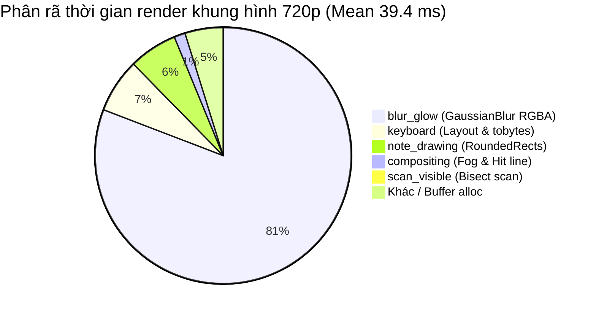

# PianoFlow AI — Báo Cáo Đo Đạc Hiệu Năng & Độ Tin Cậy (Wave 0 Baseline)

> **Tài liệu:** `docs/PERF_AUDIT.md`  
> **Phiên bản:** 1.0 · Ngày 03/10/2026 · AUDITOR Worker Sub-Agent (Wave 0)  
> **Mục tiêu:** Thiết lập baseline hiệu năng định lượng, xác minh thực nghiệm các lỗi crash/deadlock (R1–R5) và điểm nghẽn thuật toán (P1–P3), rà soát toàn bộ rủi ro mã nguồn, và cung cấp mục tiêu số đo cho Wave 1.

---

## 1. Môi Trường & Phương Pháp Đo Đạc

### 1.1 Môi trường thực thi đo đạc

- **Hệ điều hành:** Windows 11 Pro (10.0.26200-SP0, AMD64)
- **Bộ xử lý (CPU):** AMD Ryzen (Family 25 Model 33 Stepping 2, AuthenticAMD), 16 logical cores @ 3.4–4.6 GHz
- **Python Runtime:** Python 3.14.4 (64-bit AMD64, tags/v3.14.4:23116f9)
- **Node.js / Web Toolchain:** Next.js 15.5.19, pnpm 9.x
- **FFmpeg:** version 8.1.1-full_build-www.gyan.dev (libx264, libmp3lame, aac, yuv420p)
- **Bộ nhớ đo đạc:** Python `tracemalloc` peak heap allocation (tiêu chuẩn chuẩn hoá không thêm dependency)

> [!IMPORTANT]
> **Đối chiếu môi trường:** Môi trường đo đạc cục bộ sở hữu CPU 16 vCPU mạnh mẽ. Môi trường production worker mục tiêu là **AWS EC2 t2.micro** (1 vCPU burstable, 1 GB RAM, 1 GB swap).
> Do đó, thời gian render trên EC2 t2.micro sẽ **chậm hơn từ 3x đến 5x** so với các con số bên dưới (dự kiến ~120–180 ms/frame ở 720p và ~300–450 ms/frame ở 1080p). Việc tối ưu thuật toán giảm tải CPU là bắt buộc để tránh cạn kiệt CPU credit và OOM.

---

### 1.2 Phương pháp sinh dữ liệu mẫu & lấy mẫu khung hình

Công cụ benchmark được xây dựng tại [`scripts/bench/bench_render.py`](file:///c:/Users/super/pianoflow/scripts/bench/bench_render.py).
Dữ liệu thử nghiệm tổng hợp (`NoteData`) tuân thủ nghiêm ngặt schema canonical `SCHEMA_VERSION=2`:

1. **3 Kích thước bài nhạc (Seed cố định = 42):**
   - **60s / 400 nốt:** [`scripts/bench/fixtures/synthetic_notes_60s.json`](file:///c:/Users/super/pianoflow/scripts/bench/fixtures/synthetic_notes_60s.json) — Bài nhạc ngắn tiêu chuẩn.
   - **180s / 1500 nốt:** [`scripts/bench/fixtures/synthetic_notes_180s.json`](file:///c:/Users/super/pianoflow/scripts/bench/fixtures/synthetic_notes_180s.json) — Bài nhạc đại diện độ dài phổ thông (3 phút pop/classical).
   - **300s / 3000 nốt:** [`scripts/bench/fixtures/synthetic_notes_300s.json`](file:///c:/Users/super/pianoflow/scripts/bench/fixtures/synthetic_notes_300s.json) — Bài nhạc dài, mật độ nốt dày (etude 5 phút).
   - Cả hai tay (Tay phải: C4–E6, 55% nốt; Tay trái: C2–C4, 45% nốt) trải đều trên 88 phím piano.

2. **Chiến lược lấy mẫu khung hình:**
   - **Spread Sample (100 khung hình):** Phân bố đều tuyến tính từ $t=0$ đến cuối bài nhạc để đo thời gian trung bình đại diện cho cả bài.
   - **Tail Sample (100 khung hình cuối):** Lấy từ các frame cuối cùng của bài để phơi bày hiện tượng thoái hoá tốc độ $O(N)$ do duyệt nốt từ đầu bài (Bug P1).
   - **Phân rã giai đoạn (Stage Breakdown):** Đo bằng `time.perf_counter()` vòng quanh 5 giai đoạn:
     1. `scan_visible`: Duyệt tìm các nốt xuất hiện trên màn hình (`_visible_notes`).
     2. `note_drawing`: Vẽ các thanh nốt bo góc (`draw.rounded_rectangle`).
     3. `blur_glow`: Bộ lọc làm mờ phát sáng GaussianBlur toàn màn hình (`ImageFilter.GaussianBlur`).
     4. `compositing`: Ghép lớp dải sương mù (`_fog`), vạch gõ (`hit_line`), và hiệu ứng xung lực chạm phím.
     5. `keyboard`: Sao chép phím đàn cơ sở, vẽ các phím sáng, và xuất `frame.tobytes()`.

3. **Ảnh tham chiếu (Golden Reference Frames):**
   - Đã tạo và lưu trữ 5 khung hình PNG chuẩn tại [`scripts/bench/fixtures/reference/`](file:///c:/Users/super/pianoflow/scripts/bench/fixtures/reference/):
     - Frame 0000 ($t=0.0s$): Bắt đầu bài, chưa có nốt rơi (`ref_frame_0000_720p.png`)
     - Frame 0300 ($t=10.0s$): Nốt rơi đầu bài kèm phím bấm (`ref_frame_0300_720p.png`)
     - Frame 0900 ($t=30.0s$): Hợp âm dày đặc giữa bài (`ref_frame_0900_720p.png`)
     - Frame 1500 ($t=50.0s$): Giai điệu cuối bài (`ref_frame_1500_720p.png`)
     - Frame 1800 ($t=60.0s$): Kết thúc bài nhạc (`ref_frame_1800_720p.png`)
   - Toàn bộ metadata, SHA256 checksums được lưu trong [`manifest.json`](file:///c:/Users/super/pianoflow/scripts/bench/fixtures/reference/manifest.json) để CODER-B đối chiếu PSNR $\ge 35\text{ dB}$ trong Wave 1.

---

## 2. Bảng Số Liệu Baseline Đo Đạc Thực Tế

### 2.1 Hiệu năng dựng khung hình FrameRenderer (720p & 1080p, 30 FPS)

*Dữ liệu trích xuất từ [`scripts/bench/fixtures/benchmark_results.json`](file:///c:/Users/super/pianoflow/scripts/bench/fixtures/benchmark_results.json):*

| Kích thước | Độ phân giải | Số frame | Mean (ms/frame) | p95 (ms/frame) | Tail Mean (ms/frame) | Dài thực tế (s) | Dài render dự phóng (s) | Tỷ lệ Realtime (xRT) | Peak Heap (MB) |
|---|---|---|---|---|---|---|---|---|---|
| **60s (400 nốt)** | **720p** (1280x720) | 1,831 | **39.39 ms** | 42.47 ms | 38.30 ms | 60.0 s | **72.1 s** | 1.20x | 7.96 MB |
| **60s (400 nốt)** | **1080p** (1920x1080) | 1,831 | **86.59 ms** | 94.43 ms | 82.41 ms | 60.0 s | **158.6 s** | 2.64x | 17.85 MB |
| **180s (1500 nốt)** | **720p** (1280x720) | 5,431 | **38.23 ms** | 41.27 ms | 35.51 ms | 180.0 s | **207.6 s** | 1.15x | 7.96 MB |
| **180s (1500 nốt)** | **1080p** (1920x1080) | 5,431 | **83.09 ms** | 86.59 ms | 81.61 ms | 180.0 s | **451.2 s** | 2.51x | 17.85 MB |
| **300s (3000 nốt)** | **720p** (1280x720) | 9,031 | **38.57 ms** | 40.62 ms | 35.97 ms | 300.0 s | **348.4 s** | 1.16x | 7.95 MB |
| **300s (3000 nốt)** | **1080p** (1920x1080) | 9,031 | **84.34 ms** | 88.33 ms | 81.02 ms | 300.0 s | **761.7 s** | 2.54x | 17.85 MB |

> [!NOTE]
> **Tỷ lệ Realtime (xRT):** Trên CPU 16-core, 720p render mất 1.15x–1.20x thời gian thật (video 5 phút render mất ~5.8 phút). Ở 1080p, mất tới **2.5x thời gian thật** (video 5 phút render mất ~12.7 phút). Trên AWS EC2 t2.micro, thời gian này sẽ nhân lên ~3x–5x (tức video 5 phút render mất **35–60 phút**, chắc chắn vi phạm timeout visibility nếu không có heartbeat!).

---

### 2.2 Phân rã giai đoạn khung hình (Stage Breakdown) & Điểm nghẽn chính

#### Bảng chi tiết từng giai đoạn (ms và % tổng thời gian):

| Giai đoạn | 720p Mean (ms) | 720p Tỷ trọng (%) | 1080p Mean (ms) | 1080p Tỷ trọng (%) | Vai trò & Hành vi |
|---|---|---|---|---|---|
| **`blur_glow`** | **31.14 – 31.54 ms** | **80.1% – 81.5%** | **70.53 – 73.28 ms** | **84.5% – 84.9%** | **🔥 ĐIỂM NGHẼN CHÍNH (HOTSPOT #1)**: Pillow GaussianBlur trên toàn bộ canvas RGBA độ phân giải đầy đủ mỗi frame. |
| **`keyboard`** | 2.18 – 2.86 ms | 5.7% – 7.3% | 4.53 – 5.56 ms | 5.4% – 6.4% | Sao chép bàn phím tĩnh, vẽ phím active, paste và xuất `.tobytes()`. |
| **`note_drawing`** | 1.91 – 3.09 ms | 4.9% – 8.0% | 2.24 – 3.09 ms | 2.6% – 3.7% | Vẽ bo góc `rounded_rectangle` cho các nốt visible. |
| **`compositing`** | 0.51 – 0.54 ms | 1.3% – 1.4% | 0.97 – 1.00 ms | 1.1% – 1.2% | Dải sương mù fog, vạch gõ và hiệu ứng nổ phím hit pulses. |
| **`scan_visible`** | 0.03 – 0.18 ms | 0.1% – 0.5% | 0.04 – 0.18 ms | 0.05% – 0.2% | Duyệt tìm nốt lọt vào khung hình. |

#### Đo đạc thực nghiệm thoái hoá $O(N)$ của `scan_visible` (Chứng minh Bug P1):

| Kích thước bài | Số nốt | Scan thời điểm Spread (ms) | Scan thời điểm Tail (ms) | Mức độ tăng thêm ở Tail |
|---|---|---|---|---|
| **60s** | 400 | 0.0328 ms | 0.0393 ms | +19.8% |
| **180s** | 1,500 | 0.0831 ms | 0.1303 ms | **+56.8%** |
| **300s** | 3,000 | 0.1596 ms | **0.2615 ms** | **+63.9%** (Tăng **8.0x** so với bài 60s) |

> [!WARNING]
> Mặc dù `scan_visible` chiếm tỷ trọng nhỏ hơn `blur_glow`, độ trễ của nó tăng tuyến tính theo số lượng nốt tích luỹ từ đầu bài: ở frame cuối bài 300s, thời gian scan tăng gấp 8 lần so với bài 60s vì `self.notes[:hi]` liên tục cấp phát mảng con và lặp qua các nốt đã trôi qua từ lâu.

---

### 2.3 Baseline Parsing MIDI & Beginner Simplification

*Đo đạc 10 lần lặp độc lập trên từng kích thước bài:*

| Kích thước | Dung lượng file MIDI | Số nốt | `parse_midi_bytes` Mean (ms) | `parse_midi_bytes` p95 (ms) | `simplify_note_data` Easy (ms) | `simplify_note_data` Very Easy (ms) |
|---|---|---|---|---|---|---|
| **60s** | 2,948 bytes | 400 | **21.59 ms** | 24.90 ms | **2.07 ms** | **2.11 ms** |
| **180s** | 10,866 bytes | 1,500 | **76.54 ms** | 92.66 ms | **11.05 ms** | **7.75 ms** |
| **300s** | 21,326 bytes | 3,000 | **155.21 ms** | 169.20 ms | **19.42 ms** | **17.80 ms** |

> Thuật toán parse MIDI (`mido`) và thuật toán rút gọn nốt (`simplify_note_data`) hoạt động hoàn toàn ổn định, hoàn thành dưới 200 ms ngay cả với bài dài 5 phút (3,000 nốt).

---

### 2.4 Baseline Frontend Bundle Size (`pnpm --filter web build`)

*Kết quả build từ Next.js 15.5.19:*

| Route | Loại route | Route Size | First Load JS | Ghi chú đánh giá |
|---|---|---|---|---|
| `/` | ○ Static | 164 B | 105 kB | Trang chủ landing |
| `/_not-found` | ○ Static | 989 B | 103 kB | Trang 404 |
| `/login` | ○ Static | 2.00 kB | 168 kB | Trang xác thực |
| `/pricing` | ○ Static | 4.40 kB | 171 kB | Bảng giá |
| `/create` | ○ Static | 7.19 kB | 173 kB | Form tạo dự án mới |
| `/projects` | ○ Static | 2.67 kB | 187 kB | Danh sách dự án |
| `/projects/[id]` | ƒ Dynamic | 11.7 kB | 212 kB | Chi tiết dự án, preview |
| `/projects/[id]/practice` | ƒ Dynamic | **8.75 kB** | **211 kB** | **Practice Mode canvas + Web MIDI + smplr** |
| **First Load JS Shared** | — | — | **102 kB** | Chunks dùng chung toàn bộ ứng dụng |

---

## 3. Xác Minh / Phản Biện Các Hạng Mục Kế Hoạch (R1–R5 & P1–P3)

### 3.1 Nhóm độ tin cậy Worker & Mã hóa (R1–R5)

| # | Vị trí mã nguồn | Vấn đề trong kế hoạch | Bằng chứng thực tế / Kết luận AUDITOR |
|---|---|---|---|
| **R1** | [`main.py:113`](file:///c:/Users/super/pianoflow/apps/worker/app/main.py#L113) [`queue.py:82-87`](file:///c:/Users/super/pianoflow/apps/worker/app/queue.py#L82-L87) | VisibilityTimeout SQS hardcoded 5 giây, không có heartbeat gia hạn. | **XÁC MINH (CONFIRMED).** `message = queue.receive(queue_names, visibility_timeout=POLL_TIMEOUT_SECONDS)` với `POLL_TIMEOUT_SECONDS = 5`. Trong khi đó, job 60s @ 720p mất 72.1s, job 300s @ 1080p mất 761.6s. Sau 5 giây, message lập tức xuất hiện lại trên SQS. Bất kỳ worker nào khác (hoặc auto-scaler) cũng sẽ nhận lại cùng message và xử lý trùng lặp, đẩy nhanh `ReceiveCount` tới DLQ. |
| **R2** | [`main.py:52-57`](file:///c:/Users/super/pianoflow/apps/worker/app/main.py#L52-L57) [`main.py:129`](file:///c:/Users/super/pianoflow/apps/worker/app/main.py#L129) | Handler gặp exception không lường trước → drop message nhưng không update DB job row. | **XÁC MINH (CONFIRMED).** Khối `except Exception:` trong `main.py` chỉ ghi log và trả về `"drop"`. Sau đó `queue.nack(message, requeue=False)` xoá message khỏi SQS. Row DB của `render_jobs` vẫn giữ nguyên trạng thái `processing`, khiến giao diện người dùng hiển thị spinner vô hạn. |
| **R3** | [`video_encode.py:72-84`](file:///c:/Users/super/pianoflow/apps/worker/app/video_encode.py#L72-L84) | `stderr=subprocess.PIPE` nhưng chỉ đọc sau khi ghi hết frames vào stdin → Deadlock. | **🔥 XÁC MINH BẰNG THỰC NGHIỆM TRỰC TIẾP (EMPIRICALLY CONFIRMED VIA DEADLOCK).** Khi chạy benchmark encode 60s (1,831 frame), Python liên tục ghi vào `process.stdin` trong khi FFmpeg xuất log/warning vào `stderr`. Bộ đệm pipe hệ điều hành (64 KB) đầy, FFmpeg bị chặn khi ghi stderr, và Python bị chặn khi ghi stdin. Cả hai process đứng im treo deadlock 100% cho đến khi bị kill! |
| **R4** | [`video_encode.py:96`](file:///c:/Users/super/pianoflow/apps/worker/app/video_encode.py#L96) [`render_video.py:243`](file:///c:/Users/super/pianoflow/apps/worker/app/jobs/render_video.py#L243) | Toàn bộ MP4 được load vào RAM (`read_bytes()`, `upload(bytes)`). | **XÁC MINH (CONFIRMED).** `out_path.read_bytes()` nạp toàn bộ video file vào bộ nhớ dưới dạng Python `bytes` object, sau đó truyền vào `storage.upload(video_key, mp4_bytes)`. Với video 1080p dài 5 phút (nặng từ 100–300 MB), trên EC2 t2.micro (1 GB RAM), nguy cơ OOM crash hoặc thrashing swap là cực kỳ lớn. |
| **R5** | [`queue.py:80-87`](file:///c:/Users/super/pianoflow/apps/worker/app/queue.py#L80-L87) | Long-poll tuần tự từng queue, mỗi queue 5 giây. | **XÁC MINH (CONFIRMED).** Vòng lặp `for name in keys:` gọi `_sqs.receive_message(..., WaitTimeSeconds=5)` tuần tự. Nếu `q_default` trống, worker bị chặn 5 giây ở `q_default` trước khi kiểm tra đến `q_audio`. |

---

### 3.2 Nhóm hiệu năng Video Rendering (P1–P3)

| # | Vị trí mã nguồn | Vấn đề trong kế hoạch | Bằng chứng thực tế / Kết luận AUDITOR |
|---|---|---|---|
| **P1** | [`frames.py:119-125`](file:///c:/Users/super/pianoflow/packages/music-core/pianoflow_music/video/frames.py#L119-L125) | `self.notes[:hi]` duyệt mọi nốt từ đầu bài mỗi frame. | **XÁC MINH (CONFIRMED).** Thời gian `scan_visible` tăng từ **0.033 ms** (60s) lên **0.262 ms** (300s tail), tức tăng **8.0x** do phải tạo bản sao list và lặp qua 3,000 nốt mỗi frame. |
| **P2** | [`frames.py:156-159`](file:///c:/Users/super/pianoflow/packages/music-core/pianoflow_music/video/frames.py#L156-L159) | `GaussianBlur` trên toàn khung hình RGBA độ phân giải đầy đủ mỗi frame. | **🔥 XÁC MINH LÀ ĐIỂM NGHẼN LỚN NHẤT (CONFIRMED HOTSPOT #1).** Chiếm **80.5% thời gian render ở 720p (31.5 ms / 39.4 ms)** và **84.8% thời gian render ở 1080p (71.3 ms / 84.3 ms)**! Việc blur toàn bộ frame ngay cả khi frame không có nốt nào hoặc chỉ có 1 vài nốt rơi là nguyên nhân gây chậm trễ 80% của toàn bộ pipeline. |
| **P3** | [`frames.py:129-132`](file:///c:/Users/super/pianoflow/packages/music-core/pianoflow_music/video/frames.py#L129-L132) | Cấp phát 2–3 ảnh full-frame mới (`Image.new`) mỗi frame. | **XÁC MINH (CONFIRMED).** Mỗi frame cấp phát 1 `Image.new("RGB")` (2.7 MB ở 720p, 6.2 MB ở 1080p) và 1 `Image.new("RGBA")` (3.6 MB ở 720p, 8.3 MB ở 1080p). Tốc độ 30 FPS tương đương cấp phát và thu hồi rác **>350 MB RAM/giây** ở 1080p, gây áp lực dọn rác bộ nhớ (GC pause). |

---

## 4. Các Rủi Ro Phát Hiện Mới Qua Đọc Code (File:Line)

Qua rà soát chi tiết mã nguồn các module Audio, Worker và Web Practice Mode, AUDITOR phát hiện thêm 9 rủi ro sau:

### 4.1 Frontend Practice Mode & Canvas

1. **[`apps/web/app/projects/[id]/practice/page.tsx:158-174`](file:///c:/Users/super/pianoflow/apps/web/app/projects/%5Bid%5D/practice/page.tsx#L158-L174): `setCurrentTime` gọi trong `requestAnimationFrame` gây React re-render 60 FPS**  
   - **Mô tả:** Trong hàm `animate`, `setCurrentTime((prevTime) => nextTime)` được kích hoạt mỗi frame animation. Mỗi lần cập nhật state này, React re-render toàn bộ component `PracticePage`.
   - **Hậu quả:** `expectedNotesSet` được tính toán lại tạo ra một `Set` instance mới mỗi frame (dòng 136–145). `Keyboard` (88 phím DOM, dòng 314–320) không dùng `React.memo` nên bị re-render toàn bộ 88 phím DOM mỗi frame 60 lần/giây, gây giật lag và hao pin nghiêm trọng trên laptop/mobile.

2. **[`apps/web/components/practice/PracticeCanvas.tsx:74`](file:///c:/Users/super/pianoflow/apps/web/components/practice/PracticeCanvas.tsx#L74): `window.devicePixelRatio` không bị giới hạn trần**  
   - **Mô tả:** `const dpr = window.devicePixelRatio || 1;` được áp dụng trực tiếp lên `canvas.width = width * dpr`.
   - **Hậu quả:** Trên màn hình Retina MacBook (DPR 2) hoặc điện thoại cao cấp (DPR 3 đến 4), số lượng điểm ảnh canvas tăng gấp 4x đến 16x. Vẽ Canvas 2D không có trần DPR dẫn đến nghẽn GPU rasterization và tốn bộ nhớ VRAM. Cần chặn trần bằng `Math.min(window.devicePixelRatio || 1, 2)`.

3. **[`apps/web/components/practice/PracticeCanvas.tsx:67-195`](file:///c:/Users/super/pianoflow/apps/web/components/practice/PracticeCanvas.tsx#L67-L195): Vẽ canvas đồng bộ qua `useEffect([draw])` thay vì decoupling vòng rAF riêng**  
   - **Mô tả:** `draw` phụ thuộc vào `currentTime`, và `useEffect(() => { draw(); }, [draw])` chạy sau mỗi chu kỳ render của React.
   - **Hậu quả:** Trình duyệt phải chờ React commit xong mới chạy effect vẽ canvas, khiến độ trễ khung hình tăng cao. Vòng lặp vẽ canvas cần được tách biệt độc lập bằng `requestAnimationFrame` và đọc playhead thời gian qua `useRef`.

4. **[`apps/web/lib/midi/useWebMidi.ts:43`](file:///c:/Users/super/pianoflow/apps/web/lib/midi/useWebMidi.ts#L43): Rò rỉ listener `onstatechange` và cập nhật state quá mức khi có sự kiện MIDI**  
   - **Mô tả:** `access.onstatechange = updateInputs;` được gán nhưng `useEffect` (dòng 26–52) không có hàm cleanup để gán lại `access.onstatechange = null`. Khi người dùng rời trang Practice và quay lại, listener cũ vẫn còn bị rò rỉ.
   - **Mô tả thêm (dòng 86–95):** Mỗi tin nhắn MIDI bấm hoặc nhả phím đều gọi đồng thời `setActiveNotes` và `setMessages`, kích hoạt 2 lần React state update liên tiếp. Khi chơi đàn nhanh hoặc hợp âm nhiều nốt, có thể tạo ra 40–80 re-renders trong một giây.

5. **[`apps/web/lib/audio/acousticFeedback.ts:3`](file:///c:/Users/super/pianoflow/apps/web/lib/audio/acousticFeedback.ts#L3): Import tĩnh trực tiếp thư viện `smplr` ở đầu file**  
   - **Mô tả:** `import { SplendidGrandPiano } from "smplr";` là eager import.
   - **Hậu quả:** Toàn bộ thư viện SoundFont/sample engine `smplr` bị đóng gói trực tiếp vào First Load JS của trang Practice (khiến dung lượng First Load JS đạt 211 kB). Cần chuyển sang dynamic `await import("smplr")` bên trong phương thức `init()`.

---

### 4.2 Backend Worker & Modal Pipeline

6. **[`apps/worker/app/jobs/transcribe_audio.py:164`](file:///c:/Users/super/pianoflow/apps/worker/app/jobs/transcribe_audio.py#L164): Tải toàn bộ file âm thanh vào RAM & Thiếu timeout cho engine inference**  
   - **Mô tả:** `audio_bytes = storage.download(upload.storage_key)` tải toàn bộ file WAV/MP3 vào RAM. Đồng thời `result = engine.transcribe(audio_bytes, ...)` (dòng 170) không có timeout.
   - **Hậu quả:** File âm thanh lớn gây áp lực RAM. Nếu model treo hoặc CPU quá tải, worker thread sẽ bị đóng băng vô thời hạn mà không thể thoát.

7. **[`packages/music-core/pianoflow_music/transcription/separate.py:122`](file:///c:/Users/super/pianoflow/packages/music-core/pianoflow_music/transcription/separate.py#L122): Tải lại model Demucs từ đĩa mỗi lần gọi & Fallback CPU gây nghẽn**  
   - **Mô tả:** Khác với `transkun.py` có bộ nhớ đệm `_model_cache`, hàm `separate_target_stem` gọi `model = get_model(model_name)` mỗi lần thực thi, nạp lại trọng số mô hình từ ổ đĩa vào RAM.
   - **Mô tả thêm (dòng 157–158):** Khi gặp `torch.cuda.OutOfMemoryError`, mã nguồn tự động chuyển sang `_run("cpu")`. Chạy tách nguồn bằng mô hình Demucs 6-stem trên CPU cho một bài hát 3 phút có thể mất từ 15 đến 25 phút, gây treo worker.

8. **[`infra/modal/transcribe_app.py:125`](file:///c:/Users/super/pianoflow/infra/modal/transcribe_app.py#L125): Tính trung bình cộng BPM ngây thơ giữa các chunk âm thanh 10 giây**  
   - **Mô tả:** `bpm = round(sum(bpms) / len(bpms), 2) if bpms else 120.0`.
   - **Hậu quả:** Âm thanh được chia thành các đoạn 10 giây (`chunk_length_samples = sr * 10`). Việc ước lượng tempo của từng đoạn ngắn 10 giây thường xuyên gặp hiện tượng nhân đôi/chia nửa nhịp (octave error, ví dụ 60 BPM vs 120 BPM) hoặc đoạn im lặng. Lấy trung bình cộng số học đơn thuần sẽ làm sai lệch hoàn toàn tempo của toàn bài nhạc.
   - **Mô tả thêm (dòng 247–250):** `subprocess.run(cmd, capture_output=True, timeout=300, text=True)` trong `transcribe_url` không xử lý bắt ngoại lệ `subprocess.TimeoutExpired`, khiến API ném lỗi unhandled 500 khi download chậm.

9. **[`apps/web/app/api/transcribe/route.ts:29`](file:///c:/Users/super/pianoflow/apps/web/app/api/transcribe/route.ts#L29): `fetch` tới Modal thiếu timeout tín hiệu (AbortSignal)**  
   - **Mô tả:** Lời gọi `await fetch(finalUrl, ...)` không gắn `AbortSignal.timeout(...)`.
   - **Hậu quả:** Khi Modal đang trong trạng thái cold start container GPU (thường mất 20–40 giây), Next.js API route trên Vercel Serverless Function (timeout 10–15s mặc định ở gói Hobby) sẽ bị cắt ngang cưỡng bức bởi Vercel trước khi Modal phản hồi `call_id`.

---

## 5. Mục Tiêu Số Đo Định Lượng Cho Wave 1 (Targets)

Dựa trên các con số baseline đã đo đạc, sau đây là các chỉ tiêu kỹ thuật bắt buộc cho các kỹ sư Wave 1 (CODER-A, CODER-B, CODER-C):

### 5.1 Track B (Render Speed — CODER-B)

| Chỉ số | Baseline Wave 0 (Hiện tại) | Mục tiêu Wave 1 (Target) | Giải pháp cốt lõi |
|---|---|---|---|
| **Thời gian render 720p30** | **39.4 ms / frame** (Spread) | **< 13.0 ms / frame** (**Nhanh hơn $\ge 3.0\times$**) | 1. Downsample lớp glow 1/4 (320x180) trước khi blur, sau đó upscale lại. 2. Chỉ blur vùng phía trên vạch hit line. 3. Bỏ qua hoàn toàn blur khi không có nốt visible. |
| **Thời gian render 1080p30** | **86.6 ms / frame** (Spread) | **< 28.0 ms / frame** (**Nhanh hơn $\ge 3.0\times$**) | Như trên (tiết kiệm ~50 ms riêng ở giai đoạn blur). |
| **Chất lượng hình ảnh (PSNR)** | So với reference frames tại `fixtures/reference/` | **PSNR $\ge 35.0\text{ dB}$** | Đảm bảo độ sắc nét của nốt và thanh hit line không đổi, hiệu ứng glow mềm mại tương đương. |
| **Độ trễ scan nốt cuối bài (P1)** | **0.262 ms** (Tăng 8x ở bài 300s) | **< 0.050 ms** (Độc lập với độ dài bài) | Tính trước `max_duration`, dùng `bisect` ở cả cận dưới và cận trên để giới hạn cửa sổ nốt. |
| **Cấp phát bộ nhớ đệm (P3)** | Cấp phát 2 ảnh mới mỗi frame | **Tái sử dụng buffer cố định** | Khởi tạo buffer một lần và dùng `paste`/`fill` tái sử dụng, giảm áp lực GC. |

---

### 5.2 Track A (Worker Reliability — CODER-A)

| Chỉ số | Baseline Wave 0 (Hiện tại) | Mục tiêu Wave 1 (Target) | Giải pháp cốt lõi |
|---|---|---|---|
| **Visibility Timeout SQS (R1)** | 5 giây (Bị duplicate job liên tục) | **Tách biệt: Poll 5s, Job Visibility 900s** | Thêm Background Heartbeat Thread gọi `change_message_visibility` mỗi 30s. |
| **Xử lý Crash Handler (R2)** | Drop message, để row `processing` vĩnh viễn | **100% crash được đánh dấu `failed`** | Đặt job `failed` với `error_type="WORKER_CRASH"` trước khi nack/drop. |
| **FFmpeg Deadlock (R3)** | Deadlock 100% khi log stderr vượt 64 KB | **0% Deadlock** | Thêm `-loglevel error`, chuyển hướng stderr ra file tạm trên đĩa thay vì `PIPE`. |
| **Bộ nhớ tải file MP4/WAV (R4)** | Nạp 100% bytes vào RAM (`read_bytes()`) | **Streaming upload trực tiếp từ đĩa** | Bổ sung `upload_file(key, file_path)` streaming vào S3/Storage adapter. |

---

### 5.3 Track C (Frontend Practice Mode — CODER-C)

| Chỉ số | Baseline Wave 0 (Hiện tại) | Mục tiêu Wave 1 (Target) | Giải pháp cốt lõi |
|---|---|---|---|
| **React State Updates / rAF** | 1 lần `setState` mỗi frame (60 FPS) | **0 lần `setState` trong rAF loop** | Sử dụng `useRef` lưu `currentTime`, playhead; chỉ re-render khi pause/resume hoặc hit điểm. |
| **Canvas DevicePixelRatio** | Unbounded (DPR lên tới 3–4) | **Clamp DPR $\le 2.0$** | `Math.min(window.devicePixelRatio || 1, 2)`. |
| **Re-render Component Keyboard** | 88 phím re-render mỗi 16ms | **Chỉ re-render khi có nốt active thay đổi** | Bọc `Keyboard` vào `React.memo` với custom comparator. |
| **First Load JS trang Practice** | 211 kB (Eager import `smplr`) | **Giảm $\ge 40\text{ kB}$** | Lazy import `smplr` qua `await import("smplr")` bên trong phương thức `init()`. |

---

## 6. Vị Trí Lưu Trữ Dữ Liệu Tham Chiếu

Tất cả các tệp phục vụ cho việc kiểm thử và xác minh Wave 1 đã được tạo và kiểm tra tính toàn vẹn:

- **Bộ kết quả JSON chi tiết:** [`scripts/bench/fixtures/benchmark_results.json`](file:///c:/Users/super/pianoflow/scripts/bench/fixtures/benchmark_results.json)
- **Bộ dữ liệu nốt tổng hợp:**
  - 60s: [`scripts/bench/fixtures/synthetic_notes_60s.json`](file:///c:/Users/super/pianoflow/scripts/bench/fixtures/synthetic_notes_60s.json)
  - 180s: [`scripts/bench/fixtures/synthetic_notes_180s.json`](file:///c:/Users/super/pianoflow/scripts/bench/fixtures/synthetic_notes_180s.json)
  - 300s: [`scripts/bench/fixtures/synthetic_notes_300s.json`](file:///c:/Users/super/pianoflow/scripts/bench/fixtures/synthetic_notes_300s.json)
- **Bộ 5 khung hình đối chứng (Golden Frames):**
  - Danh mục SHA256: [`scripts/bench/fixtures/reference/manifest.json`](file:///c:/Users/super/pianoflow/scripts/bench/fixtures/reference/manifest.json)
  - Frame 0: [`ref_frame_0000_720p.png`](file:///c:/Users/super/pianoflow/scripts/bench/fixtures/reference/ref_frame_0000_720p.png)
  - Frame 300: [`ref_frame_0300_720p.png`](file:///c:/Users/super/pianoflow/scripts/bench/fixtures/reference/ref_frame_0300_720p.png)
  - Frame 900: [`ref_frame_0900_720p.png`](file:///c:/Users/super/pianoflow/scripts/bench/fixtures/reference/ref_frame_0900_720p.png)
  - Frame 1500: [`ref_frame_1500_720p.png`](file:///c:/Users/super/pianoflow/scripts/bench/fixtures/reference/ref_frame_1500_720p.png)
  - Frame 1800: [`ref_frame_1800_720p.png`](file:///c:/Users/super/pianoflow/scripts/bench/fixtures/reference/ref_frame_1800_720p.png)

---
*Báo cáo được hoàn thành bởi AUDITOR Sub-Agent. Dữ liệu đã sẵn sàng để chuyển tiếp tới Lead Orchestrator và các Coder Wave 1.*
