# PianoFlow AI — Development Roadmap & Phased Execution Plan

> Version: 2.0 (Post-Audit Strategic Roadmap)  
> Status: Active Engineering Roadmap  
> Last updated: October 2026  

---

## 1. Project Phase Status & Historical Assessment

| Phase | Description | Status | Audit Findings & Delivery Notes |
|---|---|---|---|
| **Phase 1** | Product & System Design | **Completed** | Full documentation baseline established. |
| **Phase 2** | Monorepo Setup | **Completed** | `uv` workspaces, `pnpm` monorepo, FastAPI backend, Next.js frontend, Docker Compose. |
| **Phase 3** | MIDI Upload & Parser | **Completed** | Two-phase presigned upload, MIDI validation (magic bytes, size, song duration caps), `NoteData` extraction. |
| **Phase 4** | Piano Roll Preview | **Completed** | Canvas-based horizontal piano roll preview (`PianoRollPreview.tsx`) and TanStack Query integration. |
| **Phase 4B** | Live Preview & Visual Settings | **Completed** | Real-time vertical falling notes preview (`FallingNotePreview.tsx`), theme presets, color pickers, `smplr` SoundFont audio. |
| **Phase 5** | Job Queue & Worker | **Completed** | SQS/Redis worker loop with idempotency, exponential retry/backoff, DLQ redrive, progress reporting. |
| **Phase 6** | Sheet PDF Generation | **Completed** | Full vector Grand Staff PDF engine delivered via Phase I (`engraver.py`) replacing text fallback table. |
| **Phase 7** | Video Tutorial Generation | **Completed** | Single-timeline video pipeline: FluidSynth audio rendering + Pillow frame generation + FFmpeg H.264/AAC muxing. |
| **Phase 7C** | Video Visual Polish | **Completed** | Vertical format (9:16 Shorts/TikTok) and hit flash lines implemented. |
| **Phase 8** | Beginner Mode | **Completed** | Rule-based simplification (`simplify_midi.py`, `rules.py`): density capping and melody preservation. |
| **Phase 9** | Auth & Ownership History | **Completed** | Supabase Auth integration, user project isolation. Daily rate limiting restored in Phase A. |
| **Phase 10** | Deployment MVP ($0/mo) | **Completed** | Vercel + Supabase + Render stage completed. |
| **Phase 11** | AWS Free-Tier Showcase | **Completed** | Lambda + API Gateway + EC2 worker + S3/R2 + SQS + Terraform IaC committed and deployed in `ap-southeast-1`. |
| **Phase 12** | Audio-to-MIDI Transcription | **Superseded** | Basic Pitch ONNX replaced on web by Modal serverless GPU pipeline (Demucs v4 stem isolation + Transkun). |
| **Phase J** | Beginner Mode Simplification | **Completed** | Pure TypeScript melody-preserving chord reduction engine (`simplifyEngine.ts`), dynamic difficulty selector pill, instant client MIDI export, and Playwright E2E test suite. |
| **Phase K** | Smart Metronome & Audio Preview | **Completed** | Lookahead precision Web Audio scheduler (`metronomeEngine.ts`), Tap Tempo, beat LED flashing UI (`MetronomeControl.tsx`), and HTML5 canvas waveform auditioning player (`AudioPreviewWaveform.tsx`). |
| **Phase L** | Project Dashboard & Repertoire | **Active Spec** | Real-time search, multi-criteria status filtering (Ready, Processing, Failed), multi-attribute sorting, quick actions (Practice, Sheet, Export, Delete), routing repair (`/create`), and Playwright E2E suite. |

---

## 2. Active Execution Roadmap (Phases A through L)

```mermaid
flowchart LR
    PhaseA["Phase A (P0)\nStability & Bugfixes\n• Sync Session Fix\n• Rate Limiting\n• Test Baselines"]
    PhaseB["Phase B (P1)\nPractice Mode Engine\n• Canvas Integration\n• Live Scoring & XP\n• Wait Mode Loop"]
    PhaseC["Phase C (P2)\nMobile & UI/UX\n• Octave Pan/Zoom\n• Nav Drawer\n• WCAG 2.1 AA"]
    PhaseD["Phase D (P3)\nSheet Music (OSMD)\n• Grand Staff SVG\n• Follow Cursor\n• PDF Engraving"]
    PhaseE["Phase E (P4)\nTranscription Pipeline\n• Unified Ingestion\n• Multi-Track MIDI\n• Demucs Optim."]
    PhaseF["Phase F (P5)\nAI Piano Coaching\n• Rhythm Analytics\n• Looping Heatmaps\n• Virtual Duet"]
    PhaseG["Phase G (P6)\nExport Center & Video\n• Unified Export Hub\n• Hand-Colored Keys\n• Monorepo Tests"]
    PhaseH["Phase H (P7)\nDemo & Song Library\n• Classical Library (/demo)\n• 4 Interactive Modes\n• Browser E2E Tests"]
    PhaseI["Phase I (P8)\nVector Sheet Engraver\n• Pure Python PDF 1.4\n• Grand Staff Vectors\n• Multi-Page Scores"]
    PhaseJ["Phase J (P9)\nBeginner Mode Simplification\n• Client-Side TS Engine\n• Dynamic Practice Pill\n• Instant MIDI Export"]
    PhaseK["Phase K (P10)\nSmart Metronome & Audio Preview\n• Web Audio Lookahead\n• Tap Tempo & Beat LEDs\n• Canvas Waveform Preview"]
    PhaseL["Phase L (P11)\nProject Dashboard & Repertoire\n• Real-Time Search\n• Status Tabs & Sorting\n• Quick Actions & Modal"]

    PhaseA --> PhaseB
    PhaseB --> PhaseC
    PhaseC --> PhaseD
    PhaseD --> PhaseE
    PhaseE --> PhaseF
    PhaseF --> PhaseG
    PhaseG --> PhaseH
    PhaseH --> PhaseI
    PhaseI --> PhaseJ
    PhaseJ --> PhaseK
    PhaseK --> PhaseL
```

---

### Phase A: Stability, Test Baseline Recovery & Critical Fixes (P0 — Immediate)

- **Goal:** Eliminate all fatal runtime crashes, restore green test suites across all packages, and enforce security rate limits.
- **Tasks:**
  1. **Resolve Synchronous SQLAlchemy Session Bug:**
     - In `apps/api/app/domains/gamification/service.py` and `apps/api/app/api/v1/routers/stripe.py`, replace all asynchronous operations (`await db.execute`, `await db.commit`) with synchronous SQLAlchemy 2.0 syntax (`db.scalars(stmt)`, `db.commit()`), matching `get_db()`.
     - Add unit tests in `apps/api/tests/` covering gamification XP awards, level calculation, and Stripe checkout sessions.
  2. **Restore Daily Usage Rate Limiting:**
     - In `apps/api/app/core/rate_limit.py`, replace `if False:` with `if current >= cap:` to reactivate upload and transcription quotas.
     - Synchronize upload size test assertions in `test_audio_flow.py` with `max_audio_bytes` configuration.
  3. **Fix PyTorch Autocast Mock in music-core:**
     - In `packages/music-core/pianoflow_music/tests/test_transkun.py`, update `_make_fake_torch()` to define `fake_torch.autocast` (returning `contextlib.nullcontext`) and `fake_torch.float16 = "float16"`.
  4. **Clean Web Linter Errors:**
     - Remove or migrate root test scratch files (`test-video.js`, `test-url.js`) in `apps/web/` to `.eslintignore` or a `scripts/` directory.
     - Remove unused variables in `apps/web/lib/transcribeClient.ts`.
  5. **Correct Stripe Success Redirection:**
     - Point Stripe checkout `success_url` and `cancel_url` to the frontend web application (`${NEXT_PUBLIC_APP_URL}/projects?session_id=...`).
- **Deliverables:** `uv run ruff check .`, `pnpm -r typecheck`, `pytest` across all packages, and `eslint` passing with 0 errors.

---

### Phase B: Interactive Practice Mode & Gamification Engine (P1)

- **Goal:** Deliver a fully playable Web MIDI practice experience with falling notes, acoustic feedback, Wait Mode, and live scoring.
- **Tasks:**
  1. **Mount Falling Note Canvas in Practice Mode:**
     - Refactor `FallingNotePreview` into a modular, headless-driven `<FallingNoteCanvasEngine />` accepting an external playhead timestamp.
     - Integrate into `apps/web/app/projects/[id]/practice/PracticePage.tsx`, replacing the static placeholder card.
  2. **Connect MidiEngine to Real-Time Scoring:**
     - Remove `Math.random()` scoring; aggregate live timing metrics from `MidiEngine.ts`:
       - Perfect Hits ($\le 50\text{ ms}$), Good Hits ($\le 120\text{ ms}$), Misses ($> 120\text{ ms}$ or wrong pitch).
       - Running score rollup and combo streak multipliers (`1x`, `2x`, `3x`, `4x`).
     - Display live performance HUD (score, combo, accuracy %) atop the canvas.
  3. **Implement Wait Mode Game Loop:**
     - Introduce playhead pause state: animation freezes when approaching an upcoming chord until the user strikes the matching MIDI pitches on their keyboard.
     - Highlight target keys in ghost outline on the virtual keyboard.
  4. **Acoustic Audio Feedback on MIDI Input:**
     - Wire incoming Web MIDI note events directly to `SampledPiano` (SoundFont Web Audio synth), ensuring players hear low-latency piano notes when striking keys.
  5. **Session Completion & XP Leveling:**
     - Trigger post-session completion modal displaying metrics, XP earned, level progress, and streak increment.
     - Persist session results via `POST /api/v1/practice-sessions`.
- **Deliverables:** A user connects a MIDI keyboard, practices a song in Wait Mode or Tempo Mode, receives real-time scoring, and gains XP.

---

### Phase C: Mobile Responsiveness, Keyboard Pan/Zoom & UI/UX Polish (P2)

- **Goal:** Ensure flawless usability on mobile viewports (<768px) and achieve WCAG 2.1 AA accessibility compliance.
- **Tasks:**
  1. **Mobile Piano Keyboard (Octave Pan & Zoom):**
     - Replace full 88-key squeeze on mobile with a focused 2–3 octave viewport (default $C3$–$C5$).
     - Add sticky `[◄ Octave]` and `[Octave ►]` buttons, horizontal touch dragging, and pinch-to-zoom.
     - Implement auto-tracking camera centering the viewport on the active note cluster.
  2. **Mobile Navigation Drawer:**
     - Implement an accessible slide-over sheet drawer (`MobileNavDrawer.tsx`) in `apps/web/app/layout.tsx` for viewports `<768px`.
  3. **Accessibility Pass (WCAG 2.1 AA):**
     - Elevate secondary text contrast from `text-zinc-600` to `text-zinc-400` (`#a1a1aa`, 7.1:1 contrast).
     - Add high-contrast focus rings (`focus-visible:ring-2 focus-visible:ring-violet-500`) across all controls.
     - Add ARIA attributes (`role="application"`, `aria-label`, `aria-live="polite"`) to canvas and scoring HUD.
  4. **Dark/Light Theme Toggle:**
     - Enable full light theme support using Tailwind CSS variables and shadcn theming.
- **Deliverables:** Flawless mobile practice on iPhone/Android screens; zero WCAG 2.1 AA violations.

---

### Phase D: Interactive Sheet Music Engraving (OSMD) (P3)

- **Goal:** Replace raw text table PDFs with professional, client-rendered grand staff sheet music.
- **Tasks:**
  1. **OpenSheetMusicDisplay (OSMD) Integration:**
     - Embed OSMD in `apps/web/` to render MusicXML files into clean, vector SVG grand staves (treble and bass clefs).
  2. **Synchronized Playback Cursor:**
     - Connect the playback playhead to OSMD's score cursor, highlighting measures and notes as they sound.
     - Enable measure click-to-seek and measure looping for targeted practice.
  3. **Printable Score Export:**
     - Generate multi-page printable PDF sheet music with headers, page numbers, and measure formatting.
- **Deliverables:** Interactive sheet music viewer with real staves and 1-click printable PDF export.

---

### Phase E: Transcription Consolidation & Multi-Track Ingestion (P4)

- **Goal:** Unify the dual transcription architecture and optimize stem separation.
- **Tasks:**
  1. **Unified Ingestion Contract:**
     - Align the Modal GPU serverless runner and worker SQS transcription jobs under a common schema.
     - Expose real-time transcription stage progress (stem separation %, onset detection %, quantization) to the UI.
  2. **Multi-Track MIDI Separation:**
     - Allow users to isolate solo piano melody from multi-instrument MIDI files.
- **Deliverables:** Transparent, unified transcription progress bar with multi-track channel selection.

---

### Phase F: AI Piano Coaching & Advanced Learning (P5)

- **Goal:** Transform PianoFlow AI from a player into an intelligent, personalized piano tutor.
- **Tasks:**
  1. **Rhythm Drift Analytics:**
     - Calculate systematic rushing or dragging trends across practice sessions.
  2. **Measure Difficulty Heatmap:**
     - Visualize note accuracy per measure, highlighting challenging sections that require drill practice.
  3. **Targeted Loop Practice:**
     - Automatically configure loop boundaries around low-accuracy measures.
- **Deliverables:** Post-session analytics revealing user rhythm tendencies and automated drill recommendations.

---

### Phase G: Unified Export Center Hub & Video Tutorial Polish (P6)

- **Goal:** Consolidate all download, streaming, and export capabilities into a unified modal hub, elevate video tutorial visual aesthetics, and clean monorepo test discovery.
- **Tasks:**
  1. **Unified Export Center Hub (`ExportCenterModal.tsx`):**
     - Build accessible modal dialog mounted in `ProjectEditor.tsx` with 4 categories:
       - Video (16:9 Landscape & 9:16 Vertical TikTok/Shorts, 720p/1080p, 30/60 FPS).
       - Sheet Music (Printable Grand Staff PDF & MusicXML).
       - MIDI (Original, Easy Simplified, and Isolated Piano).
       - Audio (Acoustic Grand Piano WAV and MP3 bounce).
     - Provide one-click project link sharing with clipboard feedback.
     - Enforce `12_NO_TUTORIAL_DOWNLOAD_POLICY` (private signed streaming URLs for video).
  2. **Video Tutorial Visual Polish (`frames.py`):**
     - Hand-specific key lighting: active white/black keys illuminated with respective hand color (RH violet `#7c3aed`, LH cyan `#22d3ee`).
     - Note pitch name labels: render clean centered pitch text (e.g. "C4", "G#5") on falling bars when `show_note_names = True` ($W \ge 16\text{ px}, H \ge 18\text{ px}$).
     - Radiant vertical hit glow on active keys projecting upward into the falling note lanes.
  3. **Technical Debt & Monorepo Test Discovery:**
     - Rename duplicate test files `apps/api/tests/test_aws_adapters.py` -> `test_api_aws_adapters.py` and `apps/worker/tests/test_aws_adapters.py` -> `test_worker_aws_adapters.py` to eliminate `import file mismatch` on root `uv run pytest`.
- **Deliverables:** Cohesive Export Center dialog, broadcast-quality Synthesia videos with hand colors and note labels, and single-command root `uv run pytest` discovery.

---

### Phase H: Interactive Demo Experience & Classical Song Library Showcase (P7)

- **Goal:** Provide a zero-friction, instantly playable classical library and multi-mode showcase at `/demo` without requiring sign-up or file uploads, linked prominently from the landing page.
- **Tasks:**
  1. **Canonical Classical Song Library (`demoSongs.ts`):**
     - Construct rich `NoteData` presets for 4 classical masterpieces:
       - Für Elise (Beethoven, 130 BPM, 3/8, iconic motif E5–D#5–E5–D#5–E5–B4–D5–C5–A4, LH accompaniment, 48 notes).
       - Clair de Lune (Debussy, 50 BPM, 9/8, lush impressionist chords, Treble + Bass, 42 notes).
       - Gymnopédie No. 1 (Satie, 65 BPM, 3/4, melancholic waltz rhythm, alternating G/D bass + gentle melody, 38 notes).
       - Canon in D (Pachelbel, 75 BPM, 4/4, classical progression D-A-B-F#-G-D-G-A, 44 notes).
  2. **Interactive Demo Showcase Page (`/demo`):**
     - Replace the dead `/demo` redirect (`/upload-audio`) with a multi-mode showcase:
       - Song Selector Carousel with difficulty badges (Beginner, Intermediate, Master).
       - Mode 1: Falling Notes Visualizer (`<FallingNotePreview />`) with SoundFont audio, playhead, and tempo controls.
       - Mode 2: Interactive Practice Mode (`<PracticeCanvas />` + `<Keyboard />`) with Wait Mode/Tempo Mode, live scoring HUD, and hit sparks.
       - Mode 3: Grand Staff Sheet Music (`<SheetMusicViewer />`) with synchronized playhead cursor, zoom, and print.
       - Mode 4: AI Coaching & Practice Analytics (`<MeasureHeatmap />` + `<CoachRecommendations />`) with the bi-directional Rushing/Dragging timing gauge.
     - Quick launch into `<ExportCenterModal />`.
  3. **Landing Page CTA (`app/page.tsx`):**
     - Add "Explore Demo Library ✨" button to the Hero action row.
  4. **Playwright E2E Browser Testing (`demo_showcase.spec.ts`):**
     - Automated tests verifying route loading, song switching, mode toggles, virtual piano scoring, and screenshot captures saved to `docs/e2e/demo/`.
- **Deliverables:** Zero-barrier playable demo experience at `/demo`, 4 classical presets, hero CTA, and automated E2E browser tests with screenshots.

---

### Phase I: Professional Grand Staff Vector PDF Engraver & Sheet Music Polish (P8)

- **Goal:** Replace the temporary 42-line monospace text fallback PDF with an infinitely scalable, pure-Python vector Grand Staff PDF engraver conforming to ISO 32000-1 (PDF 1.4) standards, completely resolving the historical "Phase 6 Partial" gap without heavy external binary dependencies (MuseScore, LilyPond, Cairo).
- **Tasks:**
  1. **Pure Python Vector Grand Staff PDF Engine (`packages/music-core/pianoflow_music/sheet/engraver.py`):**
     - Emits pure PDF 1.4 vector drawing operators (`m`, `l`, `c`, `re`, `f`, `s`) and Type 1 font dictionaries.
     - Multi-page layout engine targeting standard US Letter ($612 \times 792\text{ pt}$, 0.5-inch margins) with 3 systems on Page 1 and 4 systems on Page 2+.
     - Standard 5-line Treble staff (E4–F5) and 5-line Bass staff (G2–A3) connected by a grand staff left brace and bar lines.
     - Vector glyphs for Treble Clef (G4) and Bass Clef (F3) with precision Bezier arcs.
     - Stacked fractional time signatures (4/4, 3/4, 3/8, 6/8, 9/8, Common time).
     - Rotated elliptical noteheads ($\theta = -18^\circ$, aspect ratio 1.4:1) rendered filled for quarter/eighth/sixteenth notes and hollow for half/whole notes.
     - Diatonic step mapping ($C=0, D=1, \dots, B=6$) and dynamic ledger lines for notes above/below the staff lines (including Middle C4).
     - Directional stems (up on right, down on left) and duration flags for eighth/sixteenth notes.
     - Measure numbers, tempo markings ($♩ = \text{BPM}$), and song title/composer header metadata.
  2. **Facade & Worker Integration (`pdf.py`, `render_sheet.py`):**
     - Facade function `note_data_to_pdf` and backward compatibility alias `note_data_to_simple_pdf`.
     - Worker job `render_sheet.py` records OutputFile metadata with `"source": "vector_grand_staff_engraver"`.
  3. **Frontend Integration & Export Center (`ExportCenterModal.tsx`, `SheetMusicViewer.tsx`, `/demo`):**
     - Provide direct downloads of publication-grade printable vector PDF scores across the Export Center modal, Sheet Music viewer, and Demo page.
  4. **Rigorous Verification & Test Architecture:**
     - Pure Python unit tests in `packages/music-core/pianoflow_music/tests/test_sheet.py` verifying valid PDF syntax, xref table offsets, vector operators, and multi-page pagination.
     - Playwright browser E2E test verifying Sheet Music viewing and export download triggers.
- **Deliverables:** Publication-grade vector Grand Staff PDF sheet music output, zero external dependencies, $< 35\text{ ms}$ render latency, and 100% green test suites.

---

### Phase J: Beginner Mode Simplification Engine & Dynamic Difficulty Practice (P9 — Completed)

- **Goal:** Port the conservative melody-preserving chord reduction capabilities from Python backend batch rules into a pure TypeScript client-side engine (`simplifyEngine.ts`), unlocking zero-latency dynamic difficulty toggling (`[ Original | Easy 🟢 | Very Easy 🟡 ]`) across interactive Web MIDI practice, the zero-barrier demo showcase, project arrangement preview, and instant client-side MIDI export.
- **Tasks:**
  1. **Client-Side Simplification Engine (`apps/web/lib/midi/simplifyEngine.ts`):**
     - Port conservative melody-preserving chord reduction algorithm from Python `rules.py` to pure TypeScript.
     - Algorithms:
       - `original`: 100% full polyphonic voicing.
       - `easy`: Onset grouping within 30ms window; top melody note preserved in RH, bass root preserved in LH; capping to max 2 notes per hand; removing tight dissonant intervals (<3 semitones) and octave doublings; dropping micro-notes shorter than 60ms; enforcing 120ms inter-onset density cap per hand (with melody protected).
       - `very_easy`: Single note per hand (top melody in RH, bass root in LH); dropping micro-notes shorter than 80ms; enforcing 220ms inter-onset density cap per hand (with melody protected).
     - Output: Normalized `NoteData` with updated track metadata, duration, renumbered note IDs (0..N-1), and statistics (`note_count_original`, `note_count_simplified`, `reduction_percent`).
  2. **Interactive Difficulty Selector UI Pill (`[ Original | Easy 🟢 | Very Easy 🟡 ]`):**
     - Build accessible segmented pill component with dark-first styling and active badge indicator.
     - Integrate into `apps/web/app/projects/[id]/practice/page.tsx`:
       - Add `difficulty` state: `"original" | "easy" | "very_easy"`.
       - Render difficulty selector pill in toolbar with active badge indicator.
       - Pass simplified notes dynamically into `MidiEngine`, falling notes canvas, and timeline scrubber.
       - Pass chosen `difficulty` into `createPracticeSession({ difficulty })`.
     - Integrate into `apps/web/app/demo/page.tsx`:
       - Add difficulty selector pill in Demo Mode.
       - Dynamically simplify the 4 classical demo songs (Für Elise, Clair de Lune, Gymnopédie No. 1, Canon in D) for beginners.
     - Integrate into `apps/web/components/ProjectEditor.tsx`:
       - Preview simplified arrangements directly in the falling notes canvas without requiring a worker job.
  3. **Instant MIDI Export in Export Center (`ExportCenterModal.tsx`):**
     - Allow downloading simplified MIDI arrangements directly via client-side `createMidiBlob(simplifyNoteData(...))`.
     - Display reduction percentage and note count statistics.
  4. **Rigorous Verification & Test Architecture:**
     - Pure TypeScript unit tests verifying top melody preservation, chord reduction bounds, octave/dissonance pruning, and non-empty outputs.
     - Playwright browser E2E test suite `apps/web/tests/beginner_mode.spec.ts` verifying:
       - Toggling difficulty switches active note count in the HUD.
       - Canvas updates falling notes.
       - Practice mode scoring operates cleanly on simplified chords.
       - Screenshots captured in `docs/e2e/beginner/`.
- **Deliverables:** Zero-latency client-side difficulty switcher, dynamic practice session engine hot-swapping, instant simplified MIDI downloads, and green test suite.

---

### Phase K: Smart Metronome Engine, Tap Tempo & Audio Waveform Auditioning (P10 — Active Milestone)

- **Goal:** Equip PianoFlow AI with a precision Web Audio smart metronome engine immune to UI thread lag, an intuitive Tap Tempo calculator, synchronized visual beat indicators across all practice and demo modes, and an interactive HTML5 canvas waveform auditioning player for pre-transcription audio inspection.
- **Tasks:**
  1. **Web Audio Smart Metronome Engine (`apps/web/lib/audio/metronomeEngine.ts`):**
     - Implement Chris Wilson's "Two Clocks" lookahead precision scheduler utilizing `AudioContext.currentTime` with a 25ms polling loop and 100ms lookahead horizon.
     - Dual-tone synthesizer generating piercing resonant downbeat accent clicks (1200 Hz damped sine envelope) and subdivision clicks (800 Hz).
     - Support time signatures: 4/4, 3/4, 3/8, 6/8 (with compound secondary accent on beat 4), and 2/4.
     - Implement statistical Tap Tempo estimator with outlier rejection ([180ms, 2500ms]) and weighted moving average filter clamped to [30..300 BPM].
     - Dispatch synchronized beat callbacks (`onBeat(beatNumber, isAccent)`) calibrated to exact audio hardware timestamps.
  2. **Metronome & Tempo Control UI (`apps/web/components/practice/MetronomeControl.tsx`):**
     - Build accessible dark-first toolbar pill expanding into a detailed popover with numeric BPM display, slider, steppers (`-5`, `-1`, `+1`, `+5`), Tap button, time signature selector, and volume slider.
     - Dynamic beat LED indicator dots (`● ○ ○ ○`) pulsing luminescent Cyan on accent downbeats and Violet on weak subdivisions.
     - Integrate into Practice Mode (`apps/web/app/projects/[id]/practice/page.tsx`), Classical Demo Showcase (`apps/web/app/demo/page.tsx`), and Sheet Music Viewer (`apps/web/components/sheet/SheetMusicViewer.tsx`).
  3. **Interactive Audio Waveform Preview & Auditioning Player (`apps/web/components/AudioPreviewWaveform.tsx`):**
     - Client-side decoding via `AudioContext.decodeAudioData` of uploaded or recorded audio files (`.wav`, `.mp3`, `.m4a`, `.webm`).
     - Render interactive HTML5 Canvas waveform with dual-envelope positive/negative amplitude bars and log-energy normalization.
     - Play/pause audio auditioning with scrubbable playhead, click-to-seek, hover timestamp tooltip, and audio metadata display (duration, sample rate, channels, file size).
     - Embed in `apps/web/app/create/page.tsx` directly after audio drop or microphone recording completion.
  4. **Verification & Playwright E2E Test Suite (`apps/web/tests/metronome_audio.spec.ts`):**
     - Unit tests verifying scheduler lookahead timing, meter cycling, tap tempo convergence, and canvas downsampling.
     - Browser E2E tests verifying metronome activation, BPM adjustments, Tap Tempo clicks, beat dot pulsing, and waveform rendering/scrubbing on `/create`.
     - Capture screenshots in `docs/e2e/metronome/`.
- **Deliverables:** Rock-solid timing reference across all playing modes, instant audio auditioning to prevent bad transcriptions, and 100% green Playwright test suite.

---

### Phase L: Project Dashboard Real-Time Search, Status Filtering, Sorting & Repertoire Management (P11 — Active Milestone)

- **Goal:** Transform the Project Dashboard (`apps/web/app/projects/page.tsx`) into a high-performance repertoire management hub with real-time title search, dynamic multi-status filtering tabs, 5-attribute quantitative sorting, 1-click quick actions (Practice, Sheet, Export, Delete), resilient zero-match feedback, and elimination of broken upload routing.
- **Tasks:**
  1. **Upload Routing Remediation (`apps/web/app/projects/page.tsx`):**
     - Fix dead `/upload` links (lines 112, 138) to route directly to canonical `/create`.
     - Update button ARIA labels and empty state CTA references.
  2. **Real-Time Client-Side Search & Multi-Status Filtering:**
     - Implement tokenized case-insensitive search input with inline clear button (✕) and `Escape` reset shortcut.
     - Build status pill tabs (`All`, `Ready`, `Processing`, `Failed`) with reactive badge counters reflecting current repertoire counts.
  3. **Multi-Attribute Quantitative Sorting Engine:**
     - Support 5 sorting criteria: `Newest First` (default), `Oldest First`, `Title (A-Z)`, `Duration (Longest)`, `Note Count (Most Notes)`.
     - Handle unparsed projects and null metadata gracefully.
  4. **Enhanced Project Card Quick Action Bar (`ProjectCard.tsx`):**
     - Direct 1-click links for `Practice 🎹` (`/projects/${id}/practice`) and `Sheet 🎼` (`/projects/${id}/sheet`) for ready projects.
     - Direct `Export 🚀` trigger opening `ExportCenterModal` directly in the dashboard.
     - Status-aware visual feedback for processing (`⚡ Processing...`) and failed (`⚠️ Failed`) states.
  5. **Adaptive Zero-State Resilience:**
     - Truly empty library state guiding first-time users to `/create`.
     - Zero-match search filter feedback displaying clear search details and a "Clear Filters" reset button.
  6. **Playwright E2E Browser Test Suite (`apps/web/tests/projects_dashboard.spec.ts`):**
     - DASH-E2E-01 through DASH-E2E-07 covering header routing, title search, status tabs, sorting, card quick action navigation, export modal opening, and zero-match state recovery.
     - Capture screenshots in `docs/e2e/projects/`.
- **Deliverables:** Streamlined repertoire management experience, zero 404 links, 1-click launch into practice and sheet music, and 100% green Playwright test suite.
