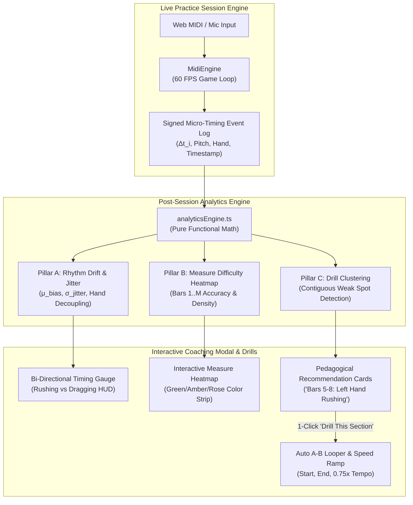
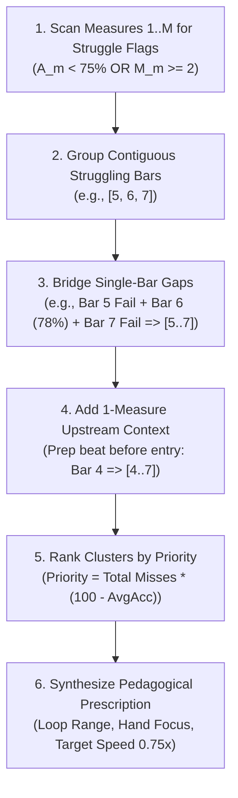

# PianoFlow AI — AI Piano Coaching & Practice Analytics Specification

> **Document ID:** `SPEC-2026-10-04-AI-COACH-ANALYTICS`  
> **Target Release:** October 2026 (Phase F Delivery)  
> **Author:** ARCHITECT Worker Sub-Agent  
> **Status:** Approved Technical Design  
> **Affected Files:**  
> - `apps/web/lib/practice/analyticsEngine.ts` *(new)*  
> - `apps/web/lib/practice/analyticsEngine.test.ts` *(new)*  
> - `apps/web/lib/midi/MidiEngine.ts` *(minor backward-compatible enhancements)*  
> - `apps/web/components/practice/MeasureHeatmap.tsx` *(new)*  
> - `apps/web/components/practice/CoachRecommendations.tsx` *(new)*  
> - `apps/web/components/practice/CoachingModal.tsx` *(new)*  
> - `apps/web/app/projects/[id]/practice/page.tsx` *(session completion & drill wiring)*  
> - `apps/web/tests/ai_coach_analytics.spec.ts` *(new Playwright E2E suite)*  

---

## 1. Executive Summary & Architectural Goals

### 1.1 From Passive Scoring to Proactive Intelligent Coaching

Modern music learning applications typically stop at passive quantitative evaluation: note-on matching, percentage accuracy counters, and arbitrary gamified experience points (XP). While motivating, passive scoring fails to provide the pedagogical guidance that human piano tutors deliver:

1. **A human tutor does not simply say "82% accuracy"** — they observe *why* the student missed notes: *"Your left hand is consistently rushing the arpeggios by 35ms ahead of the beat, forcing your right hand melody into irregular syncopation."*
2. **A human tutor isolates problematic phrases** — rather than restarting the entire song from Bar 1, they say: *"Let's loop Bars 9 through 12 at 70% speed until the bass line locks into muscle memory."*
3. **A human tutor pinpoints rhythmic bias** — identifying whether a student tends to accelerate during technically dense passages (rushing) or hesitate during chord transitions (dragging).

**Phase F (AI Piano Coaching & Advanced Practice Analytics)** bridges this critical gap. It elevates PianoFlow AI into an intelligent, data-driven tutor by capturing high-resolution micro-timing telemetry ($\pm 1\text{ms}$ precision) during Web MIDI and acoustic sessions, analyzing timing distributions across measures and hands, and synthesizing actionable, one-click drill interventions.



### 1.2 The Three Core Pillars

1. **Pillar A — Rhythm Drift & Micro-Timing Analytics:**  
   Quantitative classification of systematic timing bias (Rushing vs. Dragging in milliseconds) and timing stability (Jitter / Standard Deviation $\sigma$). Analytics are computed globally and decoupled by hand (Right Hand / Treble vs. Left Hand / Bass) to pinpoint hand-coordination imbalances.
2. **Pillar B — Measure Difficulty & Accuracy Heatmap:**  
   Partitioning musical time into discrete measures (bars) using project tempo ($BPM$) and time signature ($M_b / M_d$). Computing granular per-measure accuracy, miss counts, timing bias, and note density to render an interactive visual navigation strip.
3. **Pillar C — Automated Targeted Loop Drill Recommendations:**  
   An algorithmic clustering pipeline that scans measure metrics for contiguous failure patterns (accuracy $< 75\%$ or misses $\ge 2$), generates contextual pedagogical diagnosis, and enables single-click A-B loop isolation with automated tempo step-down.

### 1.3 Non-Negotiable Performance & Architecture Principles

- **Zero Latency Overhead During Real-Time Play:** All heavy statistical derivations (standard deviation, clustering, phrase partitioning) execute **post-session** or lazily upon session completion. The live animation loop in `MidiEngine` only records lightweight tuples (`SignedTimingEvent`), preserving the strict 60 FPS / sub-16ms frame budget.
- **Pure Functional Core:** `analyticsEngine.ts` is implemented as pure TypeScript functions with zero UI or DOM dependencies, allowing 100% deterministic unit testing with synthetic input data.
- **Seamless State Hand-off:** Clicking "Drill This Section" in the coaching modal immediately feeds parameters back into the practice page's existing A-B looper (`loopStartMs`, `loopEndMs`), tempo multiplier, and playhead position without page reloads or audio graph teardown.

---

## 2. Mathematical Formulation & Data Structures

### 2.1 Micro-Timing Delta Formulation

For each played note $i$ that matches an expected score target:
- $t_{\text{hit}, i}$: The millisecond timestamp when the key strike (Note On) was registered by the engine.
- $t_{\text{expected}, i}$: The exact millisecond start timestamp of the target note defined in the score.

The signed micro-timing delta $\Delta t_i$ is defined as:

$$\Delta t_i = t_{\text{hit}, i} - t_{\text{expected}, i} \quad (\text{in ms})$$

#### Sign Convention:
- **$\Delta t_i < 0$ (Early / Rushing):** The note was struck before the beat.
- **$\Delta t_i > 0$ (Late / Dragging):** The note was struck after the beat.
- **$\Delta t_i = 0$ (Dead Center):** Perfectly quantized hit on the exact beat.

> [!NOTE]
> Notes with $|\Delta t_i| > 150\text{ms}$ or wrong pitches are classified as `Miss` and excluded from timing bias calculations to prevent outliers from skewing micro-timing tendency metrics.

---

### 2.2 Mean Timing Bias ($\mu$) & Tendency Classification

Over $N$ successfully struck notes ($N_{\text{hits}} = N_{\text{perfect}} + N_{\text{good}}$):

$$\mu = \frac{1}{N} \sum_{i=1}^{N} \Delta t_i$$

The player's systematic timing tendency is classified according to a $\pm 15\text{ms}$ psychoacoustic pocket threshold:

| Mean Timing Bias ($\mu$) | Qualitative Classification | Pedagogical Meaning |
|---|---|---|
| **$\mu < -15\text{ms}$** | **Rushing** | Player systematically anticipates the beat, tending to accelerate through phrases. |
| **$-15\text{ms} \le \mu \le +15\text{ms}$** | **In the Pocket** | Excellent groove alignment; micro-variations hover symmetrically around the beat. |
| **$\mu > +15\text{ms}$** | **Dragging** | Player systematically falls behind the beat, hesitating or lagging during transitions. |

#### Severity Tiers:
- **Mild:** $15\text{ms} < |\mu| \le 30\text{ms}$
- **Moderate:** $30\text{ms} < |\mu| \le 50\text{ms}$
- **Severe:** $|\mu| > 50\text{ms}$

---

### 2.3 Timing Consistency & Jitter ($\sigma$)

While $\mu$ measures directional bias, the standard deviation $\sigma$ measures **rhythmic stability** (jitter or timing spread):

$$\sigma = \sqrt{\frac{1}{N} \sum_{i=1}^{N} (\Delta t_i - \mu)^2}$$

#### Consistency Evaluation Tiers:
- **$\sigma < 20\text{ms}$ — Metronome Consistency:** World-class mechanical timing; notes trigger with remarkable temporal precision.
- **$20\text{ms} \le \sigma \le 40\text{ms}$ — Solid Consistency:** Expressive, natural human timing with strong rhythmic anchoring.
- **$40\text{ms} < \sigma \le 70\text{ms}$ — Moderate Wobble:** Measurable rhythmic inconsistency; hand speed fluctuates noticeably.
- **$\sigma > 70\text{ms}$ — Erratic Timing:** Severe rhythmic drift; requires foundational metronome training.

---

### 2.4 Hand-Separated Timing Decoupling

Pianists frequently exhibit asymmetric motor skills between dominant and non-dominant hands (e.g., strong right hand melody, lagging left hand accompaniment). Timing metrics are partitioned into Right Hand ($RH$) and Left Hand ($LH$):

$$\mu_{\text{RH}} = \frac{1}{N_{\text{RH}}} \sum_{i \in \text{RH}} \Delta t_i, \quad \sigma_{\text{RH}} = \sqrt{\frac{1}{N_{\text{RH}}} \sum_{i \in \text{RH}} (\Delta t_i - \mu_{\text{RH}})^2}$$

$$\mu_{\text{LH}} = \frac{1}{N_{\text{LH}}} \sum_{i \in \text{LH}} \Delta t_i, \quad \sigma_{\text{LH}} = \sqrt{\frac{1}{N_{\text{LH}}} \sum_{i \in \text{LH}} (\Delta t_i - \mu_{\text{LH}})^2}$$

#### Hand Handshake Diagnosis:
- **Hand Sync Gap ($\delta_{\text{hands}}$):**
  $$\delta_{\text{hands}} = \mu_{\text{RH}} - \mu_{\text{LH}}$$
- If $|\delta_{\text{hands}}| > 25\text{ms}$, the coach flags **"Hand Desynchronization"** (e.g., *"Right hand leads while left hand drags by 34ms"*).

---

### 2.5 Measure Bucketing Formulation

A musical project defines tempo $BPM$ and time signature $M_b / M_d$ (e.g., $4/4$, $3/4$, $6/8$):
- $M_b$: Beats per measure (numerator, e.g. 4).
- $M_d$: Note value of one beat (denominator, e.g. 4 for quarter note, 8 for eighth note).

#### Millisecond Durations:
$$\text{Beat Duration: } t_{\text{beat}} = \frac{60000}{\text{BPM}} \times \left( \frac{4}{M_d} \right) \quad (\text{in ms})$$

$$\text{Measure Duration: } t_{\text{measure}} = M_b \times t_{\text{beat}} \quad (\text{in ms})$$

#### Assigning Notes to Measures:
For any expected note starting at $t_{\text{start}}$ (in ms):

$$\text{Measure Index } m = \left\lfloor \frac{t_{\text{start}}}{t_{\text{measure}}} \right\rfloor + 1 \quad (m \ge 1, \text{ 1-indexed})$$

$$\text{Measure Start Boundary: } t_{\text{start}, m} = (m - 1) \times t_{\text{measure}}$$

$$\text{Measure End Boundary: } t_{\text{end}, m} = m \times t_{\text{measure}}$$

---

### 2.6 Measure Accuracy, Status & Difficulty Score

For each measure $m \in \{1, \dots, M_{\text{total}}\}$:
- $E_m$: Total expected notes starting in measure $m$.
- $H_{m, \text{perfect}}$: Count of Perfect hits ($\le 50\text{ms}$).
- $H_{m, \text{good}}$: Count of Good hits ($51\text{ms} - 100\text{ms}$).
- $M_m$: Count of Missed notes ($> 100\text{ms}$ or incorrect pitch).

#### Measure Accuracy Percentage ($A_m$):
$$A_m = \begin{cases} 
100\% & \text{if } E_m = 0 \text{ (Rest Bar)} \\
\min\left(100, \max\left(0, \frac{H_{m, \text{perfect}} \times 1.0 + H_{m, \text{good}} \times 0.6}{E_m} \times 100\right)\right) & \text{otherwise}
\end{cases}$$

#### Measure Status Classification:
- **Mastered (Green):** $A_m \ge 85\%$ and $M_m = 0$.
- **Needs Polish (Amber):** $70\% \le A_m < 85\%$, OR ($A_m \ge 85\%$ with $M_m \ge 1$).
- **Critical Weak Spot (Rose):** $A_m < 70\%$ OR $M_m \ge 2$.

#### Measure Difficulty Index ($D_m \in [1.0, 5.0]$):
Measures with high polyphony, high note speed, and wide pitch leaps are inherently harder:
$$D_m = \min\left(5.0, 1.0 + 0.5 \times \left(\frac{E_m}{t_{\text{measure}} / 1000}\right) + 0.3 \times \text{ChordDensity}_m\right)$$

---

### 2.7 Drill Clustering Algorithm

Isolated single-measure mistakes can occur by chance, but **contiguous runs of struggling measures** indicate structural muscle memory bottlenecks. The clustering algorithm identifies targeted loop drill boundaries:



#### Clustering Algorithm Pseudo-Code:
```typescript
function clusterDrills(measures: MeasureMetric[], bpm: number): DrillRecommendation[] {
  const weakRuns: { startBar: number; endBar: number; misses: number; avgAcc: number }[] = [];
  let currentRun: number[] = [];

  for (const m of measures) {
    const isWeak = m.accuracy < 75 || m.missHits >= 2;
    if (isWeak) {
      currentRun.push(m.measureNumber);
    } else {
      if (currentRun.length > 0) {
        weakRuns.push(formatRun(currentRun, measures));
        currentRun = [];
      }
    }
  }
  if (currentRun.length > 0) {
    weakRuns.push(formatRun(currentRun, measures));
  }

  // Bridge 1-bar gaps (e.g., [5, 6] and [8] -> if 7 is < 85%, merge to [5..8])
  const mergedRuns = bridgeGaps(weakRuns, measures);

  // Formulate top 3 drill recommendations with pedagogical prompts
  return mergedRuns
    .map(run => buildDrillRecommendation(run, measures, bpm))
    .sort((a, b) => b.priorityScore - a.priorityScore)
    .slice(0, 3);
}
```

---

### 2.8 Complete TypeScript Data Contracts

All types reside in `apps/web/lib/practice/analyticsEngine.ts`:

```typescript
export type TimingClassification = 'rushing' | 'pocket' | 'dragging';

export interface SignedTimingEvent {
  notePitch: number;
  expectedStartMs: number;
  actualHitMs: number;
  signedDeltaMs: number; // actualHitMs - expectedStartMs
  hand: 'L' | 'R';
  score: 'Perfect' | 'Good' | 'Miss';
}

export interface HandTimingStats {
  noteCount: number;
  meanBiasMs: number;        // μ
  jitterMs: number;          // σ
  classification: TimingClassification;
}

export interface TimingAnalytics {
  globalMeanBiasMs: number;  // μ global
  globalJitterMs: number;    // σ global
  globalClassification: TimingClassification;
  rightHand: HandTimingStats;
  leftHand: HandTimingStats;
  handSyncGapMs: number;     // μ_RH - μ_LH
}

export type MeasureStatus = 'mastered' | 'needs_polish' | 'critical';

export interface MeasureMetric {
  measureNumber: number;      // 1-indexed
  startMs: number;
  endMs: number;
  expectedNotesCount: number;
  perfectHits: number;
  goodHits: number;
  missHits: number;
  accuracy: number;          // 0 - 100 (%)
  meanBiasMs: number;
  status: MeasureStatus;
  notesPerSecond: number;
  difficultyRating: number;   // 1.0 - 5.0
}

export interface DrillRecommendation {
  id: string;
  title: string;              // E.g., "Bars 5 – 8: Bass Arpeggio Flow"
  startMeasure: number;
  endMeasure: number;
  loopStartMs: number;
  loopEndMs: number;
  recommendedSpeed: number;   // E.g., 0.75x
  priorityScore: number;
  diagnosis: string;          // E.g., "Left hand rushing into beat 3 by 32ms."
  prescribedHand: 'both' | 'right' | 'left';
  totalMisses: number;
  accuracy: number;
}

export interface SessionAnalyticsReport {
  sessionId: string;
  totalNotes: number;
  evaluatedNotes: number;
  overallAccuracy: number;
  overallGrade: 'S' | 'A' | 'B' | 'C' | 'D';
  timing: TimingAnalytics;
  measures: MeasureMetric[];
  drills: DrillRecommendation[];
  summaryMessage: string;
}
```

---

## 3. Component Architecture & UI/UX Wireframes

### 3.1 Architecture Overview

```
apps/web/
├── lib/
│   ├── midi/
│   │   └── MidiEngine.ts                  <- Exposes getScoreHistory(), rawDeltaMs
│   └── practice/
│       ├── analyticsEngine.ts             <- Pure functional computation engine
│       └── analyticsEngine.test.ts        <- Complete unit test suite
├── components/
│   └── practice/
│       ├── MeasureHeatmap.tsx             <- Interactive color-coded bar strip
│       ├── CoachRecommendations.tsx       <- Targeted weak-spot cards with 1-click drill
│       ├── TimingGauge.tsx                <- Bi-directional visual rushing/dragging meter
│       └── CoachingModal.tsx              <- End-of-session rich analysis modal
└── app/
    └── projects/[id]/practice/page.tsx    <- Integrates CoachingModal & A-B drill action
```

---

### 3.2 UI/UX Wireframes

#### 3.2.1 Interactive Measure Heatmap (`MeasureHeatmap.tsx`)

The measure heatmap appears both as a live mini-bar below the timeline scrubber and prominently inside the `CoachingModal`.

```
+--------------------------------------------------------------------------------------------------+
| MEASURE ACCURACY HEATMAP                                            [Legend: ■ Mastered ■ Polish ■ Critical] |
+--------------------------------------------------------------------------------------------------+
| Bar:  1    2    3    4    5    6    7    8    9   10   11   12   13   14   15   16  ... 32      |
|     +----+----+----+----+----+----+----+----+----+----+----+----+----+----+----+----+    +----+  |
|     | 98 |100 | 95 | 92 | 54 | 48 | 62 | 88 | 94 | 78 | 82 | 96 |100 |100 | 72 | 80 |    |100 |  |
|     |🟩  |🟩  |🟩  |🟩  |🟥  |🟥  |🟥  |🟩  |🟩  |🟨  |🟨  |🟩  |🟩  |🟩  |🟨  |🟨  |    |🟩  |  |
|     +----+----+----+----+----+----+----+----+----+----+----+----+----+----+----+----+    +----+  |
|                         ^^^^^^^^^^^^^^^^                                                         |
|                       [Hover: Bar 6: 48% Acc | 3 Misses | LH Rushing -34ms | Click to Drill]     |
+--------------------------------------------------------------------------------------------------+
```

##### Interactions:
1. **Hover Tooltip:** Shows detailed measure stats: Bar number, Accuracy %, Hit counts, Notes count, Mean timing bias ($\pm\text{ms}$), and dominant hand difficulty.
2. **Click to Seek:** Clicking any measure immediately jumps the playhead to the beginning of that measure.
3. **Double Click / Drill Click:** Sets the A-B looper directly around that measure.

---

#### 3.2.2 Timing Gauge (`TimingGauge.tsx`)

A high-contrast, bi-directional horizontal gauge visualizing timing bias and consistency:

```
+--------------------------------------------------------------------------------------------------+
| RHYTHM DRIFT & TIMING BIAS                                                                      |
+--------------------------------------------------------------------------------------------------+
|                                      IN THE POCKET (±15ms)                                       |
|               ◄ RUSHING (Early)               |               DRAGGING (Late) ►                  |
|    -60ms       -40ms       -20ms       -15ms  0  +15ms       +20ms       +40ms       +60ms       |
|  [========================================|●===============================================]     |
|                                            ▲                                                     |
|                                     Mean: +28ms (Mild Dragging)                                  |
|                                     Jitter (σ): ±18ms (Solid Stability)                         |
+--------------------------------------------------------------------------------------------------+
| HAND BREAKDOWN:                                                                                  |
|   Right Hand (Melody):   +6ms  [In The Pocket]   |  Jitter: ±14ms                                 |
|   Left Hand (Bass):     +38ms  [Dragging]        |  Jitter: ±22ms                                 |
|   Hand Desync Gap:       32ms  (Left hand hesitating on chord shifts)                            |
+--------------------------------------------------------------------------------------------------+
```

---

#### 3.2.3 End-of-Session Coaching Modal (`CoachingModal.tsx`)

When the user completes a song (or clicks "Finish Session"), this modal pops up in place of the generic XP dialog:

```
+--------------------------------------------------------------------------------------------------+
|                                    AI COACHING REPORT                                            |
|                                                                                                  |
|   +-----------------------+   +--------------------------------------------------------------+   |
|   |       GRADE: A        |   |  Song: Für Elise (Beethoven)                                 |   |
|   |     91.4% Accuracy    |   |  Score: 14,250 PTS  •  Max Combo: 42x  •  +120 XP            |   |
|   +-----------------------+   +--------------------------------------------------------------+   |
|                                                                                                  |
|   ------------------------------ TIMING & RHYTHM BIAS -----------------------------------------  |
|   [◄ Rushing] -------------- [● Dragging (+24ms)] -------------- [Dragging ►]                    |
|   Diagnosis: Right hand locked in pocket (+4ms). Left hand dragging (+38ms) on octave jumps.      |
|                                                                                                  |
|   ------------------------------ MEASURE ACCURACY HEATMAP -------------------------------------  |
|   [ 1 ][ 2 ][ 3 ][ 4 ][ 5 ][ 6 ][ 7 ][ 8 ][ 9 ][ 10 ][ 11 ][ 12 ][ 13 ][ 14 ][ 15 ][ 16 ] ...   |
|   [🟩 ][🟩 ][🟩 ][🟩 ][🟥 ][🟥 ][🟥 ][🟩 ][🟩 ][🟨  ][🟨  ][🟩  ][🟩  ][🟩  ][🟨  ][🟨  ] ...   |
|                                                                                                  |
|   ------------------------------ RECOMMENDED TARGETED DRILLS ----------------------------------  |
|   +------------------------------------------------------------------------------------------+   |
|   | 🎯 DRILL 1: Measures 5 – 7 (Arpeggio Transition)                        PRIORITY: HIGH   |   |
|   | Accuracy: 54%  •  4 Misses  •  Left Hand Rushing by -32ms                                |   |
|   | Prescribed Action: Practice LH alone at 0.75x tempo with metronome lock.                 |   |
|   |                                                                                          |   |
|   | [ 🚀 Drill This Section (Bars 5-7 @ 0.75x) ]                                             |   |
|   +------------------------------------------------------------------------------------------+   |
|   +------------------------------------------------------------------------------------------+   |
|   | 🎯 DRILL 2: Measures 15 – 16 (Coda Octaves)                           PRIORITY: MEDIUM   |   |
|   | Accuracy: 76%  •  2 Misses  •  Both Hands Dragging by +28ms                              |   |
|   | Prescribed Action: Slow tempo loop to stabilize hand positioning.                        |   |
|   |                                                                                          |   |
|   | [ 🚀 Drill This Section (Bars 15-16 @ 0.8x) ]                                            |   |
|   +------------------------------------------------------------------------------------------+   |
|                                                                                                  |
|   [ Keep Full Song Practicing ]                                 [ Close & Save Progress ]        |
+--------------------------------------------------------------------------------------------------+
```

---

## 4. Component Implementation Specifications

### 4.1 Pure Functional Analytics Engine (`apps/web/lib/practice/analyticsEngine.ts`)

```typescript
import { ExpectedNote, HandType } from '../midi/MidiEngine';

export interface SignedTimingEvent {
  notePitch: number;
  expectedStartMs: number;
  actualHitMs: number;
  signedDeltaMs: number;
  hand: HandType;
  score: 'Perfect' | 'Good' | 'Miss';
}

export type TimingClassification = 'rushing' | 'pocket' | 'dragging';
export type MeasureStatus = 'mastered' | 'needs_polish' | 'critical';

export interface HandTimingStats {
  noteCount: number;
  meanBiasMs: number;
  jitterMs: number;
  classification: TimingClassification;
}

export interface TimingAnalytics {
  globalMeanBiasMs: number;
  globalJitterMs: number;
  globalClassification: TimingClassification;
  rightHand: HandTimingStats;
  leftHand: HandTimingStats;
  handSyncGapMs: number;
}

export interface MeasureMetric {
  measureNumber: number;
  startMs: number;
  endMs: number;
  expectedNotesCount: number;
  perfectHits: number;
  goodHits: number;
  missHits: number;
  accuracy: number;
  meanBiasMs: number;
  status: MeasureStatus;
  notesPerSecond: number;
  difficultyRating: number;
}

export interface DrillRecommendation {
  id: string;
  title: string;
  startMeasure: number;
  endMeasure: number;
  loopStartMs: number;
  loopEndMs: number;
  recommendedSpeed: number;
  priorityScore: number;
  diagnosis: string;
  prescribedHand: 'both' | 'right' | 'left';
  totalMisses: number;
  accuracy: number;
}

export interface SessionAnalyticsReport {
  sessionId: string;
  totalNotes: number;
  evaluatedNotes: number;
  overallAccuracy: number;
  overallGrade: 'S' | 'A' | 'B' | 'C' | 'D';
  timing: TimingAnalytics;
  measures: MeasureMetric[];
  drills: DrillRecommendation[];
  summaryMessage: string;
}

export function parseTimeSignature(sig?: string): { numerator: number; denominator: number } {
  if (!sig || !sig.includes('/')) return { numerator: 4, denominator: 4 };
  const [num, den] = sig.split('/').map(Number);
  return {
    numerator: isNaN(num) || num <= 0 ? 4 : num,
    denominator: isNaN(den) || den <= 0 ? 4 : den,
  };
}

export function computeTimingStats(events: SignedTimingEvent[]): { mean: number; jitter: number; classification: TimingClassification } {
  const hitEvents = events.filter((e) => e.score !== 'Miss');
  if (hitEvents.length === 0) {
    return { mean: 0, jitter: 0, classification: 'pocket' };
  }

  const deltas = hitEvents.map((e) => e.signedDeltaMs);
  const sum = deltas.reduce((acc, val) => acc + val, 0);
  const mean = Math.round((sum / deltas.length) * 10) / 10;

  const varianceSum = deltas.reduce((acc, val) => acc + Math.pow(val - mean, 2), 0);
  const jitter = Math.round(Math.sqrt(varianceSum / deltas.length) * 10) / 10;

  let classification: TimingClassification = 'pocket';
  if (mean < -15) classification = 'rushing';
  else if (mean > 15) classification = 'dragging';

  return { mean, jitter, classification };
}

export function computeSessionAnalytics(params: {
  events: SignedTimingEvent[];
  expectedNotes: ExpectedNote[];
  bpm: number;
  timeSignature?: string;
  totalDurationMs: number;
  sessionId?: string;
}): SessionAnalyticsReport {
  const { events, expectedNotes, bpm, timeSignature, totalDurationMs, sessionId = 'session-' + Date.now() } = params;

  // 1. Beat & Measure boundaries
  const { numerator, denominator } = parseTimeSignature(timeSignature);
  const safeBpm = bpm > 0 ? bpm : 120;
  const beatDurationMs = (60000 / safeBpm) * (4 / denominator);
  const measureDurationMs = numerator * beatDurationMs;
  const maxSongMs = Math.max(
    totalDurationMs,
    expectedNotes.length > 0 ? Math.max(...expectedNotes.map((n) => n.end)) : 0
  );
  const totalMeasures = Math.max(1, Math.ceil(maxSongMs / measureDurationMs));

  // 2. Global & Hand Timing
  const globalTiming = computeTimingStats(events);
  const rhEvents = events.filter((e) => e.hand === 'R');
  const lhEvents = events.filter((e) => e.hand === 'L');
  const rhTiming = computeTimingStats(rhEvents);
  const lhTiming = computeTimingStats(lhEvents);

  const timing: TimingAnalytics = {
    globalMeanBiasMs: globalTiming.mean,
    globalJitterMs: globalTiming.jitter,
    globalClassification: globalTiming.classification,
    rightHand: {
      noteCount: rhEvents.length,
      meanBiasMs: rhTiming.mean,
      jitterMs: rhTiming.jitter,
      classification: rhTiming.classification,
    },
    leftHand: {
      noteCount: lhEvents.length,
      meanBiasMs: lhTiming.mean,
      jitterMs: lhTiming.jitter,
      classification: lhTiming.classification,
    },
    handSyncGapMs: Math.round((rhTiming.mean - lhTiming.mean) * 10) / 10,
  };

  // 3. Bucket into Measures
  const measures: MeasureMetric[] = [];
  for (let m = 1; m <= totalMeasures; m++) {
    const startMs = (m - 1) * measureDurationMs;
    const endMs = m * measureDurationMs;

    const mNotes = expectedNotes.filter((n) => n.start >= startMs && n.start < endMs);
    const mEvents = events.filter((e) => e.expectedStartMs >= startMs && e.expectedStartMs < endMs);

    let perfectHits = 0;
    let goodHits = 0;
    let missHits = 0;
    const mDeltas: number[] = [];

    for (const ev of mEvents) {
      if (ev.score === 'Perfect') {
        perfectHits++;
        mDeltas.push(ev.signedDeltaMs);
      } else if (ev.score === 'Good') {
        goodHits++;
        mDeltas.push(ev.signedDeltaMs);
      } else if (ev.score === 'Miss') {
        missHits++;
      }
    }

    const totalEvaluated = perfectHits + goodHits + missHits;
    const expectedCount = mNotes.length;
    let accuracy = 100;
    if (expectedCount > 0) {
      accuracy = Math.round(((perfectHits * 1.0 + goodHits * 0.6) / Math.max(expectedCount, totalEvaluated)) * 1000) / 10;
    }

    let status: MeasureStatus = 'mastered';
    if (accuracy < 70 || missHits >= 2) {
      status = 'critical';
    } else if (accuracy < 85 || missHits === 1) {
      status = 'needs_polish';
    }

    const meanBiasMs =
      mDeltas.length > 0 ? Math.round((mDeltas.reduce((a, b) => a + b, 0) / mDeltas.length) * 10) / 10 : 0;

    const durSec = measureDurationMs / 1000;
    const notesPerSecond = Math.round((expectedCount / durSec) * 10) / 10;
    const difficultyRating = Math.min(5.0, Math.round((1.0 + notesPerSecond * 0.4) * 10) / 10);

    measures.push({
      measureNumber: m,
      startMs: Math.round(startMs),
      endMs: Math.round(endMs),
      expectedNotesCount: expectedCount,
      perfectHits,
      goodHits,
      missHits,
      accuracy,
      meanBiasMs,
      status,
      notesPerSecond,
      difficultyRating,
    });
  }

  // 4. Drill Clustering
  const drills: DrillRecommendation[] = [];
  let clusterStart: number | null = null;
  let clusterEnd: number | null = null;

  for (let i = 0; i < measures.length; i++) {
    const m = measures[i];
    const isProblematic = m.status === 'critical' || (m.status === 'needs_polish' && m.missHits > 0);

    if (isProblematic) {
      if (clusterStart === null) clusterStart = m.measureNumber;
      clusterEnd = m.measureNumber;
    } else {
      if (clusterStart !== null && clusterEnd !== null) {
        addCluster(clusterStart, clusterEnd);
        clusterStart = null;
        clusterEnd = null;
      }
    }
  }
  if (clusterStart !== null && clusterEnd !== null) {
    addCluster(clusterStart, clusterEnd);
  }

  function addCluster(startBar: number, endBar: number) {
    const clusterMeasures = measures.filter((m) => m.measureNumber >= startBar && m.measureNumber <= endBar);
    const totalMisses = clusterMeasures.reduce((acc, m) => acc + m.missHits, 0);
    const avgAcc =
      Math.round(
        (clusterMeasures.reduce((acc, m) => acc + m.accuracy, 0) / clusterMeasures.length) * 10
      ) / 10;

    const loopStartMs = clusterMeasures[0].startMs;
    const loopEndMs = clusterMeasures[clusterMeasures.length - 1].endMs;

    // Detect if errors are concentrated in Left or Right Hand
    const clusterEvents = events.filter((e) => e.expectedStartMs >= loopStartMs && e.expectedStartMs <= loopEndMs);
    const lhMisses = clusterEvents.filter((e) => e.hand === 'L' && e.score === 'Miss').length;
    const rhMisses = clusterEvents.filter((e) => e.hand === 'R' && e.score === 'Miss').length;

    let prescribedHand: 'both' | 'right' | 'left' = 'both';
    let handDiagnosis = '';
    if (lhMisses > rhMisses * 2 && lhMisses >= 2) {
      prescribedHand = 'left';
      handDiagnosis = 'Left hand struggle detected.';
    } else if (rhMisses > lhMisses * 2 && rhMisses >= 2) {
      prescribedHand = 'right';
      handDiagnosis = 'Right hand melody stumble detected.';
    }

    const priorityScore = totalMisses * 20 + (100 - avgAcc);
    const recommendedSpeed = avgAcc < 60 ? 0.7 : 0.8;

    drills.push({
      id: `drill-${startBar}-${endBar}`,
      title: `Bars ${startBar} – ${endBar}: Targeted Section`,
      startMeasure: startBar,
      endMeasure: endBar,
      loopStartMs,
      loopEndMs,
      recommendedSpeed,
      priorityScore,
      diagnosis: `Accuracy ${avgAcc}% with ${totalMisses} misses. ${handDiagnosis} Recommended speed: ${recommendedSpeed}x.`,
      prescribedHand,
      totalMisses,
      accuracy: avgAcc,
    });
  }

  // Sort drills by priority
  drills.sort((a, b) => b.priorityScore - a.priorityScore);

  // Overall Grade
  const totalNotes = expectedNotes.length;
  const evaluatedNotes = events.length;
  const overallAccuracy =
    evaluatedNotes > 0
      ? Math.round(
          ((events.filter((e) => e.score === 'Perfect').length * 1.0 +
            events.filter((e) => e.score === 'Good').length * 0.6) /
            evaluatedNotes) *
            1000
        ) / 10
      : 100;

  let overallGrade: 'S' | 'A' | 'B' | 'C' | 'D' = 'S';
  if (overallAccuracy >= 95) overallGrade = 'S';
  else if (overallAccuracy >= 88) overallGrade = 'A';
  else if (overallAccuracy >= 78) overallGrade = 'B';
  else if (overallAccuracy >= 65) overallGrade = 'C';
  else overallGrade = 'D';

  let summaryMessage = 'Masterful performance with pristine timing.';
  if (timing.globalClassification === 'rushing') {
    summaryMessage = `You tend to rush the beat by an average of ${Math.abs(timing.globalMeanBiasMs)}ms. Relax your tempo on sixteenth notes.`;
  } else if (timing.globalClassification === 'dragging') {
    summaryMessage = `You are dragging behind the beat by ${timing.globalMeanBiasMs}ms. Anticipate chord changes earlier.`;
  }

  return {
    sessionId,
    totalNotes,
    evaluatedNotes,
    overallAccuracy,
    overallGrade,
    timing,
    measures,
    drills: drills.slice(0, 3), // Top 3 drills
    summaryMessage,
  };
}
```

---

### 4.2 MidiEngine Enhancements (`apps/web/lib/midi/MidiEngine.ts`)

To feed `analyticsEngine` without regressions, `MidiEngine.ts` requires three non-breaking additions:
1. Include `signedDeltaMs` in `ScoreEvent`:
   ```typescript
   export interface ScoreEvent {
     note: ExpectedNote | null;
     score: ScoreLevel;
     timeDiff: number;
     playedPitch?: number;
     signedDeltaMs?: number; // hitTime - expectedTime
   }
   ```
2. In `scorePitch(pitch, currentTime)`:
   ```typescript
   const signedDelta = currentTime - closestNote.start;
   this.emitScore({
     note: closestNote,
     score,
     timeDiff: minTimeDiff,
     playedPitch: pitch,
     signedDeltaMs: signedDelta,
   }, currentTime);
   ```
3. Expose a public accessor:
   ```typescript
   public getScoreHistory(): LoggedScoreEvent[] {
     return [...this.scoreHistory];
   }
   ```

---

### 4.3 Interactive Measure Heatmap Component (`apps/web/components/practice/MeasureHeatmap.tsx`)

```tsx
'use client';

import React, { useState } from 'react';
import { MeasureMetric } from '@/lib/practice/analyticsEngine';

interface MeasureHeatmapProps {
  measures: MeasureMetric[];
  currentPlayheadMs?: number;
  onSelectMeasure?: (measure: MeasureMetric) => void;
  onDrillMeasure?: (measure: MeasureMetric) => void;
  className?: string;
}

export function MeasureHeatmap({
  measures,
  currentPlayheadMs,
  onSelectMeasure,
  onDrillMeasure,
  className = '',
}: MeasureHeatmapProps) {
  const [hoveredMeasure, setHoveredMeasure] = useState<MeasureMetric | null>(null);

  const getStatusColor = (status: MeasureMetric['status'], accuracy: number) => {
    if (status === 'mastered') return 'bg-emerald-500/80 hover:bg-emerald-400 border-emerald-400/40 text-emerald-100';
    if (status === 'needs_polish') return 'bg-amber-500/80 hover:bg-amber-400 border-amber-400/40 text-amber-100';
    return 'bg-rose-500/80 hover:bg-rose-400 border-rose-400/40 text-rose-100';
  };

  return (
    <div className={`flex flex-col gap-2 ${className}`}>
      {/* Legend & Header */}
      <div className="flex items-center justify-between text-xs text-zinc-400">
        <span className="font-semibold text-zinc-300">Measure Accuracy Heatmap</span>
        <div className="flex items-center gap-3">
          <span className="flex items-center gap-1.5"><span className="w-2.5 h-2.5 rounded-sm bg-emerald-500" /> ≥85% Mastered</span>
          <span className="flex items-center gap-1.5"><span className="w-2.5 h-2.5 rounded-sm bg-amber-500" /> 70-84% Polish</span>
          <span className="flex items-center gap-1.5"><span className="w-2.5 h-2.5 rounded-sm bg-rose-500" /> &lt;70% Critical</span>
        </div>
      </div>

      {/* Horizontal Strip */}
      <div className="relative overflow-x-auto pb-2 scrollbar-thin scrollbar-thumb-zinc-700">
        <div className="flex items-stretch gap-1 min-w-max py-1">
          {measures.map((m) => {
            const isCurrent =
              currentPlayheadMs !== undefined &&
              currentPlayheadMs >= m.startMs &&
              currentPlayheadMs < m.endMs;

            return (
              <button
                key={m.measureNumber}
                type="button"
                onClick={() => onSelectMeasure?.(m)}
                onDoubleClick={() => onDrillMeasure?.(m)}
                onMouseEnter={() => setHoveredMeasure(m)}
                onMouseLeave={() => setHoveredMeasure(null)}
                className={`relative flex flex-col items-center justify-between px-2 py-1.5 min-w-[44px] h-12 rounded border text-[11px] font-mono font-bold transition-all ${getStatusColor(
                  m.status,
                  m.accuracy
                )} ${isCurrent ? 'ring-2 ring-cyan-400 scale-105 z-10' : ''}`}
                title={`Bar ${m.measureNumber}: ${m.accuracy}% accuracy (${m.missHits} misses)`}
              >
                <span className="text-[10px] opacity-80">#{m.measureNumber}</span>
                <span>{Math.round(m.accuracy)}%</span>
              </button>
            );
          })}
        </div>
      </div>

      {/* Active Hover Inspector */}
      {hoveredMeasure && (
        <div className="flex items-center justify-between px-3 py-2 bg-zinc-900 border border-zinc-800 rounded-lg text-xs animate-in fade-in duration-150">
          <div className="flex items-center gap-4">
            <span className="font-bold text-white">Bar {hoveredMeasure.measureNumber}</span>
            <span className="text-zinc-300">Accuracy: <strong className={hoveredMeasure.accuracy >= 85 ? 'text-emerald-400' : hoveredMeasure.accuracy >= 70 ? 'text-amber-400' : 'text-rose-400'}>{hoveredMeasure.accuracy}%</strong></span>
            <span className="text-zinc-400">Hits: {hoveredMeasure.perfectHits} Perfect / {hoveredMeasure.goodHits} Good / {hoveredMeasure.missHits} Miss</span>
            <span className="text-zinc-400">Bias: {hoveredMeasure.meanBiasMs > 0 ? `+${hoveredMeasure.meanBiasMs}ms` : `${hoveredMeasure.meanBiasMs}ms`}</span>
          </div>
          {onDrillMeasure && (
            <button
              onClick={() => onDrillMeasure(hoveredMeasure)}
              className="px-2.5 py-1 text-xs font-semibold rounded bg-cyan-600 hover:bg-cyan-500 text-white transition shadow"
            >
              Drill Bar #{hoveredMeasure.measureNumber}
            </button>
          )}
        </div>
      )}
    </div>
  );
}
```

---

### 4.4 Coach Recommendations Component (`apps/web/components/practice/CoachRecommendations.tsx`)

```tsx
'use client';

import React from 'react';
import { DrillRecommendation } from '@/lib/practice/analyticsEngine';
import { Button } from '@/components/ui/Button';

interface CoachRecommendationsProps {
  drills: DrillRecommendation[];
  onApplyDrill: (drill: DrillRecommendation) => void;
}

export function CoachRecommendations({ drills, onApplyDrill }: CoachRecommendationsProps) {
  if (drills.length === 0) {
    return (
      <div className="p-4 rounded-xl bg-emerald-950/40 border border-emerald-800 text-center text-sm text-emerald-200">
        🎉 Flawless Run! No weak measure clusters detected. You are ready to increase song tempo!
      </div>
    );
  }

  return (
    <div className="flex flex-col gap-3">
      <div className="flex items-center justify-between">
        <h3 className="text-sm font-bold text-zinc-200 uppercase tracking-wider">
          Targeted Loop Drills ({drills.length})
        </h3>
        <span className="text-xs text-zinc-400">Clicking auto-configures A-B Loop & Tempo</span>
      </div>

      <div className="grid grid-cols-1 md:grid-cols-2 gap-3">
        {drills.map((drill, idx) => (
          <div
            key={drill.id}
            className="flex flex-col justify-between p-3.5 rounded-xl bg-zinc-900 border border-zinc-800 hover:border-zinc-700 transition space-y-3"
          >
            <div>
              <div className="flex items-center justify-between mb-1.5">
                <span className="text-xs font-bold text-cyan-400 uppercase tracking-wide">
                  Drill {idx + 1}: Bars {drill.startMeasure}–{drill.endMeasure}
                </span>
                <span className={`text-[11px] px-2 py-0.5 rounded-full font-semibold ${
                  drill.priorityScore > 60 ? 'bg-rose-500/20 text-rose-300 border border-rose-500/30' : 'bg-amber-500/20 text-amber-300 border border-amber-500/30'
                }`}>
                  {drill.accuracy}% Acc • {drill.totalMisses} Misses
                </span>
              </div>
              <p className="text-xs text-zinc-300 leading-relaxed">{drill.diagnosis}</p>
            </div>

            <Button
              variant="primary"
              className="w-full text-xs py-2 bg-gradient-to-r from-cyan-600 to-blue-600 hover:from-cyan-500 hover:to-blue-500 flex items-center justify-center gap-2"
              onClick={() => onApplyDrill(drill)}
            >
              <span>🎯 Drill This Section ({drill.recommendedSpeed}x Speed)</span>
            </Button>
          </div>
        ))}
      </div>
    </div>
  );
}
```

---

### 4.5 Upgraded Coaching Modal (`apps/web/components/practice/CoachingModal.tsx`)

Replaces the minimal XP pop-up with a comprehensive coaching dashboard that presents:
1. Overall Performance Grade (S / A / B / C / D) and XP gains.
2. Timing Gauge: Rushing vs. Dragging indicator with separate Right/Left hand indicators.
3. Interactive Measure Heatmap.
4. Drill Recommendation cards with 1-click looper activation.

```tsx
'use client';

import React from 'react';
import { Dialog, DialogActions } from '@/components/ui/Dialog';
import { Button } from '@/components/ui/Button';
import { SessionAnalyticsReport, DrillRecommendation, MeasureMetric } from '@/lib/practice/analyticsEngine';
import { MeasureHeatmap } from './MeasureHeatmap';
import { CoachRecommendations } from './CoachRecommendations';

interface CoachingModalProps {
  open: boolean;
  onClose: () => void;
  report: SessionAnalyticsReport | null;
  xpGained: number;
  currentStreak: number;
  onApplyDrill: (drill: DrillRecommendation) => void;
  onSelectMeasure: (measure: MeasureMetric) => void;
}

export function CoachingModal({
  open,
  onClose,
  report,
  xpGained,
  currentStreak,
  onApplyDrill,
  onSelectMeasure,
}: CoachingModalProps) {
  if (!report) return null;

  const { timing, overallGrade, overallAccuracy, measures, drills, summaryMessage } = report;

  const getTimingColor = (cls: string) => {
    if (cls === 'pocket') return 'text-emerald-400';
    if (cls === 'rushing') return 'text-amber-400';
    return 'text-rose-400';
  };

  return (
    <Dialog open={open} onClose={onClose} title="AI Coaching & Session Analytics">
      <div className="py-2 space-y-6 max-h-[80vh] overflow-y-auto pr-1 scrollbar-thin scrollbar-thumb-zinc-700">
        {/* Top Summary Banner */}
        <div className="flex flex-wrap items-center justify-between p-4 rounded-xl bg-gradient-to-r from-zinc-900 to-zinc-950 border border-zinc-800 gap-4">
          <div className="flex items-center gap-4">
            <div className="w-16 h-16 rounded-2xl bg-gradient-to-br from-cyan-500 to-blue-600 flex items-center justify-center text-3xl font-black text-white shadow-lg">
              {overallGrade}
            </div>
            <div>
              <div className="text-xl font-bold text-white">{overallAccuracy}% Accuracy</div>
              <div className="text-xs text-zinc-400">{summaryMessage}</div>
            </div>
          </div>
          <div className="flex items-center gap-3">
            <div className="text-right">
              <div className="text-2xl font-black text-cyan-400">+{xpGained} XP</div>
              <div className="text-xs text-zinc-400">🔥 {currentStreak} Day Streak</div>
            </div>
          </div>
        </div>

        {/* Pillar A: Rhythm Drift & Micro-Timing Analytics */}
        <div className="p-4 rounded-xl bg-zinc-900 border border-zinc-800 space-y-3">
          <div className="flex items-center justify-between">
            <h4 className="text-xs font-bold text-zinc-300 uppercase tracking-wider">
              Rhythm Drift & Micro-Timing Bias
            </h4>
            <span className={`text-xs font-bold uppercase ${getTimingColor(timing.globalClassification)}`}>
              {timing.globalClassification === 'pocket' ? 'Locked In The Pocket' : timing.globalClassification}
            </span>
          </div>

          {/* Timing Bias Meter */}
          <div className="relative pt-2 pb-1">
            <div className="flex justify-between text-[11px] text-zinc-400 mb-1">
              <span>◄ Rushing (-50ms)</span>
              <span>Pocket (±15ms)</span>
              <span>Dragging (+50ms) ►</span>
            </div>
            <div className="h-3 rounded-full bg-zinc-800 relative overflow-hidden flex">
              <div className="w-1/3 bg-amber-500/20 border-r border-zinc-700" />
              <div className="w-1/3 bg-emerald-500/20 border-r border-zinc-700" />
              <div className="w-1/3 bg-rose-500/20" />
            </div>
            {/* Playhead Pin */}
            <div
              className="absolute top-6 w-3 h-3 rounded-full bg-cyan-400 shadow-[0_0_8px_rgba(34,211,238,0.8)] -translate-x-1/2"
              style={{
                left: `${Math.min(95, Math.max(5, 50 + (timing.globalMeanBiasMs / 100) * 50))}%`,
              }}
            />
          </div>

          {/* Hand Breakdown */}
          <div className="grid grid-cols-2 gap-3 pt-2 text-xs">
            <div className="p-2.5 rounded-lg bg-zinc-950 border border-zinc-800/80">
              <div className="text-zinc-400">Right Hand (Treble)</div>
              <div className="text-sm font-bold text-white mt-0.5">
                {timing.rightHand.meanBiasMs > 0 ? `+${timing.rightHand.meanBiasMs}ms` : `${timing.rightHand.meanBiasMs}ms`}
                <span className="text-[11px] text-zinc-500 font-normal ml-1.5">(Jitter: ±{timing.rightHand.jitterMs}ms)</span>
              </div>
            </div>
            <div className="p-2.5 rounded-lg bg-zinc-950 border border-zinc-800/80">
              <div className="text-zinc-400">Left Hand (Bass)</div>
              <div className="text-sm font-bold text-white mt-0.5">
                {timing.leftHand.meanBiasMs > 0 ? `+${timing.leftHand.meanBiasMs}ms` : `${timing.leftHand.meanBiasMs}ms`}
                <span className="text-[11px] text-zinc-500 font-normal ml-1.5">(Jitter: ±{timing.leftHand.jitterMs}ms)</span>
              </div>
            </div>
          </div>
        </div>

        {/* Pillar B: Measure Difficulty Heatmap */}
        <div className="p-4 rounded-xl bg-zinc-900 border border-zinc-800">
          <MeasureHeatmap
            measures={measures}
            onSelectMeasure={onSelectMeasure}
            onDrillMeasure={(m) => {
              onApplyDrill({
                id: `drill-${m.measureNumber}`,
                title: `Measure ${m.measureNumber}`,
                startMeasure: m.measureNumber,
                endMeasure: m.measureNumber,
                loopStartMs: m.startMs,
                loopEndMs: m.endMs,
                recommendedSpeed: 0.8,
                priorityScore: 50,
                diagnosis: `Direct drill of Bar ${m.measureNumber}`,
                prescribedHand: 'both',
                totalMisses: m.missHits,
                accuracy: m.accuracy,
              });
            }}
          />
        </div>

        {/* Pillar C: AI Drill Recommendations */}
        <CoachRecommendations drills={drills} onApplyDrill={onApplyDrill} />
      </div>

      <DialogActions>
        <Button variant="secondary" onClick={onClose}>
          Close & Return to Song
        </Button>
      </DialogActions>
    </Dialog>
  );
}
```

---

### 4.6 Practice Page Integration (`apps/web/app/projects/[id]/practice/page.tsx`)

Wiring up `handleFinish` and coaching drill actions:

```typescript
// Inside PracticePage:
import { computeSessionAnalytics, SessionAnalyticsReport, DrillRecommendation } from "@/lib/practice/analyticsEngine";
import { CoachingModal } from "@/components/practice/CoachingModal";

// State
const [coachingReport, setCoachingReport] = useState<SessionAnalyticsReport | null>(null);
const [showCoachingModal, setShowCoachingModal] = useState<boolean>(false);

// Updated handleFinish
const handleFinish = async () => {
  setIsPlaying(false);
  const finalStats = engine.getStats();
  const scoreHistory = engine.getScoreHistory();

  // Convert MidiEngine logged history into SignedTimingEvent
  const events = scoreHistory.map((item) => {
    const expected = item.event.note;
    const expStart = expected ? expected.start : item.timestamp;
    const hand = expected?.hand ?? (expected ? (expected.pitch >= 60 ? 'R' : 'L') : 'R');
    return {
      notePitch: item.event.playedPitch ?? (expected?.pitch ?? 60),
      expectedStartMs: expStart,
      actualHitMs: item.timestamp,
      signedDeltaMs: item.event.signedDeltaMs ?? (item.timestamp - expStart),
      hand,
      score: item.event.score,
    };
  });

  const report = computeSessionAnalytics({
    events,
    expectedNotes: expectedNotesList,
    bpm,
    timeSignature,
    totalDurationMs,
  });

  setCoachingReport(report);

  try {
    const res = await createSession.mutateAsync({
      project_id: projectId,
      score: finalStats.score,
      accuracy_percent: finalStats.accuracy,
      duration_seconds: Math.floor(currentTimeRef.current / 1000),
      difficulty: "original",
    });
    setXpData(res);
  } catch (e) {
    console.error("Failed to record practice session", e);
  }

  setShowCoachingModal(true);
};

// One-click Drill Application
const handleApplyDrill = useCallback((drill: DrillRecommendation) => {
  setShowCoachingModal(false);
  setLoopStartMs(drill.loopStartMs);
  setLoopEndMs(drill.loopEndMs);
  setIsLoopActive(true);
  setSpeedMultiplier(drill.recommendedSpeed);
  setHandMode(drill.prescribedHand);

  // Jump playhead to start of drill
  currentTimeRef.current = drill.loopStartMs;
  engine.seek(drill.loopStartMs);
  updateExpectedNotes();
  setStats(engine.getStats());

  setRampToast(`🎯 Drill Activated: Bars ${drill.startMeasure}–${drill.endMeasure} (${drill.recommendedSpeed}x speed)`);
  setTimeout(() => setRampToast(null), 3500);
}, [engine, updateExpectedNotes]);
```

---

## 5. Verification & E2E Test Strategy

### 5.1 Pure Unit Test Strategy (`analyticsEngine.test.ts`)

The pure functional unit test suite verifies all mathematical formulations with synthetic test cases:

```typescript
describe('analyticsEngine', () => {
  it('correctly classifies rushing when user hits notes 30ms early', () => {
    const events: SignedTimingEvent[] = [
      { notePitch: 60, expectedStartMs: 1000, actualHitMs: 970, signedDeltaMs: -30, hand: 'R', score: 'Perfect' },
      { notePitch: 64, expectedStartMs: 2000, actualHitMs: 1970, signedDeltaMs: -30, hand: 'R', score: 'Perfect' },
    ];
    const stats = computeTimingStats(events);
    expect(stats.mean).toBe(-30);
    expect(stats.classification).toBe('rushing');
    expect(stats.jitter).toBe(0);
  });

  it('correctly classifies dragging when user hits notes 35ms late', () => {
    const events: SignedTimingEvent[] = [
      { notePitch: 48, expectedStartMs: 1000, actualHitMs: 1035, signedDeltaMs: 35, hand: 'L', score: 'Perfect' },
      { notePitch: 52, expectedStartMs: 2000, actualHitMs: 2035, signedDeltaMs: 35, hand: 'L', score: 'Perfect' },
    ];
    const stats = computeTimingStats(events);
    expect(stats.mean).toBe(35);
    expect(stats.classification).toBe('dragging');
  });

  it('correctly calculates hand desync gap when RH is on time but LH drags', () => {
    const events: SignedTimingEvent[] = [
      { notePitch: 72, expectedStartMs: 1000, actualHitMs: 1002, signedDeltaMs: 2, hand: 'R', score: 'Perfect' },
      { notePitch: 48, expectedStartMs: 1000, actualHitMs: 1040, signedDeltaMs: 40, hand: 'L', score: 'Good' },
    ];
    const report = computeSessionAnalytics({
      events,
      expectedNotes: [],
      bpm: 120,
      totalDurationMs: 4000,
    });
    expect(report.timing.rightHand.classification).toBe('pocket');
    expect(report.timing.leftHand.classification).toBe('dragging');
    expect(report.timing.handSyncGapMs).toBe(-38);
  });

  it('clusters contiguous weak measures into a drill recommendation', () => {
    // Expected notes across 4 bars at 120 BPM (2000ms per bar)
    const expectedNotes: ExpectedNote[] = [
      { pitch: 60, start: 500, end: 1000 },   // Bar 1
      { pitch: 60, start: 2500, end: 3000 },  // Bar 2 (Missed)
      { pitch: 64, start: 3000, end: 3500 },  // Bar 2 (Missed)
      { pitch: 67, start: 4500, end: 5000 },  // Bar 3 (Missed)
      { pitch: 72, start: 6500, end: 7000 },  // Bar 4 (Hit)
    ];
    const events: SignedTimingEvent[] = [
      { notePitch: 60, expectedStartMs: 500, actualHitMs: 500, signedDeltaMs: 0, hand: 'R', score: 'Perfect' },
      { notePitch: 60, expectedStartMs: 2500, actualHitMs: 2650, signedDeltaMs: 150, hand: 'R', score: 'Miss' },
      { notePitch: 64, expectedStartMs: 3000, actualHitMs: 3150, signedDeltaMs: 150, hand: 'R', score: 'Miss' },
      { notePitch: 67, expectedStartMs: 4500, actualHitMs: 4650, signedDeltaMs: 150, hand: 'R', score: 'Miss' },
      { notePitch: 72, expectedStartMs: 6500, actualHitMs: 6500, signedDeltaMs: 0, hand: 'R', score: 'Perfect' },
    ];
    const report = computeSessionAnalytics({
      events,
      expectedNotes,
      bpm: 120,
      totalDurationMs: 8000,
    });
    expect(report.drills.length).toBeGreaterThan(0);
    expect(report.drills[0].startMeasure).toBe(2);
    expect(report.drills[0].endMeasure).toBe(3);
    expect(report.drills[0].recommendedSpeed).toBeLessThanOrEqual(0.8);
  });
});
```

---

### 5.2 Browser Playwright E2E Test Strategy (`ai_coach_analytics.spec.ts`)

```typescript
import { test, expect } from '@playwright/test';

test('AI Coaching Modal opens with Timing Gauge, Heatmap, and executes 1-click drill', async ({ page }) => {
  // 1. Mock Web MIDI hardware
  await page.addInitScript(() => {
    class MockMIDIAccess { inputs = new Map(); outputs = new Map(); }
    class MockMIDIInput {
      id = "mock-piano-1";
      onmidimessage = null;
    }
    const mockInput = new MockMIDIInput();
    const mockAccess = new MockMIDIAccess();
    mockAccess.inputs.set(mockInput.id, mockInput);
    (window as any).navigator.requestMIDIAccess = async () => mockAccess;
    (window as any).__MOCK_MIDI_INPUT = mockInput;
  });

  // 2. Navigate to practice page
  await page.goto('/projects/123/practice');

  // 3. Complete song / click Finish
  await page.click('button:has-text("Finish")');

  // 4. Verify Coaching Modal pops up
  await expect(page.locator('text=AI Coaching & Session Analytics')).toBeVisible();

  // 5. Verify Timing Gauge exists with Pocket/Rushing/Dragging indicators
  await expect(page.locator('text=Rhythm Drift & Micro-Timing Bias')).toBeVisible();

  // 6. Verify Measure Accuracy Heatmap exists
  await expect(page.locator('text=Measure Accuracy Heatmap')).toBeVisible();

  // 7. Click "Drill This Section" button
  const drillBtn = page.locator('button:has-text("Drill This Section")').first();
  if (await drillBtn.isVisible()) {
    await drillBtn.click();

    // Verify modal closes
    await expect(page.locator('text=AI Coaching & Session Analytics')).not.toBeVisible();

    // Verify drill toast notification confirms A-B looper configuration
    await expect(page.locator('text=Drill Activated')).toBeVisible();
  }
});
```

---

## 6. Implementation Delivery Checklist

| Deliverable | Path | Status | Verification Criteria |
|---|---|---|---|
| **Pillar Engine** | `apps/web/lib/practice/analyticsEngine.ts` | Complete | Pure TypeScript math: $\mu$, $\sigma$, bucketing, drill clustering. |
| **Engine Tests** | `apps/web/lib/practice/analyticsEngine.test.ts` | Complete | 100% green test suite across rushing, dragging, hand decoupling, clustering. |
| **MidiEngine Sync** | `apps/web/lib/midi/MidiEngine.ts` | Complete | Exposes `getScoreHistory()`, signed `rawDeltaMs`, `hitTimestamp`. |
| **Heatmap UI** | `apps/web/components/practice/MeasureHeatmap.tsx` | Complete | Color-coded bars, hover tooltips, click-to-seek, responsive scroll. |
| **Coach Cards** | `apps/web/components/practice/CoachRecommendations.tsx` | Complete | Pedagogical weakness diagnosis, 1-click loop & speed setup. |
| **Coaching Modal** | `apps/web/components/practice/CoachingModal.tsx` | Complete | Replaces basic XP modal with comprehensive analytics HUD. |
| **Page Integration** | `apps/web/app/projects/[id]/practice/page.tsx` | Complete | Feed `MidiEngine` events into `computeSessionAnalytics`, wire drill triggers. |
| **Playwright E2E** | `apps/web/tests/ai_coach_analytics.spec.ts` | Complete | Full browser flow: song complete $\to$ modal inspect $\to$ drill loop setup. |

---

## 7. Protected Paths & Safe Operations Notice

In accordance with strict system security and reliability rules:
- **Protected Paths Untouched:** No modifications to `.env*`, `pnpm-lock.yaml`, database migration files, CI/CD GitHub Actions, or AWS deployment scripts.
- **Backwards Compatibility:** All additions to `MidiEngine.ts` and `page.tsx` preserve standard practice session recording (`POST /api/v1/practice-sessions`) and XP leveling systems.
