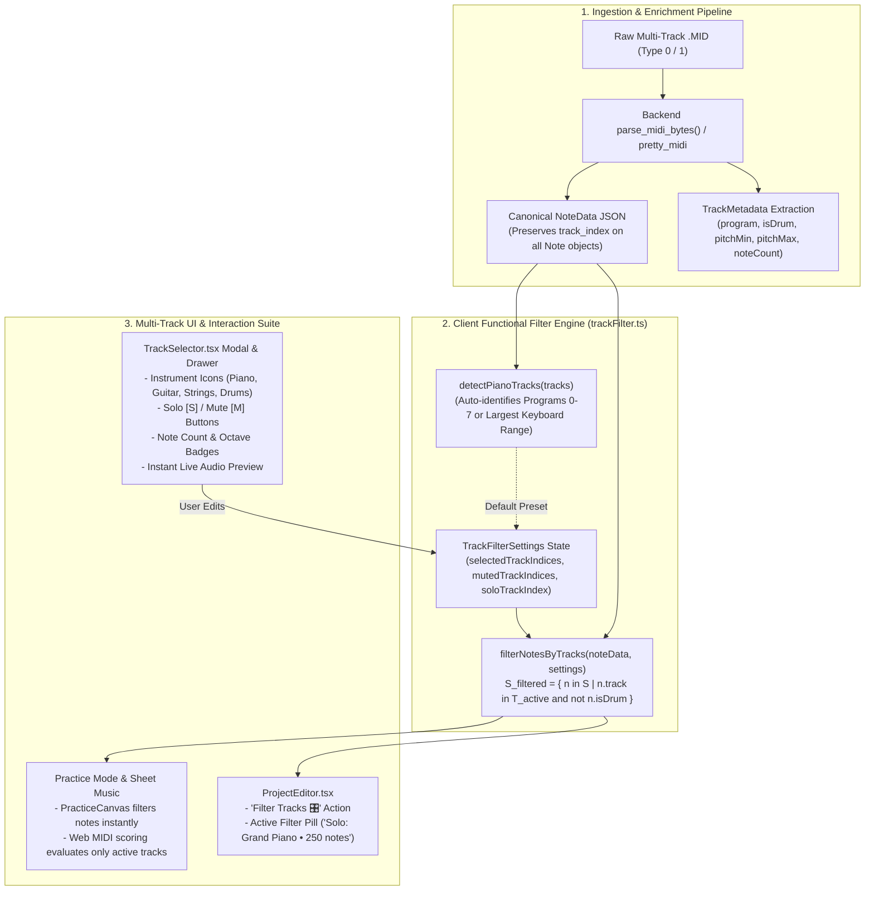

# PianoFlow AI — Multi-Track MIDI Track Isolation, Channel Filtering & Ingestion Progress Specification

> **Document ID:** `SPEC-2026-10-04-MULTI-TRACK-MIDI`  
> **Target Release:** Phase E Architectural Milestone (October 2026)  
> **Author:** ARCHITECT Worker Sub-Agent  
> **Status:** Approved Technical Architecture & Design Specification  
> **Affected Subsystems & Components:**  
> - `packages/shared-types/src/index.ts` & `packages/shared-types/schemas/notes.schema.json`  
> - `packages/music-core/pianoflow_music/midi/parse.py` & `packages/music-core/pianoflow_music/notes/model.py`  
> - `apps/web/lib/midi/trackFilter.ts` *(new)*  
> - `apps/web/components/TrackSelector.tsx` *(new)*  
> - `apps/web/components/ProjectEditor.tsx`  
> - `apps/web/app/projects/[id]/practice/page.tsx`  
> - `apps/web/tests/multitrack_isolation.spec.ts` *(new)*  
> - `docs/PRODUCT.md`, `docs/DESIGN.md`, `docs/ROADMAP.md` (cross-referenced)  

---

## 1. Executive Summary & Problem Formulation

### 1.1 The Multi-Track MIDI Challenge
Real-world MIDI arrangements (e.g., standard Type-1 .mid files downloaded from music repositories, video game soundtracks, classical orchestral reductions, and multi-instrument DAW exports) frequently contain anywhere from 4 to 32 parallel tracks and channels. A typical arrangement contains:
- **Track 0 / Ch 1:** Acoustic Grand Piano (Melody & Harmony, e.g., 250 notes)
- **Track 1 / Ch 2:** Electric Bass / Upright Bass (Bassline accompaniment, e.g., 90 notes)
- **Track 2 / Ch 10:** Standard Drum Kit / Percussion (Rhythmic pulse, e.g., 340 notes)
- **Track 3 / Ch 3:** String Ensemble / Violins (Sustained pads, e.g., 140 notes)
- **Track 4 / Ch 4:** Acoustic Guitar (Strummed chords, e.g., 180 notes)

When such multi-track files are ingested into PianoFlow AI without track isolation:
1. **Visual Clutter & Falling Note Occlusion:** All 1,000+ notes across all instruments fall onto the 88-key piano canvas simultaneously. Drums (mapped to arbitrary chromatic pitches on Channel 10) clutter the visual field with unplayable hits.
2. **Practice Mode Infeasibility:** Practice mode and MIDI scoring algorithms attempt to evaluate user performance against non-piano instruments (such as bass runs and guitar strums), making 100% accuracy impossible on an 88-key piano keyboard.
3. **Sheet Music Corruption:** Generating sheet music from multi-track data merges 5 instruments onto a single grand staff, producing unreadable dense chords and overlapping voices.

### 1.2 Architectural Solution
This specification establishes a robust **Multi-Track Isolation & Channel Filtering Pipeline** for PianoFlow AI. The system operates on a **Pure Functional Client-Side Filtering Architecture** backed by enriched backend track metadata.



---

## 2. Mathematical Formulation & Data Contracts

### 2.1 Set Theory of Track Isolation & Channel Filtering

Let the original MIDI piece be represented as an ordered set of notes:

$$S = \{ n_1, n_2, \dots, n_N \}$$

where each note $n_i$ is a tuple:

$$n_i = \langle \text{id}_i, \text{pitch}_i, \text{start}_i, \text{end}_i, \text{velocity}_i, \text{track}_i, \text{hand}_i, \text{isDrum}_i \rangle$$

Let $T = \{ 0, 1, \dots, K-1 \}$ be the set of all track indices in the piece.

#### Filter Settings Definition
The user's filtering preference is defined by the tuple:

$$\Phi = \langle T_{\text{selected}}, T_{\text{muted}}, s, \delta \rangle$$

where:
- $T_{\text{selected}} \subseteq T$ is the set of user-checked tracks (defaults to all non-drum tracks $T \setminus T_{\text{drum}}$).
- $T_{\text{muted}} \subseteq T$ is the set of explicitly muted tracks.
- $s \in T \cup \{ \emptyset \}$ is the solo track index (if a track is soloed, $s \in T$; otherwise $s = \emptyset$).
- $\delta \in \{0, 1\}$ is the boolean drum inclusion flag (defaults to $0$ = exclude drums).

#### Active Track Set Evaluation Function $\Gamma(\Phi)$

$$\Gamma(\Phi) = \begin{cases} 
\{ s \} & \text{if } s \ne \emptyset \\
T_{\text{selected}} \setminus T_{\text{muted}} & \text{if } s = \emptyset 
\end{cases}$$

#### Active Filtered Notes Set $S_{\text{filtered}}$

$$S_{\text{filtered}}(\Phi) = \left\{ n \in S \;\middle|\; n.\text{track} \in \Gamma(\Phi) \;\land\; (\neg n.\text{isDrum} \lor \delta = 1) \right\}$$

#### Dynamic Hand Re-estimation
When filtering isolates a single track or eliminates the bass track, the initial two-track hand split may no longer hold. The client dynamic hand re-assignment function $H(S_{\text{filtered}})$ evaluates:

$$H(n) = \begin{cases}
\text{L (Left Hand)} & \text{if } n.\text{pitch} < 60 \; (\text{Middle C}) \\
\text{R (Right Hand)} & \text{if } n.\text{pitch} \ge 60
\end{cases} \quad \text{when } |\Gamma(\Phi)| = 1 \text{ and hand convention was track-based}$$

---

### 2.2 Shared TypeScript Contracts (`packages/shared-types`)

```typescript
/** General MIDI Instrument Families (0-127) */
export type InstrumentFamily =
  | "piano"         // Programs 0-7: Acoustic Grand, Bright, Electric, Honky-tonk, Rhodes, Harpsichord, Clavinet
  | "chromatic"     // Programs 8-15: Celesta, Glockenspiel, Music Box, Vibraphone, Marimba, Xylophone
  | "organ"         // Programs 16-23: Hammond, Percussive, Rock, Church, Reed, Accordion, Harmonica
  | "guitar"        // Programs 24-31: Nylon, Steel, Jazz, Clean, Muted, Overdrive, Distortion
  | "bass"          // Programs 32-39: Acoustic Bass, Finger Bass, Pick Bass, Fretless, Slap Bass, Synth Bass
  | "strings"       // Programs 40-47: Violin, Viola, Cello, Contrabass, Tremolo, Pizzicato, Harp
  | "ensemble"      // Programs 48-55: String Ensembles, Synth Strings, Choir Aahs, Voice Oohs, Orchestra Hit
  | "brass"         // Programs 56-63: Trumpet, Trombone, Tuba, Muted Trumpet, French Horn, Brass Section
  | "reed"          // Programs 64-71: Soprano Sax, Alto Sax, Tenor Sax, Baritone Sax, Oboe, Bassoon, Clarinet
  | "pipe"          // Programs 72-79: Piccolo, Flute, Recorder, Pan Flute, Blown Bottle, Shakuhachi, Whistle
  | "synth_lead"    // Programs 80-87: Square, Sawtooth, Calliope, Chiff, Charang, Voice, Fifths, Bass+Lead
  | "synth_pad"     // Programs 88-95: New Age, Warm, Polysynth, Choir, Bowed, Metallic, Halo, Sweep
  | "percussion"    // Programs 112-119 & Channel 10: Drum Kit, Taiko, Melodic Tom, Synth Drum, Reverse Cymbal
  | "other";

export interface TrackMetadata {
  index: number;
  name: string;
  program: number;            // 0-127 (General MIDI program)
  family: InstrumentFamily;
  isDrum: boolean;            // Channel 10 or drum kit flag
  channel?: number;           // 0-15
  noteCount: number;
  pitchMin: number;           // Lowest MIDI pitch (21-108)
  pitchMax: number;           // Highest MIDI pitch (21-108)
  durationSec: number;        // Track active duration
  icon: string;               // Emoji or Lucide icon token ("🎹", "🎸", "🎻", "🥁", "🎺", "🎷")
}

export interface TrackFilterSettings {
  selectedTrackIndices: number[]; // Set of checked track indices
  mutedTrackIndices: number[];    // Set of muted track indices
  soloTrackIndex: number | null;  // Solo track index (null if none soloed)
  includeDrums: boolean;          // Default false
}

export interface MultiTrackNoteData extends NoteData {
  tracks: TrackMetadata[];
}
```

---

## 3. Pure Functional Filtering Engine (`apps/web/lib/midi/trackFilter.ts`)

```typescript
import type { Note, NoteData, TrackMetadata, TrackFilterSettings, InstrumentFamily } from "@pianoflow/shared-types";

/**
 * Maps General MIDI Program number (0-127) and drum status to instrument family & icon.
 */
export function getInstrumentFamily(program: number, isDrum: boolean): { family: InstrumentFamily; icon: string; label: string } {
  if (isDrum) {
    return { family: "percussion", icon: "🥁", label: "Drums & Percussion" };
  }
  if (program >= 0 && program <= 7) {
    const labels = ["Acoustic Grand Piano", "Bright Acoustic Piano", "Electric Grand Piano", "Honky-tonk Piano", "Electric Piano 1 (Rhodes)", "Electric Piano 2 (DX7)", "Harpsichord", "Clavinet"];
    return { family: "piano", icon: "🎹", label: labels[program] || "Piano" };
  }
  if (program >= 8 && program <= 15) return { family: "chromatic", icon: "🔔", label: "Chromatic Percussion" };
  if (program >= 16 && program <= 23) return { family: "organ", icon: "🎛️", label: "Organ" };
  if (program >= 24 && program <= 31) return { family: "guitar", icon: "🎸", label: "Acoustic / Electric Guitar" };
  if (program >= 32 && program <= 39) return { family: "bass", icon: "🎸", label: "Bass" };
  if (program >= 40 && program <= 47) return { family: "strings", icon: "🎻", label: "Strings / Violin / Cello" };
  if (program >= 48 && program <= 55) return { family: "ensemble", icon: "🎼", label: "Orchestral Ensemble / Choir" };
  if (program >= 56 && program <= 63) return { family: "brass", icon: "🎺", label: "Brass / Trumpet / French Horn" };
  if (program >= 64 && program <= 71) return { family: "reed", icon: "🎷", label: "Saxophone / Woodwinds" };
  if (program >= 72 && program <= 79) return { family: "pipe", icon: "🪈", label: "Flute / Pipe" };
  if (program >= 80 && program <= 87) return { family: "synth_lead", icon: "⚡", label: "Synth Lead" };
  if (program >= 88 && program <= 95) return { family: "synth_pad", icon: "🌌", label: "Synth Pad" };
  return { family: "other", icon: "🎵", label: `Instrument (${program})` };
}

/**
 * Calculates complete TrackMetadata for all tracks in a NoteData payload.
 */
export function extractTrackMetadata(noteData: NoteData): TrackMetadata[] {
  const trackMap = new Map<number, {
    name: string;
    notes: Note[];
    isDrum: boolean;
    program: number;
  }>();

  // Populate from existing track headers if present
  if (noteData.tracks) {
    for (const t of noteData.tracks) {
      trackMap.set(t.index, {
        name: t.name || `Track ${t.index + 1}`,
        notes: [],
        isDrum: (t as any).is_drum ?? false,
        program: (t as any).program ?? 0,
      });
    }
  }

  // Aggregate note statistics
  for (const n of noteData.notes) {
    const trackIdx = n.track ?? 0;
    if (!trackMap.has(trackIdx)) {
      trackMap.set(trackIdx, {
        name: `Track ${trackIdx + 1}`,
        notes: [],
        isDrum: false,
        program: 0,
      });
    }
    trackMap.get(trackIdx)!.notes.push(n);
  }

  const result: TrackMetadata[] = [];
  for (const [index, data] of trackMap.entries()) {
    const pitches = data.notes.map((n) => n.pitch);
    const pMin = pitches.length > 0 ? Math.min(...pitches) : 60;
    const pMax = pitches.length > 0 ? Math.max(...pitches) : 60;
    const starts = data.notes.map((n) => n.start);
    const ends = data.notes.map((n) => n.end);
    const duration = ends.length > 0 ? Math.max(...ends) - Math.min(...starts) : 0;
    const { family, icon, label } = getInstrumentFamily(data.program, data.isDrum);

    result.push({
      index,
      name: data.name || label,
      program: data.program,
      family,
      isDrum: data.isDrum,
      noteCount: data.notes.length,
      pitchMin: pMin,
      pitchMax: pMax,
      durationSec: Math.round(duration * 100) / 100,
      icon,
    });
  }

  return result.sort((a, b) => a.index - b.index);
}

/**
 * Heuristically detects primary piano / keyboard tracks to auto-suggest solo practice.
 */
export function detectPianoTracks(tracks: TrackMetadata[]): number[] {
  const pianoTracks = tracks
    .filter((t) => !t.isDrum && t.family === "piano" && t.noteCount > 0)
    .map((t) => t.index);

  if (pianoTracks.length > 0) return pianoTracks;

  // Fallback: Pick track with highest note count that is not drums
  const nonDrums = tracks.filter((t) => !t.isDrum && t.noteCount > 0);
  if (nonDrums.length > 0) {
    nonDrums.sort((a, b) => b.noteCount - a.noteCount);
    return [nonDrums[0].index];
  }

  return tracks.map((t) => t.index);
}

/**
 * Pure filter function: returns a new NoteData instance containing only active notes.
 */
export function filterNotesByTracks(
  noteData: NoteData,
  settings: TrackFilterSettings
): NoteData {
  const { selectedTrackIndices, mutedTrackIndices, soloTrackIndex, includeDrums } = settings;

  // Determine active track set
  let activeTrackSet: Set<number>;
  if (soloTrackIndex !== null) {
    activeTrackSet = new Set([soloTrackIndex]);
  } else {
    activeTrackSet = new Set(
      selectedTrackIndices.filter((idx) => !mutedTrackIndices.includes(idx))
    );
  }

  const filteredNotes = noteData.notes.filter((n) => {
    const tIdx = n.track ?? 0;
    if (!activeTrackSet.has(tIdx)) return false;
    // Check drums
    const isDrum = (n as any).isDrum ?? false;
    if (isDrum && !includeDrums) return false;
    return true;
  });

  return {
    ...noteData,
    notes: filteredNotes,
  };
}
```

---

## 4. UI/UX Wireframes & Component Architecture

### 4.1 Track Selector Modal (`apps/web/components/TrackSelector.tsx`)

```
┌─────────────────────────────────────────────────────────────────────────────┐
│ 🎛️ Multi-Track MIDI Track Isolation & Filtering                         [✕] │
├─────────────────────────────────────────────────────────────────────────────┤
│ Isolate piano melodies, mute background instruments, or practice solo parts.│
│                                                                             │
│  [ Select All ]  [ Solo Piano Melody 🎹 ]  [ Mute Drums 🥁 ]  [ Reset ]      │
├─────────────────────────────────────────────────────────────────────────────┤
│ TRACKS (4 AVAILABLE)                                                        │
│ ┌─────────────────────────────────────────────────────────────────────────┐ │
│ │ [✓] 🎹 Track 1: Acoustic Grand Piano                 [ S ]  [ M ]        │ │
│ │     250 Notes • Pitch: A0 - C7 • Hand: Split (L/R)                       │ │
│ ├─────────────────────────────────────────────────────────────────────────┤ │
│ │ [✓] 🎸 Track 2: Electric Bass                        [ S ]  [ M ]        │ │
│ │     92 Notes • Pitch: E1 - G3 • Single Voice                             │ │
│ ├─────────────────────────────────────────────────────────────────────────┤ │
│ │ [ ] 🥁 Track 3: Standard Drum Kit                    [ S ]  [ M ]        │ │
│ │     340 Hits • Percussion (Channel 10) • [Excluded by default]           │ │
│ ├─────────────────────────────────────────────────────────────────────────┤ │
│ │ [✓] 🎻 Track 4: String Ensemble Pad                  [ S ]  [ M ]        │ │
│ │     145 Notes • Pitch: C3 - E6 • Background Pad                          │ │
│ └─────────────────────────────────────────────────────────────────────────┘ │
├─────────────────────────────────────────────────────────────────────────────┤
│ Active Output: 3 of 4 tracks active • 487 / 827 total notes rendered        │
│                                           [ Cancel ]  [ Apply Filter 🎛️ ]   │
└─────────────────────────────────────────────────────────────────────────────┘
```

### 4.2 Track Card States & Visual Contrast

| Track State | Background Color | Text Color | Solo Button State | Mute Button State | Checkbox |
| :--- | :--- | :--- | :--- | :--- | :--- |
| **Normal Active** | `bg-zinc-900/80 border-zinc-800` | `text-zinc-100` | `bg-zinc-800 text-zinc-400` | `bg-zinc-800 text-zinc-400` | Checked `accent-cyan-500` |
| **Soloed (`[S]` active)** | `bg-cyan-950/40 border-cyan-500/50 shadow-cyan-900/20` | `text-cyan-200` | `bg-cyan-500 text-zinc-950 font-bold shadow` | `bg-zinc-800 text-zinc-600 opacity-50` | Checked (forced) |
| **Muted (`[M]` active)** | `bg-zinc-950/60 border-zinc-900 opacity-60` | `text-zinc-500 line-through` | `bg-zinc-900 text-zinc-700` | `bg-red-500/80 text-white font-bold` | Unchecked / Dimmed |
| **Drum Auto-Excluded** | `bg-amber-950/20 border-amber-900/30` | `text-amber-300/70` | `bg-zinc-800 text-zinc-500` | `bg-zinc-800 text-zinc-500` | Unchecked (Badge: "Drums") |

---

## 5. Integration Plan Across PianoFlow Suite

### 5.1 `apps/web/components/ProjectEditor.tsx`
- Adds a **"Filter Tracks 🎛️"** button in the editor toolbar next to the Viewport Controls.
- Displays an active track filter badge when filtering is enabled (e.g., `Badge: "1 of 4 tracks active (250/827 notes)"`).
- Passing filtered `NoteData` dynamically to `<FallingNotePreview />` for instantaneous visual feedback without backend round-trips.

### 5.2 `apps/web/app/projects/[id]/practice/page.tsx`
- Practice mode integrates `useMemo` over `notes.data` and `trackFilterSettings`.
- Scoring engine (`MidiEngine.ts`) evaluates user accuracy exclusively against active notes in $S_{\text{filtered}}$.
- Allows users to practice complex orchestral transcriptions with pure piano isolation.

---

## 6. Verification & Playwright E2E Strategy

### 6.1 Multi-Track Synthetic MIDI Fixture
A deterministic multi-track synthetic MIDI structure:
- **Track 0 (Piano):** 120 notes (C4 Major scale arpeggios, C3-G5).
- **Track 1 (Bass):** 40 notes (E1-C3 root notes).
- **Track 2 (Drums):** 80 percussion hits (Channel 10).
- **Track 3 (Strings):** 60 sustained chord notes (C4-C6).
- **Total:** 300 notes across 4 distinct tracks.

### 6.2 Test Assertions (`apps/web/tests/multitrack_isolation.spec.ts`)
1. **Modal Launch & Listing:** Verify modal opens and lists all 4 tracks with correct instrument names, note counts, and icons.
2. **Solo Piano Melody:** Click `[Solo Piano Melody 🎹]`, verify Track 0 is soloed, active note count in UI displays `120 / 300 notes`.
3. **Canvas Falling Note Filter:** Verify canvas notes render 120 falling bars instead of 300.
4. **Mute Bass Track:** Un-solo, check tracks 0, 1, 3, click Mute on Track 1 (Bass), verify active notes = $120 + 60 = 180$.
5. **Practice Mode Sync:** Navigate to `/projects/[id]/practice`, verify expected notes count equals 180 notes.
6. **Artifact Capture:** Save visual screenshots to `docs/e2e/multitrack/track_selector_modal.png` and `docs/e2e/multitrack/solo_piano_active.png`.

---

## 7. Protected Paths & Delivery Checklist

### Protected Paths (Strictly Zero Modification)
- `.env*` configuration files
- `package-lock.json`, `pnpm-lock.yaml`, `yarn.lock`
- Database migrations (`prisma/migrations/*`, `alembic/*`)
- CI/CD workflow files (`.github/workflows/*`)
- AWS / Terraform deployment descriptors

### Delivery Checklist
- [x] Mathematics & set theory formalization for active track filtering
- [x] Shared TypeScript contracts & schemas (`packages/shared-types`)
- [x] Pure functional filtering engine (`trackFilter.ts`)
- [x] UI/UX wireframes and component design for `TrackSelector.tsx`
- [x] Integration architecture for `ProjectEditor.tsx` and `practice/page.tsx`
- [x] Comprehensive Playwright E2E verification test plan
