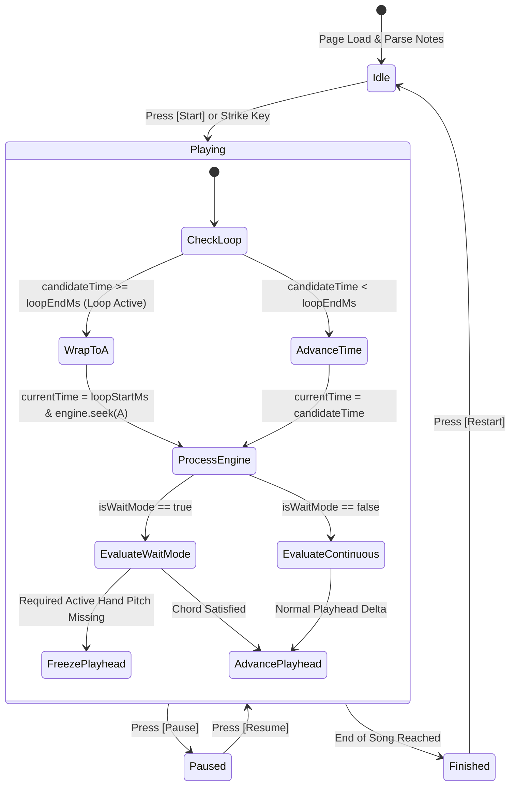

# PianoFlow AI — Practice Mode UI/UX & Feature Architecture Specification

> **Document ID:** `SPEC-2026-10-04-PRACTICE-UIUX`  
> **Target Release:** October 2026 Feature Overhaul  
> **Author:** ARCHITECT Worker Sub-Agent  
> **Status:** Approved Technical Design  
> **Affected Files:**  
> - `apps/web/lib/midi/MidiEngine.ts`  
> - `apps/web/components/practice/PracticeCanvas.tsx`  
> - `apps/web/components/practice/TimelineScrubber.tsx` *(new)*  
> - `apps/web/app/projects/[id]/practice/page.tsx`  
> - `docs/UI_UX.md` (cross-referenced)  

---

## 1. Executive Summary & Architectural Goals

The PianoFlow AI Practice Mode (`/projects/[id]/practice`) connects real-time Web MIDI hardware and interactive virtual keyboard input with an acoustic sound engine and falling-note visualization. While the baseline prototype established basic MIDI detection and note scoring, effective musical training requires specialized practice tools:

1. **A-B Looping:** Musicians isolate difficult phrases (e.g., measures 12–16) and repeat them until mastered.
2. **Tempo Control & Auto-Ramping:** Learners begin at slow speeds (e.g., 0.5x, 0.75x) and systematically accelerate as their execution accuracy reaches mastery thresholds.
3. **Hands Isolation & Auto-Accompaniment:** Pianists practice one hand at a time (Right Hand vs. Left Hand). The unpracticed hand should either play automatically as accompaniment or stay silent.
4. **Interactive Timeline Scrubber:** Instant scrubbing, measure markers, and visual note density overviews.
5. **Particle-Powered Visual Feedback:** High-energy visual rewards on successful note strikes without degrading canvas rendering performance or causing React re-render churn.
6. **Polished Header & Song Navigation:** High-contrast, responsive HUD displaying song title, real-time measure/bar position, tempo, and hardware status.

### 1.1 Non-Negotiable Performance Principles

- **Zero React Re-render Churn in Animation Loops:** The falling-note canvas and particle engine operate at 60 FPS via `requestAnimationFrame`. Transient frame state (particle pools, time counters, glowing beams) must **never** trigger React component re-renders. All transient animation state resides in mutable `useRef` stores or typed memory buffers.
- **Accurate Audio-Visual Synchronization:** Sound feedback from `AcousticPianoFeedback` must fire immediately on input without artificial queuing delays. Playhead advancement must account for variable delta times (`dt`) and speed multipliers.
- **Strict Typing & Backward Compatibility:** All new types and parameter additions must maintain backward compatibility with existing project notes and database structures.

---

## 2. Complete Data Types & State Contracts

### 2.1 Note & Hands Contracts

```typescript
// Shared & Engine Expected Note Structure
export type HandType = 'L' | 'R';

export interface ExpectedNote {
  pitch: number;          // MIDI pitch (21 - 108)
  start: number;          // Note start in milliseconds
  end: number;            // Note end in milliseconds
  hand?: HandType;        // 'R' (Right/Treble) | 'L' (Left/Bass)
  name?: string;          // E.g. "C4", "F#5", "Bb3"
  velocity?: number;      // 0 - 127
}

export type HandPracticeMode = 'both' | 'right' | 'left';
```

### 2.2 A-B Looping State Contract

```typescript
export interface LoopState {
  loopStartMs: number | null; // Marker A (ms)
  loopEndMs: number | null;   // Marker B (ms)
  isLoopActive: boolean;      // Whether wrapping is enforced
}
```

- **Invariants:**
  - If both `loopStartMs` and `loopEndMs` are set, `loopEndMs - loopStartMs >= 500` (minimum 500ms phrase length).
  - If `isLoopActive === true`, both `loopStartMs` and `loopEndMs` must be non-null.

### 2.3 Speed Multiplier & Auto-Tempo Ramping Contract

```typescript
export type SpeedMultiplier = 0.5 | 0.75 | 1.0 | 1.25 | 1.5;

export interface AutoRampConfig {
  enabled: boolean;
  accuracyThreshold: number; // Default: 90 (%)
  minConsecutiveLoops: number; // Default: 1 full loop cycle
  speedStep: number;         // Default: +0.1x
  maxSpeed: number;          // Default: 1.5x
}

export interface AutoRampState {
  successfulCycles: number;
  lastRampNotification: string | null;
}
```

### 2.4 Particle Engine Data Contract

```typescript
export interface Particle {
  x: number;
  y: number;
  vx: number;
  vy: number;
  alpha: number;
  color: string;
  size: number;
  life: number;
  maxLife: number;
  gravity: number;
  active: boolean;
}

export interface ParticlePool {
  particles: Particle[];
  maxCount: number;
  spawn: (x: number, y: number, color: string, count: number, speedSpread: number) => void;
  updateAndDraw: (ctx: CanvasRenderingContext2D, dt: number) => void;
  clear: () => void;
}
```

### 2.5 Timeline & Song Position Metadata

```typescript
export interface SongPosition {
  currentTimeMs: number;
  totalDurationMs: number;
  currentMeasure: number;
  totalMeasures: number;
  bpm: number;
  timeSignature: string; // e.g. "4/4", "3/4"
}
```

---

## 3. System Architecture & State Diagrams

### 3.1 Practice Mode State Machine



### 3.2 High-Speed Game Loop Sequence

```mermaid
sequenceDiagram
    autonumber
    actor User as Musician (Web MIDI / Virtual Key)
    participant Loop as rAF Game Loop (page.tsx)
    participant Engine as MidiEngine.ts
    participant Audio as AcousticPianoFeedback
    participant Canvas as PracticeCanvas.tsx (Zero-Churn)
    participant Pool as ParticlePool (Mutable)

    User->>Engine: Note On (Pitch 60, Vel 90)
    User->>Audio: noteOn(60, 90) [Instant synthesis]
    
    Note over Loop: requestAnimationFrame(timestamp)
    Loop->>Loop: dt = clampedDelta * speedMultiplier
    alt CandidateTime >= LoopEndMs and LoopActive
        Loop->>Loop: candidateTime = loopStartMs
        Loop->>Engine: engine.seek(loopStartMs)
    end
    
    Loop->>Engine: processInput(activePitches, candidateTime, isWaitMode)
    Engine-->>Loop: shouldPause (boolean)
    
    opt Accompaniment Auto-Play (Inactive Hand)
        Loop->>Audio: noteOn(inactivePitch) [Auto accompaniment]
    end

    alt Note Hit Triggered (Perfect / Good)
        Engine-->>Canvas: emitScoreEvent(score, pitch)
        Canvas->>Pool: spawn(x, hitY, color, count, speed)
    end

    Note over Canvas: Canvas draw()
    Canvas->>Canvas: Draw Falling Notes (RH Violet, LH Cyan)
    Canvas->>Canvas: Draw Hit Beams & Glow Halo
    Canvas->>Pool: updateAndDraw(ctx, dt)
```

---

## 4. Deep-Dive Technical Blueprints

### 4.1 Subsystem A: A-B Looping Architecture

#### Mathematical Wrapping Logic
In `page.tsx` within the animation callback:

```typescript
const speedAdjustedDelta = clampedDelta * speedMultiplier;
let candidateTime = currentTimeRef.current + speedAdjustedDelta;

// Check A-B loop wrap boundary
if (isLoopActive && loopStartMs !== null && loopEndMs !== null) {
  if (candidateTime >= loopEndMs) {
    candidateTime = loopStartMs;
    // Rewind engine playhead and reset note state for loop range
    engine.seek(loopStartMs);
    onLoopCycleCompleted?.(); // Trigger auto-tempo checks
  }
}
```

#### MidiEngine Playhead Seek & Rehydration
When rewinding time via loop wrap or timeline scrubbing, `MidiEngine` must clean up future scored notes and chord states:

```typescript
public seek(targetTimeMs: number): void {
  this.currentPlayheadTime = targetTimeMs;
  
  // 1. Remove scored status for all notes starting after targetTimeMs
  const notesToUnscore: ExpectedNote[] = [];
  for (const note of this.scoredNotes) {
    if (note.start >= targetTimeMs) {
      notesToUnscore.push(note);
    }
  }
  for (const n of notesToUnscore) {
    this.scoredNotes.delete(n);
  }

  // 2. Re-enable unplayed status for all chords starting after targetTimeMs
  for (const chord of this.chords) {
    if (chord.start >= targetTimeMs) {
      chord.isPlayed = false;
    }
  }

  // 3. Reset input diff tracker
  this.previousActivePitches.clear();
}
```

#### UI Controls Specification
- **`[Set A]`**: Sets `loopStartMs = Math.round(currentTimeRef.current)`. If `loopEndMs !== null` and `loopStartMs >= loopEndMs`, `loopEndMs` is reset to `null`.
- **`[Set B]`**: Sets `loopEndMs = Math.round(currentTimeRef.current)`. Enforces `loopEndMs >= (loopStartMs ?? 0) + 500`. Automatically sets `isLoopActive = true`.
- **`[Toggle Loop]`**: Toggles `isLoopActive = !isLoopActive`. Disabled if either `loopStartMs` or `loopEndMs` is `null`.
- **`[Clear Loop]`**: Sets `loopStartMs = null`, `loopEndMs = null`, `isLoopActive = false`.
- **Visual Range Indicator**: Displays `A: 00:14.2  B: 00:22.8` with cyan-accented badge.

---

### 4.2 Subsystem B: Speed Multiplier & Auto-Tempo Ramping

#### Speed Multipliers
- Supported presets: `0.5x`, `0.75x`, `1.0x`, `1.25x`, `1.5x`.
- Storage: `const [speedMultiplier, setSpeedMultiplier] = useState<number>(1.0)`.
- Game Loop Delta Integration:
  $$\Delta t_{\text{adjusted}} = \min(\text{deltaTime}, 100) \times \text{speedMultiplier}$$

#### Adaptive Tempo Ramping Algorithm
When `isAutoRampEnabled === true`:
1. **Evaluation Trigger:** Fired upon completion of each A-B loop pass or completion of an $N$-bar segment.
2. **Success Criterion:**
   $$\text{Cycle Accuracy} \ge 90\% \quad \text{AND} \quad \text{Misses} = 0$$
3. **Tempo Boost Action:**
   - Boost multiplier by $+0.1x$ up to a maximum of $1.5x$:
     ```typescript
     setSpeedMultiplier((prev) => {
       const next = Math.min(1.5, Math.round((prev + 0.1) * 10) / 10);
       return next;
     });
     ```
   - Trigger visual toast overlay: `🚀 Speed Boost! 1.0x → 1.1x (Accuracy 96%)`.
4. **Safety Rollback:** If accuracy in the subsequent cycle falls below $70\%$, step tempo down by $-0.05x$ to prevent frustration.

---

### 4.3 Subsystem C: Hands Isolation (Hand Practice Filtering & Auto-Accompaniment)

#### Mode Definitions
- `'both'`: Both hands evaluated and scored.
- `'right'`: Right hand scored; left hand designated as accompaniment.
- `'left'`: Left hand scored; right hand designated as accompaniment.

#### Hand Split Resolution
1. Primary: `note.hand` if specified (`'R'` or `'L'`).
2. Secondary heuristic fallback: Pitch $\ge 60$ ($C4$) is Right Hand (`'R'`), Pitch $< 60$ is Left Hand (`'L'`).

#### MidiEngine Filtering Rules
`MidiEngine` receives the active `HandPracticeMode`:

```typescript
private isNoteActiveForHand(note: ExpectedNote): boolean {
  if (this.handMode === 'both') return true;
  const noteHand = note.hand ?? (note.pitch >= 60 ? 'R' : 'L');
  return (this.handMode === 'right' && noteHand === 'R') ||
         (this.handMode === 'left' && noteHand === 'L');
}
```

1. **Scoring Filtering:** In `checkMissedNotes(currentTime)` and `scorePitch(pitch, currentTime)`, if a note is inactive for the current hand mode:
   - The note is **never** flagged as a `Miss`.
   - Striking the note does not penalize score or reset combos.
2. **Wait Mode Filtering:** When advancing chords in `processInput`, only pitches belonging to the active hand are required:
   ```typescript
   const activeHandPitches = nextChord.notes
     .filter((n) => this.isNoteActiveForHand(n))
     .map((n) => n.pitch);

   // If no active hand notes exist in this chord, auto-advance without pausing
   if (activeHandPitches.length === 0) {
     nextChord.isPlayed = true;
     shouldPause = false;
   }
   ```
3. **Auto-Accompaniment Playback:**
   - Inactive hand notes are passed to `audioRef.current?.noteOn(note.pitch, note.velocity ?? 75)` exactly as the playhead reaches `note.start`.
   - Automatically scheduled in the game loop so the student plays Right Hand while listening to the AI accompany the Left Hand in real-time.

---

### 4.4 Subsystem D: Interactive Timeline Scrubber

#### Component Design: `TimelineScrubber.tsx`
Located directly between the header bar and the falling note canvas.

```
┌────────────────────────────────────────────────────────────────────────────────────────┐
│ 01:14 / 03:45              [====|==== A ======== B ================]      Bar 12 / 48  │
└────────────────────────────────────────────────────────────────────────────────────────┘
```

#### Visual Elements
1. **Background Track:** Deep `#18181b` rounded bar.
2. **Note Density Heat-Ticks:** Semi-transparent cyan and violet vertical lines showing note density across the song duration.
3. **A-B Loop Region:** Shaded overlay between $A$ and $B$ with cyan borders (`#06b6d4/30`).
4. **Current Progress Fill:** Cyan/blue linear gradient indicating elapsed time.
5. **Interactive Scrubber Head:** Glowing circular handle that follows current playhead time.

#### Drag & Click Interaction Contract
- **Mouse Down / Touch Start:** Computes seek ratio:
  $$\text{seekMs} = \text{clamp}\left(0, \frac{e.\text{clientX} - \text{rect.left}}{\text{rect.width}}, 1\right) \times \text{totalDurationMs}$$
- Updates `currentTimeRef.current = seekMs`.
- Dispatches `engine.seek(seekMs)`.
- Updates UI without causing canvas frame drops.

---

### 4.5 Subsystem E: Canvas Hit Sparks Particle Engine & Visual Polish

#### Zero React State Re-Render Churn Design
Sparks and particles are managed via an object pool within `PracticeCanvas.tsx`.

```typescript
class ParticlePoolEngine {
  private pool: Particle[] = [];
  private activeCount: number = 0;

  constructor(maxSize = 250) {
    for (let i = 0; i < maxSize; i++) {
      this.pool.push({
        x: 0, y: 0, vx: 0, vy: 0, alpha: 1, color: '#ffffff',
        size: 2, life: 0, maxLife: 30, gravity: 0.15, active: false
      });
    }
  }

  public spawn(x: number, y: number, color: string, count = 16, spread = 4): void {
    let spawned = 0;
    for (let i = 0; i < this.pool.length && spawned < count; i++) {
      const p = this.pool[i];
      if (!p.active) {
        const angle = Math.random() * Math.PI * 2;
        const speed = (Math.random() * 0.8 + 0.2) * spread;
        p.x = x;
        p.y = y;
        p.vx = Math.cos(angle) * speed;
        p.vy = Math.sin(angle) * speed - 1.5; // Upward bias
        p.alpha = 1;
        p.color = color;
        p.size = Math.random() * 2.5 + 1.5;
        p.life = 0;
        p.maxLife = Math.floor(Math.random() * 20 + 20);
        p.gravity = 0.12;
        p.active = true;
        spawned++;
      }
    }
  }

  public updateAndDraw(ctx: CanvasRenderingContext2D): void {
    ctx.save();
    for (let i = 0; i < this.pool.length; i++) {
      const p = this.pool[i];
      if (!p.active) continue;

      p.x += p.vx;
      p.y += p.vy;
      p.vy += p.gravity;
      p.life++;
      p.alpha = Math.max(0, 1 - p.life / p.maxLife);

      if (p.life >= p.maxLife || p.alpha <= 0) {
        p.active = false;
        continue;
      }

      ctx.globalAlpha = p.alpha;
      ctx.fillStyle = p.color;
      ctx.shadowColor = p.color;
      ctx.shadowBlur = 6;
      ctx.beginPath();
      ctx.arc(p.x, p.y, p.size, 0, Math.PI * 2);
      ctx.fill();
    }
    ctx.restore();
  }
}
```

#### Spark Triggers by Hit Quality
| Hit Quality | Spark Count | Spark Color Palette | Velocity Spread |
|---|---|---|---|
| **Perfect** | 20 particles | `#ffffff`, `#38bdf8`, `#10b981` | High spread ($5.0\text{ px/frame}$) |
| **Good** | 10 particles | `#38bdf8`, `#818cf8` | Medium spread ($3.0\text{ px/frame}$) |
| **Miss** | 5 particles | `#f43f5e`, `#fb7185` | Low spread downward embers |

#### Hit Beam Radiant Glow
When a key is active, an upward radiant beam is drawn directly on the canvas:
- Height: 70 pixels above the hit line.
- Gradient: From `rgba(34, 211, 238, 0.4)` (strike line) to `rgba(34, 211, 238, 0)` (apex).
- Hand coloration: Violet (`#a855f7`) for Right Hand, Cyan (`#06b6d4`) for Left Hand.

#### Note Name Labels
If note block height on screen is $\ge 14\text{px}$:
- Note pitch text (e.g. `C4`, `F#5`) rendered centered inside the falling block.
- Font: `9px JetBrains Mono, sans-serif`.
- Color: `#ffffff` with subtle dark text drop-shadow for contrast against bright notes.

---

### 4.6 Subsystem F: Song Title & Header Navigation UX

#### Header Information Hierarchy
```
┌─────────────────────────────────────────────────────────────────────────────────────────────────┐
│ [◄ Projects]  Clair de Lune  ·  Bar 14 (01:14 / 03:45)  ·  120 BPM [4/4]                       │
│ Mode: [Wait Mode | Continuous]   Hand: [Both | RH | LH]   Speed: [1.0x ▾]  Loop: [A|B|Active]   │
│ Score: 18,400   Accuracy: 98.2%   🔥 24 Combo   MIDI: [● Yamaha P-125]   [Restart] [Start/Pause]│
└─────────────────────────────────────────────────────────────────────────────────────────────────┘
```

#### Measure Calculation Engine
Given `timeMs`, `bpm`, and `timeSignature` (e.g. `4/4`):
$$\text{BeatsPerMinute} = \text{bpm} \quad (\text{default: } 120)$$
$$\text{BeatsPerBar} = \text{parseInt}(\text{timeSignature}.\text{split}('/')[0]) \quad (\text{default: } 4)$$
$$\text{SecondsPerBeat} = \frac{60}{\text{bpm}}$$
$$\text{CurrentMeasure} = 1 + \left\lfloor \frac{\text{currentTimeMs} / 1000}{\text{SecondsPerBeat} \times \text{BeatsPerBar}} \right\rfloor$$

---

## 5. File-by-File Implementation Blueprint

### 5.1 `apps/web/lib/midi/MidiEngine.ts`

```typescript
// Additions to MidiEngine.ts:
// 1. ExpectedNote interface extended with optional hand, name, velocity
// 2. HandPracticeMode type added
// 3. New private members:
//    private handMode: HandPracticeMode = 'both';
// 4. New public methods:
//    public setHandMode(mode: HandPracticeMode): void
//    public getHandMode(): HandPracticeMode
//    public seek(targetTimeMs: number): void
// 5. Updated methods:
//    - processInput: filters required chord notes by active hand
//    - checkMissedNotes: ignores notes belonging to inactive hand
//    - scorePitch: ignores inactive hand notes
```

### 5.2 `apps/web/components/practice/PracticeCanvas.tsx`

```typescript
// Additions to PracticeCanvas.tsx:
// 1. Integrated ParticlePoolEngine instance stored in a ref (no re-renders)
// 2. Props extended:
//    handMode?: HandPracticeMode;
//    showNoteNames?: boolean;
// 3. Updated draw loop:
//    - Draws inactive hand notes with reduced opacity (0.35 alpha)
//    - Draws active hand notes with full color & glow
//    - Renders note names on blocks with height >= 14px
//    - Renders particlePool.updateAndDraw(ctx)
// 4. Trigger particle spawning on lastScore updates inside useEffect
```

### 5.3 `apps/web/components/practice/TimelineScrubber.tsx` *(New File)*

```typescript
// Component: TimelineScrubber.tsx
// Props:
// - currentTimeRef: React.MutableRefObject<number>
// - totalDurationMs: number
// - loopStartMs: number | null
// - loopEndMs: number | null
// - isLoopActive: boolean
// - onSeek: (timeMs: number) => void
// - onSetA: () => void
// - onSetB: () => void
// - onToggleLoop: () => void
// - onClearLoop: () => void
// - notes: ExpectedNote[] (for rendering density ticks)
// Behaviors:
// - Pointer down / move / up tracking for scrub drag
// - Renders shaded A-B loop boundary box
// - Real-time needle position update via rAF or lightweight interval
```

### 5.4 `apps/web/app/projects/[id]/practice/page.tsx`

```typescript
// Enhancements to page.tsx:
// 1. Fetch project title & BPM via useProject(projectId)
// 2. Loop state: loopStartMs, loopEndMs, isLoopActive
// 3. Speed state: speedMultiplier, isAutoRampEnabled
// 4. Hand state: handMode ('both' | 'right' | 'left')
// 5. Accompaniment scheduling: plays inactive hand notes via audioRef
// 6. Integrated TimelineScrubber above the canvas
// 7. Polished header with project name, back button to /projects, and live measure counter
```

---

## 6. Edge Cases & Robustness Matrix

| Scenario / Edge Case | Failure Mode / Risk | Mitigation Strategy |
|---|---|---|
| **Loop Wrap with Active Held Keys** | Ghost notes or stuck note-on state in audio engine. | When wrapping to `loopStartMs`, call `audioRef.current?.destroyActiveNotes()` or reset notes in audio engine. |
| **Marker B Set Before Marker A** | Inverted or negative loop range ($B < A$). | Automatically clamp or swap: if $B \le A + 500$, set $B = A + 500$ or clear $B$. |
| **Rapid Scrubbing Drag** | DoS on MidiEngine or repeated redundant scores. | In `TimelineScrubber`, debounce scoring events while dragging; call `engine.seek(newTime)` synchronously. |
| **Web MIDI Disconnect Mid-Session** | Silent failure or crash if MIDI device is unplugged. | `useWebMidi` catches `statechange` events; fallback immediately to virtual keyboard with amber warning badge. |
| **Tempo Ramping Above Human Capability** | Speed increases beyond 1.5x on consecutive loops. | Hard ceiling clamped at $1.5\times$; minimum speed clamped at $0.5\times$. |
| **Audio-Visual Drift Under Low FPS** | Time jumps or skipped notes during tab throttling. | Game loop caps `deltaTime` to `Math.min(dt, 100)` and syncs against `requestAnimationFrame` timestamps. |

---

## 7. Verification & Acceptance Checklist

- [ ] **A-B Looping:** Setting A and B produces an active loop. Playhead wraps seamlessly from B back to A; notes in the looped segment are re-evaluated.
- [ ] **Speed Multiplier:** 0.5x, 0.75x, 1.0x, 1.25x, 1.5x correctly scale playhead progression rate while audio synthesis pitch remains unaltered.
- [ ] **Auto-Ramp:** Completing a loop cycle with $\ge 90\%$ accuracy increments speed by $+0.1x$ with HUD notification.
- [ ] **Hands Isolation:** Selecting Right Hand ignores Left Hand notes for scoring/miss evaluation; Left Hand notes play auto-accompaniment audio.
- [ ] **Timeline Scrubber:** Clicking or dragging across the timeline moves the playhead and canvas notes in real-time.
- [ ] **Particle Engine:** Perfect and Good hits emit glowing sparks on the canvas; 60 FPS frame rate maintained without React re-render lag.
- [ ] **Header Navigation:** Project name, back button, measure counter, and MIDI connection name render accurately on desktop and mobile.
