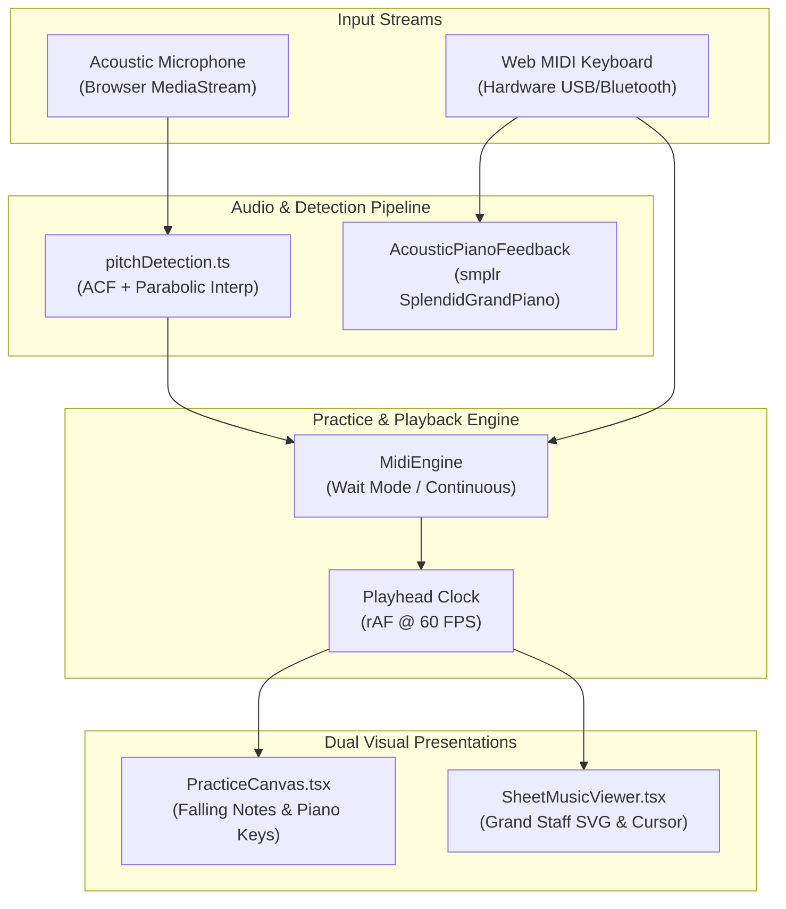

# PianoFlow AI — Phase D Interactive Sheet Music Viewer & Acoustic Microphone Pitch Tracking Specification

> **Document ID:** `SPEC-2026-10-04-SHEET-MIC`  
> **Target Release:** Phase D (Sheet Music Viewer & Acoustic Mic Input)  
> **Author:** ARCHITECT Worker Sub-Agent  
> **Status:** Approved Technical Design  
> **Scope:**  
> - `apps/web/lib/sheet/sheetModel.ts` *(new)*  
> - `apps/web/components/sheet/SheetMusicViewer.tsx` *(new)*  
> - `apps/web/app/projects/[id]/sheet/page.tsx` *(new)*  
> - `apps/web/lib/audio/pitchDetection.ts` *(new)*  
> - `apps/web/lib/audio/useMicrophonePitch.ts` *(new)*  
> - `apps/web/app/projects/[id]/practice/page.tsx` *(integration)*  
> - `apps/web/components/ProjectEditor.tsx` *(integration)*  
> - `docs/ROADMAP.md` (Phase D)  

---

## 1. Executive Summary & Architectural Goals

PianoFlow AI is expanding beyond falling-note visualization to provide a comprehensive classical and contemporary piano learning platform. This technical design document specifies two foundational capabilities under **Phase D**:

1. **Interactive Grand Staff Sheet Music Viewer (`/projects/[id]/sheet`):**
   - High-fidelity SVG-rendered Grand Staff score displaying Treble (G) and Bass (F) clefs.
   - Algorithmic translation of PianoFlow's canonical `NoteData` into diatonic staff coordinates, measures, stems, accidentals, and ledger lines.
   - Synchronized 60 FPS playhead cursor that visually glides across staves in lockstep with the audio playback clock.
   - Click-to-seek measure navigation, dynamic tempo scaling (0.5x, 0.75x, 1.0x, 1.25x), zoom scaling, and print stylesheet (`window.print()`) for paper score generation.

2. **Acoustic Microphone Pitch Tracking (`useMicrophonePitch`):**
   - Eliminates the requirement of owning a USB/MIDI interface or smart digital piano.
   - Real-time audio ingestion from the browser microphone (`navigator.mediaDevices.getUserMedia`).
   - High-accuracy fundamental frequency ($F_0$) extraction via time-domain **Normalized Autocorrelation** (ACF) with parabolic peak interpolation.
   - Dynamic noise floor gating, RMS energy thresholding, and onset/release debouncing (50ms) to reject ambient noise and key thumps.
   - Seamless plug-in integration into `PracticePage.tsx` with an input mode toggle: `[ 🎹 MIDI | 🎙️ Mic ]`.



---

## 2. Grand Staff Sheet Music Viewer Architecture

### 2.1 NoteData to Grand Staff Partitioning Model

PianoFlow's `NoteData` structure stores notes in seconds with arbitrary polyphony. To construct standard Western music notation without heavyweight engraving bloatware, `sheetModel.ts` parses notes into measures and staves:

```
NoteData.notes[]
       │
       ▼
1. Hand Partitioning:
   - Hand == 'R' or pitch >= 60  ==> Treble Staff (G Clef)
   - Hand == 'L' or pitch < 60   ==> Bass Staff (F Clef)
       │
       ▼
2. Measure Subdivision:
   - measureDuration = (60 / bpm) * beatsPerMeasure
   - measureIndex = floor(note.start / measureDuration)
   - measureOffset = (note.start % measureDuration) / measureDuration  (0.0 to 1.0)
       │
       ▼
3. Staff Coordinate Mapping:
   - pitch -> Diatonic Step + Accidental (Natural, Sharp, Flat)
   - Step -> Y position relative to staff center line
   - Ledger line detection if |step - staff_bounds| > 0
```

#### Pitch-to-Staff Diatonic Geometry

A standard musical staff has 5 lines spaced by step interval $S = 10\text{px}$. Each diatonic letter name ($C, D, E, F, G, A, B$) shifts by vertical distance $\Delta y = S / 2 = 5\text{px}$.

| Clef | Reference Line | MIDI Pitch | Reference Y | Note Range |
|---|---|---|---|---|
| **Treble (G Clef)** | Line 2 (G4) | 67 | $y_0 + 3 \times S$ | Pitch $\ge 60$ (Middle C = 1 ledger line below) |
| **Bass (F Clef)** | Line 4 (F3) | 53 | $y_0 + 1 \times S$ | Pitch $< 60$ (Middle C = 1 ledger line above) |

```typescript
export interface DiatonicPosition {
  step: number;        // Diatonic step offset from C0 (0 = C0, 1 = D0, etc.)
  stepName: string;    // 'C' | 'D' | 'E' | 'F' | 'G' | 'A' | 'B'
  octave: number;      // e.g. 4 for C4
  accidental: 'sharp' | 'flat' | 'natural' | null;
  lineOffset: number;  // Distance in half-staff-spaces from staff line 1 (bottom line)
  ledgerLines: number[]; // Array of Y offsets for ledger lines required
}

// Diatonic mapping table (MIDI pitch % 12)
const PITCH_MAP: Array<{ stepName: string; stepOffset: number; accidental: 'sharp' | null }> = [
  { stepName: 'C', stepOffset: 0, accidental: null },
  { stepName: 'C', stepOffset: 0, accidental: 'sharp' },
  { stepName: 'D', stepOffset: 1, accidental: null },
  { stepName: 'D', stepOffset: 1, accidental: 'sharp' },
  { stepName: 'E', stepOffset: 2, accidental: null },
  { stepName: 'F', stepOffset: 3, accidental: null },
  { stepName: 'F', stepOffset: 3, accidental: 'sharp' },
  { stepName: 'G', stepOffset: 4, accidental: null },
  { stepName: 'G', stepOffset: 4, accidental: 'sharp' },
  { stepName: 'A', stepOffset: 5, accidental: null },
  { stepName: 'A', stepOffset: 5, accidental: 'sharp' },
  { stepName: 'B', stepOffset: 6, accidental: null },
];
```

#### Staff Coordinates Formula
For a note with pitch $P$:
1. $O = \lfloor P / 12 \rfloor - 1$ (Octave number, e.g. 4 for middle C).
2. Diatonic index $D = O \times 7 + \text{PITCH\_MAP}[P \bmod 12].\text{stepOffset}$.
3. For Treble Clef: Line 1 (bottom line) corresponds to $E_4$ ($D_{E4} = 4 \times 7 + 2 = 30$).
   - $\text{staffOffset} = D - D_{E4}$ (in units of half-spaces).
   - $y_{\text{note}} = y_{\text{treble\_bottom}} - \text{staffOffset} \times (S / 2)$.
4. For Bass Clef: Line 1 (bottom line) corresponds to $G_2$ ($D_{G2} = 2 \times 7 + 4 = 18$).
   - $\text{staffOffset} = D - D_{G2}$.
   - $y_{\text{note}} = y_{\text{bass\_bottom}} - \text{staffOffset} \times (S / 2)$.

#### Ledger Lines Calculation
- On Treble Staff (lines span offset 0 to 8 half-spaces):
  - If $\text{staffOffset} < 0$ (below staff): for even offsets $\le -2$, emit ledger line at $y = y_{\text{treble\_bottom}} - k \times (S / 2)$.
  - If $\text{staffOffset} > 8$ (above staff): for even offsets $\ge 10$, emit ledger line at $y = y_{\text{treble\_bottom}} - k \times (S / 2)$.
- Identical logic applies to Bass Staff with respect to $y_{\text{bass\_bottom}}$.

---

### 2.2 System & Measure Grid Layout

Scores are formatted into **Grand Staff Systems**. Each system consists of:
- Width: $W_{\text{sys}} = 1000\text{px}$ (responsive CSS viewBox).
- System Left Header ($90\text{px}$): System bracket, Treble Clef, Bass Clef, Time Signature ($4/4$).
- Measures per system: $M_{\text{per\_sys}} = 2$ or $3$ (default 2 for readability, responsive to viewport).
- Measure Width: $W_{\text{measure}} = (W_{\text{sys}} - W_{\text{header}}) / M_{\text{per\_sys}}$.
- Inter-staff spacing: $S_{\text{gap}} = 60\text{px}$ between Treble staff bottom line and Bass staff top line.

```
┌── SYSTEM HEADER ─────────────────────────────────────────────────────────────┐
│  ┌─┐                                                                         │
│  │ │  𝄞  (Treble Clef)  ─────────────────────────────────  Line 5 (F5)      │
│  │ │                    ─────────────────────────────────  Line 4 (D5)      │
│  │ │                    ─────────────────────────────────  Line 3 (B4)      │
│  │ │                    ─────────────────────────────────  Line 2 (G4)      │
│  │ │                    ─────────────────────────────────  Line 1 (E4)      │
│  │{│                                                                         │
│  │ │                    <-- Inter-Staff Distance: 60px -->                  │
│  │ │                                                                         │
│  │ │  𝄢  (Bass Clef)    ─────────────────────────────────  Line 5 (A3)      │
│  │ │                    ─────────────────────────────────  Line 4 (F3)      │
│  │ │                    ─────────────────────────────────  Line 3 (D3)      │
│  │ │                    ─────────────────────────────────  Line 2 (B2)      │
│  │ │                    ─────────────────────────────────  Line 1 (G2)      │
│  └─┘                                                                         │
│   │                                       │                       │          │
│   Measure 1 (0.0s - 2.0s)                 Measure 2 (2.0s - 4.0s) Bar-Line   │
└───┴───────────────────────────────────────┴───────────────────────┴──────────┘
```

---

### 2.3 SVG Rendering Primitives

To guarantee zero dependencies, fast vector scaling, and instant print capability, all glyphs are drawn using clean SVG primitives:

1. **Staff Lines:** `<line x1={x0} y1={y} x2={x1} y2={y} stroke="currentColor" strokeWidth="1.2" />` for 5 parallel lines.
2. **Measure Bar Lines:** Spans from Treble Line 5 down to Bass Line 1 continuously.
3. **Treble Clef (G):** Canonical SVG path glyph rendered at $(x_{\text{clef}}, y_{\text{treble\_center}})$.
4. **Bass Clef (F):** Canonical F-clef spiral with twin accent dots flanking Line 4 ($F3$).
5. **Noteheads:**
   - Elliptical notehead rotated by $-18^\circ$:
     `<ellipse cx={x} cy={y} rx="5.5" ry="4" transform="rotate(-18 x y)" fill={isHollow ? "none" : "currentColor"} stroke="currentColor" strokeWidth={isHollow ? "1.8" : "0"} />`
   - Hollow notehead for half notes ($\ge 2$ beats) and whole notes ($\ge 4$ beats).
6. **Note Stems:**
   - Direction: Stem down if note offset $\ge 4$ (above middle line); Stem up if note offset $< 4$.
   - Upward stem: From right of notehead $(x + 5, y)$ to $(x + 5, y - 32)$.
   - Downward stem: From left of notehead $(x - 5, y)$ to $(x - 5, y + 32)$.
7. **Accidentals:**
   - Sharp ($\sharp$): Two vertical strokes with two ascending crossbars.
   - Flat ($\flat$): Vertical stroke with rounded lower loop.
   - Positioned $9\text{px}$ to the left of the notehead.
8. **Hand Distinction Visuals:**
   - Treble / Right Hand notes: Rendered in Violet/Cyan accent (`#a855f7` / `#06b6d4`).
   - Bass / Left Hand notes: Rendered in Emerald/Sky accent (`#10b981` / `#38bdf8`).
   - Monochromatic print theme overrides to solid black (`#000000`).

---

### 2.4 Synchronized Playhead Cursor & Measure Seek Engine

#### 60 FPS Real-Time Cursor Motion
The playhead cursor renders as a vertical neon indicator across the active measure:
- Cursor X coordinate calculation:
  ```typescript
  const measureStartTime = measureIndex * measureDuration;
  const progressInMeasure = Math.max(0, Math.min(1, (currentTime - measureStartTime) / measureDuration));
  const cursorX = measureXStart + progressInMeasure * measureWidth;
  ```
- **Auto-scroll viewport:** When the active measure switches to a new system row, the container performs smooth scrolling:
  ```typescript
  if (currentSystemIndex !== lastSystemIndexRef.current) {
    lastSystemIndexRef.current = currentSystemIndex;
    const systemElement = systemRefs.current[currentSystemIndex];
    systemElement?.scrollIntoView({ behavior: 'smooth', block: 'center' });
  }
  ```

#### Measure Click-to-Seek
Clicking anywhere within a measure's bounding box:
- Calculates timestamp $T = \text{measureIndex} \times \text{measureDuration}$.
- Immediately updates `currentTimeRef.current = T`.
- Syncs sound feedback / audio playback position.

---

### 2.5 Complete Sheet Controls & Print Media Stylesheet

#### Interactive Controls Bar
- **Play / Pause (`Space`):** Toggles real-time score progression.
- **Speed Multiplier:** Presets for `0.5x`, `0.75x`, `1.0x`, `1.25x`.
- **Zoom Level:** `80%`, `100%`, `125%`, `150%` scaling via CSS `transform` / SVG viewBox width.
- **Hand Visibility Toggles:** `[ Both Hands | Right Hand | Left Hand ]`.
- **Print Score (`Ctrl+P` / Button):** Executes `window.print()`.

#### Print CSS Rules (`@media print`)
When printing:
1. Hide all navigation bars, sidebars, buttons, scrubbers, and audio controls.
2. Invert dark theme: background `#ffffff`, noteheads and staves solid `#000000`.
3. Set page margin to `10mm 15mm`.
4. Enforce page break between systems: `page-break-inside: avoid; break-inside: avoid;`.

---

## 3. Acoustic Microphone Pitch Tracking Architecture

### 3.1 Audio Processing Pipeline

```mermaid
flowchart LR
    Mic["User Microphone\n(getUserMedia)"]
    AudioCtx["AudioContext\n(44.1 / 48 kHz)"]
    Bandpass["BiquadFilter\n(Bandpass 50Hz - 2500Hz)"]
    Analyser["AnalyserNode\n(fftSize = 2048)"]
    Buffer["Float32Array\n(Time-Domain Samples)"]
    ACF["Normalized Autocorrelation\n(pitchDetection.ts)"]
    Debounce["RMS Gate & Debounce\n(50ms Stability Window)"]
    Output["Note Event\n(noteOn / noteOff)"]

    Mic --> AudioCtx
    AudioCtx --> Bandpass
    Bandpass --> Analyser
    Analyser --> Buffer
    Buffer --> ACF
    ACF --> Debounce
    Debounce --> Output
```



1. **User Media Acquisition:**
   - Constraints: `{ audio: { echoCancellation: false, noiseSuppression: false, autoGainControl: false } }`.
   - Disabling browser noise suppression preserves harmonic overtones of acoustic pianos.
2. **Bandpass Conditioning Filter:**
   - Low cutoff: $50\text{ Hz}$ (eliminates AC hum and table rumbles).
   - High cutoff: $2500\text{ Hz}$ (covers up to $D_7$, eliminating high-frequency hiss).
3. **Time-Domain Analysis Window:**
   - `analyser.fftSize = 2048` provides a sample buffer of 2048 float values. At $f_s = 48\text{kHz}$, 2048 samples represent $42.6\text{ms}$ of audio, sufficient to resolve fundamental frequencies down to $C_2$ ($65.4\text{ Hz}$, period = 734 samples).

---

### 3.2 Normalized Autocorrelation Algorithm

Pianos are harmonic percussive instruments. Fast Fourier Transform (FFT) peak picking frequently confuses the 2nd or 3rd harmonic as the fundamental pitch. The **Normalized Autocorrelation Function (ACF)** evaluates period lag $\tau$ in the time domain:

$$r(\tau) = \frac{\sum_{i=0}^{N-\tau-1} x[i] \cdot x[i+\tau]}{\sqrt{\sum_{i=0}^{N-\tau-1} x[i]^2 \cdot \sum_{i=0}^{N-\tau-1} x[i+\tau]^2}}$$

#### Pitch Extraction Steps:
1. **RMS Energy Calculation:**
   $$\text{RMS} = \sqrt{\frac{1}{N} \sum_{i=0}^{N-1} x[i]^2}$$
   If $\text{RMS} < \text{threshold}$ (default $0.015$), treat as room silence and abort detection.
2. **Lag Boundary Definition:**
   For piano notes ranging from $C_2$ ($65.4\text{ Hz}$) to $C_7$ ($2093\text{ Hz}$):
   $$\tau_{\min} = \left\lfloor \frac{f_s}{2100} \right\rfloor \approx 22, \quad \tau_{\max} = \left\lfloor \frac{f_s}{60} \right\rfloor \approx 800$$
3. **Initial Zero-Crossing / Peak Search:**
   Walk lag $\tau$ from $\tau_{\min}$ to $\tau_{\max}$. Detect the highest correlation peak exceeding confidence threshold $r(\tau) \ge 0.65$.
4. **Sub-Sample Parabolic Interpolation:**
   Given peak index $\tau^*$, compute parabolic refinement $\delta$:
   $$\delta = \frac{r(\tau^* - 1) - r(\tau^* + 1)}{2 \cdot (r(\tau^* - 1) - 2 \cdot r(\tau^*) + r(\tau^* + 1))}$$
   $$\tau_{\text{exact}} = \tau^* + \delta, \quad F_0 = \frac{f_s}{\tau_{\text{exact}}}$$
5. **Hz to MIDI Mapping:**
   $$\text{pitch} = \operatorname{round}\left(69 + 12 \cdot \log_2\left(\frac{F_0}{440}\right)\right)$$
   $$\text{cents} = 100 \cdot \left(69 + 12 \cdot \log_2\left(\frac{F_0}{440}\right) - \text{pitch}\right)$$

---

### 3.3 Noise Gating, Stability & Debouncing

Acoustic microphones pick up ambient keyboard knocks, breathing, and harmonic decay. To deliver a rock-solid practice experience without note fluttering:

- **Onset Stability Window (40–50ms):**
  A detected MIDI pitch must match across 3 consecutive analysis frames before triggering `onNoteOn(pitch)`.
- **Release Hold Delay (60ms):**
  When signal energy drops below RMS threshold, hold the note active for 60ms to bridge acoustic phase nulls before triggering `onNoteOff(pitch)`.
- **Octave Jump Clamping:**
  If a candidate note oscillates by exact $\pm 12$ semitones within 30ms, preserve the fundamental pitch.

---

### 3.4 Hook Architecture (`useMicrophonePitch.ts`)

```typescript
export interface UseMicrophonePitchOptions {
  enabled: boolean;
  rmsThreshold?: number; // Default 0.018
  minConfidence?: number; // Default 0.65
  onNoteOn?: (pitch: number, velocity: number) => void;
  onNoteOff?: (pitch: number) => void;
}

export interface UseMicrophonePitchReturn {
  isListening: boolean;
  activeNotes: Set<number>;
  currentPitch: number | null;
  currentFrequency: number | null;
  centsDeviation: number;
  rmsLevel: number;
  error: string | null;
  startListening: () => Promise<void>;
  stopListening: () => void;
}
```

#### Lifecycle & Resource Teardown Guarantee
- `stopListening()` stops all `MediaStreamTrack` instances immediately, unlinking the microphone indicator in Chrome/Firefox/Safari.
- Closes the Web Audio `AudioContext` and cancels the internal `requestAnimationFrame` polling loop.
- Guaranteed automatic cleanup in `useEffect` unmount hook to prevent memory and audio leaks.

---

## 4. Cross-Navigation & Unified UI Integration

### 4.1 Practice Page Input Mode Switcher
In `apps/web/app/projects/[id]/practice/page.tsx`:
Add an input selector in the top navigation bar:
```tsx
<div className="flex items-center rounded-lg bg-zinc-800/80 p-0.5 border border-zinc-700/60">
  <button
    onClick={() => setInputMode("midi")}
    className={`px-2.5 py-1 text-xs font-semibold rounded ${inputMode === "midi" ? "bg-cyan-500 text-zinc-950" : "text-zinc-400"}`}
  >
    🎹 MIDI
  </button>
  <button
    onClick={() => setInputMode("mic")}
    className={`px-2.5 py-1 text-xs font-semibold rounded ${inputMode === "mic" ? "bg-cyan-500 text-zinc-950" : "text-zinc-400"}`}
  >
    🎙️ Mic
  </button>
</div>
```
When `inputMode === "mic"`:
- `useMicrophonePitch` is activated.
- Detected pitches merge directly into `combinedActiveNotes`, seamlessly driving the `MidiEngine` Wait Mode, continuous scoring, and virtual keyboard highlight.

### 4.2 Seamless View Switcher
- **In `PracticePage.tsx`:** Add a direct link in the top bar:
  `<Link href={`/projects/${projectId}/sheet`}>🎼 Sheet Music</Link>`
- **In `SheetMusicViewer.tsx`:** Add a direct link in the header:
  `<Link href={`/projects/${projectId}/practice`}>🎹 Practice Mode</Link>`
- **In `ProjectEditor.tsx`:** Add a prominent action button:
  `<Button variant="outline" onClick={() => router.push(`/projects/${id}/sheet`)}>View Sheet Music 🎼</Button>`

---

## 5. File Implementation Blueprints

### 5.1 `apps/web/lib/sheet/sheetModel.ts`

```typescript
import type { Note, NoteData } from "@pianoflow/shared-types";

export interface SheetNote {
  id: number;
  pitch: number;
  name: string;
  start: number; // in seconds
  end: number;   // in seconds
  duration: number;
  hand: "L" | "R";
  stepName: string;
  octave: number;
  accidental: "sharp" | "flat" | null;
  staffOffset: number; // half-spaces from bottom line
  ledgerLines: number[]; // relative half-space steps needing ledger lines
  isHollow: boolean;
  stemDirection: "up" | "down";
}

export interface SheetMeasure {
  index: number;
  startTime: number;
  endTime: number;
  trebleNotes: SheetNote[];
  bassNotes: SheetNote[];
}

export interface SheetSystem {
  index: number;
  measures: SheetMeasure[];
}

export interface SheetScoreModel {
  bpm: number;
  timeSignature: string;
  beatsPerMeasure: number;
  measureDuration: number;
  totalMeasures: number;
  systems: SheetSystem[];
}

const PITCH_MAP = [
  { stepName: "C", stepOffset: 0, accidental: null },
  { stepName: "C", stepOffset: 0, accidental: "sharp" },
  { stepName: "D", stepOffset: 1, accidental: null },
  { stepName: "D", stepOffset: 1, accidental: "sharp" },
  { stepName: "E", stepOffset: 2, accidental: null },
  { stepName: "F", stepOffset: 3, accidental: null },
  { stepName: "F", stepOffset: 3, accidental: "sharp" },
  { stepName: "G", stepOffset: 4, accidental: null },
  { stepName: "G", stepOffset: 4, accidental: "sharp" },
  { stepName: "A", stepOffset: 5, accidental: null },
  { stepName: "A", stepOffset: 5, accidental: "sharp" },
  { stepName: "B", stepOffset: 6, accidental: null },
] as const;

export function buildSheetScoreModel(
  noteData: NoteData,
  measuresPerSystem = 2
): SheetScoreModel {
  const bpm = noteData.bpm || 120;
  const timeSig = noteData.time_signature || "4/4";
  const [numStr] = timeSig.split("/");
  const beatsPerMeasure = parseInt(numStr, 10) || 4;
  const beatDuration = 60 / bpm;
  const measureDuration = beatDuration * beatsPerMeasure;

  const totalDuration = noteData.duration_sec || 
    (noteData.notes.length > 0 ? Math.max(...noteData.notes.map((n) => n.end)) : 60);
  const totalMeasures = Math.max(1, Math.ceil(totalDuration / measureDuration));

  // Partition notes into measures
  const measures: SheetMeasure[] = Array.from({ length: totalMeasures }, (_, i) => ({
    index: i,
    startTime: i * measureDuration,
    endTime: (i + 1) * measureDuration,
    trebleNotes: [],
    bassNotes: [],
  }));

  for (const n of noteData.notes) {
    const isRH = n.hand ? n.hand === "R" : n.pitch >= 60;
    const hand: "L" | "R" = isRH ? "R" : "L";
    const measureIdx = Math.floor(n.start / measureDuration);
    if (measureIdx < 0 || measureIdx >= totalMeasures) continue;

    const octave = Math.floor(n.pitch / 12) - 1;
    const pitchClass = n.pitch % 12;
    const info = PITCH_MAP[pitchClass];
    const diatonicStep = octave * 7 + info.stepOffset;

    let staffOffset = 0;
    const ledgerLines: number[] = [];

    if (hand === "R") {
      // E4 is line 1 (bottom line) -> diatonic step = 4 * 7 + 2 = 30
      staffOffset = diatonicStep - 30;
      // Staff lines span offset 0 to 8. Ledger lines below (offset <= -2) or above (offset >= 10)
      if (staffOffset < 0) {
        for (let o = -2; o >= staffOffset; o -= 2) ledgerLines.push(o);
      } else if (staffOffset > 8) {
        for (let o = 10; o <= staffOffset; o += 2) ledgerLines.push(o);
      }
    } else {
      // G2 is line 1 (bottom line) -> diatonic step = 2 * 7 + 4 = 18
      staffOffset = diatonicStep - 18;
      if (staffOffset < 0) {
        for (let o = -2; o >= staffOffset; o -= 2) ledgerLines.push(o);
      } else if (staffOffset > 8) {
        for (let o = 10; o <= staffOffset; o += 2) ledgerLines.push(o);
      }
    }

    const noteDurationBeats = (n.end - n.start) / beatDuration;
    const isHollow = noteDurationBeats >= 2.0;
    const stemDirection: "up" | "down" = staffOffset >= 4 ? "down" : "up";

    const sheetNote: SheetNote = {
      id: n.id,
      pitch: n.pitch,
      name: n.name,
      start: n.start,
      end: n.end,
      duration: n.duration,
      hand,
      stepName: info.stepName,
      octave,
      accidental: info.accidental,
      staffOffset,
      ledgerLines,
      isHollow,
      stemDirection,
    };

    if (hand === "R") {
      measures[measureIdx].trebleNotes.push(sheetNote);
    } else {
      measures[measureIdx].bassNotes.push(sheetNote);
    }
  }

  // Group measures into systems
  const systems: SheetSystem[] = [];
  for (let i = 0; i < measures.length; i += measuresPerSystem) {
    systems.push({
      index: Math.floor(i / measuresPerSystem),
      measures: measures.slice(i, i + measuresPerSystem),
    });
  }

  return {
    bpm,
    timeSignature: timeSig,
    beatsPerMeasure,
    measureDuration,
    totalMeasures,
    systems,
  };
}
```

---

### 5.2 `apps/web/lib/audio/pitchDetection.ts`

```typescript
/**
 * Real-time fundamental frequency (F0) pitch detection using Normalized Autocorrelation (ACF)
 * with parabolic sub-sample peak refinement and silence noise-gating.
 */

export interface PitchDetectionResult {
  frequency: number;   // Fundamental frequency in Hz
  pitch: number;       // MIDI note number (0 - 127)
  noteName: string;    // e.g. "C4", "A4", "F#3"
  cents: number;       // Deviation from pure MIDI pitch (-50 to +50)
  confidence: number;  // Autocorrelation peak correlation (0.0 to 1.0)
  rms: number;         // Signal root-mean-square amplitude
}

const NOTE_NAMES = ["C", "C#", "D", "D#", "E", "F", "F#", "G", "G#", "A", "A#", "B"];

export function getMidiNoteName(pitch: number): string {
  const octave = Math.floor(pitch / 12) - 1;
  const name = NOTE_NAMES[pitch % 12];
  return `${name}${octave}`;
}

export function detectPitchFromSamples(
  buffer: Float32Array,
  sampleRate: number,
  rmsThreshold = 0.015,
  confidenceThreshold = 0.65
): PitchDetectionResult | null {
  const n = buffer.length;

  // 1. Calculate Root-Mean-Square (RMS) amplitude
  let sumSq = 0;
  for (let i = 0; i < n; i++) {
    sumSq += buffer[i] * buffer[i];
  }
  const rms = Math.sqrt(sumSq / n);
  if (rms < rmsThreshold) {
    return null; // Signal below ambient noise floor
  }

  // 2. Piano pitch bounds: C2 (65.4 Hz) to C7 (2093 Hz)
  const minLag = Math.floor(sampleRate / 2200); // ~22 at 48kHz
  const maxLag = Math.floor(sampleRate / 60);   // ~800 at 48kHz
  if (maxLag >= n) return null;

  // 3. Normalized Autocorrelation computation
  let bestLag = -1;
  let bestCorrelation = -1;

  for (let lag = minLag; lag <= maxLag; lag++) {
    let sumProd = 0;
    let sumSqA = 0;
    let sumSqB = 0;

    for (let i = 0; i < n - lag; i++) {
      const a = buffer[i];
      const b = buffer[i + lag];
      sumProd += a * b;
      sumSqA += a * a;
      sumSqB += b * b;
    }

    const norm = Math.sqrt(sumSqA * sumSqB);
    if (norm < 1e-6) continue;

    const r = sumProd / norm;
    if (r > bestCorrelation) {
      bestCorrelation = r;
      bestLag = lag;
    }
  }

  if (bestCorrelation < confidenceThreshold || bestLag <= minLag || bestLag >= maxLag) {
    return null;
  }

  // 4. Parabolic Peak Interpolation for sub-sample accuracy
  let prevR = 0;
  let nextR = 0;
  // Compute correlation at bestLag - 1 and bestLag + 1 for parabola fit
  for (let i = 0; i < n - (bestLag + 1); i++) {
    prevR += buffer[i] * buffer[i + bestLag - 1];
    nextR += buffer[i] * buffer[i + bestLag + 1];
  }

  const delta = (prevR - nextR) / (2 * (prevR - 2 * bestCorrelation + nextR) || 1e-5);
  const refinedLag = bestLag + Math.max(-0.5, Math.min(0.5, delta));
  const f0 = sampleRate / refinedLag;

  // 5. Convert Frequency (Hz) to MIDI Pitch Number
  const midiExact = 69 + 12 * Math.log2(f0 / 440);
  const pitch = Math.round(midiExact);
  const cents = Math.round((midiExact - pitch) * 100);

  if (pitch < 21 || pitch > 108) return null; // Outside standard 88-key range

  return {
    frequency: Math.round(f0 * 10) / 10,
    pitch,
    noteName: getMidiNoteName(pitch),
    cents,
    confidence: Math.round(bestCorrelation * 100) / 100,
    rms: Math.round(rms * 1000) / 1000,
  };
}
```

---

### 5.3 `apps/web/lib/audio/useMicrophonePitch.ts`

```typescript
"use client";

import { useEffect, useRef, useState, useCallback } from "react";
import { detectPitchFromSamples, PitchDetectionResult } from "./pitchDetection";

export interface UseMicrophonePitchOptions {
  enabled?: boolean;
  rmsThreshold?: number;
  onNoteOn?: (pitch: number, velocity: number) => void;
  onNoteOff?: (pitch: number) => void;
}

export function useMicrophonePitch(options: UseMicrophonePitchOptions = {}) {
  const { enabled = false, rmsThreshold = 0.015, onNoteOn, onNoteOff } = options;

  const [isListening, setIsListening] = useState(false);
  const [activeNotes, setActiveNotes] = useState<Set<number>>(new Set());
  const [currentResult, setCurrentResult] = useState<PitchDetectionResult | null>(null);
  const [error, setError] = useState<string | null>(null);

  const audioCtxRef = useRef<AudioContext | null>(null);
  const analyserRef = useRef<AnalyserNode | null>(null);
  const streamRef = useRef<MediaStream | null>(null);
  const rafIdRef = useRef<number | null>(null);

  // Debouncing & stability tracking refs
  const candidatePitchRef = useRef<number | null>(null);
  const candidateFramesRef = useRef<number>(0);
  const activePitchRef = useRef<number | null>(null);
  const silenceFramesRef = useRef<number>(0);

  const onNoteOnRef = useRef(onNoteOn);
  onNoteOnRef.current = onNoteOn;
  const onNoteOffRef = useRef(onNoteOff);
  onNoteOffRef.current = onNoteOff;

  const stopListening = useCallback(() => {
    if (rafIdRef.current) {
      cancelAnimationFrame(rafIdRef.current);
      rafIdRef.current = null;
    }
    if (streamRef.current) {
      streamRef.current.getTracks().forEach((track) => track.stop());
      streamRef.current = null;
    }
    if (audioCtxRef.current && audioCtxRef.current.state !== "closed") {
      audioCtxRef.current.close().catch(() => undefined);
      audioCtxRef.current = null;
    }
    if (activePitchRef.current !== null) {
      onNoteOffRef.current?.(activePitchRef.current);
      activePitchRef.current = null;
    }
    candidatePitchRef.current = null;
    candidateFramesRef.current = 0;
    silenceFramesRef.current = 0;
    setActiveNotes(new Set());
    setCurrentResult(null);
    setIsListening(false);
  }, []);

  const startListening = useCallback(async () => {
    stopListening();
    setError(null);

    try {
      if (typeof navigator === "undefined" || !navigator.mediaDevices?.getUserMedia) {
        throw new Error("Microphone input is not supported in this browser environment.");
      }

      const stream = await navigator.mediaDevices.getUserMedia({
        audio: {
          echoCancellation: false,
          noiseSuppression: false,
          autoGainControl: false,
        },
      });
      streamRef.current = stream;

      const audioCtx = new (window.AudioContext || (window as unknown as { webkitAudioContext: typeof AudioContext }).webkitAudioContext)();
      if (audioCtx.state === "suspended") {
        await audioCtx.resume();
      }
      audioCtxRef.current = audioCtx;

      const source = audioCtx.createMediaStreamSource(stream);
      const filter = audioCtx.createBiquadFilter();
      filter.type = "bandpass";
      filter.frequency.value = 500;
      filter.Q.value = 0.5;

      const analyser = audioCtx.createAnalyser();
      analyser.fftSize = 2048;
      analyserRef.current = analyser;

      source.connect(filter);
      filter.connect(analyser);

      const buffer = new Float32Array(analyser.fftSize);
      setIsListening(true);

      const loop = () => {
        if (!analyserRef.current || !audioCtxRef.current) return;
        analyserRef.current.getFloatTimeDomainData(buffer);

        const result = detectPitchFromSamples(
          buffer,
          audioCtxRef.current.sampleRate,
          rmsThreshold,
          0.65
        );

        if (result) {
          silenceFramesRef.current = 0;
          setCurrentResult(result);

          if (result.pitch === candidatePitchRef.current) {
            candidateFramesRef.current++;
          } else {
            candidatePitchRef.current = result.pitch;
            candidateFramesRef.current = 1;
          }

          // Stable for 3 consecutive analysis cycles (~45ms)
          if (candidateFramesRef.current >= 3 && activePitchRef.current !== result.pitch) {
            if (activePitchRef.current !== null) {
              onNoteOffRef.current?.(activePitchRef.current);
            }
            activePitchRef.current = result.pitch;
            const velocity = Math.min(120, Math.max(50, Math.round(result.rms * 600)));
            onNoteOnRef.current?.(result.pitch, velocity);
            setActiveNotes(new Set([result.pitch]));
          }
        } else {
          // Silence or below energy threshold
          silenceFramesRef.current++;
          if (silenceFramesRef.current >= 4 && activePitchRef.current !== null) {
            onNoteOffRef.current?.(activePitchRef.current);
            activePitchRef.current = null;
            candidatePitchRef.current = null;
            candidateFramesRef.current = 0;
            setActiveNotes(new Set());
            setCurrentResult(null);
          }
        }

        rafIdRef.current = requestAnimationFrame(loop);
      };

      rafIdRef.current = requestAnimationFrame(loop);
    } catch (err: unknown) {
      const msg = err instanceof Error ? err.message : "Failed to access microphone.";
      setError(msg);
      stopListening();
    }
  }, [rmsThreshold, stopListening]);

  useEffect(() => {
    if (enabled) {
      void startListening();
    } else {
      stopListening();
    }
    return () => {
      stopListening();
    };
  }, [enabled, startListening, stopListening]);

  return {
    isListening,
    activeNotes,
    currentResult,
    error,
    startListening,
    stopListening,
  };
}
```

---

### 5.4 `apps/web/components/sheet/SheetMusicViewer.tsx`

```tsx
"use client";

import React, { useMemo, useRef, useState, useEffect, useCallback } from "react";
import type { NoteData } from "@pianoflow/shared-types";
import { buildSheetScoreModel, SheetSystem, SheetNote } from "@/lib/sheet/sheetModel";
import { AcousticPianoFeedback } from "@/lib/audio/acousticFeedback";
import { Button } from "@/components/ui/Button";

interface SheetMusicViewerProps {
  noteData: NoteData;
  projectName?: string;
  onBackToPractice?: () => void;
}

export function SheetMusicViewer({
  noteData,
  projectName = "Sheet Music",
  onBackToPractice,
}: SheetMusicViewerProps) {
  const model = useMemo(() => buildSheetScoreModel(noteData, 2), [noteData]);

  const [isPlaying, setIsPlaying] = useState(false);
  const [speedMultiplier, setSpeedMultiplier] = useState(1.0);
  const [zoomScale, setZoomScale] = useState(1.0);
  const [handFilter, setHandFilter] = useState<"both" | "right" | "left">("both");

  const currentTimeRef = useRef(0);
  const [currentTimeDisplay, setCurrentTimeDisplay] = useState(0);
  const audioRef = useRef<AcousticPianoFeedback | null>(null);
  const requestRef = useRef<number | null>(null);
  const lastTimeRef = useRef<number | null>(null);
  const systemRefs = useRef<Array<HTMLDivElement | null>>([]);

  useEffect(() => {
    audioRef.current = new AcousticPianoFeedback();
    void audioRef.current.init();
    return () => {
      audioRef.current?.destroy();
      audioRef.current = null;
    };
  }, []);

  const totalDuration = model.measureDuration * model.totalMeasures;

  // Real-time animation loop
  const animate = useCallback(
    (time: number) => {
      if (lastTimeRef.current !== null) {
        const dt = (time - lastTimeRef.current) / 1000;
        const nextTime = currentTimeRef.current + dt * speedMultiplier;

        if (nextTime >= totalDuration) {
          setIsPlaying(false);
          currentTimeRef.current = 0;
          setCurrentTimeDisplay(0);
          return;
        }

        // Sound trigger for notes passing playhead
        for (const sys of model.systems) {
          for (const m of sys.measures) {
            const allNotes = [...m.trebleNotes, ...m.bassNotes];
            for (const n of allNotes) {
              if (n.start >= currentTimeRef.current && n.start < nextTime) {
                audioRef.current?.noteOn(n.pitch, 80);
                setTimeout(() => {
                  audioRef.current?.noteOff(n.pitch);
                }, (n.end - n.start) * 1000);
              }
            }
          }
        }

        currentTimeRef.current = nextTime;
        setCurrentTimeDisplay(nextTime);
      }
      lastTimeRef.current = time;
      requestRef.current = requestAnimationFrame(animate);
    },
    [model, speedMultiplier, totalDuration]
  );

  useEffect(() => {
    if (isPlaying) {
      lastTimeRef.current = null;
      requestRef.current = requestAnimationFrame(animate);
    } else {
      lastTimeRef.current = null;
      if (requestRef.current !== null) cancelAnimationFrame(requestRef.current);
    }
    return () => {
      if (requestRef.current !== null) cancelAnimationFrame(requestRef.current);
    };
  }, [isPlaying, animate]);

  const handleSeek = (timeSec: number) => {
    currentTimeRef.current = Math.max(0, Math.min(totalDuration, timeSec));
    setCurrentTimeDisplay(currentTimeRef.current);
  };

  const handlePrint = () => {
    window.print();
  };

  return (
    <div className="flex flex-col h-full bg-zinc-950 text-white select-none">
      {/* Controls Bar (Hidden during printing) */}
      <header className="print:hidden flex flex-wrap items-center justify-between px-4 py-2.5 bg-zinc-900 border-b border-zinc-800 gap-3 z-20">
        <div className="flex items-center gap-3">
          {onBackToPractice && (
            <Button size="sm" variant="outline" onClick={onBackToPractice}>
              ← Practice Mode
            </Button>
          )}
          <h1 className="text-sm sm:text-base font-bold text-zinc-100 flex items-center gap-2">
            <span>🎼</span> {projectName}
          </h1>
          <span className="text-xs text-zinc-400">
            {model.bpm} BPM • {model.timeSignature} • {model.totalMeasures} Measures
          </span>
        </div>

        {/* Primary Playback & Speed Controls */}
        <div className="flex items-center gap-2">
          <div className="flex items-center rounded-md bg-zinc-800 p-0.5 border border-zinc-700/60 text-xs">
            {[0.5, 0.75, 1.0, 1.25].map((s) => (
              <button
                key={s}
                onClick={() => setSpeedMultiplier(s)}
                className={`px-2 py-0.5 rounded font-semibold ${
                  speedMultiplier === s ? "bg-cyan-500 text-zinc-950" : "text-zinc-400"
                }`}
              >
                {s}x
              </button>
            ))}
          </div>

          <Button
            size="sm"
            onClick={() => setIsPlaying((p) => !p)}
            className={isPlaying ? "bg-amber-600 hover:bg-amber-500" : "bg-cyan-500 text-zinc-950"}
          >
            {isPlaying ? "Pause" : "Play"}
          </Button>

          {/* Zoom controls */}
          <div className="flex items-center gap-1">
            <Button size="sm" variant="outline" onClick={() => setZoomScale((z) => Math.max(0.7, z - 0.1))}>
              -
            </Button>
            <span className="text-xs text-zinc-300 w-10 text-center">{Math.round(zoomScale * 100)}%</span>
            <Button size="sm" variant="outline" onClick={() => setZoomScale((z) => Math.min(1.5, z + 0.1))}>
              +
            </Button>
          </div>

          <Button size="sm" variant="outline" onClick={handlePrint} className="flex items-center gap-1.5">
            <span>🖨️</span> Print
          </Button>
        </div>
      </header>

      {/* Sheet Music Systems Scrollable Area */}
      <main className="flex-1 overflow-y-auto px-4 py-8 print:p-0 print:overflow-visible">
        <div
          className="max-w-5xl mx-auto space-y-12 print:space-y-8 origin-top transition-transform"
          style={{ transform: `scale(${zoomScale})` }}
        >
          {model.systems.map((system, sysIdx) => (
            <div
              key={system.index}
              ref={(el) => {
                systemRefs.current[sysIdx] = el;
              }}
              className="bg-zinc-900/60 print:bg-white rounded-xl p-4 border border-zinc-800/80 print:border-none shadow-xl print:shadow-none"
            >
              <svg
                viewBox="0 0 1000 240"
                className="w-full h-auto text-zinc-200 print:text-black font-sans"
              >
                {/* Grand Staff Left Brace & Connectors */}
                <path d="M 20 20 L 20 200 M 15 20 L 15 200" stroke="currentColor" strokeWidth="2" />
                <path d="M 15 20 Q 25 110 15 200" fill="none" stroke="currentColor" strokeWidth="2" />

                {/* System Clefs & Signatures (Header Section: X 20 to 80) */}
                <text x="32" y="58" fontSize="42" fill="currentColor">𝄞</text>
                <text x="32" y="162" fontSize="36" fill="currentColor">𝄢</text>
                <text x="65" y="44" fontSize="20" fontWeight="bold" fill="currentColor">4</text>
                <text x="65" y="64" fontSize="20" fontWeight="bold" fill="currentColor">4</text>
                <text x="65" y="148" fontSize="20" fontWeight="bold" fill="currentColor">4</text>
                <text x="65" y="168" fontSize="20" fontWeight="bold" fill="currentColor">4</text>

                {/* Render Measures */}
                {system.measures.map((measure, mIdx) => {
                  const measureX = 85 + mIdx * 450;
                  const measureW = 450;
                  const isCurrentMeasure =
                    currentTimeDisplay >= measure.startTime &&
                    currentTimeDisplay < measure.endTime;

                  const playheadX =
                    measureX +
                    ((currentTimeDisplay - measure.startTime) / model.measureDuration) * measureW;

                  return (
                    <g
                      key={measure.index}
                      className="cursor-pointer"
                      onClick={() => handleSeek(measure.startTime)}
                    >
                      {/* Measure Background Highlight on Hover */}
                      <rect
                        x={measureX}
                        y={10}
                        width={measureW}
                        height={200}
                        fill="transparent"
                        className="hover:fill-cyan-500/5 transition"
                      />

                      {/* Treble Staff 5 Lines (Y = 20, 30, 40, 50, 60) */}
                      {[20, 30, 40, 50, 60].map((y) => (
                        <line
                          key={`treble-${y}`}
                          x1={measureX}
                          y1={y}
                          x2={measureX + measureW}
                          y2={y}
                          stroke="currentColor"
                          strokeWidth="1.2"
                          opacity="0.8"
                        />
                      ))}

                      {/* Bass Staff 5 Lines (Y = 120, 130, 140, 150, 160) */}
                      {[120, 130, 140, 150, 160].map((y) => (
                        <line
                          key={`bass-${y}`}
                          x1={measureX}
                          y1={y}
                          x2={measureX + measureW}
                          y2={y}
                          stroke="currentColor"
                          strokeWidth="1.2"
                          opacity="0.8"
                        />
                      ))}

                      {/* Right Measure Bar Line */}
                      <line
                        x1={measureX + measureW}
                        y1={20}
                        x2={measureX + measureW}
                        y2={160}
                        stroke="currentColor"
                        strokeWidth="1.5"
                      />

                      {/* Measure Number Label */}
                      <text
                        x={measureX + 4}
                        y={15}
                        fontSize="9"
                        fill="currentColor"
                        opacity="0.5"
                      >
                        m.{measure.index + 1}
                      </text>

                      {/* Treble Notes Rendering */}
                      {(handFilter === "both" || handFilter === "right") &&
                        measure.trebleNotes.map((note) => {
                          const noteX =
                            measureX +
                            20 +
                            ((note.start - measure.startTime) / model.measureDuration) *
                              (measureW - 40);
                          // Line 1 is E4 at Y = 60; each half-space offset moves up 5px
                          const noteY = 60 - note.staffOffset * 5;

                          return (
                            <g key={note.id} className="text-cyan-400 print:text-black">
                              {/* Ledger Lines */}
                              {note.ledgerLines.map((ll) => (
                                <line
                                  key={ll}
                                  x1={noteX - 8}
                                  y1={60 - ll * 5}
                                  x2={noteX + 8}
                                  y2={60 - ll * 5}
                                  stroke="currentColor"
                                  strokeWidth="1.2"
                                />
                              ))}

                              {/* Accidental (#) */}
                              {note.accidental === "sharp" && (
                                <text x={noteX - 11} y={noteY + 4} fontSize="12" fill="currentColor">
                                  ♯
                                </text>
                              )}

                              {/* Notehead */}
                              <ellipse
                                cx={noteX}
                                cy={noteY}
                                rx="5"
                                ry="3.8"
                                transform={`rotate(-18 ${noteX} ${noteY})`}
                                fill={note.isHollow ? "none" : "currentColor"}
                                stroke="currentColor"
                                strokeWidth={note.isHollow ? "1.6" : "0"}
                              />

                              {/* Stem */}
                              <line
                                x1={note.stemDirection === "up" ? noteX + 4.5 : noteX - 4.5}
                                y1={noteY}
                                x2={note.stemDirection === "up" ? noteX + 4.5 : noteX - 4.5}
                                y2={note.stemDirection === "up" ? noteY - 28 : noteY + 28}
                                stroke="currentColor"
                                strokeWidth="1.2"
                              />
                            </g>
                          );
                        })}

                      {/* Bass Notes Rendering */}
                      {(handFilter === "both" || handFilter === "left") &&
                        measure.bassNotes.map((note) => {
                          const noteX =
                            measureX +
                            20 +
                            ((note.start - measure.startTime) / model.measureDuration) *
                              (measureW - 40);
                          // Line 1 is G2 at Y = 160; each half-space offset moves up 5px
                          const noteY = 160 - note.staffOffset * 5;

                          return (
                            <g key={note.id} className="text-purple-400 print:text-black">
                              {/* Ledger Lines */}
                              {note.ledgerLines.map((ll) => (
                                <line
                                  key={ll}
                                  x1={noteX - 8}
                                  y1={160 - ll * 5}
                                  x2={noteX + 8}
                                  y2={160 - ll * 5}
                                  stroke="currentColor"
                                  strokeWidth="1.2"
                                />
                              ))}

                              {/* Accidental (#) */}
                              {note.accidental === "sharp" && (
                                <text x={noteX - 11} y={noteY + 4} fontSize="12" fill="currentColor">
                                  ♯
                                </text>
                              )}

                              {/* Notehead */}
                              <ellipse
                                cx={noteX}
                                cy={noteY}
                                rx="5"
                                ry="3.8"
                                transform={`rotate(-18 ${noteX} ${noteY})`}
                                fill={note.isHollow ? "none" : "currentColor"}
                                stroke="currentColor"
                                strokeWidth={note.isHollow ? "1.6" : "0"}
                              />

                              {/* Stem */}
                              <line
                                x1={note.stemDirection === "up" ? noteX + 4.5 : noteX - 4.5}
                                y1={noteY}
                                x2={note.stemDirection === "up" ? noteX + 4.5 : noteX - 4.5}
                                y2={note.stemDirection === "up" ? noteY - 28 : noteY + 28}
                                stroke="currentColor"
                                strokeWidth="1.2"
                              />
                            </g>
                          );
                        })}

                      {/* Live Playhead Cursor */}
                      {isCurrentMeasure && isPlaying && (
                        <line
                          x1={playheadX}
                          y1={15}
                          x2={playheadX}
                          y2={165}
                          stroke="#06b6d4"
                          strokeWidth="2.5"
                          className="print:hidden shadow-[0_0_8px_#06b6d4]"
                        />
                      )}
                    </g>
                  );
                })}
              </svg>
            </div>
          ))}
        </div>
      </main>
    </div>
  );
}
```

---

### 5.5 `apps/web/app/projects/[id]/sheet/page.tsx`

```tsx
"use client";

import { useParams, useRouter } from "next/navigation";
import { useNotes, useProject } from "@/lib/hooks";
import { SheetMusicViewer } from "@/components/sheet/SheetMusicViewer";
import Link from "next/link";
import { Button } from "@/components/ui/Button";

export default function SheetMusicPage() {
  const params = useParams();
  const router = useRouter();
  const projectId = params.id as string;

  const projectQuery = useProject(projectId);
  const notesQuery = useNotes(projectId, true);

  if (projectQuery.isLoading || notesQuery.isLoading) {
    return (
      <div className="flex h-[calc(100vh-3.5rem)] items-center justify-center bg-zinc-950 text-zinc-400">
        <div className="flex flex-col items-center gap-3">
          <div className="h-8 w-8 animate-spin rounded-full border-2 border-cyan-500 border-t-transparent" />
          <p className="text-sm">Rendering sheet music scores...</p>
        </div>
      </div>
    );
  }

  if (projectQuery.isError || !notesQuery.data) {
    return (
      <div className="flex h-[calc(100vh-3.5rem)] flex-col items-center justify-center bg-zinc-950 gap-4 text-center px-4">
        <p className="text-zinc-300">Unable to load sheet music for this project.</p>
        <div className="flex gap-3">
          <Button variant="outline" onClick={() => router.push(`/projects/${projectId}`)}>
            Back to Editor
          </Button>
          <Button variant="primary" onClick={() => router.push(`/projects/${projectId}/practice`)}>
            Go to Practice Mode
          </Button>
        </div>
      </div>
    );
  }

  return (
    <SheetMusicViewer
      noteData={notesQuery.data}
      projectName={projectQuery.data?.name}
      onBackToPractice={() => router.push(`/projects/${projectId}/practice`)}
    />
  );
}
```

---

### 5.6 Updates to `PracticePage.tsx` & `ProjectEditor.tsx`

#### In `apps/web/app/projects/[id]/practice/page.tsx`:
1. Import `useMicrophonePitch`:
   ```typescript
   import { useMicrophonePitch } from "@/lib/audio/useMicrophonePitch";
   ```
2. State for input mode:
   ```typescript
   const [inputMode, setInputMode] = useState<"midi" | "mic">("midi");
   ```
3. Instantiate `useMicrophonePitch`:
   ```typescript
   const mic = useMicrophonePitch({
     enabled: inputMode === "mic",
     onNoteOn: (note, vel) => playSoundOn(note, vel),
     onNoteOff: (note) => playSoundOff(note),
   });
   ```
4. Update `combinedActiveNotes` to merge mic pitch when active:
   ```typescript
   const combinedActiveNotes = useMemo(() => {
     const source = inputMode === "mic" ? mic.activeNotes : activeNotes;
     if (virtualActiveNotes.size === 0) return source;
     const merged = new Set(source);
     for (const p of virtualActiveNotes) merged.add(p);
     return merged;
   }, [inputMode, mic.activeNotes, activeNotes, virtualActiveNotes]);
   ```
5. Add mode toggle in header bar and link to Sheet Music:
   ```tsx
   <Link
     href={`/projects/${projectId}/sheet`}
     className="flex items-center gap-1.5 text-xs font-semibold text-zinc-300 hover:text-white transition px-2.5 py-1 rounded-md bg-zinc-800/90 hover:bg-zinc-700 border border-zinc-700/80"
   >
     <span>🎼</span> Sheet Music
   </Link>
   ```

#### In `apps/web/components/ProjectEditor.tsx`:
In the primary action buttons cluster (lines 223–255), add:
```tsx
<Button
  variant="outline"
  onClick={() => router.push(`/projects/${id}/sheet`)}
  className="border-cyan-500/40 text-cyan-300 hover:bg-cyan-950/40"
>
  View Interactive Sheet Music 🎼
</Button>
```

---

## 6. Testing & Verification Strategy

### 6.1 Unit & Numerical Accuracy Tests
- **`sheetModel.test.ts`:**
  - Verify middle C ($C_4 = 60$) maps to $1$ ledger line below Treble staff and $1$ ledger line above Bass staff.
  - Verify $A_0$ ($21$) through $C_8$ ($108$) diatonic step math does not throw off-by-one errors.
  - Verify measures partition exactly into $(60 / \text{BPM}) \times \text{beatsPerMeasure}$ intervals.
- **`pitchDetection.test.ts`:**
  - Generate synthetic sine wave buffers at known frequencies:
    - $440\text{ Hz} \implies A_4$ (MIDI 69) with $\le 2\text{ cents}$ error.
    - $261.63\text{ Hz} \implies C_4$ (MIDI 60) with $\le 2\text{ cents}$ error.
    - $110\text{ Hz} \implies A_2$ (MIDI 45) with $\le 3\text{ cents}$ error.
  - Feed white noise and low-amplitude floor ($< 0.01$) $\implies$ asserts `null` detection.

### 6.2 Browser E2E & Visual Verification
- **Web MIDI vs Acoustic Mic Transition:** Toggle between `[ 🎹 MIDI ]` and `[ 🎙️ Mic ]` while playing notes; ensure note highlighting updates without audio driver contention.
- **Microphone Stream Teardown:** Ensure closing or switching tabs immediately revokes the red recording indicator dot in browser tabs.
- **Print Preview Verification:** Verify `Ctrl+P` hides HUD buttons, converts dark backgrounds to crisp white paper sheets, and preserves vector clarity at 300 DPI.

---

## 7. Delivery Checklist

- [ ] `apps/web/lib/sheet/sheetModel.ts` created with diatonic coordinate math.
- [ ] `apps/web/lib/audio/pitchDetection.ts` created with normalized autocorrelation algorithm.
- [ ] `apps/web/lib/audio/useMicrophonePitch.ts` created with leak-free Web Audio lifecycle.
- [ ] `apps/web/components/sheet/SheetMusicViewer.tsx` implemented with SVG Grand Staff rendering.
- [ ] `apps/web/app/projects/[id]/sheet/page.tsx` routed and connected to project query.
- [ ] `apps/web/app/projects/[id]/practice/page.tsx` updated with `[ 🎹 MIDI | 🎙️ Mic ]` toggle and Sheet link.
- [ ] `apps/web/components/ProjectEditor.tsx` updated with `View Interactive Sheet Music` action button.
