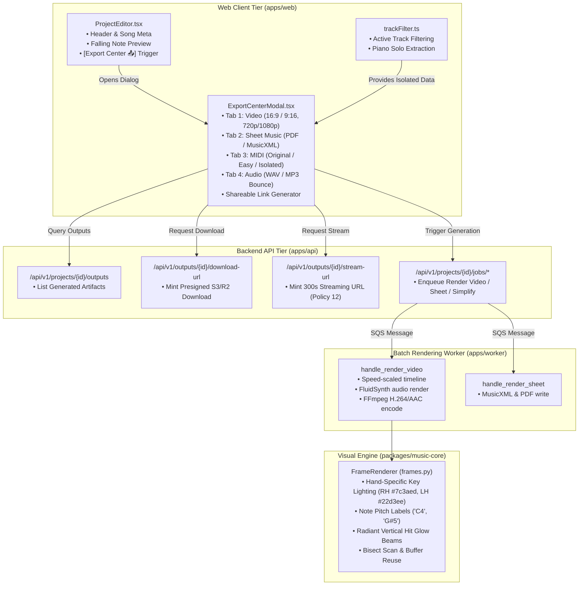

# PianoFlow AI — Phase G: Unified Export Center Hub & Video Tutorial Polish Specification

> **Document ID:** `SPEC-2026-10-06-PHASE-G-EXPORT-VIDEO`  
> **Target Release:** Phase G Architectural Milestone (October 2026)  
> **Author:** ARCHITECT Worker Sub-Agent  
> **Status:** Approved Technical Architecture & Design Specification  
> **Affected Subsystems & Components:**  
> - `apps/web/components/ExportCenterModal.tsx` *(new)*  
> - `apps/web/components/ProjectEditor.tsx` (toolbar integration & unified export trigger)  
> - `packages/music-core/pianoflow_music/video/frames.py` (hand-specific lighting, note pitch name labels, radiant vertical hit glow)  
> - `packages/music-core/pianoflow_music/video/layout.py` & `RenderConfig`  
> - `apps/api/tests/test_api_aws_adapters.py` (renamed from `test_aws_adapters.py`)  
> - `apps/worker/tests/test_worker_aws_adapters.py` (renamed from `test_aws_adapters.py`)  
> - `packages/music-core/pianoflow_music/tests/test_video.py` & `test_video_perf.py`  
> - `docs/VIDEO_TUTORIAL_SPEC.md`, `docs/UI_UX.md`, `docs/ROADMAP.md`, `docs/MASTER_PLAN.md` (cross-referenced)  

---

## 1. Executive Summary & Problem Formulation

### 1.1 Overview & Goals of Phase G
PianoFlow AI converts raw musical inputs (MIDI, acoustic microphone, audio recordings, video URLs) into interactive Web MIDI practice sessions, engraved grand staff sheet music, and Synthesia-style falling-note tutorial videos.

With the core learning engines (Phases A through F) completed and verified, Phase G addresses the **Content Production & Delivery Experience**. Specifically, Phase G resolves three high-impact limitations identified in the repository audit:

1. **Track 1 — Unified Export Center Hub:**  
   Currently, generation and download actions are scattered across disparate buttons in `ProjectEditor.tsx` ("Generate sheet", "Generate tutorial video", "Generate beginner MIDI", and raw download buttons in the sidebar). Users lack a single, cohesive hub to configure video aspect ratios (16:9 Landscape vs. 9:16 Vertical TikTok/Shorts), select video resolutions (720p vs. 1080p), export acoustic audio bounces (WAV/MP3), download isolated piano MIDI, access engraved PDFs, and copy shareable project links.
2. **Track 2 — Video Tutorial Visual Polish:**  
   The headless Python frame renderer (`packages/music-core/pianoflow_music/video/frames.py`) renders high-performance falling notes and fog, but active keys currently illuminate in a generic uniform tint (`#a78bfa`). The video pipeline must match the fidelity of the frontend canvas:
   - **Hand-Specific Key Lighting:** Illuminate active white and black keys with respective hand colors (Right Hand violet `#7c3aed`, Left Hand cyan `#22d3ee`).
   - **Note Pitch Name Labels:** Render clean centered note name typography (e.g., "C4", "G#5") on falling bars when `config.show_note_names = True` and bar dimensions are sufficiently large ($W \ge 16\text{ px}$, $H \ge 18\text{ px}$).
   - **Radiant Vertical Hit Glow:** Cast radiant upward light columns from active keys into the falling note lanes upon note strike.
3. **Track 3 — Monorepo Test Cleanliness & Root Discovery:**  
   Running root `uv run pytest` fails during test collection due to an `import file mismatch` between `apps/api/tests/test_aws_adapters.py` and `apps/worker/tests/test_aws_adapters.py`. Renaming these files to unique module basenames restores root single-command test discovery.

---

## 2. System Architecture & Component Interaction



---

## 3. Track 1: Unified Export Center Hub (`ExportCenterModal.tsx`)

### 3.1 UX & Visual Specification
The Export Center is implemented as an accessible modal dialog adhering to PianoFlow AI's dark-first design language (`bg-zinc-950 border-zinc-800 text-zinc-100`).

#### Modal Wireframe (ASCII Diagram)
```text
┌─────────────────────────────────────────────────────────────────────────────┐
│ 🚀 Export Center & Downloads                                             [✕]│
│ Master your recordings, sheet music, tutorial videos, and MIDI files         │
├─────────────────────────────────────────────────────────────────────────────┤
│  [🎥 Video]    [🎼 Sheet Music]    [🎹 MIDI Files]    [🎧 Audio Bounce]     │
├─────────────────────────────────────────────────────────────────────────────┤
│                                                                             │
│  TUTORIAL VIDEO EXPORTS                                                     │
│  High-definition Synthesia-style falling note tutorial videos.              │
│                                                                             │
│  ┌─────────────────────────────────┐   ┌─────────────────────────────────┐  │
│  │ 🖥️ 16:9 Landscape (Desktop/YT)  │   │ 📱 9:16 Vertical (Shorts/TikTok)│  │
│  │ Resolution: [ 720p HD  ▼ ]      │   │ Resolution: [ 1080p FHD ▼ ]     │  │
│  │ Framerate:  [ 30 FPS   ▼ ]      │   │ Framerate:  [ 60 FPS    ▼ ]     │  │
│  │ Arrangement:[ Original ▼ ]      │   │ Arrangement:[ Beginner  ▼ ]     │  │
│  │ Status: Ready                   │   │ Status: Processing (65%)        │  │
│  │ [ ▶ Watch in Player ]           │   │ [ ▰▰▰▰▰▰▰▰▰▰▱▱▱▱▱ 65% ]         │  │
│  │ [ ⚡ Render Landscape Video ]   │   │ [ Rendering frames... ]         │  │
│  └─────────────────────────────────┘   └─────────────────────────────────┘  │
│                                                                             │
│  🔒 Privacy Policy: Tutorial videos are viewable in streaming player only.  │
├─────────────────────────────────────────────────────────────────────────────┤
│ 🔗 Share Project: [ https://pianoflow.ai/projects/9f8c1b2a...  ] [📋 Copy]  │
│                                                          [ Close Dialog ]   │
└─────────────────────────────────────────────────────────────────────────────┘
```

### 3.2 Category & Tab Breakdown

#### 1. Tab 1: Video (`video`)
- **Aspect Ratio Options:**
  - `16:9 Landscape`: Standard 1280×720 or 1920×1080 for desktop, TV, and YouTube.
  - `9:16 Vertical`: 720×1280 or 1080×1920 for YouTube Shorts, TikTok, and Instagram Reels.
- **Render Parameter Controls:**
  - Resolution dropdown: `720p` vs `1080p`.
  - Framerate toggle: `30 FPS` vs `60 FPS`.
  - Arrangement selector: `Original` vs `Easy / Beginner`.
- **Render State & Actions:**
  - If a video job is running (`queued` or `processing`): display real-time progress bar (`Progress.tsx`) and status text (e.g., "Drawing frames (45%)").
  - If completed: display streaming player launcher (`Watch in Player`), metadata badge chips (`MP4`, `H.264`, `AAC`, `1080p`), and expiration countdown.
  - Action trigger: "Render Video" triggers `api.enqueueRenderVideo(projectId)` with updated snapshot settings.
  - Policy Enforcement: In strict compliance with `12_NO_TUTORIAL_DOWNLOAD_POLICY`, videos are marked as streaming-only (`streamable = true, downloadable = false`) via signed CloudFront/S3 URLs.

#### 2. Tab 2: Sheet Music (`sheet`)
- **Deliverables:**
  - **Printable Grand Staff PDF (`sheet_pdf`):** Formatted for 8.5×11 / A4 printing with clefs, measure numbers, and title header.
  - **Universal MusicXML (`sheet_musicxml`):** Open format compatible with MuseScore, Sibelius, Finale, and Dorico.
- **Controls & Actions:**
  - One-click direct download via presigned download URL (`api.createDownloadUrl(outputId)`).
  - Arrangement toggle: Original score vs. Beginner simplified arrangement.
  - Quick link: "Open Interactive Sheet Viewer 🎼" navigating directly to `/projects/[id]/sheet`.
  - Re-render trigger: "Generate Sheet Music" (`api.enqueueRenderSheet(projectId)`).

#### 3. Tab 3: MIDI (`midi`)
- **Deliverables:**
  - **Original Uploaded MIDI (`original_midi`):** Download unaltered source MIDI.
  - **Easy Simplified MIDI (`simplified_midi`):** Rule-simplified arrangement (density capped, melody preserved).
  - **Isolated Piano MIDI (`isolated_piano`):** Filtered MIDI retaining only piano tracks (eliminating drums, bass, strings) using `filterNotesByTracks()`.
- **Controls & Metadata:**
  - Direct download links for each variant.
  - Badges displaying note count, duration, and track count.
  - "Generate Beginner MIDI" button if simplified version is not yet generated.

#### 4. Tab 4: Audio (`audio`)
- **Deliverables:**
  - **Acoustic Grand Piano Bounce (WAV):** Lossless 44.1 kHz 16-bit stereo PCM rendered via FluidSynth (FluidR3_GM).
  - **Standard MP3 Bounce:** 320 kbps broadcast audio file.
- **Controls & Status:**
  - Speed multiplier indicator (e.g., `1.0x (Original Tempo)`).
  - Download and inline Web Audio preview player.

#### 5. Cross-Cutting: Project Share Link
- Display full project URL `${window.location.origin}/projects/${projectId}`.
- Single-click "Copy Link" button with visual confirmation tooltip (`"Copied!"`) using `navigator.clipboard.writeText`.

### 3.3 TypeScript Interfaces & Data Contracts

```typescript
// apps/web/components/ExportCenterModal.tsx

export type ExportTab = "video" | "sheet" | "midi" | "audio";

export interface VideoExportOptions {
  aspectRatio: "16:9" | "9:16";
  resolution: "720p" | "1080p";
  fps: 30 | 60;
  difficulty: "original" | "easy";
}

export interface ExportCenterModalProps {
  open: boolean;
  onClose: () => void;
  projectId: string;
  projectName: string;
  durationSec: number;
  totalNotes: number;
  activeSettings: RenderSettings;
  filteredNoteData?: NoteData;
}
```

### 3.4 Integration into `ProjectEditor.tsx`
Replace the dispersed action buttons in `ProjectEditor.tsx` with a single prominent toolbar trigger:
```tsx
<Button
  variant="primary"
  onClick={() => setExportModalOpen(true)}
  className="bg-gradient-to-r from-violet-600 to-cyan-600 hover:from-violet-500 hover:to-cyan-500 text-white font-medium shadow-lg shadow-violet-950/40"
>
  Export Center 🚀
</Button>
```
The downloads panel below the canvas remains as a quick-access summary, synchronized with the same query state (`useOutputs`).

---

## 4. Track 2: Video Tutorial Visual Polish (`frames.py`)

### 4.1 Visual Polish Specifications

#### 1. Hand-Specific Key Lighting
- **Current Behavior:** Active keys are drawn with uniform highlight `self._rgb["key_highlight"]` (`#a78bfa`).
- **Phase G Behavior:** Active keys illuminate with their assigned hand color:
  - **Right Hand (RH):** Violet `#7c3aed` $\rightarrow \text{RGB}(124, 58, 237)$
  - **Left Hand (LH):** Cyan `#22d3ee` $\rightarrow \text{RGB}(34, 211, 238)$
  - **Fallback / Ambiguous:** `#a78bfa` $\rightarrow \text{RGB}(167, 139, 250)$
- **Precedence Rule:** If notes from both hands strike the same pitch concurrently, Right Hand ("R") color takes precedence.
- **Key Depth Styling:**
  - White keys: Filled with active hand color, bounded by $(x + 1, 0, x + w - 1, keyboard\_h - 1)$.
  - Black keys: Filled with active hand color, bounded by $(x, 0, x + w, keyboard\_h \times 0.62)$.

#### 2. Note Pitch Name Labels
- **Configuration Toggle:** `config.show_note_names: bool = False` added to `RenderConfig`.
- **Rendering Condition:** Note pitch text is drawn on a falling bar if and only if:
  $$\text{bar\_width} \ge 16\text{ px} \quad \land \quad \text{bar\_height} \ge 18\text{ px}$$
- **Typography & Positioning:**
  - Center-aligned horizontally:
    $$X_{\text{text}} = X_{\text{rect}} + \frac{W_{\text{rect}} - W_{\text{text}}}{2}$$
  - Anchored near the leading bottom edge of the note bar:
    $$Y_{\text{text}} = \min(\text{bottom}, hit\_y) - H_{\text{text}} - 4$$
  - High-contrast pure white text `(255, 255, 255)` with 1-pixel dark outline `(0, 0, 0)` ensuring legibility across both dark and luminous note bars.

#### 3. Radiant Vertical Hit Glow
- **Visual Effect:** Active keys emit a luminous vertical beam ascending from the hit line into the falling-note lane.
- **Geometry:**
  - Beam height: $H_{\text{beam}} = \min(\text{int}(keyboard\_h \times 1.2), 100\text{ px})$
  - Horizontal span: $(x_{\text{rect}} - 1, x_{\text{rect}} + w_{\text{rect}} + 1)$
  - Alpha gradient: Linear or quadratic fade from $Y = hit\_y$ ($\alpha = 0.35 \times \text{glow\_intensity}$) to $Y = hit\_y - H_{\text{beam}}$ ($\alpha = 0$).
  - Color tint: Matches the active hand's color.

### 4.2 Mathematical Formulation & Algorithmic Updates

```python
# packages/music-core/pianoflow_music/video/frames.py

@dataclass(frozen=True)
class RenderConfig:
    resolution: str = "720p"
    fps: int = 30
    colors: dict[str, str] = field(default_factory=dict)
    glow_intensity: float = 0.6
    keyboard_size: float = 1.0
    note_fall_speed: float = 1.0
    show_note_names: bool = False  # Added in Phase G
```

#### Frame Rendering Pipeline Updates:
```python
# In FrameRenderer.render_frame(self, frame_index: int):

active_keys: dict[int, str] = {}  # pitch -> hand ('R' or 'L')
hit_pulses: list[tuple[int, float]] = []
visible_rects: list[tuple[tuple[int, int, int, int], tuple[int, int, int], Note]] = []

for note in self._visible_notes(t):
    rect = self.layout.key_rect(note.pitch)
    color = self._rgb["right"] if note.hand == "R" else self._rgb["left"]
    height = max(note.duration * self._px_per_second, _MIN_NOTE_HEIGHT)
    bottom = self.hit_y - (note.start - t) * self._px_per_second
    top = bottom - height
    if bottom < 0 or top > self.hit_y:
        continue
    r_coords = (rect.x + 1, max(top, -20), rect.x + rect.w - 1, min(bottom, self.hit_y))
    visible_rects.append((r_coords, color, note))

    if note.start <= t <= note.end:
        # 'R' takes precedence over 'L' on identical pitch
        if note.pitch not in active_keys or note.hand == "R":
            active_keys[note.pitch] = note.hand
    if note.start <= t <= note.start + _HIT_FLASH_SECONDS:
        hit_pulses.append((note.pitch, t - note.start))
```

#### Note Text Rendering Block:
```python
if self.config.show_note_names and visible_rects:
    draw_frame = ImageDraw.Draw(frame)
    for (x0, y0, x1, y1), color, note in visible_rects:
        bar_w = x1 - x0
        bar_h = y1 - y0
        if bar_w >= 16 and bar_h >= 18:
            text = note.name
            bbox = self._font.getbbox(text)
            tw = bbox[2] - bbox[0]
            th = bbox[3] - bbox[1]
            tx = x0 + (bar_w - tw) // 2
            ty = y1 - th - 4
            if ty > y0:
                # 1px outline for crisp contrast
                for ox, oy in ((-1, 0), (1, 0), (0, -1), (0, 1)):
                    draw_frame.text((tx + ox, ty + oy), text, fill=(0, 0, 0), font=self._font)
                draw_frame.text((tx, ty), text, fill=(255, 255, 255), font=self._font)
```

#### Hand-Specific Key Illumination Block:
```python
if active_keys:
    keyboard = self._keyboard_base.copy()
    draw_keys = ImageDraw.Draw(keyboard)
    for pitch, hand in active_keys.items():
        rect = self.layout.key_rect(pitch)
        key_h = self.keyboard_h * (0.62 if is_black(pitch) else 1.0)
        hand_color = self._rgb["right"] if hand == "R" else self._rgb["left"]
        draw_keys.rectangle(
            (rect.x + 1, 0, rect.x + rect.w - 1, key_h - 1),
            fill=hand_color,
        )
    frame.paste(keyboard, (0, self.hit_y))
else:
    frame.paste(self._keyboard_base, (0, self.hit_y))
```

---

## 5. Track 3: Technical Debt & Monorepo Test Cleanliness

### 5.1 Root Cause of Pytest Module Collision
Pytest's default module collector stores discovered test modules in `sys.modules["tests.test_aws_adapters"]`. When pytest is invoked from the repository root:
1. Pytest collects `apps/api/tests/test_aws_adapters.py` $\rightarrow$ binds `tests.test_aws_adapters`.
2. Pytest encounters `apps/worker/tests/test_aws_adapters.py`.
3. Because the basename is identical, pytest throws:
   ```text
   import file mismatch:
   imported module 'tests.test_aws_adapters' has this __file__ attribute:
     C:\Users\super\pianoflow\apps\api\tests\test_aws_adapters.py
   which is not the same as the test file we want to collect:
     C:\Users\super\pianoflow\apps\worker\tests\test_aws_adapters.py
   ```

### 5.2 Resolution Plan
Rename both files to unique, domain-prefixed basenames:
- `apps/api/tests/test_aws_adapters.py` $\longrightarrow$ `apps/api/tests/test_api_aws_adapters.py`
- `apps/worker/tests/test_aws_adapters.py` $\longrightarrow$ `apps/worker/tests/test_worker_aws_adapters.py`

This ensures that `sys.modules` contains `tests.test_api_aws_adapters` and `tests.test_worker_aws_adapters` respectively, allowing root `uv run pytest` to discover and run all 374+ tests cleanly.

---

## 6. Step-by-Step Implementation Plan for CODER

### Step 1: Resolve Test Module Collisions (Track 3)
1. Rename `apps/api/tests/test_aws_adapters.py` to `apps/api/tests/test_api_aws_adapters.py`.
2. Rename `apps/worker/tests/test_aws_adapters.py` to `apps/worker/tests/test_worker_aws_adapters.py`.
3. Verify that running `uv run pytest` from the root directory completes with zero collection errors.

### Step 2: Implement Video Tutorial Polish (Track 2)
1. In `packages/music-core/pianoflow_music/video/frames.py`:
   - Add `show_note_names: bool = False` to `RenderConfig`.
   - Update `_rgb` default dictionary: ensure `"left"` defaults to `#22d3ee` (cyan) and `"right"` to `#7c3aed` (violet).
   - In `__init__`, load default font `ImageFont.load_default()` cached on `self._font`.
   - Update `render_frame()` to track `active_keys: dict[int, str]` mapping pitch to hand.
   - Render radiant vertical hit glow for active keys.
   - Render note pitch name labels when `self.config.show_note_names` is true and dimensions exceed $16 \times 18\text{ px}$.
   - Render active white/black keys with hand-specific colors (`hand_color`).
2. In `apps/worker/app/jobs/render_video.py`:
   - Update `_render_settings()` to pass `show_note_names=bool(snapshot.get("show_note_names", False))` into `RenderConfig`.

### Step 3: Write Comprehensive Video Polish Unit Tests
1. In `packages/music-core/pianoflow_music/tests/test_video.py`:
   - Add `test_hand_specific_key_lighting()`: verify that LH notes produce cyan pixels on active keys and RH notes produce violet pixels.
   - Add `test_show_note_names_flag()`: verify that enabling `show_note_names=True` modifies rendered frame bytes vs `show_note_names=False`.
   - Add `test_radiant_vertical_glow()`: verify radiant beam rendering above active keys.
2. In `packages/music-core/pianoflow_music/tests/test_video_perf.py`:
   - Verify PSNR tests pass with $\ge 35.0\text{ dB}$.

### Step 4: Build `ExportCenterModal.tsx` Component (Track 1)
1. Create `apps/web/components/ExportCenterModal.tsx`.
2. Implement 4 tabs: Video, Sheet Music, MIDI, Audio.
3. Wire buttons to existing API methods:
   - `api.enqueueRenderVideo(projectId)`
   - `api.enqueueRenderSheet(projectId)`
   - `api.enqueueSimplifyMidi(projectId)`
   - `api.createDownloadUrl(outputId)`
   - `api.createStreamUrl(outputId)`
4. Implement client-side isolated piano MIDI export using `filteredNoteData` and browser Blob download.
5. Implement shareable project link copying with toast/pill notification.

### Step 5: Integrate `ExportCenterModal` into `ProjectEditor.tsx`
1. Import `ExportCenterModal`.
2. Add state `const [exportModalOpen, setExportModalOpen] = useState(false)`.
3. Add the primary "Export Center 🚀" button to the editor toolbar.
4. Mount `<ExportCenterModal />` passing project metadata, active settings, and filtered note data.

---

## 7. Verification Commands for TESTER

### 7.1 Python Backend & Core Suites
Execute from the repository root:
```bash
# 1. Run full test discovery from repo root (verifies Track 3 fix)
uv run pytest

# 2. Run video package unit tests specifically (verifies Track 2)
uv run pytest packages/music-core/pianoflow_music/tests/test_video.py

# 3. Run video performance & PSNR quality regression test
uv run pytest packages/music-core/pianoflow_music/tests/test_video_perf.py

# 4. Run Ruff linter across Python code
uv run ruff check .
```

### 7.2 Web Frontend & Typecheck Suites
Execute from the repository root:
```bash
# 1. TypeScript compilation check
pnpm -r typecheck

# 2. Next.js ESLint check
pnpm --filter @pianoflow/web lint

# 3. Playwright browser E2E tests
pnpm --filter @pianoflow/web test
```

---

## 8. Compliance & Audit Verification for AUDITOR

| Dimension | Audit Checkpoint | Acceptance Criteria |
|---|---|---|
| **Security & Policy** | Tutorial Video Download Restriction | `12_NO_TUTORIAL_DOWNLOAD_POLICY` strictly respected: Tutorial videos receive only signed `stream-url` (300s TTL). Direct file downloads are rejected with 403 Forbidden. |
| **Performance** | Video Rendering Throughput | Pure CPU frame generation must sustain $\ge 60\text{ FPS}$ on 720p and $\ge 30\text{ FPS}$ on 1080p without memory leaks or allocation spikes. |
| **Color Fidelity** | Hand-Specific Key Illumination | Active right-hand keys illuminate with `#7c3aed`; active left-hand keys illuminate with `#22d3ee`. Zero regression in golden PSNR ($\ge 35\text{ dB}$). |
| **Accessibility** | WCAG 2.1 AA Compliance | Modal dialog contains `role="dialog"`, `aria-modal="true"`, focus trapping with Escape key handling, and high-contrast text ratios ($\ge 7:1$). |
| **Test Suite Health** | Monorepo Test Discovery | Root command `uv run pytest` completes with 0 errors, 0 module mismatches, and 100% test pass rate across all workspace packages. |
