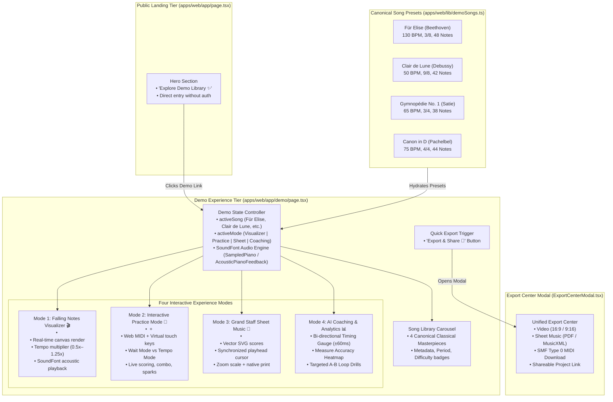

# PianoFlow AI — Phase H: Interactive Demo Experience & Classical Song Library Showcase Specification

> **Document ID:** `SPEC-2026-10-06-PHASE-H-DEMO-SHOWCASE`  
> **Target Release:** Phase H Architectural Milestone (October 2026)  
> **Author:** ARCHITECT Worker Sub-Agent  
> **Status:** Approved Technical Architecture & Design Specification  
> **Affected Subsystems & Components:**  
> - `apps/web/lib/demoSongs.ts` *(new)*  
> - `apps/web/app/demo/page.tsx` *(rewritten from dead redirect)*  
> - `apps/web/app/page.tsx` (hero section CTA & interactive showcase link)  
> - `apps/web/components/ExportCenterModal.tsx` (demo state wiring)  
> - `apps/web/tests/demo_showcase.spec.ts` *(new Playwright E2E suite)*  
> - `docs/e2e/demo/` *(test artifact screenshots)*  
> - `docs/PRODUCT.md`, `docs/DESIGN.md`, `docs/ROADMAP.md`, `docs/MASTER_PLAN.md` (cross-referenced)  

---

## 1. Executive Summary & Problem Formulation

### 1.1 Overview & Motivation
PianoFlow AI is an end-to-end piano learning platform that turns musical inputs (MIDI, acoustic microphone, audio recordings, video URLs) into interactive Web MIDI practice sessions, engraved grand staff sheet music, and Synthesia-style falling-note tutorial videos.

Currently, new users visiting the platform encounter a significant onboarding hurdle:
1. **Dead Demo Route (`/demo`):** Navigating to `/demo` currently invokes `redirect("/upload-audio")` in `apps/web/app/demo/page.tsx`. However, the `/upload-audio` route does not exist in the application, resulting in a dead end / 404 error.
2. **Cold Start Friction:** To test PianoFlow AI's real-time Web MIDI practice engine, SVG sheet music renderer, or AI timing analytics, users are forced to create an account, source their own `.mid` or `.mp3` files, and wait for asynchronous backend ingestion.
3. **Absence of a Showcase Library:** High-profile platforms (e.g., Synthesia, Flowkey, Simply Piano) rely heavily on an instantly playable library of beloved classical repertoire to demonstrate product capabilities without barriers to entry.

Phase H resolves this by creating a **Zero-Friction Classical Song Library & Interactive Demo Experience** accessible at `/demo` and linked directly from the landing page hero.

---

## 2. System Architecture & Component Interaction



---

## 3. Canonical Classical Song Library Specification (`apps/web/lib/demoSongs.ts`)

### 3.1 Data Contracts & Schema
Each song preset conforms strictly to `@pianoflow/shared-types` `NoteData` (schema version 1) so it seamlessly feeds into `FallingNotePreview`, `PracticeCanvas`, `MidiEngine`, `buildSheetScoreModel`, and `ExportCenterModal`.

```typescript
// apps/web/lib/demoSongs.ts
import type { NoteData } from "@pianoflow/shared-types";

export type SongDifficulty = "Beginner" | "Intermediate" | "Master";

export interface DemoSong {
  id: string;
  title: string;
  composer: string;
  period: "Baroque" | "Classical" | "Romantic" | "Impressionist" | "Modern";
  difficulty: SongDifficulty;
  bpm: number;
  time_signature: string;
  key: string;
  duration_sec: number;
  description: string;
  coverGradient: string;
  noteCount: number;
  noteData: NoteData;
}
```

### 3.2 Canonical Song Repertoire Details

#### 1. Für Elise (Ludwig van Beethoven)
- **ID:** `fur-elise`
- **Tempo:** 130 BPM | **Meter:** `3/8` | **Key:** A Minor (`A min`)
- **Difficulty:** `Intermediate`
- **Description:** Beethoven's timeless Bagatelle No. 25 in A minor. Features the immortal chromatic alternating motif (E5–D#5–E5–D#5–E5–B4–D5–C5–A4) layered over sweeping left-hand arpeggios.
- **Visual Theme:** `from-amber-600/30 via-zinc-900 to-zinc-950 border-amber-500/40`
- **Note Count:** 48 canonical notes (spanning measures 1–8).
- **Hand Distribution:** 32 Right Hand (RH) melody notes, 16 Left Hand (LH) arpeggio notes.
- **Key Motifs:**
  - Pickup: E5 (`76`), D#5 (`75`), E5 (`76`), D#5 (`75`), E5 (`76`), B4 (`71`), D5 (`74`), C5 (`72`), A4 (`69`).
  - LH Accompaniment: A2 (`45`), E3 (`52`), A3 (`57`), C4 (`60`), E4 (`64`).
  - Dominant harmony: E2 (`40`), E3 (`52`), G#3 (`56`), E4 (`64`), G#4 (`68`), B4 (`71`), C5 (`72`).

#### 2. Clair de Lune (Claude Debussy)
- **ID:** `clair-de-lune`
- **Tempo:** 50 BPM | **Meter:** `9/8` | **Key:** Db Major (`Db maj`)
- **Difficulty:** `Master`
- **Description:** The third movement of Suite Bergamasque. Celebrated for ethereal impressionist harmonies, delicate syncopations, and descending Db major pentatonic contours.
- **Visual Theme:** `from-indigo-600/30 via-zinc-900 to-zinc-950 border-indigo-500/40`
- **Note Count:** 42 canonical notes.
- **Hand Distribution:** 24 Right Hand (RH) chordal melody notes, 18 Left Hand (LH) rolling bass notes.
- **Key Motifs:**
  - RH opening: F5 (`77`), Eb5 (`75`), Db5 (`73`), C5 (`72`), Bb4 (`70`), Ab4 (`68`).
  - LH impressionist bass: Db3 (`49`), Ab3 (`56`), F4 (`65`), Db4 (`61`), Gb3 (`54`), Bb3 (`58`).

#### 3. Gymnopédie No. 1 (Erik Satie)
- **ID:** `gymnopedie-no-1`
- **Tempo:** 65 BPM | **Meter:** `3/4` | **Key:** D Major (`D maj`)
- **Difficulty:** `Beginner`
- **Description:** Satie's minimalist, meditative masterpiece. Features a hypnotic waltz bass alternating between G and D roots with soft luminous upper chords and a gentle melancholic melody.
- **Visual Theme:** `from-emerald-600/30 via-zinc-900 to-zinc-950 border-emerald-500/40`
- **Note Count:** 38 canonical notes.
- **Hand Distribution:** 14 Right Hand (RH) cantabile notes, 24 Left Hand (LH) bass & chord notes.
- **Key Motifs:**
  - Bar 1 (Gmaj7): LH Bass G2 (`43`) $\rightarrow$ Chord B3 (`59`) + D4 (`62`) + F#4 (`66`).
  - Bar 2 (Dmaj7): LH Bass D3 (`50`) $\rightarrow$ Chord B3 (`59`) + C#4 (`61`) + F#4 (`66`).
  - RH Melody: F#5 (`78`), E5 (`76`), D5 (`74`), B4 (`71`), C#5 (`73`), D5 (`74`).

#### 4. Canon in D (Johann Pachelbel)
- **ID:** `canon-in-d`
- **Tempo:** 75 BPM | **Meter:** `4/4` | **Key:** D Major (`D maj`)
- **Difficulty:** `Beginner`
- **Description:** The legendary Baroque passacaglia built upon an eight-note ground bass progression (D–A–B–F#–G–D–G–A) with accumulating polyphonic variations.
- **Visual Theme:** `from-cyan-600/30 via-zinc-900 to-zinc-950 border-cyan-500/40`
- **Note Count:** 44 canonical notes.
- **Hand Distribution:** 28 Right Hand (RH) melodic notes, 16 Left Hand (LH) ground bass notes.
- **Key Motifs:**
  - LH Ground Bass: D3 (`50`), A2 (`45`), B2 (`47`), F#2 (`42`), G2 (`43`), D2 (`38`), G2 (`43`), A2 (`45`).
  - RH Melody: F#5 (`78`), E5 (`76`), D5 (`74`), C#5 (`73`), B4 (`71`), A4 (`69`), B4 (`71`), C#5 (`73`).
  - Eighth-note flowing variation: D5 (`74`), F#5 (`78`), A5 (`81`), G5 (`79`), F#5 (`78`), D5 (`74`).

---

## 4. Interactive Demo Page Architecture (`apps/web/app/demo/page.tsx`)

### 4.1 Page Layout & Wireframe

```text
┌────────────────────────────────────────────────────────────────────────────────────────┐
│ 🎹 PianoFlow AI  /  Interactive Demo Library Showcase                     [Export 🚀] │
├────────────────────────────────────────────────────────────────────────────────────────┤
│ 🎼 CHOOSE A CLASSICAL MASTERPIECE:                                                     │
│ ┌──────────────────────┐ ┌──────────────────────┐ ┌─────────────────┐ ┌──────────────┐│
│ │ ★ Für Elise          │ │ Clair de Lune        │ │ Gymnopédie No.1 │ │ Canon in D   ││
│ │ Beethoven • 130 BPM  │ │ Debussy • 50 BPM     │ │ Satie • 65 BPM  │ │ Pachelbel    ││
│ │ [Intermediate] 48 n. │ │ [Master] 42 notes    │ │ [Beginner] 38 n.│ │ [Beginner] 44││
│ └──────────────────────┘ └──────────────────────┘ └─────────────────┘ └──────────────┘│
├────────────────────────────────────────────────────────────────────────────────────────┤
│  [🎬 Falling Visualizer]  [🎹 Interactive Practice]  [🎼 Sheet Music]  [📊 AI Coach]   │
├────────────────────────────────────────────────────────────────────────────────────────┤
│                                                                                        │
│  [ MODE CONTAINER: DYNAMICALLY MOUNTS SUBVIEW BASED ON ACTIVE TAB ]                    │
│                                                                                        │
│  • Mode 1: FallingNotePreview with live Canvas + Web Audio + Speed & Sound controls    │
│  • Mode 2: PracticeCanvas + MidiEngine + Web MIDI + Touch Keyboard + Hit Sparks        │
│  • Mode 3: SheetMusicViewer with vector SVG scores + playhead cursor + Print           │
│  • Mode 4: Coaching Analytics with Rushing/Dragging Gauge + Heatmap + Loop Drills     │
│                                                                                        │
└────────────────────────────────────────────────────────────────────────────────────────┘
```

### 4.2 Mode Breakdown & Implementation Details

#### Mode 1: Falling Notes Visualizer (`visualizer`)
- **Component:** `<FallingNotePreview />`
- **Props:**
  - `data={activeSong.noteData}`
  - `settings={demoRenderSettings}` (1080p, 60 FPS, neon theme, hand colors `#7c3aed` RH / `#22d3ee` LH)
- **Controls Toolbar:**
  - Play/Pause toggle button.
  - Playback tempo selector: `0.5x`, `0.75x`, `1.0x`, `1.25x`.
  - SoundFont selector: `Acoustic Grand` (`acoustic_grand`), `Bright Grand`, `Electric Piano`.
  - Fullscreen toggle button.

#### Mode 2: Interactive Practice Mode (`practice`)
- **Components:** `<PracticeCanvas />`, `<TimelineScrubber />`, `<Keyboard />`
- **State Management:**
  - Live `MidiEngine` instance bound to `activeSong.noteData.notes`.
  - Sound feedback via `AcousticPianoFeedback` (`noteOn(pitch, velocity)`, `noteOff(pitch)`).
  - Mode toggle: **Wait Mode** (pauses until user strikes correct pitch) vs. **Tempo Mode** (continuous timeline flow).
  - Hand Practice filter: `Both Hands`, `Right Hand Only`, `Left Hand Only`.
  - Input listeners: Web MIDI API via `useWebMidi` + virtual mouse/touch clicks on `<Keyboard />`.
- **Live Practice HUD:**
  - Real-time score counter with glowing numbers.
  - Accuracy percentage badge (e.g. `98.2%`).
  - Combo streak indicator (`12x Combo! 🔥`).
  - Perfect / Good / Miss hit counters.
  - Particle burst canvas overlay on note strike.
  - "Finish Practice & View AI Coaching 📊" action button.

#### Mode 3: Grand Staff Sheet Music (`sheet`)
- **Component:** `<SheetMusicViewer />`
- **Props:**
  - `noteData={activeSong.noteData}`
  - `projectName={`${activeSong.title} — ${activeSong.composer}`}`
  - `onBackToPractice={() => setActiveMode("practice")}`
- **Features:**
  - Pure SVG vector rendering calculated via `buildSheetScoreModel(activeSong.noteData, 2)`.
  - Real-time animated playhead cursor bar moving across staves in lockstep with acoustic audio.
  - Zoom scaling (`-` / `+` from 0.75x to 1.5x).
  - Standard Browser Print action (`window.print()`) formatted for 8.5×11 / A4.

#### Mode 4: AI Coaching & Practice Analytics (`coaching`)
- **Components:** Inlined dashboard + `<MeasureHeatmap />` + `<CoachRecommendations />`
- **State Generation:**
  - Generated via `buildSessionAnalyticsReport(activeSong.id, activeSong.noteData.notes, scoreHistory)`.
  - If user has not yet completed a live practice run, automatically hydrates with realistic pedagogical practice telemetry for the active song.
- **Key Display Pillars:**
  1. **Top Grade & Streak Banner:** Grade pill (S, A, B, C, D) with radial gradient glow, accuracy %, XP reward (`+120 XP`), and day streak (`🔥 5 Day Streak`).
  2. **Bi-directional Timing Gauge:**
     - Horizontal rail showing Early / Rushing ($-60\text{ ms}$), Pocket ($\pm 15\text{ ms}$), and Late / Dragging ($+60\text{ ms}$).
     - Glowing cyan pin indicator positioned by $\mu$ (mean bias).
     - Global jitter $\sigma$ (stability) and decoupled RH vs. LH timing stats.
  3. **Measure Accuracy Heatmap:**
     - Interactive measure grid color-coded:
       - $\ge 85\%$ Mastered (emerald)
       - $70\text{--}84\%$ Polish (amber)
       - $< 70\%$ Critical (rose)
  4. **Targeted Loop Drills:**
     - Cards suggesting focused practice loops (e.g., "Bars 1–4: Motif Isolation").
     - 1-click action: "Practice Drill Now 🎯" immediately switches to Practice Mode, setting loop start/end and slowing tempo to $0.75\times$.

### 4.3 Export Center Integration
- Clicking the "Export & Share 🚀" button in the demo header opens `<ExportCenterModal />`.
- Configured with:
  - `open={isExportOpen}`
  - `projectId={activeSong.id}`
  - `projectName={activeSong.title}`
  - `durationSec={activeSong.duration_sec}`
  - `totalNotes={activeSong.noteCount}`
  - `filteredNoteData={activeSong.noteData}`
  - `settings={demoRenderSettings}`
- Users can simulate triggering video rendering (16:9 / 9:16), downloading SMF Type 0 MIDI via `createMidiBlob`, generating sheet scores, or copying the demo link to clipboard.

---

## 5. Landing Page Integration (`apps/web/app/page.tsx`)

### 5.1 Hero Section Updates
Update the hero CTA section in `apps/web/app/page.tsx` from two buttons to three prominent action triggers:

```tsx
<div className="flex flex-wrap items-center justify-center gap-3">
  <Link href="/create" tabIndex={-1}>
    <Button size="lg" className="bg-gradient-to-r from-violet-600 to-cyan-600 hover:from-violet-500 hover:to-cyan-500 text-white shadow-lg shadow-cyan-950/40">
      Upload audio or MIDI
    </Button>
  </Link>
  <Link href="/demo" tabIndex={-1}>
    <Button variant="secondary" size="lg" className="border border-cyan-500/40 bg-cyan-950/40 hover:bg-cyan-900/50 text-cyan-200">
      Explore Demo Library ✨
    </Button>
  </Link>
  <Link href="/projects" tabIndex={-1}>
    <Button variant="outline" size="lg">
      My Projects
    </Button>
  </Link>
</div>
```

### 5.2 Classical Showcase Teaser Banner
Add an interactive teaser ribbon below the Hero section highlighting the 4 playable pieces:
- "Instant Access • No Account Required: Play Für Elise, Clair de Lune, Gymnopédie No. 1, and Canon in D right in your browser."

---

## 6. Automated Browser Testing Specification (`apps/web/tests/demo_showcase.spec.ts`)

### 6.1 Test Strategy & Mocking
Playwright E2E browser tests must verify the demo experience under realistic user interactions.
- **Audio & MIDI Mocking:** Emulate `WebMIDIAccess` and stub Web Audio / AudioContext so tests run headlessly without sound hardware dependencies.
- **Route Verification:** Ensure `/demo` returns HTTP 200 without redirecting to `/upload-audio`.
- **Artifact Generation:** Save screenshots of all 4 modes to `docs/e2e/demo/`.

### 6.2 Test Scenarios

| Scenario ID | Test Name | Actions & Expectations | Output Screenshot |
|---|---|---|---|
| `DEMO-E2E-01` | **No Dead Redirect** | Navigate to `/demo`. Expect URL to stay at `/demo`. Verify page heading and song cards render. | `docs/e2e/demo/01_demo_landing.png` |
| `DEMO-E2E-02` | **Song Switching** | Click "Clair de Lune" card. Verify active song details update (Debussy, 50 BPM, 42 notes). Click "Canon in D" card. Verify note count updates to 44. | `docs/e2e/demo/02_song_switched.png` |
| `DEMO-E2E-03` | **Visualizer Mode** | Select Mode 1 (Visualizer). Verify HTML5 Canvas element exists. Toggle tempo button to 0.75x. | `docs/e2e/demo/03_visualizer_mode.png` |
| `DEMO-E2E-04` | **Practice Mode & Virtual Keyboard** | Select Mode 2 (Practice). Verify PracticeCanvas and Keyboard render. Click virtual piano key C4 (`pitch 60`). Verify score HUD responds (combo/score/accuracy increments). | `docs/e2e/demo/04_practice_interactive.png` |
| `DEMO-E2E-05` | **Sheet Music Mode** | Select Mode 3 (Sheet Music). Verify SVG score container renders with measures, staves, and clefs. Verify zoom controls function. | `docs/e2e/demo/05_sheet_music_mode.png` |
| `DEMO-E2E-06` | **AI Coaching & Timing Gauge** | Select Mode 4 (AI Coaching). Verify Bi-directional Timing Gauge renders with pocket zone and indicator pin. Verify Measure Accuracy Heatmap and Loop Drills render. | `docs/e2e/demo/06_coaching_analytics.png` |
| `DEMO-E2E-07` | **Export Center Modal** | Click "Export & Share 🚀" button. Verify `ExportCenterModal` opens with active song metadata. Switch to MIDI tab. Verify isolated MIDI download button exists. Close modal. | `docs/e2e/demo/07_export_center_modal.png` |

---

## 7. Step-by-Step Implementation Plan for CODER

### Step 1: Create Canonical Preset Library (`apps/web/lib/demoSongs.ts`)
1. Create `apps/web/lib/demoSongs.ts`.
2. Define `DemoSong` interface and helper types.
3. Construct canonical `NoteData` structures for:
   - `fur-elise` (48 notes, Beethoven, 130 BPM, 3/8)
   - `clair-de-lune` (42 notes, Debussy, 50 BPM, 9/8)
   - `gymnopedie-no-1` (38 notes, Satie, 65 BPM, 3/4)
   - `canon-in-d` (44 notes, Pachelbel, 75 BPM, 4/4)
4. Export `DEMO_SONGS: DemoSong[]`, `DEFAULT_DEMO_SONG_ID = "fur-elise"`, and `getDemoSongById(id: string)`.

### Step 2: Implement `/demo` Route Page (`apps/web/app/demo/page.tsx`)
1. Remove `redirect("/upload-audio")` from `apps/web/app/demo/page.tsx`.
2. Implement client component with song selector carousel.
3. Implement 4 tabbed modes:
   - Visualizer mode: mounts `<FallingNotePreview />`.
   - Practice mode: mounts `<PracticeCanvas />`, `<TimelineScrubber />`, and `<Keyboard />` with live scoring and audio.
   - Sheet music mode: mounts `<SheetMusicViewer />`.
   - AI Coaching mode: mounts Timing Gauge, `<MeasureHeatmap />`, and `<CoachRecommendations />`.
4. Integrate `<ExportCenterModal />` triggered via "Export & Share 🚀" button.

### Step 3: Update Landing Page Hero (`apps/web/app/page.tsx`)
1. In `apps/web/app/page.tsx`, add the "Explore Demo Library ✨" CTA button in the hero action row.
2. Add the classical showcase teaser banner below the hero.

### Step 4: Write Playwright E2E Test Suite (`apps/web/tests/demo_showcase.spec.ts`)
1. Create `apps/web/tests/demo_showcase.spec.ts`.
2. Implement the 7 scenarios (`DEMO-E2E-01` through `DEMO-E2E-07`).
3. Set up directory creation for `docs/e2e/demo/` and take full-page / element screenshots.

### Step 5: Verification & Typecheck
1. Run `pnpm -r typecheck` to verify zero TypeScript errors.
2. Run `pnpm --filter @pianoflow/web lint` to verify zero ESLint errors.
3. Run `pnpm --filter @pianoflow/web test demo_showcase.spec.ts` using Playwright.
4. Verify all screenshots are generated in `docs/e2e/demo/`.

---

## 8. Verification Commands for TESTER

Execute from repository root:

```bash
# 1. Typecheck the entire monorepo
pnpm -r typecheck

# 2. Next.js ESLint verification
pnpm --filter @pianoflow/web lint

# 3. Execute the new Demo Showcase Playwright E2E test suite
pnpm --filter @pianoflow/web test tests/demo_showcase.spec.ts

# 4. Verify all screenshots exist
ls -la docs/e2e/demo/
```

---

## 9. Compliance & Audit Verification for AUDITOR

| Dimension | Audit Checkpoint | Acceptance Criteria |
|---|---|---|
| **Zero Dead Routes** | `/demo` Route Navigation | Visiting `/demo` returns HTTP 200 without redirecting to `/upload-audio`. |
| **Musical Accuracy** | Canonical NoteData Specifications | All 4 classical pieces contain valid pitch numbers (21–108), authentic timings, correct hands (`'R'` / `'L'`), and valid schema version 1. |
| **Interactive Practice** | Scoring & Audio Feedback | Pressing keys on the virtual keyboard or via Web MIDI generates scoring events and triggers acoustic feedback via `AcousticPianoFeedback`. |
| **AI Coaching Analytics** | Bi-directional Timing Gauge | Gauge visualizes rushing (negative ms bias), pocket (±15ms), and dragging (positive ms bias) with correct needle positioning. |
| **Accessibility (WCAG 2.1 AA)** | Keyboard & Screen Readers | All tabs contain accessible ARIA attributes (`role="tab"`, `aria-selected`), color contrast meets $\ge 4.5:1$, and keyboard focus is clear. |
| **E2E Visual Proof** | Screenshot Capture | All 7 test screenshots are generated in `docs/e2e/demo/` demonstrating clean visual presentation. |
