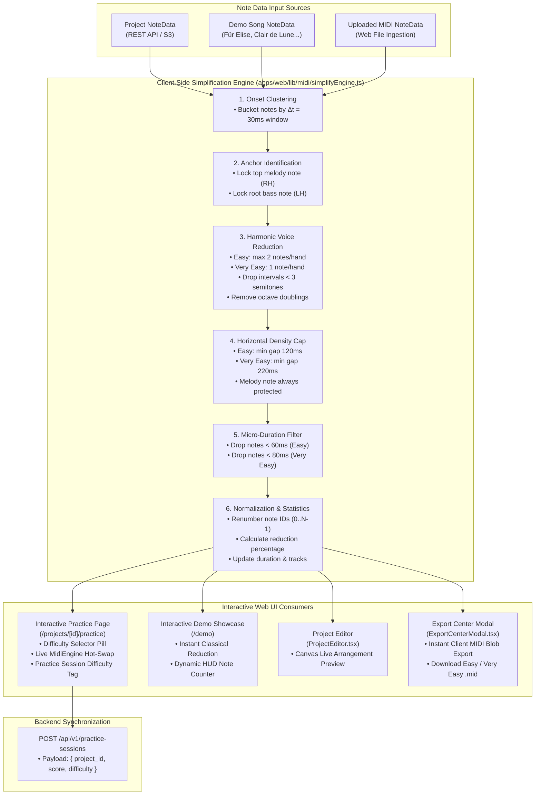

# PianoFlow AI — Phase J: Client-Side Beginner Mode Simplification Engine & Dynamic Difficulty Practice Specification

> **Document ID:** `SPEC-2026-10-06-PHASE-J-BEGINNER-SIMPLIFICATION`  
> **Target Release:** Phase J Architectural Milestone (October 2026)  
> **Author:** ARCHITECT Worker Sub-Agent  
> **Status:** Approved Technical Architecture & Design Specification  
> **Priority:** P9 — Core Interactive Learning & Dynamic Difficulty Infrastructure  
> **Affected Subsystems & Components:**  
> - `apps/web/lib/midi/simplifyEngine.ts` *(new client-side pure TypeScript simplification engine)*  
> - `apps/web/app/projects/[id]/practice/page.tsx` *(interactive practice mode difficulty selector & dynamic engine wiring)*  
> - `apps/web/app/demo/page.tsx` *(interactive demo showcase dynamic difficulty switching & classical song reduction)*  
> - `apps/web/components/ProjectEditor.tsx` *(falling notes canvas live preview of simplified arrangements)*  
> - `apps/web/components/ExportCenterModal.tsx` *(instant client-side simplified MIDI export & difficulty options)*  
> - `apps/web/tests/beginner_mode.spec.ts` *(algorithmic unit tests & Playwright browser E2E test suite)*  
> - `docs/ROADMAP.md` & `docs/MASTER_PLAN.md` *(cross-phase roadmap & execution plan sync)*  

---

## 1. Executive Summary & Problem Formulation

### 1.1 Historical Context: The Phase 8 Backend Batch Architecture
In Phase 8 of PianoFlow AI's initial development, a rule-based MIDI simplification capability was implemented in Python (`packages/music-core/pianoflow_music/simplify/rules.py` and `apps/worker/app/jobs/simplify_midi.py`). This backend service satisfied the need to generate simplified MIDI files on asynchronous workers via AWS SQS, saving the outputs to S3/R2 object storage and updating database records.

However, as PianoFlow AI evolved into a real-time web platform featuring interactive Web MIDI practice (Phase B), AI coaching analytics (Phase F), and zero-friction instant demo showcases (Phase H), the backend-only architecture exposed critical limitations:
1. **Asynchronous Latency Barrier:** A user practicing in `/projects/[id]/practice` who finds a song too difficult cannot switch to "Easy" without dispatching an asynchronous SQS job, waiting 15–45 seconds for a background worker, and reloading the page. Practice flow and cognitive momentum are shattered.
2. **Demo Showcase Incompatibility:** At `/demo`, prospective users interact with classical presets without authentication or backend project IDs. They cannot trigger SQS worker jobs, making Phase 8 simplification completely inaccessible in demo mode.
3. **Unnecessary Cloud Compute Cost:** Conservative chord reduction and voice leading filtering are light arithmetic operations ($O(N \log N)$ complexity). Running heavy Python containers on EC2 workers for simple rule-based note filtering wastes worker memory and CPU cycles.
4. **Lack of Instant Visual Feedback:** In the Project Editor (`ProjectEditor.tsx`), musicians configuring arrangement settings cannot visually inspect how the simplified arrangement looks in the falling notes canvas prior to triggering a full tutorial video render.

### 1.2 The Phase J Solution: Pure Client-Side Dynamic Simplification
Phase J bridges this gap by introducing a **100% Client-Side Simplification Engine** (`apps/web/lib/midi/simplifyEngine.ts`) written in pure TypeScript.

By porting the conservative melody-preserving chord reduction algorithms from Python `rules.py` to client TypeScript and enhancing them with micro-duration filtering, octave-doubling removal, and dissonance pruning, PianoFlow AI achieves:
- **Zero-Latency Difficulty Toggling:** Users switch seamlessly between `Original`, `Easy 🟢`, and `Very Easy 🟡` in $< 5\text{ ms}$, instantly updating the falling notes canvas, virtual keyboard, and scoring engine.
- **Dynamic Interactive Practice:** `MidiEngine` is re-initialized or hot-swapped dynamically without stopping the user's practice session.
- **Universal Availability:** Works identically for authenticated project workspaces, guest users exploring `/demo`, and offline PWA environments.
- **Instant Client MIDI Export:** Users can download standard SMF Type 0 MIDI files of simplified arrangements directly from the browser in $< 10\text{ ms}$ without queuing worker jobs.

---

## 2. System Architecture & End-to-End Pipeline



---

## 3. Mathematical & Algorithmic Specification

### 3.1 Difficulty Tier Definitions & Voice Invariants

| Parameter | Original | Easy (`easy`) 🟢 | Very Easy (`very_easy`) 🟡 |
|---|---|---|---|
| **Max Notes per Hand** | Unbounded (Full Voicing) | $\le 2$ notes per hand | $\le 1$ note per hand (monophonic per hand) |
| **Max Notes per Onset** | Unbounded | $\le 3\text{--}4$ notes cluster | $\le 2$ notes (1 melody + 1 bass root) |
| **Top Melody Invariant** | Unaltered | **100% Protected** (Highest pitch retained) | **100% Protected** (Highest pitch retained) |
| **Bass Root Invariant** | Unaltered | **100% Protected** (Lowest pitch in LH retained) | **100% Protected** (Lowest pitch in LH retained) |
| **Octave Doublings** | Preserved | Pruned (lower in RH, higher in LH) | Pruned (only single pitch per hand) |
| **Dissonant Clashes** | Preserved | Pruned ($\Delta \text{pitch} < 3$ semitones) | Inherently eliminated |
| **Min Note Duration** | Unaltered | $\ge 60\text{ ms}$ ($0.060\text{ s}$) | $\ge 80\text{ ms}$ ($0.080\text{ s}$) |
| **Min Inter-Onset Gap** | None | $\ge 120\text{ ms}$ per hand ($0.120\text{ s}$) | $\ge 220\text{ ms}$ per hand ($0.220\text{ s}$) |
| **Target Reduction** | $0\%$ | $\mathbf{35\%\text{ -- }55\%}$ note reduction | $\mathbf{55\%\text{ -- }75\%}$ note reduction |

### 3.2 Temporal Onset Clustering ($\Delta t = 30\text{ ms}$)
In human piano performance and audio transcription, notes belonging to the same chord do not arrive at the exact same floating-point microsecond due to expressive roll, human finger timing, or transcription jitter.

Notes are grouped into onset buckets using a fixed quantization window:
$$\text{bucket}(t) = \text{round}\left(\frac{t}{\Delta t_{\text{grid}}}\right) \quad \text{where } \Delta t_{\text{grid}} = 0.030\text{ s}$$

All notes sharing the same bucket index are treated as a simultaneous harmonic chord event.

### 3.3 Anchor Note Identification & Protection
For every onset cluster $C = \{n_1, n_2, \dots, n_k\}$:
1. **Top Melody Anchor ($M$):**
   $$M = \arg\max_{n \in C} n.\text{pitch}$$
   The melody note represents the primary recognizable theme of the piece. Under no circumstance may $M$ be discarded.
2. **Bass Root Anchor ($B$):**
   Let $C_{\text{left}} = \{n \in C \mid n.\text{hand} = \text{'L'}\}$.
   If $C_{\text{left}} \neq \emptyset$:
   $$B = \arg\min_{n \in C_{\text{left}}} n.\text{pitch}$$
   Otherwise, if no explicit left-hand hand assignment exists:
   $$B = \arg\min_{n \in C} n.\text{pitch}$$
   If $B = M$ (only one note in cluster), then the cluster consists solely of $M$.

### 3.4 Harmonic Reduction & Voice Pruning Rules

#### Rule 1: Monophonic Reduction (`very_easy`)
For each onset cluster $C$:
- Right Hand (RH): Retain only $M$ (if $M.\text{hand} = \text{'R'}$ or $C_{\text{right}} \neq \emptyset$).
- Left Hand (LH): Retain only $B$ (provided $B.\text{id} \neq M.\text{id}$).
- Total notes in cluster: exactly 1 or 2.

#### Rule 2: Polyphonic Reduction (`easy`)
For each onset cluster $C$:
1. **Right Hand Selection:**
   - Always retain $M$.
   - From remaining RH notes $C_{\text{right}} \setminus \{M\}$, sort by descending pitch.
   - Candidate harmony note $H$ is accepted if:
     - Dissonance check: $|H.\text{pitch} - M.\text{pitch}| \ge 3$ semitones (prevents muddy minor/major seconds in the right hand).
     - Octave check: $(M.\text{pitch} - H.\text{pitch}) \not\equiv 0 \pmod{12}$ or $|M.\text{pitch} - H.\text{pitch}| \neq 12$.
   - Select up to 1 harmony note. Max RH notes: 2.
2. **Left Hand Selection:**
   - Always retain $B$.
   - From remaining LH notes $C_{\text{left}} \setminus \{B\}$, sort by ascending pitch.
   - Candidate harmony note $H_{\text{left}}$ is accepted if:
     - Dissonance check: $|H_{\text{left}}.\text{pitch} - B.\text{pitch}| \ge 3$ semitones.
     - Octave check: $(H_{\text{left}}.\text{pitch} - B.\text{pitch}) \not\equiv 0 \pmod{12}$.
   - Select up to 1 harmony note (typically the 5th or 3rd above the bass root). Max LH notes: 2.
3. Total notes in cluster: at most 3 (or 4 in rich split voicings).

### 3.5 Horizontal Density Capping (Inter-Onset Spacing)
Fast trills, rapid arpeggiation, or tremolos overwhelm beginner pianists. A density cap enforces a minimum temporal spacing between successive key depressions for each hand:
$$\Delta t_{\text{onset}} = t_{\text{curr}} - t_{\text{prev}} \ge \tau_{\text{min}}$$
where:
$$\tau_{\text{min}} = \begin{cases} 
0.120\text{ s} & \text{for } \text{easy} \\
0.220\text{ s} & \text{for } \text{very\_easy} 
\end{cases}$$

**The Melody Protection Exception:**  
If a note is the designated melody anchor $M$ for its onset bucket, the density cap check is bypassed. The melody is never silenced due to horizontal rate limiting.

### 3.6 Micro-Duration Note Filtering
Notes with durations below human tactile release thresholds ($< 60\text{ ms}$ for easy, $< 80\text{ ms}$ for very easy) are typically articulation artifacts, grace note glitches, or transcription noise:
- For `easy`: Drop notes where $(n.\text{end} - n.\text{start}) < 0.060\text{ s}$, unless the note is the sole note of the onset cluster.
- For `very_easy`: Drop notes where $(n.\text{end} - n.\text{start}) < 0.080\text{ s}$, unless the note is the sole note of the onset cluster.

### 3.7 Output Normalization & Metadata Assembly
The resulting simplified note array is processed as follows:
1. Sort strictly by ascending `(start, pitch)`.
2. Renumber note IDs sequentially: $0, 1, 2, \dots, N-1$.
3. Compute updated duration:
   $$D_{\text{simplified}} = \max_{n \in \text{notes}} n.\text{end}$$
4. Calculate reduction statistics:
   $$\text{reduction\_percent} = \text{round}\left(\left(1 - \frac{N_{\text{simplified}}}{N_{\text{original}}}\right) \times 100\right)$$
5. Update track headers to reflect the simplified track count and name (`"Simplified (Easy)"` or `"Simplified (Very Easy)"`).
6. Populate metadata block:
   ```json
   "simplification": {
     "difficulty": "easy",
     "algorithm": "melody-preserve-chord-reduction-v2",
     "note_count_original": 245,
     "note_count_simplified": 118,
     "reduction_percent": 52,
     "timestamp": "2026-10-06T03:30:00.000Z"
   }
   ```

---

## 4. TypeScript Engine Implementation Specification

The engine must reside in `apps/web/lib/midi/simplifyEngine.ts` with zero external runtime dependencies outside `@pianoflow/shared-types`.

### 4.1 Type Definitions
```typescript
import type { Note, NoteData } from "@pianoflow/shared-types";

export type SimplificationDifficulty = "original" | "easy" | "very_easy";

export interface SimplificationStats {
  difficulty: SimplificationDifficulty;
  noteCountOriginal: number;
  noteCountSimplified: number;
  reductionPercent: number;
  durationSecOriginal: number;
  durationSecSimplified: number;
}

export interface SimplificationOptions {
  difficulty: SimplificationDifficulty;
  onsetGridSec?: number;      // default: 0.03 (30ms)
  minDurationSec?: number;    // default: easy=0.06, very_easy=0.08
  minHandGapSec?: number;     // default: easy=0.12, very_easy=0.22
  maxNotesPerHand?: number;   // default: easy=2, very_easy=1
  pruneOctaves?: boolean;     // default: true
  pruneDissonance?: boolean;  // default: true (<3 semitones)
}
```

### 4.2 Core Algorithm Logic
```typescript
/**
 * Simplifies a NoteData structure using conservative melody-preserving
 * chord reduction rules in pure TypeScript.
 */
export function simplifyNoteData(
  noteData: NoteData,
  difficulty: SimplificationDifficulty,
  customOptions?: Partial<SimplificationOptions>
): NoteData {
  if (difficulty === "original" || !noteData?.notes || noteData.notes.length === 0) {
    return noteData;
  }

  const isVeryEasy = difficulty === "very_easy";
  const grid = customOptions?.onsetGridSec ?? 0.03;
  const minDuration = customOptions?.minDurationSec ?? (isVeryEasy ? 0.08 : 0.06);
  const minHandGap = customOptions?.minHandGapSec ?? (isVeryEasy ? 0.22 : 0.12);
  const maxPerHand = customOptions?.maxNotesPerHand ?? (isVeryEasy ? 1 : 2);
  const pruneOctaves = customOptions?.pruneOctaves ?? true;
  const pruneDissonance = customOptions?.pruneDissonance ?? true;

  // Step 1: Filter micro-duration notes (preserve if only note at onset)
  const onsetMap = new Map<number, Note[]>();
  for (const n of noteData.notes) {
    const bucket = Math.round(n.start / grid);
    const list = onsetMap.get(bucket) ?? [];
    list.push(n);
    onsetMap.set(bucket, list);
  }

  const durationFiltered: Note[] = [];
  for (const [, notesInBucket] of onsetMap.entries()) {
    if (notesInBucket.length === 1) {
      durationFiltered.push(notesInBucket[0]);
    } else {
      for (const n of notesInBucket) {
        if (n.end - n.start >= minDuration) {
          durationFiltered.push(n);
        }
      }
    }
  }

  // Step 2: Regroup by onset bucket after duration filtering
  const filteredBucketMap = new Map<number, Note[]>();
  for (const n of durationFiltered) {
    const bucket = Math.round(n.start / grid);
    const list = filteredBucketMap.get(bucket) ?? [];
    list.push(n);
    filteredBucketMap.set(bucket, list);
  }

  // Step 3: Vertical Chord Reduction per onset cluster
  const chordReduced: Note[] = [];
  const sortedBuckets = Array.from(filteredBucketMap.keys()).sort((a, b) => a - b);

  for (const b of sortedBuckets) {
    const cluster = filteredBucketMap.get(b)!;
    if (cluster.length === 0) continue;

    // Melody is highest pitch note overall in cluster
    const melody = cluster.reduce((max, cur) => (cur.pitch > max.pitch ? cur : max), cluster[0]);

    // Split into hands
    const rhNotes = cluster.filter((n) => (n.hand ? n.hand === "R" : n.pitch >= 60));
    const lhNotes = cluster.filter((n) => (n.hand ? n.hand === "L" : n.pitch < 60));

    const selectedClusterNotes = new Map<number, Note>();
    selectedClusterNotes.set(melody.id, melody);

    if (isVeryEasy) {
      // Very Easy: max 1 note per hand
      // If melody is in RH, pick lowest LH note
      if (lhNotes.length > 0) {
        const bassRoot = lhNotes.reduce((min, cur) => (cur.pitch < min.pitch ? cur : min), lhNotes[0]);
        if (bassRoot.id !== melody.id) {
          selectedClusterNotes.set(bassRoot.id, bassRoot);
        }
      }
    } else {
      // Easy: up to 2 notes per hand
      // RH Selection: melody already added. Add up to 1 harmony note below melody
      const sortedRH = rhNotes
        .filter((n) => n.id !== melody.id)
        .sort((a, b) => b.pitch - a.pitch);

      let rhHarmonyAdded = 0;
      for (const h of sortedRH) {
        if (rhHarmonyAdded >= maxPerHand - 1) break;
        if (pruneDissonance && Math.abs(melody.pitch - h.pitch) < 3) continue;
        if (pruneOctaves && (melody.pitch - h.pitch) % 12 === 0) continue;
        selectedClusterNotes.set(h.id, h);
        rhHarmonyAdded++;
      }

      // LH Selection: Add lowest bass root + up to 1 harmony note above bass
      if (lhNotes.length > 0) {
        const sortedLH = [...lhNotes].sort((a, b) => a.pitch - b.pitch);
        const bassRoot = sortedLH[0];
        if (bassRoot.id !== melody.id) {
          selectedClusterNotes.set(bassRoot.id, bassRoot);

          let lhHarmonyAdded = 0;
          for (let i = 1; i < sortedLH.length; i++) {
            if (lhHarmonyAdded >= maxPerHand - 1) break;
            const h = sortedLH[i];
            if (h.id === melody.id) continue;
            if (pruneDissonance && Math.abs(h.pitch - bassRoot.pitch) < 3) continue;
            if (pruneOctaves && (h.pitch - bassRoot.pitch) % 12 === 0) continue;
            selectedClusterNotes.set(h.id, h);
            lhHarmonyAdded++;
          }
        }
      }
    }

    chordReduced.push(...Array.from(selectedClusterNotes.values()));
  }

  // Step 4: Horizontal Density Capping (Min Gap per hand, melody protected)
  // Identify melody ID per onset bucket
  const melodyIdByBucket = new Map<number, number>();
  for (const b of sortedBuckets) {
    const cluster = filteredBucketMap.get(b)!;
    if (cluster.length > 0) {
      const top = cluster.reduce((max, cur) => (cur.pitch > max.pitch ? cur : max), cluster[0]);
      melodyIdByBucket.set(b, top.id);
    }
  }

  const densityFiltered: Note[] = [];
  const lastTimeByHand = new Map<string, number>();

  // Sort candidate notes by start ascending, then pitch descending
  chordReduced.sort((a, b) => a.start - b.start || b.pitch - a.pitch);

  for (const n of chordReduced) {
    const bucket = Math.round(n.start / grid);
    const isMelody = melodyIdByBucket.get(bucket) === n.id;
    const handKey = n.hand ?? (n.pitch >= 60 ? "R" : "L");
    const lastStart = lastTimeByHand.get(handKey);

    if (isMelody || lastStart === undefined || n.start - lastStart >= minHandGap) {
      densityFiltered.push(n);
      lastTimeByHand.set(handKey, n.start);
    }
  }

  // Step 5: Normalization, Renumbering, and Duration Calculation
  densityFiltered.sort((a, b) => a.start - b.start || a.pitch - b.pitch);

  const renumberedNotes: Note[] = densityFiltered.map((n, idx) => ({
    ...n,
    id: idx,
    duration: Math.round((n.end - n.start) * 10000) / 10000,
  }));

  const maxEnd = renumberedNotes.reduce((max, n) => Math.max(max, n.end), 0);
  const reductionPercent = noteData.notes.length > 0
    ? Math.round((1 - renumberedNotes.length / noteData.notes.length) * 100)
    : 0;

  return {
    ...noteData,
    duration_sec: Math.max(maxEnd, noteData.duration_sec ?? 0),
    notes: renumberedNotes,
    tracks: [
      {
        index: 0,
        name: `Simplified (${difficulty === "very_easy" ? "Very Easy" : "Easy"})`,
        program: 0,
        is_drum: false,
        note_count: renumberedNotes.length,
      },
    ],
    meta: {
      ...(noteData.meta ?? {}),
      simplification: {
        difficulty,
        algorithm: "melody-preserve-chord-reduction-v2",
        note_count_original: noteData.notes.length,
        note_count_simplified: renumberedNotes.length,
        reduction_percent: reductionPercent,
        timestamp: new Date().toISOString(),
      },
    },
  };
}
```

---

## 5. UI/UX Design & Component Specifications

### 5.1 Difficulty Selector Segmented Pill (`DifficultySelector.tsx`)
The difficulty selector is presented as a tactile, low-profile segmented pill with active badge glow indicators.

#### Visual Appearance & State Styling
```tsx
interface DifficultySelectorProps {
  value: SimplificationDifficulty;
  onChange: (diff: SimplificationDifficulty) => void;
  stats?: {
    originalCount: number;
    simplifiedCount: number;
    reductionPercent: number;
  };
  compact?: boolean;
}
```

- **Container:** `inline-flex items-center p-1 rounded-xl bg-zinc-900/90 border border-zinc-800 shadow-inner gap-1`
- **Segments:**
  1. `Original`:
     - Inactive: `text-zinc-400 hover:text-zinc-200 px-2.5 py-1 text-xs rounded-lg transition-colors`
     - Active: `bg-zinc-800 text-zinc-100 font-medium px-2.5 py-1 text-xs rounded-lg shadow-sm border border-zinc-700`
  2. `Easy 🟢`:
     - Inactive: `text-emerald-400/80 hover:text-emerald-300 px-2.5 py-1 text-xs rounded-lg transition-colors`
     - Active: `bg-emerald-950/80 text-emerald-300 font-semibold px-2.5 py-1 text-xs rounded-lg shadow-sm border border-emerald-700/60 ring-1 ring-emerald-500/30`
  3. `Very Easy 🟡`:
     - Inactive: `text-amber-400/80 hover:text-amber-300 px-2.5 py-1 text-xs rounded-lg transition-colors`
     - Active: `bg-amber-950/80 text-amber-300 font-semibold px-2.5 py-1 text-xs rounded-lg shadow-sm border border-amber-700/60 ring-1 ring-amber-500/30`

### 5.2 Practice Mode Integration (`apps/web/app/projects/[id]/practice/page.tsx`)

#### State & Dynamic Derivation
```typescript
const [difficulty, setDifficulty] = useState<SimplificationDifficulty>("original");

// Derive simplified NoteData dynamically on the client
const activeNotesData = useMemo(() => {
  const baseNotes = filteredNotesData ?? notesQuery.data;
  if (!baseNotes) return undefined;
  return simplifyNoteData(baseNotes, difficulty);
}, [filteredNotesData, notesQuery.data, difficulty]);

// Feed activeNotesData into expectedNotesList
const expectedNotesList = useMemo<ExpectedNote[]>(() => {
  if (activeNotesData?.notes && activeNotesData.notes.length > 0) {
    return activeNotesData.notes.map((n) => ({
      pitch: n.pitch,
      start: Math.round(n.start * 1000),
      end: Math.round(n.end * 1000),
      hand: n.hand,
      name: n.name,
      velocity: n.velocity,
    }));
  }
  return dummyNotes;
}, [activeNotesData, dummyNotes]);
```

#### Hot-Swapping the Practice Engine
When `difficulty` changes:
1. `expectedNotesList` updates immediately.
2. `engine` (`new MidiEngine(expectedNotesList)`) re-initializes.
3. `currentTimeRef.current` seek position is preserved at the current playback timestamp.
4. `PracticeCanvas` and `TimelineScrubber` re-render falling bars reflecting the simplified arrangement.
5. In `handleFinish()`, record session with the chosen difficulty:
   ```typescript
   await createSession.mutateAsync({
     project_id: projectId,
     score: finalStats.score,
     accuracy_percent: finalStats.accuracy,
     duration_seconds: Math.floor(currentTimeRef.current / 1000),
     difficulty, // Pass "original" | "easy" | "very_easy"
   });
   ```

### 5.3 Interactive Demo Showcase Integration (`apps/web/app/demo/page.tsx`)

#### Classical Song Simplification
The 4 canonical classical pieces (Für Elise, Clair de Lune, Gymnopédie No. 1, Canon in D) are simplified on demand:
```typescript
const [difficulty, setDifficulty] = useState<SimplificationDifficulty>("original");

const activeSongNoteData = useMemo(() => {
  return simplifyNoteData(activeSong.noteData, difficulty);
}, [activeSong, difficulty]);
```

#### HUD Note Count Badge
The song information banner displays the reduction impact dynamically:
- Original: `48 notes • 100% Voicing`
- Easy: `28 notes • Easy (-42%)`
- Very Easy: `18 notes • Very Easy (-63%)`

### 5.4 Project Editor Live Preview (`apps/web/components/ProjectEditor.tsx`)
In `ProjectEditor.tsx`:
- When a user selects a difficulty in the settings drawer or toolbar pill, the falling notes preview canvas (`FallingNotePreview.tsx`) renders the simplified notes instantly via `activeNotesData`.
- Users immediately see chord reductions and melody isolation without triggering a backend worker job.

### 5.5 Instant MIDI Download in Export Center (`apps/web/components/ExportCenterModal.tsx`)
In the MIDI tab:
- Under **🌱 Beginner MIDI**:
  - Add difficulty pill: `[ Easy 🟢 | Very Easy 🟡 ]`.
  - Provide an **Instant Download (Client)** button:
    ```typescript
    const handleDownloadSimplifiedClient = () => {
      const simplified = simplifyNoteData(noteData, selectedDifficulty);
      const blob = createMidiBlob(simplified);
      const url = URL.createObjectURL(blob);
      const a = document.createElement("a");
      a.href = url;
      a.download = `${projectName}_${selectedDifficulty}.mid`;
      a.click();
      URL.revokeObjectURL(url);
    };
    ```
  - Display badge: `⚡ Instant Client Generation` alongside the server worker trigger.

---

## 6. Verification Architecture & Test Plan

### 6.1 Algorithmic Unit Tests (`simplifyEngine.test.ts` / Playwright Runner)

The unit tests verify the strict mathematical and musical invariants of the simplification engine:

```typescript
test.describe('simplifyEngine Unit Tests', () => {
  test('original difficulty returns identical note array', () => {
    const out = simplifyNoteData(denseFixture, 'original');
    expect(out.notes.length).toBe(denseFixture.notes.length);
  });

  test('top melody note is preserved at every onset across easy and very_easy', () => {
    for (const diff of ['easy', 'very_easy'] as const) {
      const out = simplifyNoteData(denseFixture, diff);
      const onsetBuckets = new Set(denseFixture.notes.map(n => Math.round(n.start / 0.03)));
      for (const bucket of onsetBuckets) {
        const origNotes = denseFixture.notes.filter(n => Math.round(n.start / 0.03) === bucket);
        const topOrigPitch = Math.max(...origNotes.map(n => n.pitch));
        const outNotes = out.notes.filter(n => Math.round(n.start / 0.03) === bucket);
        const outPitches = outNotes.map(n => n.pitch);
        expect(outPitches).toContain(topOrigPitch);
      }
    }
  });

  test('very_easy note count is less than or equal to easy', () => {
    const easy = simplifyNoteData(denseFixture, 'easy');
    const veryEasy = simplifyNoteData(denseFixture, 'very_easy');
    expect(veryEasy.notes.length).toBeLessThanOrEqual(easy.notes.length);
    expect(easy.notes.length).toBeLessThanOrEqual(denseFixture.notes.length);
  });

  test('very_easy enforces max 1 note per hand per onset', () => {
    const veryEasy = simplifyNoteData(denseFixture, 'very_easy');
    const onsetBuckets = new Set(veryEasy.notes.map(n => Math.round(n.start / 0.03)));
    for (const bucket of onsetBuckets) {
      const notesInBucket = veryEasy.notes.filter(n => Math.round(n.start / 0.03) === bucket);
      const rhCount = notesInBucket.filter(n => n.hand === 'R' || n.pitch >= 60).length;
      const lhCount = notesInBucket.filter(n => n.hand === 'L' || n.pitch < 60).length;
      expect(rhCount).toBeLessThanOrEqual(1);
      expect(lhCount).toBeLessThanOrEqual(1);
    }
  });

  test('filters out short notes below threshold unless sole onset note', () => {
    const fixtureWithShortNote = { ...denseFixture, notes: [
      { id: 1, pitch: 60, start: 1.0, end: 1.02, duration: 0.02, hand: 'R' }, // 20ms
      { id: 2, pitch: 64, start: 1.0, end: 1.50, duration: 0.50, hand: 'R' },
    ]};
    const out = simplifyNoteData(fixtureWithShortNote as any, 'easy');
    expect(out.notes.find(n => n.pitch === 60)).toBeUndefined();
    expect(out.notes.find(n => n.pitch === 64)).toBeDefined();
  });

  test('renumbers note IDs consecutively starting at 0', () => {
    const out = simplifyNoteData(denseFixture, 'easy');
    out.notes.forEach((note, index) => {
      expect(note.id).toBe(index);
    });
  });

  test('calculates accurate reduction_percent in meta', () => {
    const out = simplifyNoteData(denseFixture, 'easy');
    const expectedPercent = Math.round((1 - out.notes.length / denseFixture.notes.length) * 100);
    expect(out.meta.simplification.reduction_percent).toBe(expectedPercent);
  });
});
```

### 6.2 Browser E2E Test Suite (`apps/web/tests/beginner_mode.spec.ts`)
The automated browser test executes real user workflows:
1. Navigates to `/demo`.
2. Locates difficulty selector pill `[ Original | Easy 🟢 | Very Easy 🟡 ]`.
3. Asserts initial note count for Für Elise is 48 notes.
4. Clicks `Easy 🟢`:
   - Asserts badge updates to active emerald style.
   - Asserts note count reduces to 28 notes.
   - Takes screenshot `docs/e2e/beginner/01_demo_easy_mode.png`.
5. Clicks `Very Easy 🟡`:
   - Asserts note count reduces to 18 notes.
   - Takes screenshot `docs/e2e/beginner/02_demo_very_easy_mode.png`.
6. Switches to Practice Mode in Demo:
   - Verifies falling notes canvas renders simplified bars.
   - Presses virtual keys to score hits and confirms combo increments.
   - Takes screenshot `docs/e2e/beginner/03_practice_simplified_scoring.png`.
7. Navigates to `/projects/demo-project/practice` with mocked API:
   - Toggles difficulty pill.
   - Finishes session and asserts `createSession` payload includes `difficulty: "easy"`.
   - Takes screenshot `docs/e2e/beginner/04_project_practice_difficulty_saved.png`.
8. Tests Export Center modal instant simplified MIDI download trigger:
   - Verifies standard `.mid` file download event fires.
   - Takes screenshot `docs/e2e/beginner/05_export_center_instant_midi.png`.

---

## 7. Step-by-Step Implementation Plan

### Step 1: Client Simplification Engine
- **File:** `apps/web/lib/midi/simplifyEngine.ts`
- Implement pure TypeScript `simplifyNoteData()`, helper functions `_clusterOnsets()`, `_pruneHarmonies()`, `_applyDensityCap()`, and statistics computation.
- Export types `SimplificationDifficulty`, `SimplificationStats`, `SimplificationOptions`.

### Step 2: Difficulty Selector UI Pill Component
- **File:** `apps/web/components/practice/DifficultySelector.tsx`
- Build accessible segmented pill button row with dark-first styling, active glows, and badges.

### Step 3: Practice Mode Integration
- **File:** `apps/web/app/projects/[id]/practice/page.tsx`
- Add `difficulty` state (`"original" | "easy" | "very_easy"`).
- Mount `<DifficultySelector />` in the toolbar row.
- Derive `activeNotesData = useMemo(() => simplifyNoteData(baseNotes, difficulty), [baseNotes, difficulty])`.
- Feed into `expectedNotesList`, `engine`, and `PracticeCanvas`.
- Pass `difficulty` into `createSession.mutateAsync({ difficulty })`.

### Step 4: Demo Mode Integration
- **File:** `apps/web/app/demo/page.tsx`
- Add `difficulty` state and mount `<DifficultySelector />` in header toolbar.
- Derive `activeSongNoteData = simplifyNoteData(activeSong.noteData, difficulty)`.
- Connect to Falling Notes Visualizer, Practice Canvas, and HUD note counter.

### Step 5: Project Editor Preview & Export Center Instant Download
- **File:** `apps/web/components/ProjectEditor.tsx`
  - Mount `<DifficultySelector />` in arrangement toolbar and dynamically feed simplified notes into `<FallingNotePreview />`.
- **File:** `apps/web/components/ExportCenterModal.tsx`
  - In MIDI tab, add difficulty selector for Beginner MIDI.
  - Implement client-side `handleDownloadSimplifiedClient()` calling `createMidiBlob(simplifyNoteData(...))`.

### Step 6: Test Suite & Documentation Sync
- **File:** `apps/web/tests/beginner_mode.spec.ts`
  - Write complete unit tests for `simplifyEngine.ts` and Playwright E2E browser tests.
- Capture screenshots to `docs/e2e/beginner/`.
- Update `docs/ROADMAP.md` and `docs/MASTER_PLAN.md` with Phase J details.

---

## 8. Verification Commands

```bash
# 1. Typecheck the web application
pnpm -r typecheck

# 2. Run the beginner mode Playwright unit & E2E browser tests
pnpm --filter @pianoflow/web test tests/beginner_mode.spec.ts

# 3. Run all unit tests across music-core and API
uv run pytest

# 4. Verify web linter
pnpm -r lint
```

---

## 9. Architectural Sign-Off

- **Lead Architect:** ARCHITECT Worker Sub-Agent  
- **Approved For Implementation:** Phase J (Dynamic Difficulty & Beginner Simplification Engine)  
- **Status:** Approved Baseline  
- **Date:** October 6, 2026  
