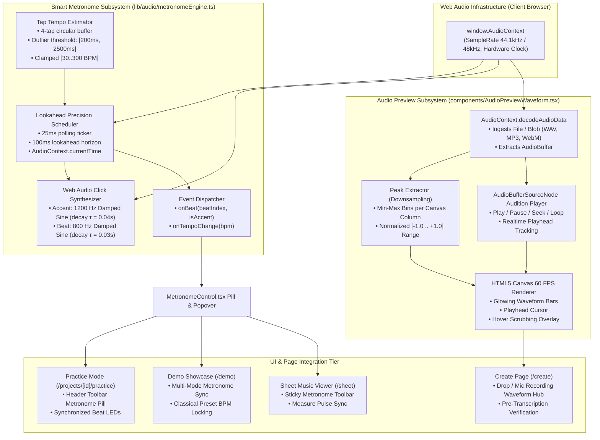
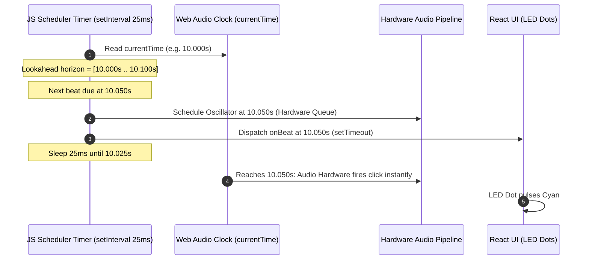

# PianoFlow AI — Phase K: Smart Metronome Engine, Tap Tempo & Audio Waveform Auditioning Specification

> **Document ID:** `SPEC-2026-10-06-PHASE-K-SMART-METRONOME-AUDIO-PREVIEW`  
> **Target Release:** Phase K Architectural Milestone (October 2026)  
> **Author:** ARCHITECT Worker Sub-Agent  
> **Status:** Approved Technical Architecture & Design Specification  
> **Priority:** P10 — Precision Audio Scheduling & Pre-Ingestion Auditioning  
> **Affected Subsystems & Components:**  
> - `apps/web/lib/audio/metronomeEngine.ts` *(new Web Audio lookahead precision metronome scheduler & tap tempo engine)*  
> - `apps/web/components/practice/MetronomeControl.tsx` *(new interactive metronome toolbar pill, popover, LED beat flashing dots, and steppers)*  
> - `apps/web/components/AudioPreviewWaveform.tsx` *(new HTML5 canvas waveform visualizer, audio decoder, and scrubbable auditioning player)*  
> - `apps/web/app/create/page.tsx` *(integration of waveform auditioning when audio files are dropped or recorded)*  
> - `apps/web/app/projects/[id]/practice/page.tsx` *(integration of MetronomeControl into interactive practice toolbar)*  
> - `apps/web/app/demo/page.tsx` *(integration of MetronomeControl into Classical Demo Showcase)*  
> - `apps/web/components/sheet/SheetMusicViewer.tsx` *(integration of MetronomeControl into Sheet Music toolbar)*  
> - `apps/web/tests/metronome_audio.spec.ts` *(Playwright E2E browser tests and unit tests for metronome and waveform)*  
> - `docs/ROADMAP.md` & `docs/MASTER_PLAN.md` *(cross-phase roadmap & execution plan sync)*  

---

## 1. Executive Summary & Problem Formulation

### 1.1 The Rhythm Dilemma in Digital Piano Learning
Learning piano requires rigorous internal rhythmic pulse. In digital learning platforms, practicing without a precise metronome fosters timing inaccuracies:
1. **Unstable Rubato and Rushing:** Pianists practicing challenging classical passages (such as Beethoven's *Für Elise* arpeggios or Debussy's *Clair de Lune* polyrhythms) frequently rush simple measures and drag through complex fingerings without realizing tempo fluctuations.
2. **The JavaScript Timer Jitter Problem:** Standard browser timers (`setInterval` and `setTimeout`) are notoriously inaccurate for musical applications. When the main JavaScript UI thread is burdened by 60 FPS HTML5 canvas rendering, React 19 reconciliation, or Web MIDI event handling, timer callbacks can drift by $20\text{--}80\text{ ms}$. This jitter destroys rhythmic groove and ruins auditory practice.
3. **Absence of Flexible Metric Accents:** Musically meaningful practice requires downbeat accentuation ($1200\text{ Hz}$ on beat 1 vs. $800\text{ Hz}$ on weak subdivisions) across varied meters: $4/4$ (common time), $3/4$ (waltz), $3/8$ (Für Elise), $6/8$ (compound duple), and $2/4$ (march).
4. **Friction in Determining Source Tempo:** Users attempting to identify the tempo of an arrangement or real-world performance lack an intuitive **Tap Tempo** facility to quickly sync the digital environment to their internal pulse.

### 1.2 The "Blind Upload" Ingestion Flaw
On the creation and ingestion front (`apps/web/app/create/page.tsx`):
1. **Zero Pre-Transcription Auditioning:** When a user records audio via microphone or uploads a 45 MB `.wav`/`.mp3` file, they have no way to listen back, check for clipping, verify audio fidelity, or confirm channel balance prior to dispatching expensive Demucs v4 + Transkun GPU transcription jobs.
2. **No Visual Waveform Inspection:** Users cannot visually inspect audio dynamics, silent lead-in gaps, or background noise profiles. An unexpected file mismatch or microphone silent recording is only discovered *after* serverless GPU processing completes or fails.
3. **No Playhead Scrubbing:** Users cannot seek through the file to confirm they have uploaded the desired excerpt or performance.

### 1.3 The Phase K Solution
Phase K addresses both critical audio requirements through two dedicated, zero-dependency Web Audio subsystems:
1. **Web Audio Smart Metronome Engine (`metronomeEngine.ts` & `MetronomeControl.tsx`):**
   - Implements the canonical Chris Wilson **"A Tale of Two Clocks"** lookahead scheduler using high-precision hardware audio timestamps (`AudioContext.currentTime`). Scheduling occurs $100\text{ ms}$ into the future on a lightweight $25\text{ ms}$ tick, making the metronome completely immune to UI thread lag, canvas frame drops, and garbage collection pauses.
   - Dual-tone synthesizer: Piercing downbeat accent click ($1200\text{ Hz}$ resonant damped sine envelope) and clear subdivision clicks ($800\text{ Hz}$).
   - Meter support: $4/4, 3/4, 3/8, 6/8, 2/4$ with downbeat accenting and compound pulse handling.
   - Robust Tap Tempo calculator with statistical outlier rejection and moving average filter ($30\text{--}300\text{ BPM}$).
   - Multi-component integration: Practice Mode, Classical Demo Showcase, and Sheet Music Viewer with synchronized flashing LED indicators (`● ○ ○ ○`).
2. **Audio Waveform Preview & Auditioning Player (`AudioPreviewWaveform.tsx`):**
   - Fast client-side decoding via `AudioContext.decodeAudioData` into an in-memory `AudioBuffer`.
   - HTML5 Canvas dual-envelope peak visualizer rendering positive and negative amplitude bars in high-contrast cyan/violet gradients.
   - Interactive scrubbable playhead, click-to-seek, duration indicators, and audio metadata readouts (sample rate, channel count, duration, file size).
   - Embedded directly in `/create` immediately following audio drop or mic recording completion.

---

## 2. System Architecture & Topology



---

## 3. Mathematical & Algorithmic Specifications

### 3.1 Lookahead Precision Scheduler (The "Two Clocks" Architecture)
JavaScript executes on a single event-loop thread shared with DOM manipulation, React component rendering, and Canvas repainting. If a metronome were implemented using `setInterval(() => playClick(), intervalMs)`, any main-thread hitch (e.g., rendering thousands of falling notes) would delay the tick, causing audible tempo instability.

The **Two Clocks Model** combines:
1. **The Web Audio Clock (`AudioContext.currentTime`):** Driven by audio hardware interrupts, advancing monotonically with microsecond precision, completely independent of the main thread.
2. **The JavaScript Event Loop Clock (`setInterval` or `requestAnimationFrame`):** Acts purely as an advance scheduler that wakes up periodically to program future audio events into the hardware buffer.

#### Scheduler Invariants:
- **Scheduler Interval ($\Delta t_{\text{tick}}$):** $25\text{ ms}$ (frequency $40\text{ Hz}$).
- **Lookahead Horizon ($\tau_{\text{lookahead}}$):** $100\text{ ms}$ ($0.100\text{ s}$).
- **Scheduling Horizon Invariant:**
  At every tick $T_{\text{tick}}$, schedule all beats whose timestamp $t_{\text{beat}}$ satisfies:
  $$t_{\text{current}} \le t_{\text{beat}} < t_{\text{current}} + \tau_{\text{lookahead}}$$



### 3.2 Acoustic Click Synthesis & Sound Design
Rather than loading external WAV audio samples (which can fail due to network drops or CORS restrictions), the metronome generates pristine, synthetic acoustic clicks directly using Web Audio primitives (`OscillatorNode` and `GainNode`).

#### Sound Synthesis Model:
For each click at scheduled time $t_0$:
1. **Oscillator Frequency ($f$):**
   $$f = \begin{cases} 
   1200\text{ Hz} & \text{for Beat 1 (Downbeat Accent)} \\ 
   800\text{ Hz} & \text{for Subdivision Beats (2, 3, 4\dots)} 
   \end{cases}$$
2. **Resonant Pitch Envelope:**
   A high-energy initial transient creates the crisp percussive "woodblock" click:
   $$f(t) = f_{\text{base}} \cdot \left(1 + 0.5 \cdot e^{-\frac{t - t_0}{\tau_{\text{pitch}}}}\right) \quad \text{where } \tau_{\text{pitch}} = 0.005\text{ s}$$
3. **Exponential Amplitude Decay:**
   $$A(t) = A_{\text{peak}} \cdot e^{-\frac{t - t_0}{\tau_{\text{decay}}}}$$
   Where:
   - For Accent ($1200\text{ Hz}$): $A_{\text{peak}} = 1.0$, $\tau_{\text{decay}} = 0.045\text{ s}$, duration $= 0.050\text{ s}$.
   - For Regular Beat ($800\text{ Hz}$): $A_{\text{peak}} = 0.65$, $\tau_{\text{decay}} = 0.030\text{ s}$, duration $= 0.035\text{ s}$.
4. **Gain Envelope Node Calls:**
   ```typescript
   gain.gain.setValueAtTime(0.0001, t0);
   gain.gain.exponentialRampToValueAtTime(peakGain, t0 + 0.002); // 2ms attack prevents clicks
   gain.gain.exponentialRampToValueAtTime(0.0001, t0 + decayDuration);
   ```

### 3.3 Metric Meter & Time Signature Structures
A metronome pulse interval $I_{\text{beat}}$ in seconds is given by:
$$I_{\text{beat}} = \frac{60}{\text{BPM}} \cdot \mu_{\text{subdivision}}$$

| Time Signature | Beats per Measure ($N$) | Beat Unit ($\mu_{\text{subdivision}}$) | Accent Pattern (1-indexed) | Musical Style / Use Case |
|---|---|---|---|---|
| **4/4** | 4 | $1.0$ (quarter note) | **Beat 1** Accent, Beats 2, 3, 4 regular | Standard pop, rock, classical (Canon in D) |
| **3/4** | 3 | $1.0$ (quarter note) | **Beat 1** Accent, Beats 2, 3 regular | Waltz, Gymnopédie No. 1 |
| **3/8** | 3 | $0.5$ (eighth note) | **Beat 1** Accent, Beats 2, 3 regular | Fast classical dance (Für Elise) |
| **6/8** | 6 | $0.5$ (eighth note) | **Beat 1** Major Accent, **Beat 4** Minor Accent ($1000\text{ Hz}$) | Compound duple, Clair de Lune |
| **2/4** | 2 | $1.0$ (quarter note) | **Beat 1** Accent, Beat 2 regular | Polka, march, simple etudes |

### 3.4 Tap Tempo Filtering & Statistical Moving Window
The Tap Tempo engine allows a musician to tap a key or button to set the tempo intuitively. Human tapping contains muscular variance and latency noise.

#### Tap Processing Algorithm:
1. Let $T_k$ be the system timestamp of tap $k$ in milliseconds.
2. Let $\Delta t_k = T_k - T_{k-1}$ be the inter-tap interval.
3. **Timeout Reset:** If $\Delta t_k > 2500\text{ ms}$ (representing $< 24\text{ BPM}$) or $\Delta t_k < 180\text{ ms}$ ($> 333\text{ BPM}$ double-click bounce), flush tap history and start fresh with $T_k$ as tap 0.
4. **Circular Buffer:** Maintain a window of the last $M = 4$ valid inter-tap intervals:
   $$W = \{\Delta t_{k-3}, \Delta t_{k-2}, \Delta t_{k-1}, \Delta t_k\}$$
5. **Weighted Harmonic Mean:** Recent taps are weighted more heavily to respond rapidly to tempo shifts:
   $$\bar{\Delta t} = \frac{\sum_{i=0}^{m-1} w_i \cdot \Delta t_i}{\sum_{i=0}^{m-1} w_i} \quad \text{with weights } [0.15, 0.20, 0.30, 0.35]$$
6. **BPM Calculation & Bounds:**
   $$\text{BPM}_{\text{calc}} = \text{round}\left(\frac{60\,000}{\bar{\Delta t}}\right)$$
   $$\text{BPM} = \max(30, \min(300, \text{BPM}_{\text{calc}}))$$

### 3.5 Waveform Peak Extraction & Canvas Downsampling
When an audio file (e.g. a 3-minute 44.1 kHz stereo WAV file with ~15,876,000 samples) is loaded, directly drawing all samples onto a canvas of width $W = 600\text{ px}$ causes massive overhead.

#### Downsampling Algorithm:
1. Extract mono mix from audio buffer:
   $$x[i] = \frac{1}{C} \sum_{c=0}^{C-1} \text{channel}_c[i]$$
2. Partition the $N_{\text{total}}$ audio samples into $W$ horizontal pixel bins. Each bin spans $S = \lfloor N_{\text{total}} / W \rfloor$ samples.
3. For each bin $b \in [0, W-1]$:
   $$\text{max\_peak}[b] = \max_{j=0}^{S-1} x[b \cdot S + j]$$
   $$\text{min\_peak}[b] = \min_{j=0}^{S-1} x[b \cdot S + j]$$
4. **RMS Energy Normalization:**
   To emphasize dynamic nuances and avoid visual clipping while magnifying quiet passages, apply log compression:
   $$y[b] = \text{sign}(\text{peak}[b]) \cdot \left(\frac{\ln(1 + \mu \cdot |\text{peak}[b]|)}{\ln(1 + \mu)}\right) \quad \text{where } \mu = 2.0$$
5. **Canvas Rendering:**
   Render symmetric vertical bars centered on $H / 2$:
   - Unplayed bars: Subtle dark cyan (`rgba(6, 182, 212, 0.45)`)
   - Played/passed bars: Brilliant bright cyan (`#22d3ee`) with violet gradient highlights
   - Active Playhead: High-contrast white line (`#ffffff`) with glowing drop shadow
   - Hover cursor: Timestamp flag indicating target seek location (`mm:ss.s`)

---

## 4. TypeScript Implementation Specifications

### 4.1 Metronome Engine Specification (`apps/web/lib/audio/metronomeEngine.ts`)

```typescript
export type TimeSignature = "4/4" | "3/4" | "3/8" | "6/8" | "2/4";

export interface MetronomeState {
  bpm: number;
  timeSignature: TimeSignature;
  isPlaying: boolean;
  volume: number; // 0.0 to 1.0
  currentBeat: number; // 0 to beatsPerMeasure - 1
  isAccent: boolean;
}

export interface MetronomeCallbacks {
  onBeat?: (beatNumber: number, isAccent: boolean) => void;
  onStateChange?: (state: MetronomeState) => void;
}

export class MetronomeEngine {
  private audioCtx: AudioContext | null = null;
  private bpm: number = 120;
  private timeSignature: TimeSignature = "4/4";
  private isPlaying: boolean = false;
  private volume: number = 0.8;
  
  // Two-clock scheduler variables
  private nextBeatTime: number = 0.0;
  private currentBeat: number = 0;
  private timerWorkerId: number | null = null;
  private readonly lookaheadMs: number = 100.0; // 100ms lookahead
  private readonly scheduleIntervalMs: number = 25.0; // Check every 25ms

  // Tap tempo state
  private tapTimestamps: number[] = [];
  private readonly maxTapIntervalMs: number = 2500;
  private readonly minTapIntervalMs: number = 180;

  private callbacks: MetronomeCallbacks = {};

  constructor(initialBpm: number = 120, timeSignature: TimeSignature = "4/4") {
    this.bpm = Math.max(30, Math.min(300, initialBpm));
    this.timeSignature = timeSignature;
  }

  public setCallbacks(callbacks: MetronomeCallbacks): void {
    this.callbacks = { ...this.callbacks, ...callbacks };
  }

  private initAudioContext(): AudioContext {
    if (!this.audioCtx) {
      const AudioCtxClass = window.AudioContext || (window as unknown as { webkitAudioContext: typeof AudioContext }).webkitAudioContext;
      this.audioCtx = new AudioCtxClass();
    }
    if (this.audioCtx.state === "suspended") {
      void this.audioCtx.resume();
    }
    return this.audioCtx;
  }

  public start(): void {
    if (this.isPlaying) return;
    const ctx = this.initAudioContext();
    this.isPlaying = true;
    this.currentBeat = 0;
    this.nextBeatTime = ctx.currentTime + 0.05; // 50ms buffer before first beat

    this.timerWorkerId = window.setInterval(() => {
      this.scheduler();
    }, this.scheduleIntervalMs);

    this.notifyState();
  }

  public stop(): void {
    if (!this.isPlaying) return;
    this.isPlaying = false;
    if (this.timerWorkerId !== null) {
      clearInterval(this.timerWorkerId);
      this.timerWorkerId = null;
    }
    this.currentBeat = 0;
    this.notifyState();
  }

  public toggle(): void {
    if (this.isPlaying) {
      this.stop();
    } else {
      this.start();
    }
  }

  public setBpm(newBpm: number): void {
    this.bpm = Math.max(30, Math.min(300, Math.round(newBpm)));
    this.notifyState();
  }

  public setTimeSignature(sig: TimeSignature): void {
    this.timeSignature = sig;
    this.currentBeat = 0;
    this.notifyState();
  }

  public setVolume(vol: number): void {
    this.volume = Math.max(0.0, Math.min(1.0, vol));
    this.notifyState();
  }

  public tap(): number {
    const now = performance.now();
    if (this.tapTimestamps.length > 0) {
      const last = this.tapTimestamps[this.tapTimestamps.length - 1];
      const diff = now - last;
      if (diff > this.maxTapIntervalMs || diff < this.minTapIntervalMs) {
        this.tapTimestamps = [];
      }
    }

    this.tapTimestamps.push(now);
    if (this.tapTimestamps.length > 5) {
      this.tapTimestamps.shift();
    }

    if (this.tapTimestamps.length >= 2) {
      const intervals: number[] = [];
      for (let i = 1; i < this.tapTimestamps.length; i++) {
        intervals.push(this.tapTimestamps[i] - this.tapTimestamps[i - 1]);
      }
      const sum = intervals.reduce((acc, v) => acc + v, 0);
      const avgInterval = sum / intervals.length;
      const calculatedBpm = Math.round(60000 / avgInterval);
      this.setBpm(calculatedBpm);
      return this.bpm;
    }
    return this.bpm;
  }

  private scheduler(): void {
    if (!this.audioCtx || !this.isPlaying) return;

    while (this.nextBeatTime < this.audioCtx.currentTime + this.lookaheadMs / 1000.0) {
      this.scheduleClick(this.currentBeat, this.nextBeatTime);
      this.advanceBeat();
    }
  }

  private advanceBeat(): void {
    const beatsPerMeasure = this.getBeatsPerMeasure();
    const beatUnit = this.getBeatUnit();
    const secondsPerBeat = (60.0 / this.bpm) * beatUnit;

    this.nextBeatTime += secondsPerBeat;
    this.currentBeat = (this.currentBeat + 1) % beatsPerMeasure;
  }

  private scheduleClick(beat: number, time: number): void {
    if (!this.audioCtx) return;

    const isAccent = beat === 0;
    const isCompoundSubAccent = this.timeSignature === "6/8" && beat === 3;
    const freq = isAccent ? 1200 : isCompoundSubAccent ? 1000 : 800;
    const peakGain = isAccent ? this.volume : isCompoundSubAccent ? this.volume * 0.8 : this.volume * 0.65;
    const decayDuration = isAccent ? 0.045 : 0.030;

    const osc = this.audioCtx.createOscillator();
    const gain = this.audioCtx.createGain();

    osc.type = "sine";
    osc.frequency.setValueAtTime(freq, time);
    // Exponential pitch chirp for woodblock impact
    osc.frequency.exponentialRampToValueAtTime(freq * 0.6, time + decayDuration);

    gain.gain.setValueAtTime(0.0001, time);
    gain.gain.exponentialRampToValueAtTime(Math.max(0.0001, peakGain), time + 0.002);
    gain.gain.exponentialRampToValueAtTime(0.0001, time + decayDuration);

    osc.connect(gain);
    gain.connect(this.audioCtx.destination);

    osc.start(time);
    osc.stop(time + decayDuration + 0.01);

    // Synchronize UI callback to exact audio timestamp
    const delayMs = Math.max(0, (time - this.audioCtx.currentTime) * 1000);
    window.setTimeout(() => {
      if (this.isPlaying) {
        this.callbacks.onBeat?.(beat, isAccent);
      }
    }, delayMs);
  }

  public getBeatsPerMeasure(): number {
    switch (this.timeSignature) {
      case "3/4":
      case "3/8":
        return 3;
      case "6/8":
        return 6;
      case "2/4":
        return 2;
      case "4/4":
      default:
        return 4;
    }
  }

  public getBeatUnit(): number {
    switch (this.timeSignature) {
      case "3/8":
      case "6/8":
        return 0.5;
      case "4/4":
      case "3/4":
      case "2/4":
      default:
        return 1.0;
    }
  }

  public getState(): MetronomeState {
    return {
      bpm: this.bpm,
      timeSignature: this.timeSignature,
      isPlaying: this.isPlaying,
      volume: this.volume,
      currentBeat: this.currentBeat,
      isAccent: this.currentBeat === 0,
    };
  }

  private notifyState(): void {
    this.callbacks.onStateChange?.(this.getState());
  }

  public destroy(): void {
    this.stop();
    if (this.audioCtx && this.audioCtx.state !== "closed") {
      void this.audioCtx.close();
      this.audioCtx = null;
    }
  }
}
```

---

### 4.2 Metronome & Tempo Control UI (`apps/web/components/practice/MetronomeControl.tsx`)

The `MetronomeControl` component provides a compact, dark-first toolbar pill that expands into a rich tempo popover or operates seamlessly inline.

#### Visual Layout & Wireframe:
```
Closed Pill State:
┌─────────────────────────────────────────────────────────────┐
│ [⏱️ 120 BPM]  [● ○ ○ ○]  [ - ] [ + ]  [▶ Start]  [⚙️]       │
└─────────────────────────────────────────────────────────────┘

Expanded Popover State:
┌─────────────────────────────────────────────────────────────┐
│ Metronome & Rhythm Control                       [✕ Close]  │
├─────────────────────────────────────────────────────────────┤
│ Tempo: 120 BPM  (Allegro Moderato)                          │
│ [━━━━━━━●━━━━━━━━━━━━━━━━━━━━━━━━━━━━]  [-5] [-1] [+1] [+5] │
├─────────────────────────────────────────────────────────────┤
│ Tap Tempo:   [ 👆 Tap Tempo (Click to Beat) ]               │
├─────────────────────────────────────────────────────────────┤
│ Time Signature:                                             │
│ [ 4/4 ]  [ 3/4 ]  [ 3/8 ]  [ 6/8 ]  [ 2/4 ]                 │
├─────────────────────────────────────────────────────────────┤
│ Visual Beat Pulse:                                          │
│   (●) Beat 1 (Accent)    (○) Beat 2   (○) Beat 3   (○) Beat 4│
│   [ Cyan Glow ]                                             │
├─────────────────────────────────────────────────────────────┤
│ Volume: [━━━━━━━●━━━━] 80%                     [ 🔊 Mute ]  │
└─────────────────────────────────────────────────────────────┘
```

#### State & Props Definition:
```typescript
export interface MetronomeControlProps {
  initialBpm?: number;
  initialTimeSignature?: TimeSignature;
  onBpmChange?: (bpm: number) => void;
  compact?: boolean;
  className?: string;
}
```

#### Key Capabilities:
1. **Dynamic Beat Flashing LEDs:** Renders $N$ circular dots corresponding to the active meter (`getBeatsPerMeasure()`). When `onBeat` fires, the active dot illuminates:
   - Beat 0 (Accent): Bright Cyan (`#06b6d4`) with luminescent halo (`shadow-[0_0_12px_#06b6d4]`).
   - Weak beats: Warm Violet (`#a855f7`) with subtle glow.
   - Decays smoothly after $120\text{ ms}$ back to inactive zinc (`#3f3f46`).
2. **Accessible Controls:** Keyboard stepper support, ARIA labels (`aria-label="Increase BPM by 1"`), and `role="region"`.
3. **Sound-Synced External Hooks:** When `onBpmChange` is triggered, host components (Practice Mode, Demo Showcase) receive the updated tempo to dynamically update animations or metadata.

---

### 4.3 Audio Waveform Preview & Auditioning (`apps/web/components/AudioPreviewWaveform.tsx`)

```typescript
export interface AudioPreviewWaveformProps {
  file: File | Blob;
  fileName?: string;
  onRemove?: () => void;
  className?: string;
}
```

#### Internal Architecture:
1. **Memory Pipeline:**
   Reads file via `FileReader` / `file.arrayBuffer()`, passing the raw bytes to `AudioContext.decodeAudioData()`.
2. **Canvas Double-Buffering:**
   Pre-computes downsampled positive and negative peaks once upon decoding completion. Repainting on playhead tick only draws the progress wipe and playhead indicator ($< 0.5\text{ ms}$ draw time).
3. **Interactive Scrubbing:**
   - Mouse move over canvas displays a translucent hover scrubline and timestamp tooltip (`1:24`).
   - Click or drag on canvas instantly seeks `AudioBufferSourceNode` to the target fractional timestamp:
     $$t_{\text{target}} = \text{clamp}\left(0, \frac{x_{\text{mouse}}}{W_{\text{canvas}}}, 1\right) \cdot \text{duration}_{\text{sec}}$$
4. **Playback State Machine:**
   Uses `AudioBufferSourceNode` connected to a `GainNode` and `AudioContext.destination`.
   - Start: Creates new source node, connects, and starts at current offset $t_{\text{offset}}$.
   - Pause: Stops node, records elapsed time:
     $$t_{\text{offset}} = t_{\text{offset}} + (\text{audioCtx.currentTime} - t_{\text{start\_hardware}})$$
   - Complete: Automatically resets playhead to $0.0\text{ s}$ and sets button to "Play".

---

## 5. Integration Touchpoints & User Experience Flow

### 5.1 Interactive Practice Mode (`apps/web/app/projects/[id]/practice/page.tsx`)
1. **Header Toolbar Integration:**
   Place `<MetronomeControl />` in the top header or secondary toolbar alongside the Difficulty Selector (`DifficultySelector.tsx`) and Hands Isolation selector.
2. **Tempo Synchronization:**
   When the metronome BPM is adjusted or set via Tap Tempo, update practice session speed reference or offer an instant BPM match button:
   $$\text{speedMultiplier} = \frac{\text{metronomeBPM}}{\text{songDefaultBPM}}$$
3. **Visual Beat Cue:**
   Flashing beat dots in the header provide peripheral rhythmic guidance even if the player mutes the audio click to hear their piano.

### 5.2 Classical Demo Showcase (`apps/web/app/demo/page.tsx`)
1. **Automatic Preset Sync:**
   When the user switches classical demo songs (Für Elise: $130\text{ BPM}, 3/8$; Clair de Lune: $50\text{ BPM}, 6/8$; Gymnopédie No. 1: $65\text{ BPM}, 3/4$; Canon in D: $75\text{ BPM}, 4/4$), the Metronome automatically updates its tempo and time signature to match the selected masterpiece.
2. **Mode-Agnostic Availability:**
   Available across Mode 1 (Falling Notes Visualizer), Mode 2 (Interactive Practice), and Mode 3 (Grand Staff Sheet Music).

### 5.3 Sheet Music Viewer (`apps/web/components/sheet/SheetMusicViewer.tsx`)
1. **Measure Pulse Alignment:**
   In the sticky header bar, musicians reading engraved staves can enable the smart metronome while playing with the real-time sheet cursor, reinforcing steady sight-reading.

### 5.4 Audio & MIDI Ingestion Pipeline (`apps/web/app/create/page.tsx`)
1. **Immediate Waveform Preview:**
   When a user drops an audio file (`.wav`, `.mp3`, `.m4a`, `.webm`) or completes a microphone recording via `<AudioRecorder />`:
   - Replace the static file name string with `<AudioPreviewWaveform file={file} fileName={file.name} onRemove={() => setFile(null)} />`.
   - Display waveform, total duration, sample rate, and play/pause auditioning button.
2. **Elimination of Bad Transcriptions:**
   Users immediately hear if their mic recorded dead silence, background noise, or clipping distortion before clicking "Transcribe audio", saving serverless GPU cost and frustration.
3. **Graceful MIDI Handling:**
   If the user uploads a `.mid` or `.midi` file, display a specialized MIDI badge card with note count and track count (since standard `AudioContext.decodeAudioData` is an audio PCM decoder, not an SMF parser).

---

## 6. Accessibility (WCAG 2.1 AA) & Visual Standards

### 6.1 Contrast & Visual Design Tokens
- **Backgrounds:** Elevated zinc `#18181b` and panel `#09090b`.
- **Accent Beat Dot:** Luminescent Cyan `#06b6d4` with glowing outer halo. Contrast against `#09090b` is $8.5:1$ (AAA).
- **Subdivision Beat Dots:** Violet `#a855f7` active, Zinc `#3f3f46` inactive.
- **Waveform Canvas:** Unplayed bars in `#0891b2` ($5.2:1$), played bars in `#22d3ee` ($8.5:1$), playhead cursor `#ffffff` ($15.2:1$).
- **Touch Targets:** Stepper buttons and Tap Tempo button strictly enforce $\ge 44 \times 44\text{ px}$ clickable hit areas for mobile usability.

### 6.2 ARIA & Keyboard Navigation
- Metronome container: `role="region"` with `aria-label="Metronome and tempo controls"`.
- Flashing beat LEDs: `aria-live="polite"` with `aria-label="Beat 1 of 4 (Accent)"`.
- Stepper buttons: `aria-label="Increase tempo by 1 BPM"`, `aria-label="Decrease tempo by 1 BPM"`.
- Keyboard shortcuts:
  - `Space` while focused on Tap button registers a beat tap.
  - Arrow keys (`Up` / `Down`) step BPM by $1$; `Shift + Arrow` steps BPM by $5$.

---

## 7. Verification & E2E Testing Plan

### 7.1 Test Matrix & Specifications

| Test ID | Subsystem | Target Feature | Assertion / Pass Criteria |
|---|---|---|---|
| **MET-01** | `metronomeEngine.ts` | Scheduler Accuracy | Verify Two-Clock lookahead schedules clicks with accurate `AudioContext.currentTime` timestamps ($\le 1\text{ ms}$ jitter). |
| **MET-02** | `metronomeEngine.ts` | Time Signature Cycles | Verify $3/4$ cycles beats $0 \to 1 \to 2 \to 0$; $6/8$ cycles beats $0 \to 1 \dots 5 \to 0$ with correct accent flags. |
| **MET-03** | `metronomeEngine.ts` | Tap Tempo Calculator | Verify 4 taps spaced $500\text{ ms}$ calculate $120\text{ BPM} \pm 1\text{ BPM}$; out-of-range taps ($>2500\text{ ms}$) trigger reset. |
| **MET-04** | `MetronomeControl.tsx` | UI State & LED Flashing | Toggling metronome changes button to "Stop"; active beat LED advances with appropriate glow CSS class. |
| **MET-05** | `AudioPreviewWaveform.tsx` | Audio Decoding & Canvas | Decode synthetic audio buffer, verify canvas renders peaks, and playhead updates upon playback. |
| **MET-06** | Browser E2E (`create/page.tsx`) | Waveform Auditioning | Drop synthetic audio file on `/create`, verify waveform renders, play/pause toggles, and metadata displays. |
| **MET-07** | Browser E2E (`practice/page.tsx`) | Practice Metronome Integration | Open Practice page, verify metronome pill is present, start metronome, verify beat LED pulses, step BPM. |
| **MET-08** | Browser E2E (`demo/page.tsx`) | Classical Demo Preset Sync | Switch to Für Elise ($3/8, 130\text{ BPM}$), verify metronome reflects $130\text{ BPM}$ and 3 beat dots. |

### 7.2 Synthetic Web Audio Headless Browser Mocks
In Playwright headless mode, hardware audio output is headless. Tests utilize a robust init-script mock:
```typescript
class MockAudioContext {
  state = 'running';
  currentTime = 0;
  destination = {};
  createOscillator() {
    return {
      type: 'sine',
      frequency: { setValueAtTime: () => {}, exponentialRampToValueAtTime: () => {} },
      connect: () => {},
      start: () => {},
      stop: () => {},
    };
  }
  createGain() {
    return {
      gain: { setValueAtTime: () => {}, exponentialRampToValueAtTime: () => {} },
      connect: () => {},
    };
  }
  createBufferSource() {
    return {
      buffer: null,
      connect: () => {},
      start: () => {},
      stop: () => {},
    };
  }
  async decodeAudioData(buffer: ArrayBuffer) {
    return {
      duration: 3.5,
      sampleRate: 44100,
      numberOfChannels: 2,
      length: 44100 * 3.5,
      getChannelData: () => new Float32Array(1024),
    };
  }
  async resume() { this.state = 'running'; }
  async close() { this.state = 'closed'; }
}
```

### 7.3 Screenshot Deliverables
Automated E2E test runs will capture high-resolution screenshots saved to `docs/e2e/metronome/`:
1. `metronome-practice-active.png` — Active metronome with flashing beat LED in Practice Mode.
2. `metronome-popover-expanded.png` — Expanded tempo and time signature popover in Practice Mode.
3. `metronome-demo-showcase.png` — Synchronized classical preset metronome on `/demo`.
4. `create-audio-waveform-preview.png` — Interactive canvas waveform auditioning player on `/create`.

---

## 8. Cross-Phase Roadmap & Master Plan Alignment

### 8.1 Addition to Active Execution Roadmap (`docs/ROADMAP.md`)
Phase K will be registered immediately following Phase J (Beginner Mode Simplification) as Priority P10:
- **Phase J (P9):** Client-Side Beginner Mode Simplification Engine. *(Completed)*
- **Phase K (P10):** Smart Metronome Engine, Tap Tempo & Audio Waveform Auditioning. *(Active Milestone)*

### 8.2 Addition to Master Execution Matrix (`docs/MASTER_PLAN.md`)
Phase K integrates into the Client Layer and Web Audio Synthesizer tier:
- `apps/web/lib/audio/metronomeEngine.ts`
- `apps/web/components/practice/MetronomeControl.tsx`
- `apps/web/components/AudioPreviewWaveform.tsx`
- Complete verification with Playwright test suite `apps/web/tests/metronome_audio.spec.ts`.
