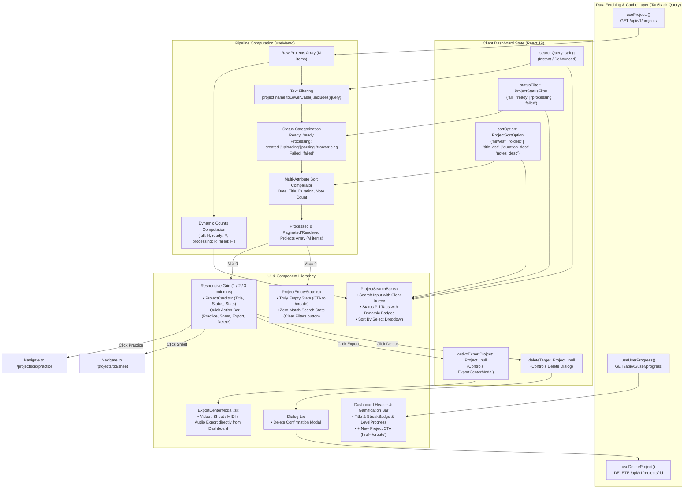
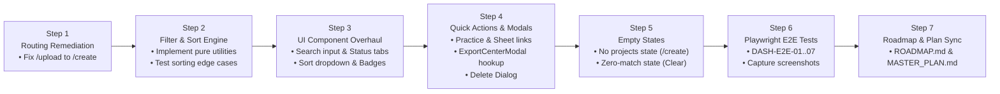

# PianoFlow AI — Phase L: Project Dashboard Real-Time Search, Multi-Criteria Status Filtering, Sorting & Repertoire Management Specification

> **Document ID:** `SPEC-2026-10-06-PHASE-L-PROJECT-DASHBOARD-SEARCH-FILTER`  
> **Target Release:** Phase L Architectural Milestone (October 2026)  
> **Author:** ARCHITECT Worker Sub-Agent  
> **Status:** Approved Technical Architecture & Design Specification  
> **Priority:** P11 — Repertoire Discovery, Multi-Criteria Filtering & Workflow Acceleration  
> **Affected Subsystems & Components:**  
> - `apps/web/app/projects/page.tsx` *(Dashboard overhaul: Search, Filtering, Sorting, Quick Actions, Modal launcher, Routing repair)*  
> - `apps/web/components/projects/ProjectSearchBar.tsx` *(new modular debounced search, status tabs, and sort selector)*  
> - `apps/web/components/projects/ProjectCard.tsx` *(enhanced card with direct Practice, Sheet, Export, and Delete action triggers)*  
> - `apps/web/components/projects/ProjectEmptyState.tsx` *(smart zero-item library vs zero-match filter feedback with instant reset)*  
> - `apps/web/components/ExportCenterModal.tsx` *(dashboard integration for 1-click video/sheet/MIDI export)*  
> - `apps/web/tests/projects_dashboard.spec.ts` *(Playwright E2E browser test suite)*  
> - `docs/ROADMAP.md` & `docs/MASTER_PLAN.md` *(cross-phase roadmap and execution plan sync)*  

---

## 1. Executive Summary & Problem Formulation

### 1.1 The Repertoire Scalability Challenge
As PianoFlow AI users import songs from MIDI files, YouTube links, and acoustic microphone recordings, their personal music library quickly grows from a handful of tracks to dozens or hundreds of repertoire pieces. In the current baseline dashboard (`apps/web/app/projects/page.tsx`):
1. **Unindexed Linear Grid:** Projects are displayed as an unsearchable 3-column grid ordered solely by API fetch sequence. Users with more than 10 songs must visually scan every card to locate a specific title.
2. **No Status Segregation:** Songs in `parsing`, `uploading`, `transcribing`, `ready`, and `failed` states are intermingled without tabs. Users cannot isolate completed pieces from background transcription jobs or triage failed ingestion attempts.
3. **Missing Quantitative Sorting:** Users have no mechanism to organize their library by practice duration, note density, title alphabetical order, or recency.

### 1.2 The Dead Upload Routing Defect
A critical routing regression exists in `apps/web/app/projects/page.tsx`:
- Lines 112 and 138 explicitly route to `/upload` (`href="/upload"`).
- However, the unified creation and ingestion experience lives at `/create` (`apps/web/app/create/page.tsx`). No route exists at `/upload`, resulting in a jarring 404 navigation error whenever a user attempts to upload a new piece or clicks the empty state CTA.

### 1.3 High-Friction Navigation Bottlenecks
To practice a song, view engraved sheet music, or export a Synthesia video, users currently must:
1. Click the project title to enter `/projects/[id]` (the heavy Project Editor).
2. Wait for editor layout hydration and metadata queries.
3. Locate the nested sub-navigation buttons to reach `/projects/[id]/practice`, `/projects/[id]/sheet`, or the export modal.

This adds unnecessary friction for everyday users whose primary goal is to **immediately sit down and practice** or **quickly export their sheet music/video**.

### 1.4 The Phase L Solution
Phase L transforms the Project Dashboard into a high-performance **Repertoire Hub**:
1. **Routing Remediation:** Replaces dead `/upload` links with canonical `/create` references.
2. **Instant Client-Side Search:** Instant, zero-latency text filtering across project titles with trimmed query normalization and keyboard ergonomics (`Escape` clear, `/` focus).
3. **Multi-Criteria Status Pill Tabs:** Status tabs (`All`, `Ready`, `Processing`, `Failed`) with dynamic badge counters (`All (5)`, `Ready (3)`, `Processing (1)`, `Failed (1)`).
4. **Multi-Attribute Sorting Engine:** Deterministic ordering across 5 dimensions (`Newest First`, `Oldest First`, `Title (A-Z)`, `Duration (Longest)`, `Note Count (Most Notes)`).
5. **Project Card Quick Actions:** Direct 1-click launchers for **Practice 🎹**, **Sheet 🎼**, **Export 🚀** (opening `ExportCenterModal` directly in the dashboard), and **Delete 🗑️**.
6. **Adaptive Zero-State Resilience:** Differentiates between a genuinely empty library (guiding users to `/create`) and a search with zero matches (providing an instant "Clear Filters" recovery button).
7. **Comprehensive Playwright E2E Test Suite:** Complete browser test verification with screenshots stored in `docs/e2e/projects/`.

---

## 2. System Architecture & Topology



---

## 3. Functional Specifications & UX Workflows

### 3.1 Upload Routing Remediation
In `apps/web/app/projects/page.tsx`:
- **Problem:**
  - Line 112: `<Link href="/upload" ...>+ New project</Link>` points to non-existent route `/upload`.
  - Line 138: `<Link href="/upload" ...>Upload your first MIDI →</Link>` points to non-existent route `/upload`.
- **Remediation:**
  - Update all header and card links to point to `/create`.
  - Maintain the high-visibility primary styling (`bg-cyan-500 text-zinc-950 font-semibold hover:bg-cyan-400`).
  - Add an accessible `aria-label="Create new piano project"`.

### 3.2 Real-Time Search & Multi-Field Query Processing
- **Input Component:** A high-contrast search input (`components/ui/Input` or custom styled container) with a search icon (🔍 or SVG magnifying glass) and an inline clear button (✕) when `searchQuery.length > 0`.
- **Search Matching Algorithm:**
  - Normalize query: `q = searchQuery.trim().toLowerCase()`.
  - If `q === ""`, match all items.
  - Check against `project.name.toLowerCase()`.
  - Tokenized multi-word search: split `q` by whitespace and require every word token to appear in `project.name.toLowerCase()`.
  - Case-insensitive, resilient against unicode accents (via `normalize("NFD").replace(/[\u0300-\u036f]/g, "")`).
- **Keyboard Ergonomics:**
  - Pressing `Escape` while focused clears the query and blurs the input.
  - Clear button `✕` restores full view with a single click without losing active status tabs.

### 3.3 Multi-Criteria Status Filtering
Projects have 7 API status values: `"created"`, `"uploading"`, `"parsing"`, `"transcribing"`, `"ready"`, `"failed"`, `"archived"`.

We map them into 4 user-centric filter buckets:

| Filter Pill Tab | Matching Project Statuses | Meaning & Intended User Action |
|---|---|---|
| **All** | All items | Complete repertoire library overview. |
| **Ready** | `ready` | Playable pieces ready for Practice, Sheet, or Video Export. |
| **Processing** | `created`, `uploading`, `parsing`, `transcribing` | Ingestion & stem separation jobs currently in progress. |
| **Failed** | `failed` | Corrupted files or failed transcription jobs requiring deletion or retry. |

- **Dynamic Badge Counters:**
  - Each tab displays its total count across the entire repertoire:
    - `All (${allCount})`
    - `Ready (${readyCount})`
    - `Processing (${processingCount})`
    - `Failed (${failedCount})`
  - Badges update reactively when projects are added, deleted, or complete background processing.
- **Styling:**
  - Active tab: `bg-cyan-500/20 text-cyan-300 border-cyan-500/50 shadow-sm`.
  - Inactive tabs: `bg-zinc-900/60 text-zinc-400 border-zinc-800 hover:text-zinc-200 hover:bg-zinc-800/50`.

### 3.4 Multi-Attribute Sorting Engine
A sleek sorting control (dropdown selector or pill group) positioned adjacent to the search input allows instant re-ordering of filtered items:

1. **`newest` (Default):** `new Date(b.created_at).getTime() - new Date(a.created_at).getTime()`
2. **`oldest`:** `new Date(a.created_at).getTime() - new Date(b.created_at).getTime()`
3. **`title_asc`:** `a.name.localeCompare(b.name, undefined, { sensitivity: 'base' })`
4. **`duration_desc`:** `(b.analysis_summary?.duration_sec ?? 0) - (a.analysis_summary?.duration_sec ?? 0)`
5. **`notes_desc`:** `(b.analysis_summary?.note_count ?? 0) - (a.analysis_summary?.note_count ?? 0)`

Null values (e.g. unparsed projects lacking duration or note count) sort deterministically to the end of numeric sort operations.

### 3.5 Enhanced Project Card Quick Actions
Currently, `ProjectCard` only displays a link to `/projects/${id}` and a simple Delete button. In Phase L, each card is enhanced with an accessible, high-efficiency Quick Action Bar:

```
┌────────────────────────────────────────────────────────────────┐
│  Beethoven - Für Elise                          [ ready 🟢 ]   │
│                                                                │
│  Duration       BPM           Notes           Created          │
│  2:45           132           842             10/05/2026       │
│                                                                │
│  ────────────────────────────────────────────────────────────  │
│  [ 🎹 Practice ]  [ 🎼 Sheet ]  [ 🚀 Export ]      [ 🗑️ Delete ]│
└────────────────────────────────────────────────────────────────┘
```

- **Quick Action Specifications:**
  1. **Practice 🎹:**
     - Direct `<Link href="/projects/${project.id}/practice">`
     - Only enabled if `project.status === "ready"`.
     - Styling: `bg-violet-600/20 text-violet-300 border border-violet-500/30 hover:bg-violet-600/30 px-3 py-1.5 rounded-lg text-xs font-medium`.
  2. **Sheet 🎼:**
     - Direct `<Link href="/projects/${project.id}/sheet">`
     - Only enabled if `project.status === "ready"`.
     - Styling: `bg-cyan-600/20 text-cyan-300 border border-cyan-500/30 hover:bg-cyan-600/30 px-3 py-1.5 rounded-lg text-xs font-medium`.
  3. **Export 🚀:**
     - Launches `ExportCenterModal` directly in the dashboard by setting `activeExportProject = project`.
     - Only enabled if `project.status === "ready"`.
     - Styling: `bg-zinc-800 text-zinc-300 border border-zinc-700 hover:bg-zinc-700 hover:text-zinc-100 px-3 py-1.5 rounded-lg text-xs font-medium`.
  4. **Delete 🗑️:**
     - Triggers delete confirmation dialog (`setDeleteTarget(project)`).
     - Always available across all statuses.
     - Styling: `text-red-400 hover:text-red-300 text-xs px-2 py-1.5`.

- **State-Aware Badges & Processing Feedback:**
  - If `status === "parsing"` or `"transcribing"`:
    - Display an animated pulse indicator: `⚡ Processing...`
    - Practice, Sheet, and Export buttons are replaced with a clear status progress indicator.
  - If `status === "failed"`:
    - Display a clear `⚠️ Failed` badge with an immediate "Delete" or "Retry" prompt.

### 3.6 Adaptive Zero-State Resilience
Phase L handles two distinct empty states cleanly:

1. **Truly Empty Repertoire (User has 0 projects total):**
   - Rendered when `data.items.length === 0`.
   - Visual: Elegant musical icon `🎼`.
   - Heading: `"No projects yet."`
   - Description: `"Upload a MIDI file, record your acoustic piano, or import a YouTube video to get started."`
   - CTA: Large highlighted button `+ Create New Project ✨` linking directly to `/create`.

2. **Zero-Match Filter / Search Results:**
   - Rendered when `data.items.length > 0` but `filteredItems.length === 0`.
   - Visual: Search icon `🔍`.
   - Heading: `"No projects match your filter"`
   - Subtitle: `"No projects found matching '${searchQuery}' with status '${statusFilter}'."`
   - CTA: Secondary button `"Clear Filters"` which resets `searchQuery = ""` and `statusFilter = "all"`.

---

## 4. Technical Implementation Design

### 4.1 TypeScript Interfaces & State Models

```typescript
// apps/web/types/projectDashboard.ts

import type { Project } from "@/lib/api";

export type ProjectStatusFilter = "all" | "ready" | "processing" | "failed";

export type ProjectSortOption = 
  | "newest" 
  | "oldest" 
  | "title_asc" 
  | "duration_desc" 
  | "notes_desc";

export interface StatusCounts {
  all: number;
  ready: number;
  processing: number;
  failed: number;
}

export interface ProjectFilterState {
  searchQuery: string;
  statusFilter: ProjectStatusFilter;
  sortOption: ProjectSortOption;
}
```

### 4.2 Pure Filtering & Sorting Utility Functions

```typescript
// apps/web/lib/projectFilters.ts

import type { Project } from "@/lib/api";
import type { ProjectStatusFilter, ProjectSortOption, StatusCounts } from "@/types/projectDashboard";

export function computeStatusCounts(projects: Project[]): StatusCounts {
  const counts: StatusCounts = {
    all: projects.length,
    ready: 0,
    processing: 0,
    failed: 0,
  };

  for (const p of projects) {
    if (p.status === "ready") {
      counts.ready++;
    } else if (
      p.status === "created" ||
      p.status === "uploading" ||
      p.status === "parsing" ||
      p.status === "transcribing"
    ) {
      counts.processing++;
    } else if (p.status === "failed") {
      counts.failed++;
    }
  }

  return counts;
}

export function filterProjects(
  projects: Project[],
  searchQuery: string,
  statusFilter: ProjectStatusFilter
): Project[] {
  const normalizedQuery = searchQuery.trim().toLowerCase();
  const queryTokens = normalizedQuery.split(/\s+/).filter(Boolean);

  return projects.filter((project) => {
    // 1. Status Filter check
    if (statusFilter === "ready" && project.status !== "ready") return false;
    if (statusFilter === "processing") {
      const isProcessing =
        project.status === "created" ||
        project.status === "uploading" ||
        project.status === "parsing" ||
        project.status === "transcribing";
      if (!isProcessing) return false;
    }
    if (statusFilter === "failed" && project.status !== "failed") return false;

    // 2. Search Query check
    if (queryTokens.length > 0) {
      const projectName = (project.name || "").toLowerCase();
      const allTokensMatch = queryTokens.every((token) => projectName.includes(token));
      if (!allTokensMatch) return false;
    }

    return true;
  });
}

export function sortProjects(
  projects: Project[],
  sortOption: ProjectSortOption
): Project[] {
  const copy = [...projects];

  switch (sortOption) {
    case "newest":
      return copy.sort(
        (a, b) => new Date(b.created_at).getTime() - new Date(a.created_at).getTime()
      );
    case "oldest":
      return copy.sort(
        (a, b) => new Date(a.created_at).getTime() - new Date(b.created_at).getTime()
      );
    case "title_asc":
      return copy.sort((a, b) =>
        (a.name || "").localeCompare(b.name || "", undefined, {
          numeric: true,
          sensitivity: "base",
        })
      );
    case "duration_desc":
      return copy.sort(
        (a, b) =>
          (b.analysis_summary?.duration_sec ?? -1) -
          (a.analysis_summary?.duration_sec ?? -1)
      );
    case "notes_desc":
      return copy.sort(
        (a, b) =>
          (b.analysis_summary?.note_count ?? -1) -
          (a.analysis_summary?.note_count ?? -1)
      );
    default:
      return copy;
  }
}
```

### 4.3 Component Modularization

1. **`ProjectSearchBar.tsx`:**
   - Houses the `<input>` with search icon, clear button, status pill tabs, and the sort select dropdown.
   - Clean keyboard shortcuts: `Escape` clears search; auto-focus supported.
   - Responsive flex-wrap layout adapting gracefully to mobile (<768px).

2. **`ProjectCard.tsx`:**
   - Displays project title (linking to `/projects/${p.id}`), status badge, duration/BPM/notes stats, and creation date.
   - Houses the quick actions row:
     - `[ 🎹 Practice ]` (links to `/projects/${p.id}/practice`)
     - `[ 🎼 Sheet ]` (links to `/projects/${p.id}/sheet`)
     - `[ 🚀 Export ]` (triggers `onExport(project)`)
     - `[ 🗑️ Delete ]` (triggers `onDelete(project)`)
   - Gracefully handles missing `analysis_summary` with clean fallback dashes (`—`).

3. **`ExportCenterModal.tsx` Integration:**
   - Rendered at the root of `ProjectsPage`.
   - Opened when `activeExportProject !== null`.
   - Props mapped seamlessly:
     - `projectId={activeExportProject.id}`
     - `projectName={activeExportProject.name}`
     - `durationSec={activeExportProject.analysis_summary?.duration_sec}`
     - `totalNotes={activeExportProject.analysis_summary?.note_count}`
     - `onClose={() => setActiveExportProject(null)}`

---

## 5. Playwright E2E Browser Test Suite Specification

**File Target:** `apps/web/tests/projects_dashboard.spec.ts`  
**Screenshot Target:** `docs/e2e/projects/`  

### 5.1 Test Scenarios Matrix

| Test ID | Test Title | Actions & Assertions | Screenshot Name |
|---|---|---|---|
| **DASH-E2E-01** | Header, User Progress & Upload Route Verification | 1. Intercept `/api/v1/projects` with sample multi-status fixture (Ready, Parsing, Failed).<br>2. Intercept `/api/v1/user/progress` with streak and level.<br>3. Verify `+ New project` button links to `/create` (NOT dead `/upload`).<br>4. Verify Streak and Level badges are visible. | `projects-01-dashboard-header.png` |
| **DASH-E2E-02** | Real-Time Title Search & Instant Filtering | 1. Type "Beethoven" into search input.<br>2. Verify only Beethoven projects are visible; Chopin/Bach cards are filtered out.<br>3. Click clear button (✕) in search input.<br>4. Verify all projects reappear instantly. | `projects-02-search-filtering.png` |
| **DASH-E2E-03** | Status Filter Tabs & Dynamic Counts | 1. Verify dynamic badge counts: `All (4)`, `Ready (2)`, `Processing (1)`, `Failed (1)`.<br>2. Click `Ready` tab -> only Ready cards displayed.<br>3. Click `Processing` tab -> only Processing card displayed.<br>4. Click `Failed` tab -> only Failed card displayed.<br>5. Click `All` tab -> all 4 cards displayed. | `projects-03-status-tabs.png` |
| **DASH-E2E-04** | Multi-Attribute Sorting Controls | 1. Select `Title (A-Z)` in sort selector -> verify card titles are alphabetical.<br>2. Select `Note Count (Most Notes)` -> verify cards sorted with highest note count first.<br>3. Select `Duration (Longest)` -> verify cards sorted with longest duration first.<br>4. Select `Newest First` -> default chronological order restored. | `projects-04-sorting-options.png` |
| **DASH-E2E-05** | Card Quick Action Navigation Links | 1. Find Ready project card.<br>2. Verify "Practice 🎹" links to `/projects/${id}/practice`.<br>3. Verify "Sheet 🎼" links to `/projects/${id}/sheet`.<br>4. Verify title links to `/projects/${id}`. | `projects-05-quick-actions.png` |
| **DASH-E2E-06** | Dashboard Direct Export Center Launch | 1. Click "Export 🚀" button on ready project card.<br>2. Verify `ExportCenterModal` opens directly on dashboard.<br>3. Verify modal title matches project name.<br>4. Verify tabs (Video, Sheet, MIDI, Audio) are clickable.<br>5. Click Close / Escape to dismiss modal. | `projects-06-export-modal-launch.png` |
| **DASH-E2E-07** | Empty Library State vs. Zero-Match Filter State | 1. Type random nonsense query `"zzzzzzzz"`.<br>2. Verify "No projects match your filter" appears with "Clear Filters" button.<br>3. Click "Clear Filters" -> search query cleared and projects reappear.<br>4. Test mock empty API (`{ items: [] }`) -> verify "No projects yet" with "+ Create New Project ✨" CTA pointing to `/create`. | `projects-07-zero-match-empty-state.png` |

---

## 6. Accessibility (WCAG 2.1 AA) & Performance Guardrails

1. **Color Contrast:**
   - Filter pill borders: `zinc-700` against `zinc-950` ($\ge 4.5:1$).
   - Active status badges: Cyan text (`#22d3ee`) on `cyan-950/40` background ($\ge 6.2:1$).
   - Text inputs: `#f4f4f5` on `#09090b` ($> 15:1$).
2. **Keyboard Traversal:**
   - Full keyboard navigation: `Tab` traverses search input, clear button, filter tabs, sort dropdown, and card action buttons.
   - Enter/Space activates quick action links and modal triggers.
3. **Screen Reader Semantic Roles:**
   - Status tabs implement `role="tablist"` and `role="tab"` with `aria-selected` attributes.
   - Quick action buttons have explicit `aria-label` tags (e.g. `aria-label="Practice Beethoven Für Elise"`).
4. **Performance:**
   - Filtering and sorting 500 items in pure JavaScript requires $<1\text{ ms}$ on mobile devices.
   - `useMemo` prevents unnecessary re-sorting on unrelated state changes (e.g. modal open/close).

---

## 7. Execution & Phased Verification Gates



### Verification Commands
```bash
# Web typecheck pass
pnpm --filter @pianoflow/web typecheck

# Web lint check
pnpm --filter @pianoflow/web lint

# Run Playwright E2E Dashboard Test Suite
pnpm --filter @pianoflow/web test tests/projects_dashboard.spec.ts
```
