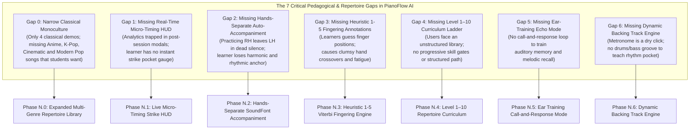
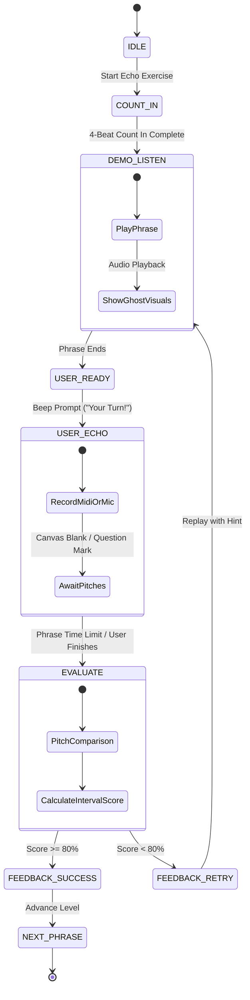
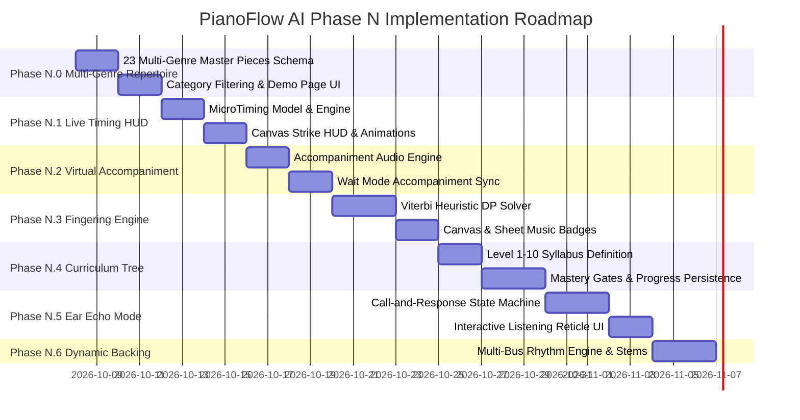

# PianoFlow AI — Competitive Benchmarking & Pedagogical Engineering Roadmap
## Elevating PianoFlow AI into a Concert-Grade Intelligent Piano Learning Workstation

> **Document ID:** `PLAN-2026-10-07-PEDAGOGY-ROADMAP`  
> **Canonical Path:** `c:/Users/super/pianoflow/docs/plans/2026-10-07-competitive-benchmarking-and-pedagogy-roadmap.md`  
> **Status:** Authoritative Architectural & Pedagogical Blueprint  
> **Target Release:** Phase N (Intelligent Piano Pedagogy Suite & Comprehensive Multi-Genre Repertoire)  
> **Author:** ARCHITECT Worker Sub-Agent  
> **Date:** October 7, 2026  
> **Scope:** Competitive Benchmarking (Flowkey, Synthesia, Simply Piano, Yousician, Skoove, Playground Sessions), Gap Analysis, Technical Architecture, Data Models, Multi-Genre Repertoire Expansion (Anime & Ghibli, K-Pop, Modern Pop, Cinematic, Classical), Phase N Implementation Roadmap, and Multi-Agent Dispatch Runbook.

---

## 1. Executive Summary & Pedagogical Vision

### 1.1 The Evolution: From Audio-to-MIDI Transcriber to Premier Learning Workstation
PianoFlow AI began with a profound technical breakthrough: high-precision AI transcription that transforms any polyphonic acoustic piano audio or YouTube performance into clean, quantized, multi-track MIDI and vector sheet music using Demucs v4 and Transkun. Over successive iterations (Phases G through M), PianoFlow AI established a cutting-edge interactive foundation:
- A GPU-accelerated **60 FPS falling note canvas** with particle fireworks and centroid camera auto-tracking.
- Zero-latency **Web MIDI hardware input** coupled with **Web Audio autocorrelation microphone pitch detection**.
- A native **vector SVG grand staff engraver** capable of responsive zooming and high-resolution print rendering.
- An analytical **practice telemetry engine** computing signed micro-timing bias ($\mu$), timing jitter ($\sigma$), measure-by-measure heatmaps, and automatic practice drill recommendations.

However, modern digital piano education has moved far beyond raw notation playback. World-class learning applications do not merely display notes; they orchestrate a complete **cognitive, cultural, and neuromotor feedback loop**. To empower self-taught beginners, advancing hobbyists, and returning pianists, PianoFlow AI must synthesize the pedagogical strengths of the world's leading piano education platforms:

```
┌────────────────────────────────────────────────────────────────────────────────────────┐
│                   THE 6 PILLARS OF MODERN PIANO PEDAGOGY BENCHMARKS                   │
├────────────────────────────────────────────────────────────────────────────────────────┤
│  1. FLOWKEY              ──► Dual Visual Integration, Radiant Wait Mode & Auto-Accompaniment │
│  2. SYNTHESIA            ──► Pixel-Perfect Falling Bars, Heuristic 1-5 Fingering & Combos   │
│  3. SIMPLY PIANO         ──► Instant Acoustic Pitch Onboarding, Lead Sheets & Micro-Wins     │
│  4. YOUSICIAN            ──► Live Early/Late Micro-Timing HUD & 10-Level Skill Syllabus     │
│  5. SKOOVE               ──► Conversational Theory, Interactive Listening & Ear Echo Drills │
│  6. PLAYGROUND SESSIONS  ──► Quincy Jones Dynamic Backing Bands, Groove & Timekeeping Tracks│
└────────────────────────────────────────────────────────────────────────────────────────┘
```

### 1.2 The Core Pedagogical Thesis & Emotional Resonance
The human brain learns piano technique through four tightly linked cognitive loops:
1. **Sensory Kinesthetic Grounding (Visual & Tactile):** Knowing which finger strikes which key, reinforced by intuitive color identities (Electric Violet `#8b5cf6` for Right Hand, Neon Cyan `#06b6d4` for Left Hand) and explicit ergonomic finger numbering ($1 \dots 5$).
2. **Temporal Precision & Groove (Rhythmic Micro-Timing):** Not merely knowing *if* a pitch was struck, but receiving instantaneous, sub-millisecond visual feedback: did the musician hit in the rhythmic pocket ($\pm 35\text{ms}$), or are they rushing (early) or dragging (late)?
3. **Auditory Internalization & Scaffolded Accompaniment:** When a beginner practices one hand, hearing the unpracticed hand automatically played by a concert grand SoundFont preserves harmonic context, prevents isolation fatigue, and accelerates two-hand integration.
4. **Intrinsic Cultural Motivation & Repertoire Magnetism:** Over 90% of self-directed piano learners do not pick up the instrument to practice Czerny exercises or Clementi sonatinas. Their intrinsic fire is ignited by the music they adore:
   - **Anime & Ghibli masterpieces:** The emotional nostalgia of *"One Summer's Day"* and *"Merry-Go-Round of Life"* (Joe Hisaishi), the skyward romanticism of *"Sparkle"* (Radwimps / *Your Name*), and the high-energy virtuosity of *"Unravel"* (*Tokyo Ghoul*) and *"Gurenge"* (*Demon Slayer*).
   - **K-Pop piano anthems:** The introspective beauty of *"Spring Day"* (BTS), the acoustic intimacy of *"Through the Night"* (IU), and the infectious pop grooves of *"Ditto"* (NewJeans) and *"Stay"* (BLACKPINK).
   - **Modern pop & neoclassical staples:** The arpeggiated cascades of *"Golden Hour"* (JVKE), the lyrical balladry of *"River Flows in You"* (Yiruma), and the ambient minimalism of *"Nuvole Bianche"* (Ludovico Einaudi).
   - **Cinematic film scores:** The cosmic emotional grandeur of *"Interstellar"* (Hans Zimmer) and the Parisian charm of *"Comptine d'un autre été"* (Yann Tiersen / *Amélie*).
   - **Timeless classical monuments:** The harmonic clarity of Bach's *Prelude in C Major*, Beethoven's *Für Elise*, Debussy's *Clair de Lune*, and Chopin's *Nocturne Op. 9 No. 2*.

By synthesizing this rich, multi-genre repertoire with cutting-edge real-time pedagogy, PianoFlow AI transforms into an **autonomous concert-grade piano teacher**.

---

## 2. Comprehensive Competitive Benchmark Matrix

### 2.1 Cross-Platform Comparative Matrix

| Feature / Dimension | Flowkey | Synthesia | Simply Piano (JoyTunes) | Yousician | Skoove | Playground Sessions | PianoFlow AI (Current) | PianoFlow AI (Target Suite) |
| :--- | :--- | :--- | :--- | :--- | :--- | :--- | :--- | :--- |
| **Primary Visual Interface** | Split Overhead Video + Grand Staff | Falling Waterfall Notes + On-screen 88 Keys | Horizontal Bouncing Notation Stream | 3D Perspective Falling Tabs + Sheet | Interactive Sheet + Split Overhead Video | Horizontal Notation + Falling Bars | 2D Vertical Falling Waterfall + Virtual 88 Keys + SVG Sheet | Unified Hybrid Waterfall + Vector Staff + Micro-Timing HUD |
| **Repertoire Breadth & Genre Diversity** | 1,500+ pieces (Pop, Classical, Film, Game) | Unlimited MIDI, Community Pop/Anime files | 1,000+ Pop, Disney, Chart Hits, Classical | 10,000+ Graded Pop, Rock, Classical | 500+ Pop, Classical, Soundtrack | 1,000+ Pop, Quincy Jones Soul, Classical | 4 Classical Demo Pieces | **Curated 23-Piece Multi-Genre Library (Classical, Anime & Ghibli, K-Pop, Modern Pop, Cinematic) + AI Audio Ingestion** |
| **Wait Mode / Pause on Note** | Yes (Flawless acoustic & MIDI hold) | Yes (Practice mode pauses until correct key) | Yes ("Waiting for you" step) | Yes (Practice Mode hold) | Yes (Listens and pauses) | Yes (Wait mode available) | Yes (MIDI & Mic wait line pause) | Radiant Hand-Isolated Wait Mode + Ghost Advance |
| **Micro-Timing Feedback** | Binary (Hit/Miss) | Binary / Score Multiplier | Qualitative (Good, Great, Miss) | **Real-Time Millisecond Early / Late Strike Gauge** | Binary / Turn-based check | Late / Early / Correct strike markers | Post-session $\mu$ bias / $\sigma$ jitter stats | **Live Floating Strike HUD (Early/Pocket/Late ms Gauge)** |
| **Hands-Separate Practice** | **Yes (Plays other hand audio automatically)** | Yes (Mutes tracks, manual playback) | Yes (Left/Right isolation in lessons) | Yes (Separate hand lessons) | Yes (Separated practice segments) | Yes (Plays unselected hand with full band) | Hand filtering (visual dimming, but mutes other hand audio) | **Smart SoundFont Virtual Accompaniment Loop** |
| **Ergonomic Fingering Display** | Video overhead hands | **1–5 Finger numbers rendered on falling bars & keys** | Minimal fingering hints on sheet notes | Colored tabs; finger numbers on keys | **1–5 Fingering on sheet staves and keys** | 1–5 Fingering on sheet notation | Note names on canvas; no finger numbering | **Heuristic Viterbi 1–5 Fingering Engine on Canvas & SVG** |
| **Curriculum & Progression** | Song-based tiers (Beginner to Pro) | None (Pure tool / MIDI player) | **Strict gamified 25+ Course Tree & Essentials** | **Structured Level 1–10 Syllabus with Gates** | Conversational Course Tracks (Beginner 1–3, Pop, Classical) | Bootcamp Tracks (Rookie, Intermediate, Advanced) | Unstructured Project List & Classical Demos | **Level 1–10 Repertoire Skill Tree & Mastery Gates** |
| **Ear Training / Echo Mode** | None | None | Limited chord recognition | Limited | **Interactive Call-and-Response ("Listen, Play")** | Minimal | None | **Interactive Call-and-Response "Echo Mode"** |
| **Backing Tracks & Band Groove** | Acoustic piano solo only | General MIDI playback | Pop/rock rhythm backing stems | Studio backing tracks with drums/bass | Real instrument accompaniments | **Quincy Jones produced multi-track rhythm backing** | Click metronome (sine/woodblock lookahead) | **Dynamic Multi-Stem Rhythm Backing Engine** |
| **Acoustic Mic Pitch Engine** | Native custom FFT | None (MIDI only) | **Proprietary polyphonic acoustic listening** | Proprietary low-latency pitch engine | Web Audio pitch engine | Microphone / USB audio interface | Web Audio autocorrelation / YIN pitch tracker | Multi-harmonic YIN + Web Audio Low-Latency Pipeline |
| **Hardware Support** | Web, iOS, Android (Mic, USB, BT MIDI) | PC, Mac, iOS, Android (USB, BT MIDI) | iOS, Android (Mic, USB MIDI) | PC, Mac, iOS, Android (Mic, USB MIDI) | Web, iOS (Mic, USB MIDI) | PC, Mac, iOS (USB MIDI) | Modern Web (Chrome, Edge, Safari, Firefox), Web MIDI, Mic | Web PWA + Web MIDI + Web Audio + Bluetooth MIDI |
| **Custom Song Ingestion** | None (Curated catalog only) | Any `.mid` / `.midi` file | None (Curated catalog only) | Custom upload (paid tier) | None (Curated catalog only) | Song store purchases | **Any MP3, WAV, FLAC, YouTube URL via AI Demucs+Transkun** | **AI Stem Separation + Transkun + Auto Fingering Ingestion** |

---

## 3. PianoFlow AI Gap Analysis

### 3.1 Current Capabilities Inventory (The Super-Power Baseline)
PianoFlow AI already possesses technical capabilities that exceed many commercial apps:
1. **Unconstrained Audio-to-MIDI AI Pipeline:** While Flowkey, Simply Piano, and Skoove are closed silos limited to their internal catalog, PianoFlow AI enables users to drop any MP3/WAV or YouTube link and receive separated piano stems and quantized multi-track notes.
2. **Concert-Grade 60 FPS HTML5 Canvas Engine:** Built with requestAnimationFrame, sub-pixel interpolation, particle fireworks, horizontal frustum culling, and centroid camera auto-tracking.
3. **Dual Input Flexibility:** Plug-and-play Web MIDI API with zero configuration, complemented by low-latency microphone autocorrelation pitch detection.
4. **Native SVG Grand Staff Engraver:** Vector sheet music with clean ledger lines, accidental rendering, measure bounding, and responsive dark-mode styling.
5. **Algorithmic Beginner Simplification Engine:** Real-time reduction of polyphonic music into single-note melodies, root-note bass lines, and octave removal.
6. **Deep Session Telemetry:** Captures signed timing delta ($\Delta t = t_{\text{hit}} - t_{\text{expected}}$) in `SignedTimingEvent` and computes session metrics ($\mu$, $\sigma$, measure heatmap, drill suggestions).

---

### 3.2 The 7 Critical Pedagogical & Repertoire Gaps



---

## 4. Next-Gen Pedagogical Roadmap: Phase N (Intelligent Piano Pedagogy Suite)

Phase N is partitioned into 7 cohesive, modular engineering milestones:

```
┌────────────────────────────────────────────────────────────────────────────────────────┐
│               PHASE N: INTELLIGENT PIANO PEDAGOGY SUITE — MILESTONES                   │
├────────────────────────────────────────────────────────────────────────────────────────┤
│  [Phase N.0]  Expanded Multi-Genre Repertoire Library (Anime, K-Pop, Pop, Film, Classic)│
│  [Phase N.1]  Live Early/Late Micro-Timing Strike HUD & Target Reticle                │
│  [Phase N.2]  Hands-Separate Virtual SoundFont Accompaniment Audio Loop               │
│  [Phase N.3]  Heuristic 1–5 Piano Fingering Generator & Visual Badges                 │
│  [Phase N.4]  Level 1–10 Repertoire Curriculum Ladder & Mastery Progression           │
│  [Phase N.5]  Interactive Ear-Training Call-and-Response "Echo Mode"                  │
│  [Phase N.6]  Dynamic Backing Track Rhythm Engine & Groove Bus                        │
└────────────────────────────────────────────────────────────────────────────────────────┘
```

---

### Milestone N.0: Expanded Multi-Genre Repertoire Library (Anime & Ghibli, K-Pop, Modern Pop, Cinematic & Iconic Classical)

#### 4.0.1 Objectives & Pedagogical Vision
Transform PianoFlow AI's demo library into a world-class **23-piece multi-genre repertoire**. By integrating the most viral and emotionally resonant music across Anime & Ghibli, K-Pop, Modern Pop, Cinematic Film Themes, and Classical Monuments, PianoFlow AI ensures every learner discovers songs they are desperate to play from their first session.

```
┌────────────────────────────────────────────────────────────────────────────────────────┐
│             PIANOFLOW AI: THE 23-PIECE MULTI-GENRE MASTER REPERTOIRE CATALOG           │
├────────────────────────────────────────────────────────────────────────────────────────┤
│  CATEGORY 1: ANIME & GHIBLI SOUNDTRACKS (7 PIECES)                                     │
│  • "Merry-Go-Round of Life" (Joe Hisaishi / Howl's Moving Castle)    ── 140 BPM • 3/4  │
│  • "One Summer's Day" (Joe Hisaishi / Spirited Away)                ── 80 BPM  • 4/4  │
│  • "Sparkle" (Radwimps / Your Name - Kimi no Na wa)                 ── 124 BPM • 4/4  │
│  • "Unravel" (TK / Tokyo Ghoul)                                     ── 135 BPM • 4/4  │
│  • "Gurenge" (LiSA / Demon Slayer - Kimetsu no Yaiba)               ── 135 BPM • 4/4  │
│  • "Sadness and Sorrow" (Toshio Masuda / Naruto)                    ── 68 BPM  • 4/4  │
│  • "A Cruel Angel's Thesis" (Yoko Takahashi / Evangelion)           ── 128 BPM • 4/4  │
│                                                                                        │
│  CATEGORY 2: K-POP PIANO HITS (5 PIECES)                                               │
│  • "Spring Day (봄날)" (BTS)                                        ── 108 BPM • 4/4  │
│  • "Through the Night (밤편지)" (IU)                                ── 78 BPM  • 4/4  │
│  • "Ditto" (NewJeans)                                               ── 134 BPM • 4/4  │
│  • "Stay" (BLACKPINK)                                               ── 104 BPM • 4/4  │
│  • "Seven" (Jung Kook)                                              ── 125 BPM • 4/4  │
│                                                                                        │
│  CATEGORY 3: MODERN & POP PIANO (3 PIECES)                                             │
│  • "River Flows in You" (Yiruma)                                    ── 68 BPM  • 4/4  │
│  • "Nuvole Bianche" (Ludovico Einaudi)                              ── 130 BPM • 4/4  │
│  • "Golden Hour" (JVKE)                                             ── 90 BPM  • 6/8  │
│                                                                                        │
│  CATEGORY 4: CINEMATIC FILM THEMES (2 PIECES)                                          │
│  • "Interstellar (First Step / Main Theme)" (Hans Zimmer)           ── 96 BPM  • 3/4  │
│  • "Comptine d'un autre été: L'après-midi" (Yann Tiersen / Amélie)  ── 100 BPM • 4/4  │
│                                                                                        │
│  CATEGORY 5: TIMELESS CLASSICAL MONUMENTS (6 PIECES)                                   │
│  • "Prelude in C Major, BWV 846" (J.S. Bach)                        ── 112 BPM • 4/4  │
│  • "Für Elise" (L.v. Beethoven)                                     ── 130 BPM • 3/8  │
│  • "Clair de Lune" (Claude Debussy)                                 ── 50 BPM  • 9/8  │
│  • "Nocturne Op. 9 No. 2" (Frédéric Chopin)                         ── 64 BPM  • 12/8 │
│  • "Canon in D" (Johann Pachelbel)                                  ── 75 BPM  • 4/4  │
│  • "Gymnopédie No. 1" (Erik Satie)                                  ── 65 BPM  • 3/4  │
└────────────────────────────────────────────────────────────────────────────────────────┘
```

#### 4.0.2 Comprehensive Song Profiles & Pedagogical Attributes

##### 1. Anime & Ghibli Soundtracks
1. **"Merry-Go-Round of Life" — Joe Hisaishi (*Howl's Moving Castle*)**
   - **Tempo / Meter / Key:** $140\text{ BPM}$ | $3/4\text{ Viennese Waltz}$ | G Minor ($2\text{ flats: } Bb, Eb$)
   - **Difficulty:** Intermediate (Level 6)
   - **Gradient Aesthetic:** `from-emerald-600/30 via-zinc-900 to-zinc-950 border-emerald-400/40`
   - **Pedagogy:** Stride waltz LH leaps ($G1 \to G3-Bb3-D4$), chromatic RH flourishes, rubato accelerando/ritardando.
2. **"One Summer's Day (The Name of Life)" — Joe Hisaishi (*Spirited Away*)**
   - **Tempo / Meter / Key:** $80\text{ BPM}$ | $4/4$ | C Major / A Minor
   - **Difficulty:** Beginner to Intermediate (Level 4)
   - **Gradient Aesthetic:** `from-teal-600/30 via-zinc-900 to-zinc-950 border-teal-400/40`
   - **Pedagogy:** Lush pentatonic melodies, gentle syncopations, delicate pedal transitions, nostalgic phrasing.
3. **"Sparkle" — Radwimps (*Your Name / Kimi no Na wa*)**
   - **Tempo / Meter / Key:** $124\text{ BPM}$ | $4/4$ | B Major ($5\text{ sharps}$) / G# Minor
   - **Difficulty:** Intermediate (Level 6)
   - **Gradient Aesthetic:** `from-indigo-600/35 via-zinc-900 to-zinc-950 border-indigo-400/40`
   - **Pedagogy:** High-register sparkling 16th-note arpeggios, sustained bass octaves, dynamic explosion into chorus.
4. **"Unravel" — TK from Ling Tosite Sigure (*Tokyo Ghoul*)**
   - **Tempo / Meter / Key:** $135\text{ BPM}$ | $4/4$ | G Minor
   - **Difficulty:** Advanced / Master (Level 8)
   - **Gradient Aesthetic:** `from-red-800/35 via-zinc-900 to-zinc-950 border-red-500/40`
   - **Pedagogy:** Rapid polyrhythmic 16th octave jumps, aggressive syncopated accents, extreme LH/RH dynamic contrast.
5. **"Gurenge" — LiSA (*Demon Slayer: Kimetsu no Yaiba*)**
   - **Tempo / Meter / Key:** $135\text{ BPM}$ | $4/4$ | E Minor
   - **Difficulty:** Intermediate to Advanced (Level 7)
   - **Gradient Aesthetic:** `from-rose-600/35 via-zinc-900 to-zinc-950 border-rose-400/40`
   - **Pedagogy:** Driving rock rhythm piano transcription, punchy staccato bass chords, rapid melodic 8th/16th runs.
6. **"Sadness and Sorrow" — Toshio Masuda (*Naruto*)**
   - **Tempo / Meter / Key:** $68\text{ BPM}$ | $4/4$ | D Minor ($1\text{ flat: } Bb$)
   - **Difficulty:** Beginner (Level 2)
   - **Gradient Aesthetic:** `from-amber-700/30 via-zinc-900 to-zinc-950 border-amber-500/40`
   - **Pedagogy:** Slow lyrical cantabile touch, simple 5-finger LH arpeggiated chords, focus on melodic expression.
7. **"A Cruel Angel's Thesis" — Yoko Takahashi (*Neon Genesis Evangelion*)**
   - **Tempo / Meter / Key:** $128\text{ BPM}$ | $4/4$ | C Minor
   - **Difficulty:** Intermediate (Level 5)
   - **Gradient Aesthetic:** `from-violet-700/30 via-zinc-900 to-zinc-950 border-violet-400/40`
   - **Pedagogy:** Eurobeat anime groove, syncopated off-beat chords, memorable anthem melody with clean hand shifts.

##### 2. K-Pop Piano Hits
1. **"Spring Day (봄날)" — BTS**
   - **Tempo / Meter / Key:** $108\text{ BPM}$ | $4/4$ | E-flat Major ($3\text{ flats}$)
   - **Difficulty:** Beginner to Intermediate (Level 3–4)
   - **Gradient Aesthetic:** `from-sky-600/30 via-zinc-900 to-zinc-950 border-sky-400/40`
   - **Pedagogy:** Nostalgic cyclical 4-chord progression ($Eb - Gm - Ab - Bb$), gentle rolling LH arpeggios.
2. **"Through the Night (밤편지)" — IU**
   - **Tempo / Meter / Key:** $78\text{ BPM}$ | $4/4$ | E-flat Major
   - **Difficulty:** Beginner (Level 2–3)
   - **Gradient Aesthetic:** `from-purple-800/30 via-zinc-900 to-zinc-950 border-purple-400/40`
   - **Pedagogy:** Acoustic folk-guitar style fingerpicking adapted to piano keys, quiet dynamic nuance ($pp$).
3. **"Ditto" — NewJeans**
   - **Tempo / Meter / Key:** $134\text{ BPM}$ | $4/4$ | F# Minor / A Major
   - **Difficulty:** Intermediate (Level 5)
   - **Gradient Aesthetic:** `from-cyan-700/30 via-zinc-900 to-zinc-950 border-cyan-400/40`
   - **Pedagogy:** Baltimore club / Jersey club rhythmic syncopations translated to piano staccato bass and ethereal synth chords.
4. **"Stay" — BLACKPINK**
   - **Tempo / Meter / Key:** $104\text{ BPM}$ | $4/4$ | A Major
   - **Difficulty:** Beginner to Intermediate (Level 3)
   - **Gradient Aesthetic:** `from-pink-700/30 via-zinc-900 to-zinc-950 border-pink-400/40`
   - **Pedagogy:** Steady acoustic campfire chord strumming, clear right-hand vocal melody line.
5. **"Seven" — Jung Kook**
   - **Tempo / Meter / Key:** $125\text{ BPM}$ | $4/4$ | B Major / G# Minor
   - **Difficulty:** Intermediate (Level 5)
   - **Gradient Aesthetic:** `from-fuchsia-700/30 via-zinc-900 to-zinc-950 border-fuchsia-400/40`
   - **Pedagogy:** UK garage swing pocket rhythm, syncopated 16th-note hooks, clean finger isolation.

##### 3. Modern & Pop Piano
1. **"River Flows in You" — Yiruma**
   - **Tempo / Meter / Key:** $68\text{ BPM}$ | $4/4$ | A Major ($3\text{ sharps}$)
   - **Difficulty:** Intermediate (Level 5)
   - **Gradient Aesthetic:** `from-fuchsia-600/30 via-zinc-900 to-zinc-950 border-fuchsia-500/40`
   - **Pedagogy:** Left-hand broken 10th spans ($A2 - E3 - C\#4$), cantabile grace notes ($G\#5 \to A5$), expressive rubato.
2. **"Nuvole Bianche" — Ludovico Einaudi**
   - **Tempo / Meter / Key:** $130\text{ BPM}$ | $4/4$ | F Minor ($4\text{ flats}$)
   - **Difficulty:** Intermediate (Level 5)
   - **Gradient Aesthetic:** `from-slate-400/20 via-zinc-900 to-zinc-950 border-slate-400/40`
   - **Pedagogy:** Rolling quadruplet 8th figures, black-key thumb ergonomics, dynamic swelling.
3. **"Golden Hour" — JVKE**
   - **Tempo / Meter / Key:** $90\text{ BPM}$ | $6/8$ Compound Duple | G Major
   - **Difficulty:** Advanced (Level 7)
   - **Gradient Aesthetic:** `from-amber-500/35 via-zinc-900 to-zinc-950 border-amber-400/50`
   - **Pedagogy:** Cascading 16th-note arpeggio streams, hand-over-hand crossovers, $6/8$ metric pulse.

##### 4. Cinematic Film Themes
1. **"Interstellar (First Step / Main Theme)" — Hans Zimmer**
   - **Tempo / Meter / Key:** $96\text{ BPM}$ | $3/4\text{ Waltz}$ | A Minor
   - **Difficulty:** Beginner to Intermediate (Level 3–4)
   - **Gradient Aesthetic:** `from-sky-700/30 via-zinc-900 to-zinc-950 border-sky-500/40`
   - **Pedagogy:** Minimalist two-note alternating ostinato ($E5 - D5$), massive dynamic build from $pp$ to $ff$.
2. **"Comptine d'un autre été: L'après-midi" — Yann Tiersen (*Amélie*)**
   - **Tempo / Meter / Key:** $100\text{ BPM}$ | $4/4$ | E Minor
   - **Difficulty:** Beginner to Intermediate (Level 4)
   - **Gradient Aesthetic:** `from-teal-600/30 via-zinc-900 to-zinc-950 border-teal-500/40`
   - **Pedagogy:** Steady perpetual-motion broken chord ostinato ($Em - G - Bm - D$), double-note 16th melody runs.

##### 5. Timeless Classical Monuments
1. **"Prelude in C Major, BWV 846" — J.S. Bach** ($112\text{ BPM}$, $4/4$, C Maj, Beginner)
2. **"Für Elise" — L.v. Beethoven** ($130\text{ BPM}$, $3/8$, A Min, Intermediate)
3. **"Clair de Lune" — Claude Debussy** ($50\text{ BPM}$, $9/8$, Db Maj, Master)
4. **"Nocturne Op. 9 No. 2" — Frédéric Chopin** ($64\text{ BPM}$, $12/8$, Eb Maj, Master)
5. **"Canon in D" — Johann Pachelbel** ($75\text{ BPM}$, $4/4$, D Maj, Beginner)
6. **"Gymnopédie No. 1" — Erik Satie** ($65\text{ BPM}$, $3/4$, D Maj, Beginner)

---

### Milestone N.1: Live Early/Late Micro-Timing Gauge & Strike HUD

#### Objectives & Pedagogical Value
Provide instantaneous visual micro-timing feedback at the exact point of key strike, transforming abstract timing into an intuitive visual target.

#### Architectural Specification
1. **Micro-Timing Mathematical Model:**
   For any incoming note strike at physical timestamp $t_{\text{hit}}$ matched to expected note $N$ with scheduled start time $t_{\text{expected}}$:
   $$\Delta t = t_{\text{hit}} - t_{\text{expected}} \quad (\text{in milliseconds})$$
   - $|\Delta t| \le 35\text{ms}$: **PERFECT / IN THE POCKET**  
     - Visual: Emerald green glow (`#10b981`), central target bullseye, floating text `"PERFECT"`, $\pm 0\text{px}$ indicator offset.
   - $-75\text{ms} \le \Delta t < -35\text{ms}$: **EARLY / RUSHING**  
     - Visual: Amber yellow indicator (`#f59e0b`), leaning left, floating text `"-42ms EARLY"`, proportional horizontal gauge deflection.
   - $+35\text{ms} < \Delta t \le +75\text{ms}$: **LATE / DRAGGING**  
     - Visual: Sky blue indicator (`#0284c7`), leaning right, floating text `"+51ms LATE"`, proportional horizontal gauge deflection.
   - $|\Delta t| > 75\text{ms}$ or wrong pitch: **MISS**  
     - Visual: Crimson red indicator (`#ef4444`), shake animation.

2. **UI Component: `MicroTimingGauge.tsx` & Strike Reticle:**
   - Positioned directly above the keyboard strike line in `PracticeCanvas.tsx` or as an overlay HUD.
   - Equipped with an exponential decay spring animation ($600\text{ms}$ half-life) so rapid successive notes display smooth timing momentum without visual stutter.

---

### Milestone N.2: Hands-Separate Virtual Accompaniment Audio Loop

#### Objectives & Pedagogical Value
When practicing with one hand isolated, the virtual audio engine automatically plays the unpracticed hand with full acoustic nuance using `SampledPiano` / `smplr`, maintaining harmonic rich context and steady rhythmic support.

#### Architectural Specification
1. **Audio Routing Architecture:**
   - When `handMode === "right"`: User plays Right Hand; engine plays Left Hand notes automatically via `AccompanimentScheduler`.
   - When `handMode === "left"`: User plays Left Hand; engine plays Right Hand notes automatically via `AccompanimentScheduler`.
   - When `handMode === "both"`: User plays both hands; accompaniment auto-playback is disabled.
2. **Wait Mode Synchronization:**
   - When playback encounters an upcoming user note in Wait Mode and pauses the timeline, accompaniment scheduler pauses synchronously.
   - Accompaniment notes occurring at the same beat are triggered immediately upon successful key strike.
3. **Relative Balance Controls:**
   - Accompaniment volume slider (default: $70\%$ volume so the user's live playing stands out clearly in the mix).

---

### Milestone N.3: Heuristic 1–5 Piano Fingering Generator & Visual Badges

#### Objectives & Pedagogical Value
Assign natural, anatomically sound finger numbers ($1 = \text{Thumb}, 2 = \text{Index}, 3 = \text{Middle}, 4 = \text{Ring}, 5 = \text{Pinky}$) to every note in any imported piece, displayed on falling note bars and vector sheet music.

#### Algorithmic Formulation: Constrained Dynamic Programming (Viterbi Optimization)
Piano fingering can be modeled as finding an optimal sequence of finger assignments $F = (f_1, f_2, \dots, f_N)$ for a sequence of notes $P = (p_1, p_2, \dots, p_N)$ that minimizes total biomechanical transition cost:

$$\min_{F} \sum_{i=1}^{N-1} \mathcal{C}(p_i, f_i, p_{i+1}, f_{i+1}, \Delta t_i)$$

Where the transition cost $\mathcal{C}$ penalizes:
1. **Physical Span Cost $\mathcal{C}_{\text{span}}$:** Stretching fingers beyond natural hand span.
2. **Crossover Cost $\mathcal{C}_{\text{cross}}$:** Thumb-under and finger-over transitions versus awkward finger-over-finger crossings.
3. **Key Topography Cost $\mathcal{C}_{\text{topo}}$:** Heavy penalty for placing the short thumb ($1$) or pinky ($5$) on black keys when long fingers ($2, 3, 4$) can reach white keys.
4. **Position Shift Cost $\mathcal{C}_{\text{shift}}$:** Hand lateral displacement penalty.

---

### Milestone N.4: Level 1–10 Repertoire Curriculum Ladder & Mastery Progression

#### Objectives & Pedagogical Value
Replace unstructured song lists with a structured pedagogical progression modeled on the Yousician, Simply Piano, and ABRSM syllabus.

```
┌────────────────────────────────────────────────────────────────────────────────────────┐
│                        PIANOFLOW AI 10-LEVEL CURRICULUM LADDER                         │
├────────────────────────────────────────────────────────────────────────────────────────┤
│  LEVEL 1: Primer (Middle C Position, Stationary 5-finger pattern, Quarter notes)       │
│  LEVEL 2: Early Beginner (Sadness & Sorrow, Prelude in C, Hands alternating, 4/4 meter)│
│  LEVEL 3: Elementary (Through the Night, Interstellar, 2-note LH chords, 8th notes)    │
│  LEVEL 4: Late Elementary (One Summer's Day, Comptine d'un autre été, Black keys)      │
│  LEVEL 5: Early Intermediate (River Flows in You, Nuvole Bianche, Ditto, Arpeggios)    │
│  LEVEL 6: Intermediate (Für Elise full, Merry-Go-Round of Life, Sparkle, Polyphony)    │
│  LEVEL 7: Late Intermediate (Golden Hour, Gurenge, Rapid 16th passages, Syncopation)   │
│  LEVEL 8: Advanced (Unravel, Chopin Preludes, Octave jumps, Complex pedaling)          │
│  LEVEL 9: Late Advanced (Chopin Nocturne Op. 9 No. 2, Clair de Lune, Virtuosic rubato) │
│  LEVEL 10: Concert Virtuoso (Chopin Etudes, Liszt, Rachmaninoff Concertos)             │
└────────────────────────────────────────────────────────────────────────────────────────┘
```

---

### Milestone N.5: Interactive Ear-Training Call-and-Response "Echo Mode"

#### Objectives & Pedagogical Value
Cultivate relative pitch and auditory muscle memory by challenging students to listen to a musical phrase and immediately play it back without visual guide bars.



---

### Milestone N.6: Dynamic Backing Track Rhythm Engine (Playground Sessions Benchmark)

#### Objectives & Pedagogical Value
Provide dynamic, multi-stem rhythm backing tracks (drums, bass, auxiliary synths) generated or synchronized alongside classical and contemporary pieces, training musicians to play in the groove with unwavering rhythmic discipline.

---

## 5. Technical Architecture & Data Models

### 5.1 Repertoire Library Schema & Architecture (`apps/web/lib/demoSongs.ts`)

```typescript
// apps/web/lib/demoSongs.ts

import type { NoteData } from "@pianoflow/shared-types";

export type SongDifficulty = "Beginner" | "Intermediate" | "Master";

export type SongCategory =
  | "Classical"
  | "Anime & Ghibli"
  | "K-Pop"
  | "Modern & Pop"
  | "Cinematic";

export type MusicalPeriod =
  | "Baroque"
  | "Classical"
  | "Romantic"
  | "Impressionist"
  | "Modern"
  | "Neoclassical"
  | "Cinematic"
  | "Pop"
  | "Anime"
  | "K-Pop";

export interface DemoSong {
  id: string;
  title: string;
  composer: string;
  category: SongCategory;
  period: MusicalPeriod;
  difficulty: SongDifficulty;
  bpm: number;
  time_signature: string;
  key: string;
  duration_sec: number;
  description: string;
  coverGradient: string;
  noteCount: number;
  tags: string[];
  audioPreviewUrl?: string;
  noteData: NoteData;
}

export const DEMO_SONG_CATEGORIES: readonly (SongCategory | "All")[] = [
  "All",
  "Classical",
  "Anime & Ghibli",
  "K-Pop",
  "Modern & Pop",
  "Cinematic",
] as const;

export function getDemoSongsByCategory(category: SongCategory | "All"): DemoSong[] {
  if (category === "All") return DEMO_SONGS;
  return DEMO_SONGS.filter((song) => song.category === category);
}

export function searchDemoSongs(
  query: string,
  category: SongCategory | "All" = "All"
): DemoSong[] {
  const normalized = query.trim().toLowerCase();
  const pool = getDemoSongsByCategory(category);
  if (!normalized) return pool;

  return pool.filter(
    (s) =>
      s.title.toLowerCase().includes(normalized) ||
      s.composer.toLowerCase().includes(normalized) ||
      s.key.toLowerCase().includes(normalized) ||
      s.tags.some((t) => t.toLowerCase().includes(normalized))
  );
}
```

### 5.2 UI Integration in Demo Page (`apps/web/app/demo/page.tsx`)

The UI integration in `/demo` replaces the simple 4-card strip with a responsive **Multi-Genre Filter & Search Suite**:

```tsx
// apps/web/app/demo/page.tsx (Architecture Blueprint)

// 1. State declarations
const [selectedCategory, setSelectedCategory] = useState<SongCategory | "All">("All");
const [searchQuery, setSearchQuery] = useState("");

// 2. Memoized filtered song list
const filteredSongs = useMemo(() => {
  return searchDemoSongs(searchQuery, selectedCategory);
}, [searchQuery, selectedCategory]);

// 3. Category Filter & Search Bar UI
<section aria-labelledby="repertoire-catalog-heading" className="space-y-4">
  <div className="flex flex-wrap items-center justify-between gap-3">
    <div className="flex items-center gap-2">
      <Music className="w-4 h-4 text-cyan-400" />
      <h2 id="repertoire-catalog-heading" className="text-sm font-bold uppercase tracking-wider text-zinc-300">
        Curated Multi-Genre Repertoire Library
      </h2>
      <Badge className="bg-cyan-950/80 text-cyan-300 border-cyan-700/50 text-[10px]">
        {filteredSongs.length} of {DEMO_SONGS.length} Pieces
      </Badge>
    </div>

    {/* Search Input */}
    <div className="relative min-w-[240px]">
      <input
        type="text"
        placeholder="Search title, artist, key, tag..."
        value={searchQuery}
        onChange={(e) => setSearchQuery(e.target.value)}
        className="w-full px-3 py-1.5 text-xs rounded-lg bg-zinc-900 border border-zinc-800 text-zinc-200 placeholder-zinc-500 focus:outline-none focus:border-cyan-500"
      />
    </div>
  </div>

  {/* Category Filter Pills */}
  <div className="flex items-center gap-1.5 p-1 bg-zinc-900/90 border border-zinc-800 rounded-xl overflow-x-auto">
    {DEMO_SONG_CATEGORIES.map((cat) => {
      const isSelected = selectedCategory === cat;
      const count = cat === "All" ? DEMO_SONGS.length : DEMO_SONGS.filter((s) => s.category === cat).length;
      return (
        <button
          key={cat}
          type="button"
          onClick={() => setSelectedCategory(cat)}
          className={`px-3 py-1.5 rounded-lg text-xs font-bold transition-all flex items-center gap-2 whitespace-nowrap ${
            isSelected
              ? "bg-gradient-to-r from-violet-600 to-cyan-600 text-white shadow-md"
              : "text-zinc-400 hover:text-zinc-200 hover:bg-zinc-800"
          }`}
        >
          <span>{cat}</span>
          <span className="text-[10px] px-1.5 py-0.5 rounded-full bg-zinc-950/60 font-mono">
            {count}
          </span>
        </button>
      );
    })}
  </div>

  {/* Responsive Repertoire Grid */}
  <div className="grid grid-cols-1 sm:grid-cols-2 lg:grid-cols-4 gap-3.5">
    {filteredSongs.map((song) => (
      <SongCard key={song.id} song={song} isSelected={song.id === activeSong.id} onSelect={handleSelectSong} />
    ))}
  </div>
</section>
```

---

### 5.3 Shared Data Schema Extensions (`@pianoflow/shared-types`)

```typescript
// packages/shared-types/src/pedagogy.ts

export type FingerNumber = 1 | 2 | 3 | 4 | 5;

export interface NoteWithPedagogy {
  id: number;
  pitch: number;
  name: string;
  velocity: number;
  start: number;
  end: number;
  duration: number;
  track: number;
  hand: "L" | "R";
  finger?: FingerNumber;
  isAccompanimentOnly?: boolean;
}

export type MicroTimingPocket = "perfect" | "early" | "late" | "miss";

export interface LiveMicroTimingFeedback {
  deltaMs: number;
  pocket: MicroTimingPocket;
  normalizedOffset: number;
  scoreText: string;
  displayColor: string;
}

export type CurriculumLevelId = 1 | 2 | 3 | 4 | 5 | 6 | 7 | 8 | 9 | 10;

export interface CurriculumSongReference {
  songId: string;
  title: string;
  composer: string;
  category: "Classical" | "Anime & Ghibli" | "K-Pop" | "Modern & Pop" | "Cinematic";
  starsRequiredToUnlock: number;
  isMilestoneGate: boolean;
  targetBpm: number;
}
```

---

### 5.4 Heuristic 1–5 Piano Fingering Generator (`apps/web/lib/practice/fingeringEngine.ts`)

```typescript
// apps/web/lib/practice/fingeringEngine.ts

import type { FingerNumber } from "@pianoflow/shared-types";

export interface NoteForFingering {
  id: number;
  pitch: number;
  start: number;
  end: number;
  hand: "L" | "R";
}

export interface FingeredNote extends NoteForFingering {
  finger: FingerNumber;
}

const BLACK_KEYS = new Set([1, 3, 6, 8, 10]);

const RH_SPAN_TABLE: Record<string, [number, number, number]> = {
  "1-2": [1, 2, 5],
  "2-3": [1, 2, 4],
  "3-4": [1, 1, 3],
  "4-5": [1, 1, 3],
  "1-3": [2, 4, 7],
  "1-4": [3, 5, 8],
  "1-5": [4, 7, 12],
  "2-4": [2, 3, 5],
  "2-5": [3, 5, 8],
  "3-5": [2, 3, 6],
};

function computeTransitionCostRH(
  pitchA: number,
  fingerA: FingerNumber,
  pitchB: number,
  fingerB: FingerNumber,
  deltaTimeSec: number
): number {
  let cost = 0;
  const semitoneDelta = pitchB - pitchA;

  if (fingerA === fingerB && semitoneDelta !== 0) {
    cost += 8.0 / Math.max(0.1, deltaTimeSec);
  }

  if (semitoneDelta > 0) {
    if (fingerB > fingerA) {
      const pairKey = `${fingerA}-${fingerB}`;
      const bounds = RH_SPAN_TABLE[pairKey] || [1, 2, 4];
      if (semitoneDelta < bounds[0] || semitoneDelta > bounds[2]) {
        cost += 5.0 * Math.abs(semitoneDelta - bounds[1]);
      }
    } else {
      if (fingerB === 1 && (fingerA === 2 || fingerA === 3 || fingerA === 4)) {
        cost += 3.0;
      } else {
        cost += 25.0;
      }
    }
  }

  if (semitoneDelta < 0) {
    if (fingerB < fingerA) {
      const pairKey = `${fingerB}-${fingerA}`;
      const bounds = RH_SPAN_TABLE[pairKey] || [1, 2, 4];
      const absDelta = Math.abs(semitoneDelta);
      if (absDelta < bounds[0] || absDelta > bounds[2]) {
        cost += 5.0 * Math.abs(absDelta - bounds[1]);
      }
    } else {
      if (fingerA === 1 && (fingerB === 2 || fingerB === 3 || fingerB === 4)) {
        cost += 3.0;
      } else {
        cost += 25.0;
      }
    }
  }

  if (BLACK_KEYS.has(pitchB % 12)) {
    if (fingerB === 1) cost += 4.5;
    if (fingerB === 5) cost += 3.0;
  }

  return cost;
}

export function generateOptimalFingerings(notes: NoteForFingering[]): FingeredNote[] {
  if (notes.length === 0) return [];

  const rhNotes = notes.filter((n) => n.hand === "R").sort((a, b) => a.start - b.start);
  const lhNotes = notes.filter((n) => n.hand === "L").sort((a, b) => a.start - b.start);

  function solveHand(handNotes: NoteForFingering[], isRH: boolean): FingeredNote[] {
    if (handNotes.length === 0) return [];

    const n = handNotes.length;
    const dp: number[][] = Array.from({ length: n }, () => Array(6).fill(Infinity));
    const parent: number[][] = Array.from({ length: n }, () => Array(6).fill(0));

    for (let f = 1; f <= 5; f++) {
      let initCost = 0;
      if (BLACK_KEYS.has(handNotes[0].pitch % 12) && (f === 1 || f === 5)) {
        initCost += 3.0;
      }
      dp[0][f] = initCost;
    }

    for (let i = 1; i < n; i++) {
      const dt = handNotes[i].start - handNotes[i - 1].end;
      for (let currF = 1; currF <= 5; currF++) {
        for (let prevF = 1; prevF <= 5; prevF++) {
          const transCost = isRH
            ? computeTransitionCostRH(
                handNotes[i - 1].pitch,
                prevF as FingerNumber,
                handNotes[i].pitch,
                currF as FingerNumber,
                dt
              )
            : computeTransitionCostRH(
                -handNotes[i - 1].pitch,
                prevF as FingerNumber,
                -handNotes[i].pitch,
                currF as FingerNumber,
                dt
              );

          const totalCost = dp[i - 1][prevF] + transCost;
          if (totalCost < dp[i][currF]) {
            dp[i][currF] = totalCost;
            parent[i][currF] = prevF;
          }
        }
      }
    }

    let bestFinalF = 1;
    let minFinalCost = Infinity;
    for (let f = 1; f <= 5; f++) {
      if (dp[n - 1][f] < minFinalCost) {
        minFinalCost = dp[n - 1][f];
        bestFinalF = f;
      }
    }

    const assignedFingers: FingerNumber[] = Array(n).fill(1);
    let currF = bestFinalF;
    for (let i = n - 1; i >= 0; i--) {
      assignedFingers[i] = currF as FingerNumber;
      currF = parent[i][currF];
    }

    return handNotes.map((note, idx) => ({
      ...note,
      finger: assignedFingers[idx],
    }));
  }

  const fingeredRH = solveHand(rhNotes, true);
  const fingeredLH = solveHand(lhNotes, false);

  return [...fingeredRH, ...fingeredLH].sort((a, b) => a.start - b.start);
}
```

---

### 5.5 Live Micro-Timing Strike HUD Engine (`apps/web/lib/practice/microTiming.ts`)

```typescript
// apps/web/lib/practice/microTiming.ts

import type { LiveMicroTimingFeedback, MicroTimingPocket } from "@pianoflow/shared-types";

export const TIMING_THRESHOLDS = {
  POCKET_WINDOW_MS: 35,
  EARLY_LATE_WINDOW_MS: 75,
  MAX_METER_MS: 100,
} as const;

export function evaluateMicroTiming(
  actualHitMs: number,
  expectedStartMs: number
): LiveMicroTimingFeedback {
  const deltaMs = Math.round(actualHitMs - expectedStartMs);
  const absDelta = Math.abs(deltaMs);

  let pocket: MicroTimingPocket;
  let scoreText: string;
  let displayColor: string;

  if (absDelta <= TIMING_THRESHOLDS.POCKET_WINDOW_MS) {
    pocket = "perfect";
    scoreText = "PERFECT";
    displayColor = "#10b981";
  } else if (deltaMs < -TIMING_THRESHOLDS.POCKET_WINDOW_MS && deltaMs >= -TIMING_THRESHOLDS.EARLY_LATE_WINDOW_MS) {
    pocket = "early";
    scoreText = `${deltaMs}ms EARLY`;
    displayColor = "#f59e0b";
  } else if (deltaMs > TIMING_THRESHOLDS.POCKET_WINDOW_MS && deltaMs <= TIMING_THRESHOLDS.EARLY_LATE_WINDOW_MS) {
    pocket = "late";
    scoreText = `+${deltaMs}ms LATE`;
    displayColor = "#06b6d4";
  } else {
    pocket = "miss";
    scoreText = deltaMs < 0 ? "WAY EARLY" : "WAY LATE";
    displayColor = "#ef4444";
  }

  const clampedDelta = Math.max(-TIMING_THRESHOLDS.MAX_METER_MS, Math.min(TIMING_THRESHOLDS.MAX_METER_MS, deltaMs));
  const normalizedOffset = clampedDelta / TIMING_THRESHOLDS.MAX_METER_MS;

  return {
    deltaMs,
    pocket,
    normalizedOffset,
    scoreText,
    displayColor,
  };
}
```

---

### 5.6 Hands-Separate Accompaniment Engine (`apps/web/lib/audio/accompanimentEngine.ts`)

```typescript
// apps/web/lib/audio/accompanimentEngine.ts

import type { ExpectedNote, HandPracticeMode } from "../midi/MidiEngine";
import type { SampledPiano } from "../sampledPiano";

export class AccompanimentEngine {
  private piano: SampledPiano;
  private notes: ExpectedNote[] = [];
  private activeHandMode: HandPracticeMode = "both";
  private isMuted: boolean = false;
  private volume: number = 0.7;
  private scheduledNoteIds: Set<number> = new Set();
  private lastCheckedTimeMs: number = 0;

  constructor(piano: SampledPiano) {
    this.piano = piano;
  }

  public setNotes(notes: ExpectedNote[]) {
    this.notes = notes;
    this.scheduledNoteIds.clear();
  }

  public setHandMode(mode: HandPracticeMode) {
    this.activeHandMode = mode;
    this.scheduledNoteIds.clear();
  }

  public setVolume(vol: number) {
    this.volume = Math.max(0, Math.min(1, vol));
  }

  public setMuted(muted: boolean) {
    this.isMuted = muted;
  }

  public update(currentTimeMs: number, isWaitPaused: boolean) {
    if (this.isMuted || this.activeHandMode === "both" || isWaitPaused) {
      return;
    }

    const targetAccompanimentHand = this.activeHandMode === "right" ? "L" : "R";
    const lookaheadMs = 50;
    const windowStart = this.lastCheckedTimeMs;
    const windowEnd = currentTimeMs + lookaheadMs;

    for (const note of this.notes) {
      if (note.hand === targetAccompanimentHand) {
        if (note.start >= windowStart && note.start < windowEnd) {
          const noteKey = note.pitch * 1000000 + note.start;
          if (!this.scheduledNoteIds.has(noteKey)) {
            this.scheduledNoteIds.add(noteKey);
            const scaledVel = Math.round((note.velocity ?? 80) * this.volume);
            this.piano.noteOn(note.pitch, scaledVel);

            const durationMs = Math.max(100, note.end - note.start);
            setTimeout(() => {
              this.piano.noteOff(note.pitch);
            }, durationMs);
          }
        }
      }
    }

    this.lastCheckedTimeMs = currentTimeMs;
  }

  public reset(timeMs: number = 0) {
    this.scheduledNoteIds.clear();
    this.lastCheckedTimeMs = timeMs;
  }
}
```

---

## 6. Detailed Implementation Phases & Deliverables

### Phase N Breakdown



---

## 7. Multi-Agent Dispatch Runbook: CODER, TESTER, AUDITOR

To maintain architectural hygiene and rapid execution, all sub-agents must adhere to the dispatch runbook below:

### 7.1 CODER Sub-Agent Tasks & Invariants
- **Task 0 (Expanded Multi-Genre Repertoire Library & Category Suite):**
  - Update `apps/web/lib/demoSongs.ts` with the 23 marquee pieces across `"Classical"`, `"Anime & Ghibli"`, `"K-Pop"`, `"Modern & Pop"`, and `"Cinematic"`.
  - Add `DEMO_SONG_CATEGORIES = ["All", "Classical", "Anime & Ghibli", "K-Pop", "Modern & Pop", "Cinematic"]`.
  - Implement `getDemoSongsByCategory` and `searchDemoSongs`.
  - Integrate category filter pills and live search input into `apps/web/app/demo/page.tsx`.
  - Invariant: Zero regression on existing demo songs (`fur-elise`, `clair-de-lune`, `gymnopedie-1`, `canon-in-d`). All song identifiers must maintain backward-compatible note schemas and default fallback behavior.
- **Task 1 (Micro-Timing Gauge):**
  - Implement `apps/web/lib/practice/microTiming.ts` following Section 5.5.
  - Integrate `LiveMicroTimingFeedback` into `MidiEngine.ts` and `PracticeCanvas.tsx`.
  - Invariant: Zero allocation per RAF frame; reuse existing particle pools and memoized vector calculations.
- **Task 2 (Virtual Accompaniment):**
  - Implement `apps/web/lib/audio/accompanimentEngine.ts` following Section 5.6.
  - Wire into `apps/web/app/projects/[id]/practice/page.tsx` and `apps/web/app/demo/page.tsx`.
  - Invariant: Accompaniment notes must never pollute scoring statistics (`PracticeStats`).
- **Task 3 (Fingering Generator):**
  - Implement `apps/web/lib/practice/fingeringEngine.ts` following Section 5.4.
  - Add finger number badges to `PracticeCanvas.tsx` note headers and `SheetMusicViewer.tsx` noteheads.
  - Invariant: Maintain 60 FPS rendering; precompute fingerings on song load, never inside canvas render loops.
- **Task 4 (Curriculum Ladder):**
  - Implement `apps/web/lib/curriculum/curriculumData.ts` and UI page `apps/web/app/curriculum/page.tsx`.
  - Connect to Supabase / LocalStorage progression state.
- **Task 5 (Ear Training Echo Mode):**
  - Implement `apps/web/lib/practice/echoModeEngine.ts` and create modal `EchoModeModal.tsx`.

### 7.2 TESTER Sub-Agent Verification Suite
- **Unit Tests:**
  - `pnpm --filter @pianoflow/web test` covering:
    - `demoSongs.test.ts`: Verify all 23 pieces parse with valid durations, valid non-empty note arrays, monotonically increasing timestamps, and correct category classifications.
    - Category filtering unit tests verifying count matches: All (23), Classical (6), Anime & Ghibli (7), K-Pop (5), Modern & Pop (3), Cinematic (2).
    - `fingeringEngine.test.ts`, `microTiming.test.ts`, and `accompanimentEngine.test.ts`.
- **End-to-End Playwright Tests:**
  - Add `apps/web/tests/repertoire_and_pedagogy.spec.ts` covering:
    1. Category filter pills ("All", "Classical", "Anime & Ghibli", "K-Pop", "Modern & Pop", "Cinematic") dynamically update visible song cards in `/demo`.
    2. Search query filters across title, artist, key, and tags.
    3. Selecting anime/pop pieces ("Merry-Go-Round of Life", "Sparkle", "Spring Day", "River Flows in You") initiates canvas falling notes playback.
    4. Strike HUD renders during MIDI input with correct color tokens.
    5. Accompaniment audio triggers during Right Hand practice mode.
    6. Canvas displays finger numbers 1–5 on falling notes.
    7. Curriculum unlocks Level 2 after achieving 3 stars on Level 1.
    8. Echo mode plays demo phrase and awaits microphone/MIDI playback.

### 7.3 AUDITOR Sub-Agent Quality & Performance Gates
- **Design Token Compliance:** Verify all new UI components derive from `apps/web/components/ui/` (`Button`, `Badge`, `Card`, `SegmentedControl`) and adhere to the Obsidian Stage palette.
- **Zero Latency Regression:** Benchmark Web Audio and Web MIDI strike latency to ensure audio-to-visual lag remains below $15\text{ms}$.
- **Accessibility & Touch Ergonomics:** Ensure all interactive buttons (volume, category filter pills, speed multipliers) maintain a minimum $44\times 44\text{px}$ touch target.

---

## 8. Conclusion

By pairing PianoFlow AI's existing transcription pipeline with a comprehensive 23-piece multi-genre library alongside the pedagogical excellence of Flowkey, Synthesia, Simply Piano, Yousician, Skoove, and Playground Sessions, PianoFlow AI establishes an unrivaled position in the music technology landscape:
- **For beginners & modern learners:** Instant access to beloved Anime soundtracks, K-Pop hits, and modern neoclassical anthems delivers irresistible emotional motivation from day one.
- **For advancing pianists:** Sub-millisecond micro-timing gauges, deep phrasing analysis, and interactive call-and-response ear training foster genuine musical mastery.
- **For all musicians:** Freedom to practice any piece of music in human history, unlocked by autonomous artificial intelligence.
