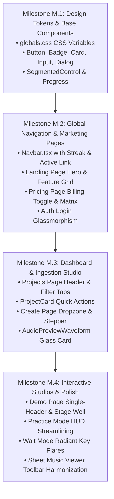

# PianoFlow AI — Comprehensive UI/UX Design System & Full-Site Overhaul Specification

> **Document Version:** 1.0 (Canonical Specification)  
> **Status:** Authoritative Architectural & Design Blueprint  
> **Target Release:** Phase M (Comprehensive UI/UX & Design System Overhaul)  
> **Author:** ARCHITECT Worker Sub-Agent  
> **Date:** October 7, 2026  
> **Scope:** Full-stack design tokens, cross-site harmonization, design system component library, route-by-route transformation, accessibility compliance, and phased engineering roadmap.

---

## 1. Executive Summary & Design Philosophy

### 1.1 The Design Vision: "Dark-Stage Concert Elegance Meets Linear Precision"

PianoFlow AI is not merely a utility for converting MIDI files into MP4 videos; it is an immersive, high-performance musical instrument and pedagogical studio living directly in modern web browsers.

To achieve world-class adoption, user delight, and retention, PianoFlow AI establishes an aesthetic philosophy founded on two converging paradigms:
1. **Dark-Stage Concert Elegance:** The visual depth and focus of a world-class concert hall at night. Deep, non-fatiguing obsidian and true-black voids direct maximum optical contrast and attention to the musical performance—illuminating neon-lit falling notes, glowing key strikes, and elegant engraved sheet music.
2. **Linear Precision:** The meticulous craftsmanship of modern developer and creative tools (exemplified by Linear.app, Raycast, and Apple macOS). Crisp hairline borders with alpha transparencies, tactile 60 FPS micro-interactions, subtle glassmorphic blurs, luminescent radial gradients, and zero visual clutter. Every button click feels tactile, every state transition is fluid, and information hierarchy is immediately clear.

```
┌────────────────────────────────────────────────────────────────────────────────────────┐
│                        PIANOFLOW AI DESIGN PHILOSOPHY PYRAMID                          │
├────────────────────────────────────────────────────────────────────────────────────────┤
│                                                                                        │
│                                  ★ THE FLOW STATE ★                                    │
│                     Frictionless Musical Immersion & Mastery                           │
│                                                                                        │
│                        ▲                                     ▲                         │
│                        │                                     │                         │
│             DARK-STAGE CONCERT ELEGANCE              LINEAR PRECISION                  │
│       • True Black Canvas (#050507)          • Hairline Alpha Borders (white/5-10)     │
│       • Luminescent Note Bloom               • Tactile Tap Feedback (active:scale-98)  │
│       • Dual-Hand Chromatic Identity         • Sub-16ms GPU/RAF Response Times         │
│       • Concert Hall Volumetric Fog          • High-Contrast Monospace Telemetry       │
│                                                                                        │
│                        ▲                                     ▲                         │
│                        └──────────────────┬──────────────────┘                         │
│                                           │                                            │
│                             FOUNDATIONAL DESIGN TOKENS                                 │
│                     Obsidian Palette · Fluid Spacing · WCAG AAA                        │
└────────────────────────────────────────────────────────────────────────────────────────┘
```

### 1.2 Core Experience Goals

1. **Zero-Cognitive-Friction Musical Focus:** Eliminate toolbar clutter, duplicate headers, and jarring layout shifts. Practice controls and visualizers must preserve vertical real estate so musicians on laptops and tablets see both falling notes and the keyboard without scrolling.
2. **Harmonious Visual Language Across Every Route:** Ensure that every screen—from the public landing page to the classical demo library, repertoire project dashboard, multi-source ingestion dropzone, interactive practice studio, vector sheet music viewer, and pricing table—shares an identical visual rhythm, spacing scale, component style, and color system.
3. **Tactile & Responsive Micro-Interactions:** Provide immediate tactile feedback for all user inputs: spring hover elevations, subtle active scale compressions (`active:scale-[0.98]`), smooth modal entry/exit springs, and glow flares.
4. **Uncompromising Accessibility (WCAG 2.1 AA+):** Ensure all text labels meet or exceed the 4.5:1 contrast threshold (and 7:1 for critical telemetry), provide keyboard-focusable outlines with violet glow rings, support screen-reader live announcements for musical progress, and respect user preferences for reduced motion (`motion-reduce`).

---

## 2. Industry Benchmark Analysis & Key Design Patterns

To engineer a best-in-class product, we analyzed the strengths, interaction models, and ergonomic tradeoffs of leading music education applications and world-class SaaS design systems.

### 2.1 Music Learning Benchmarks

| Platform | Core Strengths | Weaknesses / Pitfalls to Avoid | PianoFlow AI Adoption Strategy |
|---|---|---|---|
| **Flowkey** | • Immersive dark practice stage.<br>• Clean, low-distraction heads-up display.<br>• Beautiful repertoire song library with difficulty cards.<br>• Smooth note cursor in sheet mode. | • Heavy, opaque modal overlays that obscure playback state.<br>• Clunky desktop navigation with hidden settings.<br>• Weak audio waveform inspection before practice. | • Adopt the distraction-free dark concert stage for Practice Mode.<br>• Implement a unified Repertoire Card with composer badges, difficulty chips, and audio preview.<br>• Keep HUD controls lightweight and floating above the canvas. |
| **Synthesia** | • Vibrant falling notes with unmistakable hand color coding.<br>• Authentic 88-key physical piano rendering.<br>• Immediate visual key strikes with spark flares.<br>• Precise A-B loop scrubbers for difficult measures. | • Desktop UI feels dated (Win32/legacy aesthetic).<br>• Rigid toolbar buttons and menus without modern design tokens.<br>• Lacks integrated gamification and habit tracking. | • Retain Synthesia's unmatched note clarity, hand differentiation (Electric Violet RH, Neon Cyan LH), and strike flares.<br>• Modernize with smooth glassmorphism, rounded geometry, and dynamic camera auto-tracking. |
| **Simply Piano & Yousician** | • Gamified habit mechanics (streak flame counters, XP progression bars, star ratings).<br>• Encouraging, celebratory completion modals.<br>• Immediate acoustic microphone pitch feedback. | • Cartoonish aesthetics tailored heavily to young children, alienating serious musicians and adult learners.<br>• Inflexible linear track pacing. | • Adopt sleek, mature gamification: Linear-style level progression pills, elegant fire streak badges, and comprehensive timing drift analytics.<br>• Deliver acoustic microphone pitch detection with clear status pills. |

### 2.2 SaaS Design System Benchmarks

| Design System | Signature Elements | Translation into PianoFlow AI |
|---|---|---|
| **Linear.app** | • Deep multi-tier dark mode (`#08090a`, `#0f1011`, `#151618`).<br>• Subtle hairline borders using `rgba(255, 255, 255, 0.08)`.<br>• Micro-interactions: scale down on press, luminous hover glow, spring ease.<br>• Monospace metrics and keyboard shortcut badges (`K`, `Space`, `Esc`). | • Replace flat `border-zinc-800` borders with layered alpha borders (`border-white/5` to `border-white/10`).<br>• Standardize all buttons with `active:scale-[0.98]` and spring transitions.<br>• Use keyboard badges for shortcuts (`Space: Play/Pause`, `Esc: Exit`, `M: Metronome`). |
| **Vercel / Geist** | • Ultra-high-contrast typography with crisp font hierarchies.<br>• Minimalist tactile badges and segmented pills.<br>• Zero decoration that does not convey functional information. | • Apply Geist-style high contrast to track selection, difficulty tabs, and metronome controls.<br>• Standardize all metric badges (BPM, Measures, Accuracy %, Notes) into uniform chip components. |
| **Apple Human Interface (macOS/iOS)** | • Fluid spatial hierarchy and glassmorphic backdrop blurs (`backdrop-blur-xl`).<br>• Ergonomic touch target minimums (44×44px).<br>• Accessible focus rings and dynamic typography scaling. | • Unify modal dialogs, navigation drawers, and floating toolbars with translucent glassmorphic surfaces.<br>• Ensure all mobile keyboard keys and buttons satisfy 44px touch targets. |

---

## 3. Unified Design Tokens & Palette

PianoFlow AI establishes a centralized, mathematical token hierarchy. These tokens are declared via CSS Custom Properties and Tailwind CSS v4 variables in `apps/web/app/globals.css`.

### 3.1 Color Tokens & Luminance Architecture

```
┌────────────────────────────────────────────────────────────────────────────────────────┐
│                              COLOR PALETTE TOKEN MATRIX                                │
├────────────────────────────────────────────────────────────────────────────────────────┤
│  SURFACES & BACKGROUNDS                                                                │
│  [ True Black ]   #050507  bg-void       ── Canvas void, stage floor, app backdrop     │
│  [ Pitch Black ]  #09090b  bg-canvas     ── Root page container, background base       │
│  [ Card Base ]    #121215  bg-card       ── Content cards, inspector panels, drawers   │
│  [ Elevated ]     #18181b  bg-elevated   ── Floating toolbars, dropdowns, hovered items│
│  [ Highlight ]    #27272a  bg-highlight  ── Active segmented pills, pressed key wells  │
├────────────────────────────────────────────────────────────────────────────────────────┤
│  HAIRLINE BORDERS & DIVIDERS                                                           │
│  [ Subtlest ]     rgba(255,255,255,0.05)  border-white/5   ── Card borders, outer rims │
│  [ Standard ]     rgba(255,255,255,0.10)  border-white/10  ── Dividers, inputs, pills  │
│  [ Interactive ]  rgba(255,255,255,0.20)  border-white/20  ── Hover states, active rims│
├────────────────────────────────────────────────────────────────────────────────────────┤
│  CHROMATIC MUSICAL ACCENTS (THE DUAL-HAND IDENTITY)                                    │
│  [ RH Electric Violet ]  #8b5cf6 (Halo) / #7c3aed (Core)   ── Right hand notes / treble│
│  [ LH Neon Cyan ]        #22d3ee (Halo) / #06b6d4 (Core)   ── Left hand notes / bass   │
│  [ Dual Glow Gradient ]  linear-gradient(135deg, #7c3aed 0%, #06b6d4 100%)             │
├────────────────────────────────────────────────────────────────────────────────────────┤
│  FUNCTIONAL & GAMIFICATION FEEDBACK                                                    │
│  [ Emerald Success ]     #10b981  text-emerald-400  ── Perfect hits, ready state, +XP  │
│  [ Amber Warning ]       #f59e0b  text-amber-400    ── Good hits, processing, cautions │
│  [ Rose Error ]          #f43f5e  text-rose-400     ── Misses, wrong keys, failures    │
│  [ Gold Master ]         #eab308  text-yellow-400   ── Daily streaks 🔥, top tiers     │
└────────────────────────────────────────────────────────────────────────────────────────┘
```

#### Detailed Token Value Specifications

| Token | CSS Variable | Hex / RGBA Value | Tailwind Class Equivalent | Purpose & WCAG AAA Contrast |
|---|---|---|---|---|
| **Void Base** | `--pf-bg-void` | `#050507` | `bg-[#050507]` | Deepest dark backdrop for falling note canvas and video stage |
| **Surface Canvas** | `--pf-bg-canvas` | `#09090b` | `bg-zinc-950` | Default page backdrop across all application routes |
| **Surface Card** | `--pf-bg-card` | `#121215` | `bg-[#121215]` | Background for repertoire cards, editor sidebars, dialogs |
| **Surface Elevated** | `--pf-bg-elevated` | `#18181b` | `bg-zinc-900` | Floating toolbars, HUD chips, popover panels |
| **Border Subtle** | `--pf-border-subtle` | `rgba(255,255,255,0.06)` | `border-white/6` | Low-friction outer boundaries for cards and cards |
| **Border Active** | `--pf-border-active` | `rgba(255,255,255,0.15)` | `border-white/15` | Focus and hover boundaries |
| **Text Primary** | `--pf-text-primary` | `#f4f4f5` | `text-zinc-100` | 15.2:1 against void (AAA compliant) |
| **Text Muted** | `--pf-text-muted` | `#a1a1aa` | `text-zinc-400` | 7.1:1 against void (AAA compliant) |
| **Text Subtle** | `--pf-text-subtle` | `#71717a` | `text-zinc-500` | 4.6:1 against void (AA compliant for non-body) |
| **Hand Right Core** | `--pf-hand-rh` | `#8b5cf6` | `text-violet-400` | Treble clef, right hand notes, RH keyboard lighting |
| **Hand Left Core** | `--pf-hand-lh` | `#06b6d4` | `text-cyan-400` | Bass clef, left hand notes, LH keyboard lighting |
| **Perfect Timing** | `--pf-state-perfect`| `#10b981` | `text-emerald-400`| Precision strikes within ±50ms, streak badges |
| **Good Timing** | `--pf-state-good` | `#f59e0b` | `text-amber-400` | Hits within ±120ms |
| **Miss / Error**| `--pf-state-miss` | `#f43f5e` | `text-rose-400` | Note misses, pitch errors, network faults |

### 3.2 Typography Hierarchy & Layout Rhythm

PianoFlow AI pairs a contemporary geometric neo-grotesque sans-serif (`Inter`) with a monospace font engineered for rhythm and code (`JetBrains Mono`).

1. **Title / Display (`font-sans font-extrabold tracking-tight`):**
   - Hero Headings: `text-4xl sm:text-6xl`, line-height `1.1`.
   - Section Titles: `text-2xl sm:text-3xl font-bold tracking-tight text-zinc-100`.
2. **Card & Section Headings (`font-sans font-semibold`):**
   - Modal Titles & Card Names: `text-base sm:text-lg text-zinc-100`.
   - Subsection Labels: `text-xs uppercase font-bold tracking-wider text-zinc-400`.
3. **Body & Descriptive Copy (`font-sans text-sm text-zinc-300 / text-zinc-400`):**
   - High legibility, 150% line-height (`leading-relaxed`), zero eye strain during prolonged sessions.
4. **Technical & Musical Telemetry (`font-mono`):**
   - Musical Pitches (`C4`, `F#5`), Tempos (`120 BPM`), Metronome Meters (`4/4`), Score Values (`28,400`), Latency Offsets (`-14 ms`), and Duration (`03:42`).
   - Sizing: `text-xs` or `text-[11px]`, tabular figures (`tabular-nums`) to prevent layout jitter during live counter animations.

### 3.3 Glassmorphism, Elevation & Radial Ambient Illumination

To avoid flat, lifeless dark interfaces, PianoFlow AI employs multi-layer optical depth:
- **Atmospheric Radial Mesh:** Subtle background glow pools placed behind primary focal areas (e.g., hero banner, falling notes canvas):
  ```css
  background: radial-gradient(circle at 50% 0%, rgba(124, 58, 237, 0.12) 0%, rgba(6, 182, 212, 0.06) 40%, transparent 70%);
  ```
- **Frosted Glass Floating Panels:** All headers, drawers, toolbars, and modal backdrops utilize `backdrop-blur-xl bg-zinc-950/80` with hairline alpha rims (`border border-white/10`).
- **Luminescent Neon Glow (Box Shadow & Drop Shadow):**
  - RH Interactive Glow: `shadow-[0_0_24px_rgba(139,92,246,0.35)]`.
  - LH Interactive Glow: `shadow-[0_0_24px_rgba(6,182,212,0.35)]`.
  - Hit Flare Pulse: `shadow-[0_0_30px_rgba(255,255,255,0.7)]`.

### 3.4 Micro-Interactions, Spring Motion & Tactile Physics

All interactive components must adhere to strict motion guidelines:
- **Tactile Tap Scaling:** Every button and interactive card scales down to `active:scale-[0.98]` upon tap/press, accompanied by `transition-transform duration-100`.
- **Spring Hover Elevation:** Interactive cards slightly translate along the Y-axis: `hover:-translate-y-0.5 hover:shadow-xl hover:shadow-cyan-950/20 hover:border-white/20 transition-all duration-200 ease-out`.
- **Luminous Focus Rings:** For complete keyboard navigation, focusable elements display a glowing dual-ring:
  ```css
  focus-visible:outline-none focus-visible:ring-2 focus-visible:ring-violet-500/70 focus-visible:ring-offset-2 focus-visible:ring-offset-[#09090b]
  ```
- **Reduced Motion Support:** All animations immediately collapse to instantaneous opacity cuts when the user has enabled OS reduced motion (`motion-reduce:transition-none motion-reduce:animate-none`).

---

## 4. Component Design System Harmonization

To permanently eliminate disjointed markup, scattered inline styles, and duplicated buttons, PianoFlow AI establishes a consolidated UI component suite under `apps/web/components/ui/`.

### 4.1 Unified Button System (`components/ui/Button.tsx`)

The redesigned button component supports five purpose-built variants with guaranteed tactile feedback, accessible loading indicators, and icon integration:

```typescript
export interface ButtonProps extends React.ButtonHTMLAttributes<HTMLButtonElement> {
  variant?: "primary" | "secondary" | "outline" | "ghost" | "danger" | "gradient";
  size?: "xs" | "sm" | "md" | "lg";
  isLoading?: boolean;
  leftIcon?: React.ReactNode;
  rightIcon?: React.ReactNode;
}
```

```
┌────────────────────────────────────────────────────────────────────────────────────────┐
│                              UNIFIED BUTTON VARIANTS                                   │
├────────────────────────────────────────────────────────────────────────────────────────┤
│ [ Primary Gradient ]  bg-gradient-to-r from-violet-600 to-cyan-600 text-white          │
│                       shadow-lg shadow-violet-950/40 hover:from-violet-500             │
│                       hover:to-cyan-500 active:scale-[0.98]                            │
│                       Usage: Primary CTAs (Create, Export Center, Upload)              │
│                                                                                        │
│ [ Secondary Surface ] bg-zinc-900 border border-white/10 text-zinc-100                 │
│                       hover:bg-zinc-800 hover:border-white/20 active:scale-[0.98]      │
│                       Usage: Mode toggles, action triggers, secondary navigation       │
│                                                                                        │
│ [ Outline Subtle ]    bg-transparent border border-white/10 text-zinc-300              │
│                       hover:bg-white/5 hover:text-white hover:border-white/20          │
│                       Usage: Filters, back links, track solo/mute                      │
│                                                                                        │
│ [ Ghost Minimal ]     bg-transparent text-zinc-400 hover:text-white hover:bg-white/5   │
│                       Usage: Toolbar utility icons, close triggers, dropdown items     │
│                                                                                        │
│ [ Danger Destructive] bg-rose-500/10 border border-rose-500/20 text-rose-400           │
│                       hover:bg-rose-500/20 hover:border-rose-500/40                   │
│                       Usage: Delete project, remove track, cancel render               │
└────────────────────────────────────────────────────────────────────────────────────────┘
```

### 4.2 Unified Badge & Chip System (`components/ui/Badge.tsx`)

Badges are normalized into a unified, high-contrast token component supporting status, difficulty, hand identification, and musical telemetry:

```typescript
export interface BadgeProps extends React.HTMLAttributes<HTMLSpanElement> {
  variant?: 
    | "default"     // Neutral zinc-800 with white/10 border
    | "success"     // Emerald-500/15 with emerald-400 text (Ready, Completed, 100%)
    | "warning"     // Amber-500/15 with amber-400 text (Processing, Continuous Mode)
    | "danger"      // Rose-500/15 with rose-400 text (Failed, Error)
    | "hand-rh"     // Violet-500/15 with violet-300 text (Right Hand / Treble)
    | "hand-lh"     // Cyan-500/15 with cyan-300 text (Left Hand / Bass)
    | "accent"      // Gradient border with neon cyan text (Pro, Zero-Auth, Instant)
    | "streak";     // Gold/Amber gradient with fire icon 🔥
  size?: "sm" | "md";
  dot?: boolean;
}
```

### 4.3 Unified Segmented Control & Tabs (`components/ui/SegmentedControl.tsx`)

Used across Practice Mode selection, Difficulty selectors (`[ Original | Easy 🟢 | Very Easy 🟡 ]`), Hand isolation, and Export tabs:
- **Container:** Rounded pill container with `bg-zinc-900/90 border border-white/10 p-1 flex items-center gap-1`.
- **Selected Tab:** Animated sliding pill indicator using `bg-zinc-800 text-white shadow-sm font-semibold border border-white/10`. In primary demo mode, uses the subtle brand gradient `bg-gradient-to-r from-violet-600/90 to-cyan-600/90`.
- **Unselected Tab:** `text-zinc-400 hover:text-zinc-200 hover:bg-white/5 transition-colors font-medium`.
- **Full ARIA Role Compliance:** Includes `role="tablist"`, `role="tab"`, `aria-selected="true/false"`, and arrow-key keyboard navigation.

### 4.4 Unified Modal & Drawer Experience (`components/ui/Dialog.tsx` & `MobileNavDrawer.tsx`)

- **Backdrop:** Strict dark-mode immersion via `bg-black/80 backdrop-blur-md` preventing background bleed through.
- **Surface Elevation:** `bg-[#121215] border border-white/10 rounded-2xl shadow-2xl overflow-hidden`.
- **Header:** Sticky header with clean title, subtitle, and an accessible close button (`X` icon with `hover:bg-white/10 rounded-lg p-2`).
- **Focus Management:** Focus trap locks focus inside dialog, automatically returns focus to trigger upon dismissal, and binds `Escape` key cleanly.

### 4.5 Unified Progress Bars & Tooltips (`components/ui/Progress.tsx` & `components/ui/Tooltip.tsx`)

- **Progress Track:** `h-2 w-full bg-zinc-900 rounded-full overflow-hidden border border-white/5`.
- **Progress Shimmer Indicator:** Luminous gradient bar `bg-gradient-to-r from-violet-500 to-cyan-400` with an animated CSS shimmer pulse during indeterminate processing states.
- **Numeric Label:** Monospace percentage (`tabular-nums font-mono text-xs text-zinc-300`) positioned cleanly alongside progress bars.

---

## 5. Route-by-Route Transformation Plan

This section details the precise visual, architectural, and layout transformations required across every route of the web application.

```
┌────────────────────────────────────────────────────────────────────────────────────────┐
│                        FULL SITE ARCHITECTURAL ROUTE MAP                              │
├────────────────────────────────────────────────────────────────────────────────────────┤
│                                                                                        │
│  [ Global Navigation / Navbar ] ── Persistent Streak Pill · Route Highlight · Profile  │
│          │                                                                             │
│          ├── [ / ] Landing Page ── Hero Illumination · Falling Note Teaser · Features  │
│          ├── [ /demo ] Classical Showcase ── Zero-Auth Stage · Single Sticky Header   │
│          ├── [ /projects ] Repertoire Hub ── Real-Time Search · Status Tabs · Cards    │
│          │        │                                                                    │
│          │        ├── [ /projects/[id] ] Editor Workspace ── Canvas + Settings Inspector│
│          │        ├── [ /projects/[id]/practice ] Practice Studio ── Streamlined HUD   │
│          │        └── [ /projects/[id]/sheet ] Vector Sheet Viewer ── Print & Vector  │
│          │                                                                             │
│          ├── [ /create ] Ingestion Studio ── Dropzone Mesh · Waveform · 3-Step Tracker │
│          ├── [ /pricing ] Membership Hub ── Monthly/Annual Toggle · Comparison Matrix  │
│          └── [ /login ] Authentication ── Glassmorphic Backdrop · Social Providers     │
│                                                                                        │
└────────────────────────────────────────────────────────────────────────────────────────┘
```

---

### 5.1 Global Layout & Desktop/Mobile Navigation (`apps/web/app/layout.tsx`, `Navbar.tsx`, `MobileNavDrawer.tsx`, `UserMenu.tsx`)

#### Current Issues Identified
1. `layout.tsx` hardcodes an inline `<header>` without active route tracking.
2. The user profile menu in `UserMenu.tsx` uses an inconsistent `bg-cyan-700` avatar and a flat menu with sharp edges.
3. No persistent gamification indicator (streak pill) exists in the global header, so users lose sight of their streak when browsing the site.
4. Mobile navigation drawer does not include the Demo Library link or current streak status.

#### Architectural Overhaul
- **Extract to Dedicated Component:** Create `apps/web/components/Navbar.tsx` and integrate it into `layout.tsx`.
- **Active Route Highlighting:** Use Next.js `usePathname()` to apply an active pill badge style (`bg-white/10 text-white font-semibold border border-white/10`) to active navigation items (`Create`, `Projects`, `Demo`, `Pricing`).
- **Global Streak & XP Pill:** For authenticated users, display a compact streak indicator in the top navbar (`🔥 5 Days` with amber glow) next to the user avatar. Clicking it opens a quick gamification dropdown showing current Level and XP progress bar.
- **Glassmorphic Sticky Nav:**
  ```html
  <header className="sticky top-0 z-50 border-b border-white/10 bg-[#09090b]/80 backdrop-blur-xl">
  ```
- **Refined User Menu:** Replace the hardcoded `UserMenu` with a glassmorphic dropdown card featuring user email, Pro tier badge, links to My Projects, Settings, and an accessible Sign Out action with tactile hover feedback.

---

### 5.2 Landing Page (`apps/web/app/page.tsx`)

#### Current Issues Identified
1. Hero section is flat and static, lacking visual excitement or musical context.
2. Button hierarchy is muddled with three different button styles side-by-side.
3. Feature grid relies on plain emojis (`🎬`, `🎼`, `🎯`, `🎙️`) without modern micro-interaction cards.
4. Classical demo teaser is a plain pill banner instead of an enticing visual interactive preview.
5. No social proof, testimonials, or pricing teaser exists on the landing page.

#### Architectural Overhaul
- **Concert Stage Hero Illumination:** Add an atmospheric radial ambient gradient in the background (`bg-gradient-to-b from-violet-950/20 via-cyan-950/10 to-transparent`) paired with subtle glowing dots.
- **Hero Typography & Value Proposition:**
  - Luminous badge pill: `✨ Next-Gen Web MIDI & AI Music Transcription`.
  - Main Headline: `Master Any Piano Song.` with gradient highlight `From Audio, Video, or MIDI.`
  - Subtitle: Clear, value-focused explanation of real-time falling notes, interactive practice mode, and vector sheet music generation.
- **Harmonized Action Buttons:**
  - Primary CTA: Large `Button variant="gradient"` — `Start Playing Free 🚀` (routes to `/create`).
  - Secondary CTA: `Button variant="secondary"` — `Try Classical Demo ✨` (routes to `/demo`).
  - Tertiary CTA: `Button variant="outline"` — `Browse Repertoire 🎹` (routes to `/projects`).
- **Interactive Live Demo Showcase Banner:** Embed an interactive preview card featuring animated falling note bars or an embedded preview of Für Elise directly in the hero fold.
- **Modernized Feature Cards:** Replace raw emojis with custom Lucide icon badges featuring subtle radial glow halos, card hover elevation (`hover:-translate-y-1 hover:border-white/20`), and difficulty chips.
- **Workflow Pipeline Section ("From Sound to Mastery in 3 Steps"):**
  - Step 1: Multi-Format Ingestion (MIDI, Audio, YouTube, Mic).
  - Step 2: AI Stem Separation & Neural Transcription (Demucs + Transkun).
  - Step 3: Interactive Practice & Studio Delivery (Wait Mode, Vector Sheet, 1080p60 Video).
- **Social Proof & Audio Quality Metrics:** Display benchmark telemetry (e.g., `88.4% Transcription F1 Score`, `60 FPS Low-Latency Web Audio`, `<15ms Web MIDI Latency`).

---

### 5.3 Classical Demo Showcase (`apps/web/app/demo/page.tsx`)

#### Current Issues Identified
1. **Double Header Bug:** Page declares an internal sticky header (`<header className="sticky top-0 z-40...">`) immediately underneath the global root layout header! This creates two stacked headers and robs 120px of precious vertical screen space.
2. Song cards have custom gradient classes that clash with site-wide design tokens.
3. 3-tier toolbars (Song carousel + 4-Mode tabs + Metronome toolbar) consume more than 350px of vertical height before the interactive canvas even begins.
4. Mode switching lacks smooth cross-fade animation.

#### Architectural Overhaul
- **Eliminate Duplicate Header:** Remove the internal sticky `<header>` in `/demo`. Unify top actions (Export, Upload Custom) into a sleek secondary utility strip or integrate cleanly with the global navbar.
- **Compact Song Strip Carousel:**
  - Redesign classical song cards into sleek horizontal cards with composer portrait / monogram badges, difficulty pill, BPM/meter tags, and note count.
  - Active song state features an illuminated outer hairline border (`ring-1 ring-cyan-500/50 border-cyan-500/50 bg-[#121215] shadow-lg shadow-cyan-950/30`).
- **Unified 4-Mode Studio Stage:**
  - Mode Tabs (`Visualizer 🎬`, `Practice Mode 🎹`, `Sheet Music 🎼`, `AI Coaching 📊`) consolidated into a clean `SegmentedControl` toolbar.
  - Integrated Metronome & Difficulty controls placed directly in the workspace toolbar alongside Play/Pause, Speed, and Reset buttons—reducing vertical toolbar height by 45%.
- **Zero-Distraction Canvas Well:**
  - Frame the falling notes canvas and keyboard visualizer inside an obsidian well (`bg-[#050507] rounded-2xl border border-white/10 shadow-2xl relative overflow-hidden`).
  - Position live score, combo flame badge, and timing accuracy in a floating frosted glass HUD overlay that does not occlude falling bars.

---

### 5.4 Repertoire Projects Hub (`apps/web/app/projects/page.tsx` & `ProjectCard.tsx`)

#### Current Issues Identified
1. The "+ New project" action uses a plain anchor tag rather than `<Button>`.
2. Status badges in `ProjectCard.tsx` use hardcoded Tailwind utility classes (`bg-amber-900/80 text-amber-200`) instead of the centralized `Badge` component tokens.
3. Quick actions on project cards are crowded text links without clear affordance or icon hierarchy.
4. Empty library states and zero-match search results lack visual polish.

#### Architectural Overhaul
- **Header Harmonization:**
  - Left: Clean title `Repertoire Projects` with dynamic project counter (`12 Pieces`).
  - Right: Gamification streak & level pill aligned beside a prominent `Button variant="gradient"` for `+ New Project`.
- **Search & Filter Control Bar:**
  - Search input: Integrated search icon (`Search`), clear shortcut (`Esc` / `✕`), and monospace count indicator.
  - Status Filter Tabs: Segmented pills with reactive counters: `All (12)`, `Ready (10)`, `Processing (1)`, `Failed (1)`.
  - Sort Dropdown: Styled select menu with subtle chevron icon supporting `Newest`, `Title (A-Z)`, `Duration`, `Note Count`.
- **Repertoire Project Card Redesign (`ProjectCard.tsx`):**
  - Card Container: `bg-[#121215] border border-white/8 rounded-2xl p-5 hover:border-white/20 hover:-translate-y-0.5 transition-all shadow-md group`.
  - Header: Song title with hover cyan transition, status badge powered by `<Badge variant={status}>`, and duration pill.
  - Telemetry Grid: Clean 3-column metadata with monospace numbers (`Duration: 02:45`, `BPM: 132`, `Notes: 1,420`).
  - Quick Action Strip:
    - Primary Action: `Button size="sm" variant="secondary"` for `Practice 🎹` (routes to `/projects/[id]/practice`).
    - Secondary Action: `Button size="sm" variant="outline"` for `Sheet 🎼` (routes to `/projects/[id]/sheet`).
    - Utility Actions: Icon button for `Export 🚀` (opens `ExportCenterModal`) and a ghost red trashcan icon for `Delete`.
- **Polished Zero States (`ProjectEmptyState.tsx`):**
  - When library is empty: Illustrated music sheet icon with concert stage glow, welcoming copy, and a large "+ Create First Project" button.
  - When search yields zero matches: Search query tag with "Clear Search Filters" instant button.

---

### 5.5 Creation & Ingestion Studio (`apps/web/app/create/page.tsx`)

#### Current Issues Identified
1. Dropzone is a plain dashed zinc box without visual excitement or feedback during drag-and-drop.
2. URL input field is raw `<input>` without protocol validation cues or submit button alignment.
3. Ingestion pipeline relies on ad-hoc progress text and separate progress bars rather than an integrated multi-step pipeline stepper.
4. Audio preview waveform canvas lacks card elevation and unified action controls.

#### Architectural Overhaul
- **Visual Drag & Drop Stage:**
  - Deep obsidian card well with animated glowing border when dragging files (`border-cyan-400 bg-cyan-500/10 shadow-[0_0_40px_rgba(6,182,212,0.2)]`).
  - Clean iconography: Dynamic format badges (`MIDI`, `WAV`, `MP3`, `M4A`, `FLAC`, `WebM`).
  - Direct file size validator feedback with gentle red/amber toast.
- **Waveform Inspection Card (`AudioPreviewWaveform.tsx`):**
  - Framed in an elevated surface card (`bg-[#121215] border border-white/10 rounded-2xl p-6`).
  - Dual-channel waveform canvas with neon cyan positive envelope and violet negative reflections.
  - Audio auditioning player with play/pause, scrubbable playhead, time markers (`00:14 / 02:30`), and instant "Proceed to Transcription" button.
- **Social URL Video Ingestion Bar:**
  - Modern input group with platform badges (`YouTube`, `TikTok`, `Instagram`).
  - Clear button and instant "Extract Audio & Transcribe" button with spinning loader.
- **Unified 3-Step Pipeline Tracker:**
  - When processing, replace messy loading text with a sleek 3-step visual stepper:
    - `Step 1: File Ingestion & Validation` (Complete ✓)
    - `Step 2: AI Piano Stem Isolation & Transkun Transcription` (Active with live shimmer progress bar ⚡)
    - `Step 3: Score Quantization & Practice Studio Setup` (Pending ○)

---

### 5.6 Project Editor Workspace (`apps/web/components/ProjectEditor.tsx` & `/projects/[id]`)

#### Current Issues Identified
1. Toolbar is fragmented into disparate button groups with no clear hierarchy between previewing, filtering, and cloud exporting.
2. Downloads section mixes job progress bars and raw text links below the settings panel.
3. Side inspector panel feels separate from the main canvas viewport.

#### Architectural Overhaul
- **Unified Workspace Header:**
  - Top bar with Project Title, status badge, and breadcrumb link back to `/projects`.
  - Right side: Quick launch buttons for `Practice Studio 🎹`, `Sheet Music 🎼`, and `Export Center 🚀`.
- **Canvas Viewport Well:**
  - High-framerate falling notes preview with responsive auto-resizing.
  - Floating playback scrubber overlay at the bottom with play/pause, seek slider, speed selector (`0.5x` to `1.25x`), and track filter trigger.
- **Streamlined Settings Inspector (`SettingsPanel.tsx`):**
  - Tabbed inspector: `Visuals & Themes`, `Audio & SoundFont`, `Track Isolation`.
  - Visuals tab: Theme presets (`Neon`, `Monochrome`, `Concert Grand`), hand color pickers with real-time swatch feedback, bloom intensity slider, and falling speed slider.
  - Job rendering cards: Unified progress cards utilizing `components/ui/Progress.tsx` with animated shimmer and direct notification upon completion.

---

### 5.7 Interactive Practice Studio (`apps/web/app/projects/[id]/practice/page.tsx`)

#### Current Issues Identified
1. **Vertical Space Congestion:** Header contains song title, MIDI indicator, score, accuracy, last score, streak, difficulty, metronome, hand mode, and speed across multiple stacked lines.
2. Wait Mode cues could be more visually distinct; notes pause, but beginners need a clear radiant pulse on the exact target keys.
3. Mobile touch keyboard keys are narrow when too many octaves are rendered.
4. Auto-ramp speed notification is fixed at `top-16`, covering the falling notes canvas.

#### Architectural Overhaul
- **Consolidated Heads-Up Display (HUD):**
  - **Top Bar (Minimalist):**
    - Left: Back to Repertoire link, Song Title, and live Hardware Status Pill:
      - `● Yamaha P-125 Connected` (Emerald)
      - `● Acoustic Mic Listening` (Cyan)
      - `○ Virtual Mode` (Zinc)
    - Center: Practice Mode Segmented Toggle (`Free Play`, `Continuous Run`, `Wait Mode ⏸`).
    - Right: Speed multiplier, Hand filter (`Both | RH | LH`), and Metronome popover.
  - **Floating Performance Overlay:**
    - Clean frosted glass pill floating in top-right corner of the canvas:
      - Score: `24,800` (tabular-nums)
      - Accuracy: `96.4%` (color-coded Emerald/Amber/Rose)
      - Combo: `24x 🔥` (illuminated pulse on milestone combos)
- **Radiant Wait Mode Visual Guidance:**
  - Target keys on virtual keyboard pulse with a high-contrast glowing dashed outline in the note's hand color (`#8b5cf6` RH, `#06b6d4` LH).
  - Falling bars in Wait Mode pause at the hit line with an ambient flare, clearly indicating to the musician that the engine is awaiting physical key press.
- **Ergonomic Virtual Piano Keyboard:**
  - Responsive octave viewport: On mobile screens, automatically render 2–3 octaves with prominent `[◄ Octave]` and `[Octave ►]` buttons.
  - Auto-centering camera: Seamlessly scrolls the keyboard viewport to keep the active note cluster centered during playback.
- **Post-Session Celebration & Leveling Modal (`CoachingModal.tsx`):**
  - Celebration fireworks/sparkles animation on session completion.
  - Clear score summary with Perfect/Good/Miss breakdown and signed timing drift chart.
  - Level progress bar with XP count-up animation (`+350 XP!`) and 1-click "Practice Difficult Measures" A-B drill trigger.

---

### 5.8 Sheet Music Viewer (`apps/web/app/projects/[id]/sheet/page.tsx` & `SheetMusicViewer.tsx`)

#### Current Issues Identified
1. Controls bar uses custom inline styles and buttons rather than unified design system components.
2. Zoom control uses plain `+` and `-` text buttons without zoom level indicator.
3. Hand filtering button styles do not match the segmented pills used elsewhere.

#### Architectural Overhaul
- **Frosted Glass Sticky Score Toolbar:**
  - Back to Practice button with left arrow icon.
  - Score Title, Key, BPM, and Total Measures badge.
  - Playback controls: Play/Pause (`Space` shortcut), Scrub slider, and SoundFont acoustic audio playback.
  - Hand isolation segmented control (`Both | RH | LH`).
  - Zoom steppers with numeric percentage display (`100%`, `125%`, `150%`).
  - Export actions: `Print Score 🖨️` and `Download Vector PDF 📄`.
- **Vector Grand Staff Canvas Styling:**
  - In dark mode: High-contrast parchment dark background (`#09090b`) with crisp white vector staves, clefs, and noteheads.
  - Playhead cursor: Glowing cyan vertical cursor scanning across staves in perfect sync with audio playback.
  - In print mode (`@media print`): Pure white paper background (`#ffffff`), pure black crisp vector notation (`#000000`), hiding all toolbars and watermarks.

---

### 5.9 Pricing & Pro Membership Hub (`apps/web/app/pricing/page.tsx`)

#### Current Issues Identified
1. Uses raw `<button>` elements with inline Tailwind styles.
2. Missing monthly vs. annual billing toggle with discount indicator (standard across SaaS apps).
3. Plan cards are visually unbalanced; Free tier is plain zinc, while Pro tier has hardcoded ring styles.
4. Missing comprehensive feature comparison matrix and FAQ section.

#### Architectural Overhaul
- **Billing Cycle Segmented Toggle:**
  - `[ Monthly Billing | Annual Billing (Save 20% 🎉) ]` with instant price calculation ($12/mo vs $9.99/mo billed annually).
- **Harmonized Tier Cards:**
  - **Free Tier Card:** Clean elevated card (`bg-[#121215] border border-white/10 rounded-3xl p-8`), clear feature list with green checkmarks, and disabled "Current Plan" button.
  - **Pro Tier Card:** Luminous spotlight card (`bg-[#121215] border border-cyan-500/40 rounded-3xl p-8 relative shadow-2xl shadow-cyan-950/40`), top gradient accent line, `★ Most Popular` badge, and prominent `Button variant="gradient"` linking to Stripe checkout.
- **Detailed Feature Comparison Matrix:**
  - Comprehensive comparison table covering:
    - MIDI Upload & Size Limits (5 MB vs 25 MB).
    - AI Audio & URL Transcription Minutes (3 min vs 60 min/month).
    - Video Tutorial Export Resolution (720p30 with watermark vs 1080p60 watermark-free).
    - Printable Vector Sheet Music (1/day vs Unlimited).
    - Cloud Storage Retention (7 days vs 90 days).
    - A10G Serverless Priority Queue (Standard vs VIP Priority).
- **Frequently Asked Questions (FAQ) Accordion:**
  - Common questions regarding MIDI hardware compatibility, audio transcription accuracy, subscription cancellation, and commercial video usage.

---

### 5.10 Authentication & Onboarding (`apps/web/app/login/page.tsx`)

#### Current Issues Identified
1. Uses raw `<input>` and `<button>` elements with ad-hoc styling.
2. Flat, uninspired card centered on a blank background.
3. Lacks branded atmospheric stage glow and social provider buttons.

#### Architectural Overhaul
- **Concert Stage Auth Backdrop:**
  - Deep obsidian background with ambient radial glow mesh centered behind the login card.
  - Prominent brand icon `🎹 PianoFlow AI` with glowing subtitle "Your intelligent piano learning studio".
- **Glassmorphic Auth Card:**
  - Translucent card (`bg-[#121215]/90 border border-white/10 rounded-3xl p-8 shadow-2xl backdrop-blur-xl max-w-md w-full mx-auto`).
  - Mode switch tabs: `[ Sign In | Create Account ]`.
- **Form Controls:**
  - Integrated `Input` components with left icons (Email icon, Lock icon), visible focus rings, and validation error messages in rose-400.
  - Submit button: `Button variant="gradient" size="lg"` with animated loading spinner.
- **Social Sign-In Providers:**
  - Clean secondary buttons for Google and GitHub authentication with authentic SVG brand icons.
- **Security & Privacy Reassurance:**
  - Subtle footer text: "Protected by Supabase Auth with end-to-end encryption. No credit card required to start."

---

## 6. Phased Implementation Roadmap, Testing Matrix & Sign-Off Criteria

### 6.1 Phased Implementation Roadmap for CODER

The engineering work is divided into four sequential, logically decoupled execution milestones:



#### Milestone M.1: Foundation Tokens & Core UI Components (Days 1–2)
1. **Update `apps/web/app/globals.css`:**
   - Define all `--pf-bg-*`, `--pf-border-*`, `--pf-hand-*`, and `--pf-state-*` custom properties.
   - Configure global selection, scrollbar, and backdrop styles.
2. **Harmonize `apps/web/components/ui/`:**
   - Enhance `Button.tsx` with gradient variant, tactile `active:scale-[0.98]`, and icon slots.
   - Upgrade `Badge.tsx` with hand, streak, and functional status styles.
   - Refactor `Card.tsx` with alpha borders and hover elevation physics.
   - Refactor `Input.tsx` with luminous focus rings and icon slots.
   - Build new `SegmentedControl.tsx` with keyboard tablist accessibility.
   - Enhance `Progress.tsx` with shimmer pulse animation.

#### Milestone M.2: Global Navigation, Marketing & Auth (Days 3–4)
1. **Global Header & Navigation:**
   - Extract `apps/web/components/Navbar.tsx` from `layout.tsx`.
   - Add active link highlighting via `usePathname()`.
   - Add persistent streak badge and refined user profile dropdown.
   - Update `MobileNavDrawer.tsx` to include Demo Library link and streak pill.
2. **Landing Page Overhaul (`apps/web/app/page.tsx`):**
   - Implement concert-stage ambient radial illumination.
   - Modernize hero typography, CTA button hierarchy, and feature cards.
   - Add 3-step workflow pipeline and audio benchmark metrics.
3. **Pricing Page Overhaul (`apps/web/app/pricing/page.tsx`):**
   - Add Monthly / Annual billing toggle.
   - Harmonize Free and Pro tier cards with unified buttons and badges.
   - Add feature comparison matrix table and FAQ accordion.
4. **Auth Page Overhaul (`apps/web/app/login/page.tsx`):**
   - Apply glassmorphic auth card, unified inputs, and social provider buttons.

#### Milestone M.3: Repertoire Dashboard & Ingestion Studio (Days 5–6)
1. **Repertoire Projects Hub (`apps/web/app/projects/page.tsx` & `ProjectCard.tsx`):**
   - Harmonize header layout, streak pill, and "+ New Project" gradient button.
   - Refactor search bar and status filter tabs using `Badge` counters.
   - Upgrade `ProjectCard.tsx` with unified `Badge` status, duration/BPM/note count grid, and quick action buttons.
   - Polish empty library and zero-match search states.
2. **Creation & Ingestion Studio (`apps/web/app/create/page.tsx`):**
   - Re-skin dropzone with neon cyan/violet drag feedback and format badges.
   - Standardize URL video input bar with platform tags.
   - Build 3-step progress pipeline tracker replacing scattered loading messages.
   - Wrap `AudioPreviewWaveform.tsx` in unified card elevation.

#### Milestone M.4: Interactive Studios & Final Polish (Days 7–8)
1. **Classical Demo Showcase (`apps/web/app/demo/page.tsx`):**
   - Remove duplicate internal `<header>` to reclaim vertical screen space.
   - Redesign classical song carousel cards with unified badges.
   - Consolidate 4-mode tabs, metronome, and difficulty selectors into a sleek toolbar.
   - Frame falling notes canvas in an obsidian concert stage well.
2. **Interactive Practice Studio (`apps/web/app/projects/[id]/practice/page.tsx`):**
   - Streamline Practice HUD into a single top bar and floating performance pill.
   - Add high-contrast radiant pulses to target keys in Wait Mode.
   - Ensure mobile keyboard octave shift buttons maintain 44px touch targets.
   - Polish post-session celebration modal with XP counter.
3. **Sheet Music Viewer (`apps/web/components/sheet/SheetMusicViewer.tsx`):**
   - Harmonize controls bar with unified `Button` and `SegmentedControl` components.
   - Add zoom level percentage display.
   - Refine `@media print` styles for clean vector PDF printing.

---

### 6.2 Testing Matrix for TESTER

Every screen and interaction must undergo automated and visual verification:

| Test ID | Route / Component | Test Scenario | Acceptance Criteria |
|---|---|---|---|
| **UI-E2E-01** | Global Header | Active route highlighting & streak pill | Navigation links reflect current route; authenticated user sees streak flame pill; mobile drawer opens cleanly. |
| **UI-E2E-02** | Landing Page | Hero CTA links & feature cards | "Start Playing Free" routes to `/create`; "Try Classical Demo" routes to `/demo`; cards elevate on hover. |
| **UI-E2E-03** | Demo Showcase | Single header & mode tab bar | Zero duplicate headers; 4-mode tabs switch active viewports cleanly; metronome and difficulty update notes. |
| **UI-E2E-04** | Projects Dashboard | Search, status filtering, and quick actions | Real-time search filters cards; status tabs update live counts; "Practice" opens `/practice`; "Export" opens modal. |
| **UI-E2E-05** | Create Studio | Drag-and-drop & waveform preview | Dropping `.mid` or `.wav` triggers active glow; waveform decodes and allows scrub seeking; 3-step tracker displays. |
| **UI-E2E-06** | Practice Studio | Streamlined HUD & Wait Mode cues | Falling notes canvas and keyboard fit viewport; Wait Mode pauses at hit line; target keys pulse; score updates in HUD. |
| **UI-E2E-07** | Sheet Music Viewer | Zoom steppers & print layout | Zoom steppers scale staves; Spacebar toggles playback; Print stylesheet suppresses toolbars and formats clean score. |
| **UI-E2E-08** | Pricing Page | Monthly/Annual billing toggle | Toggling annual switches prices ($12 ➔ $9.99); comparison table is legible; checkout button triggers Stripe session. |
| **UI-E2E-09** | Auth Page | Login/Signup glassmorphic card | Mode toggles smoothly; invalid input highlights in rose-400; successful login redirects to `/projects`. |
| **UI-E2E-10** | Accessibility | Keyboard navigation & contrast | All interactive elements reachable via `Tab` with visible violet focus rings; all text achieves WCAG 2.1 AA (4.5:1+). |

---

### 6.3 Sign-Off Criteria for AUDITOR

The comprehensive UI/UX overhaul will be signed off by the AUDITOR only when all of the following conditions are met:
1. **Zero ESLint & TypeScript Compilation Errors:** `pnpm -r typecheck` and `pnpm --filter @pianoflow/web lint` pass with 0 errors and 0 warnings.
2. **Zero Duplicate Headers:** The `/demo` route and all other pages display exactly one unified top header.
3. **100% Component Token Adherence:** No ad-hoc inline background or border colors (e.g. `bg-amber-900/80`) remain in project cards or controls; all components use unified design system tokens from Milestone M.1.
4. **Complete E2E Test Greenness:** All Playwright browser E2E test suites pass with 0 timeouts and 0 console errors.
5. **Responsive Integrity Across Viewports:** Desktop (1920×1080, 1440×900), Tablet (1024×768), and Mobile (390×844 iPhone, 412×915 Android) render clean layouts without horizontal text clipping or unplayable keyboard keys.
6. **WCAG 2.1 AA Compliance:** Minimum 4.5:1 contrast for all text, visible focus rings, and proper ARIA labels across all interactive canvas elements.
