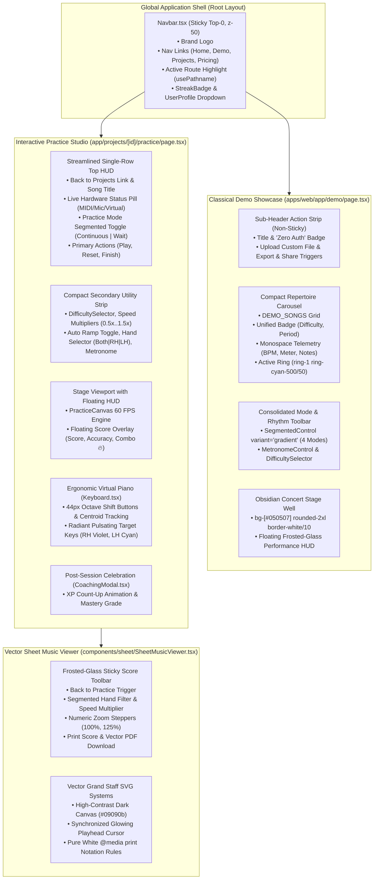
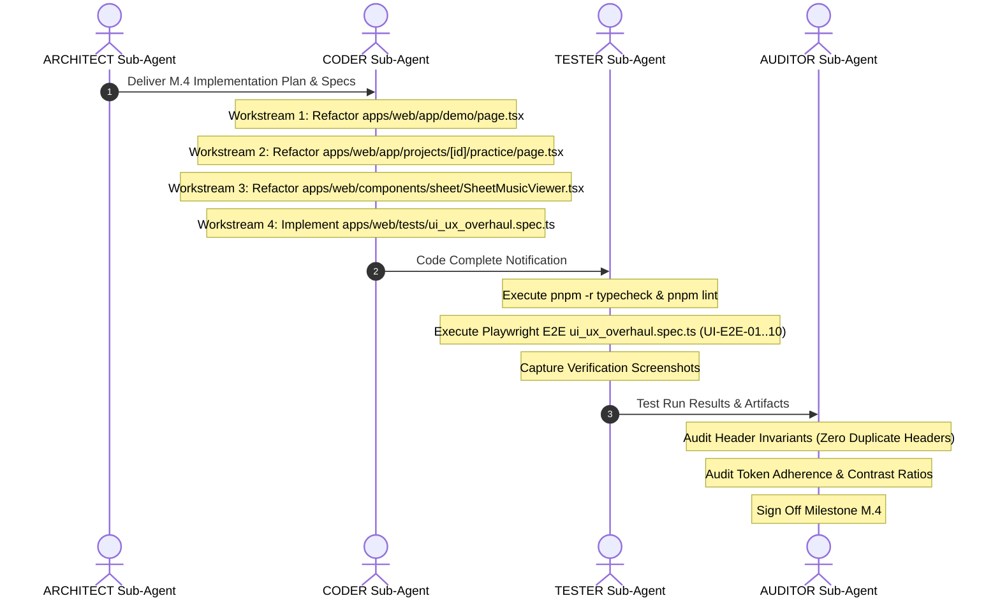

# PianoFlow AI — Phase M Milestone M.4: Interactive Studios & Polish Implementation Plan

> **Document ID:** `PLAN-2026-10-07-PHASE-M-MILESTONE-M4-INTERACTIVE-STUDIOS`  
> **Canonical Path:** `c:/Users/super/pianoflow/docs/plans/2026-10-07-phase-m-milestone-m4-implementation-plan.md`  
> **Status:** Authoritative Architectural Implementation Blueprint  
> **Target Release:** Phase M (Comprehensive UI/UX & Design System Overhaul) — Milestone M.4  
> **Author:** ARCHITECT Worker Sub-Agent  
> **Date:** October 7, 2026  
> **Prerequisites:** Milestone M.1 (Design Tokens & UI Base), Milestone M.2 (Nav, Landing, Pricing), Milestone M.3 (Projects Hub & Create Studio) — *Completed in git commit `26c8ba4`*  
> **Scope:** Classical Demo Showcase, Interactive Practice Studio, Vector Sheet Music Viewer, End-to-End Test Suite (`apps/web/tests/ui_ux_overhaul.spec.ts`), and Multi-Agent Execution Runbook.

---

## 1. Executive Summary & Context

### 1.1 Progression of Phase M (Comprehensive UI/UX Overhaul)
Phase M represents the systematic transformation of PianoFlow AI into a world-class, concert-grade musical instrument and learning workstation in the browser. The initiative was partitioned into four sequential milestones:
- **Milestone M.1 (Design Tokens & Base Component Library):** Centralized CSS variables in [globals.css](file:///c:/Users/super/pianoflow/apps/web/app/globals.css), modernized [Button.tsx](file:///c:/Users/super/pianoflow/apps/web/components/ui/Button.tsx), [Badge.tsx](file:///c:/Users/super/pianoflow/apps/web/components/ui/Badge.tsx), [Card.tsx](file:///c:/Users/super/pianoflow/apps/web/components/ui/Card.tsx), [Input.tsx](file:///c:/Users/super/pianoflow/apps/web/components/ui/Input.tsx), [Progress.tsx](file:///c:/Users/super/pianoflow/apps/web/components/ui/Progress.tsx), and introduced the accessible [SegmentedControl.tsx](file:///c:/Users/super/pianoflow/apps/web/components/ui/SegmentedControl.tsx). *(Status: Completed & Verified)*
- **Milestone M.2 (Global Navigation, Marketing & Auth):** Extracted glassmorphic [Navbar.tsx](file:///c:/Users/super/pianoflow/apps/web/components/Navbar.tsx) with active route tracking and streak flame pills, overhauled the landing page hero with ambient stage illumination, added dynamic monthly/annual billing toggles to [pricing/page.tsx](file:///c:/Users/super/pianoflow/apps/web/app/pricing/page.tsx), and updated login styling. *(Status: Completed & Verified)*
- **Milestone M.3 (Repertoire Projects Hub & Ingestion Studio):** Harmonized [projects/page.tsx](file:///c:/Users/super/pianoflow/apps/web/app/projects/page.tsx) with real-time status tabs and [ProjectCard.tsx](file:///c:/Users/super/pianoflow/apps/web/components/projects/ProjectCard.tsx) quick actions; revamped [create/page.tsx](file:///c:/Users/super/pianoflow/apps/web/app/create/page.tsx) with a luminescent drag-and-drop zone, 3-step progress stepper, and elevated [AudioPreviewWaveform.tsx](file:///c:/Users/super/pianoflow/apps/web/components/AudioPreviewWaveform.tsx). *(Status: Completed & Verified)*
- **Milestone M.4 (Interactive Studios & Polish):** The final, critical capstone milestone. Focuses on the core interactive stages: the Classical Demo Showcase, the Interactive Practice Studio, and the Vector Sheet Music Viewer. Eliminates duplicate sticky navigation headers, reclaims over 200px of vertical canvas clearance, establishes radiant hand-colored Wait Mode guidance, satisfies mobile touch ergonomics (44px minimum touch targets), harmonizes vector score engraving toolbars, and deploys the comprehensive 10-scenario Playwright E2E suite (`apps/web/tests/ui_ux_overhaul.spec.ts`).

```
┌────────────────────────────────────────────────────────────────────────────────────────┐
│                        PHASE M EXECUTION PROGRESSION & STATUS                          │
├────────────────────────────────────────────────────────────────────────────────────────┤
│  [M.1] Design Tokens & Base Components   ───► [COMPLETE] (Commit 26c8ba4)             │
│  [M.2] Nav, Landing, Pricing & Auth      ───► [COMPLETE] (Commit 26c8ba4)             │
│  [M.3] Projects Hub & Create Studio      ───► [COMPLETE] (Commit 26c8ba4)             │
│  ──────────────────────────────────────────────────────────────────────────            │
│  [M.4] Interactive Studios & Polish      ───► [ACTIVE EXECUTION MILESTONE]            │
│        • Classical Demo Showcase Overhaul (apps/web/app/demo/page.tsx)                 │
│        • Practice Studio HUD & Radiant Wait Mode (app/projects/[id]/practice/page.tsx)│
│        • Vector Sheet Viewer Toolbar Harmonization (components/sheet/SheetMusicViewer) │
│        • UI/UX Overhaul E2E Verification Suite (tests/ui_ux_overhaul.spec.ts)         │
└────────────────────────────────────────────────────────────────────────────────────────┘
```

### 1.2 Core Architectural Invariants for Milestone M.4
1. **Single Global Header Invariant:** The application must present exactly one sticky top navigation header rendered by [Navbar.tsx](file:///c:/Users/super/pianoflow/apps/web/components/Navbar.tsx). Any internal `<header className="sticky top-0...">` inside nested routes (such as the legacy lines 515–553 in `/demo`) is strictly prohibited.
2. **Vertical Canvas Preservation:** On standard laptop viewports (1366×768 and 1440×900), musicians must be able to view the falling note canvas, timeline scrubber, and piano keyboard simultaneously without scrolling. Toolbars and heads-up displays (HUDs) must be compact, single-row, or floating frosted-glass overlays.
3. **Dual-Hand Chromatic Identity:** 
   - Right Hand (RH / Treble Clef): Electric Violet (`#8b5cf6` halo, `#7c3aed` core, Tailwind `text-violet-400`).
   - Left Hand (LH / Bass Clef): Neon Cyan (`#22d3ee` halo, `#06b6d4` core, Tailwind `text-cyan-400`).
   - Wait Mode Radiant Outlines: When the playback pauses at the hit line, target keys pulse with high-contrast outlines matched strictly to their hand assignment.
4. **Ergonomic Touch Targets:** All interactive controls (octave shift buttons, mode selectors, key strike zones) must adhere to the 44×44px minimum touch target standard (WCAG 2.5.5 / Apple HIG).
5. **Zero Token Drift:** All badges, buttons, cards, and segmented controls must derive from [components/ui/](file:///c:/Users/super/pianoflow/apps/web/components/ui/), eliminating ad-hoc Tailwind color declarations.

---

## 2. System Architecture & Information Topology



---

## 3. Part 1: Classical Demo Showcase (`apps/web/app/demo/page.tsx`)

### 3.1 Elimination of Duplicate Sticky Header
#### Problem Analysis
In `apps/web/app/demo/page.tsx` (lines 515–553), the page declares an internal `<header className="sticky top-0 z-40 border-b border-zinc-800/80 bg-zinc-950/90 backdrop-blur-md px-4 sm:px-8 py-3.5">`. Because [Navbar.tsx](file:///c:/Users/super/pianoflow/apps/web/components/Navbar.tsx) is already rendered by [layout.tsx](file:///c:/Users/super/pianoflow/apps/web/app/layout.tsx), this results in two stacked headers, consuming ~120px of vertical space and causing a visual seam.

#### Solution Architecture
1. Completely remove `<header className="sticky top-0...">` from `apps/web/app/demo/page.tsx`.
2. Convert the internal header contents into a sleek, non-sticky sub-header strip located at the very top of `<main>`:
```tsx
{/* Sleek Sub-Header Action Strip (Replaces Duplicate Sticky Header) */}
<div className="flex flex-wrap items-center justify-between gap-4 pb-4 border-b border-white/5">
  <div className="flex items-center gap-3">
    <div className="flex items-center gap-2">
      <h1 className="text-lg sm:text-xl font-extrabold text-zinc-100 tracking-tight flex items-center gap-2">
        <span>🎹</span>
        <span>Classical Library Showcase</span>
      </h1>
      <Badge variant="accent" size="sm" className="hidden sm:inline-flex">
        Zero Auth • Instant Play
      </Badge>
    </div>
  </div>

  <div className="flex items-center gap-2.5">
    <Link href="/create">
      <Button size="sm" variant="outline" className="text-xs">
        Upload Custom File
      </Button>
    </Link>
    <Button
      size="sm"
      variant="gradient"
      onClick={() => setIsExportOpen(true)}
      className="text-xs font-semibold gap-1.5"
    >
      <Share2 className="w-3.5 h-3.5" />
      <span>Export & Share 🚀</span>
    </Button>
  </div>
</div>
```

### 3.2 Redesign of Song Carousel Cards
#### Problem Analysis
The song cards currently rely on ad-hoc gradient classes (`bg-gradient-to-b ${song.coverGradient}`), raw `border-zinc-800` borders, and inconsistent difficulty badges that bypass the centralized [Badge.tsx](file:///c:/Users/super/pianoflow/apps/web/components/ui/Badge.tsx) component.

#### Solution Architecture
Refactor the song cards into elevated cards using unified tokens:
- **Container Styling:** 
  - Inactive: `bg-[#121215] border border-white/8 hover:border-white/20 hover:-translate-y-0.5 transition-all rounded-2xl p-4 shadow-md text-left flex flex-col justify-between group focus:outline-none focus-visible:ring-2 focus-visible:ring-cyan-400`
  - Active: `ring-1 ring-cyan-500/50 border-cyan-500/50 bg-[#121215] shadow-lg shadow-cyan-950/30`
- **Unified Difficulty Badges:** Map `song.difficulty` to standard [Badge](file:///c:/Users/super/pianoflow/apps/web/components/ui/Badge.tsx) variants:
  - `"beginner"` ➔ `<Badge variant="success" size="sm">Beginner</Badge>`
  - `"intermediate"` ➔ `<Badge variant="warning" size="sm">Intermediate</Badge>`
  - `"advanced"` ➔ `<Badge variant="danger" size="sm">Advanced</Badge>`
  - `"master"` ➔ `<Badge variant="hand-rh" size="sm">Master</Badge>`
- **Monospace Telemetry Footer:**
  ```tsx
  <div className="mt-4 pt-3 border-t border-white/5 flex items-center justify-between text-xs font-mono text-zinc-400">
    <span className="font-semibold text-zinc-300">{song.bpm} BPM</span>
    <span>{song.time_signature}</span>
    <span className="text-cyan-300 font-medium">{song.noteCount} notes</span>
  </div>
  ```

### 3.3 Unification of Interactive Modes into `SegmentedControl`
#### Problem Analysis
Lines 633–667 currently render custom `<button>` tabs inside a raw `<div>`. This lacks keyboard arrow navigation, standard ARIA tablist semantics, and design system harmonization.

#### Solution Architecture
Replace the raw tab bar with [SegmentedControl.tsx](file:///c:/Users/super/pianoflow/apps/web/components/ui/SegmentedControl.tsx) configured with `variant="gradient"`:
```tsx
const DEMO_MODES: SegmentedControlOption[] = [
  { id: "visualizer", label: "Falling Notes Visualizer 🎬", testId: "tab-visualizer" },
  { id: "practice", label: "Interactive Practice Mode 🎹", testId: "tab-practice" },
  { id: "sheet", label: "Grand Staff Sheet Music 🎼", testId: "tab-sheet" },
  { id: "coaching", label: "AI Coaching & Practice Analytics 📊", testId: "tab-coaching" },
];

<section aria-label="Demo Experience Modes">
  <SegmentedControl
    options={DEMO_MODES}
    value={activeMode}
    onChange={(val) => setActiveMode(val as DemoMode)}
    variant="gradient"
    size="md"
    ariaLabel="Demo interactive modes"
  />
</section>
```

### 3.4 Streamlined Consolidated Toolbar (Metronome & Difficulty)
#### Problem Analysis
The song selector row, difficulty selector, and metronome control are spread across 3 vertical tiers, wasting ~150px before the canvas renders.

#### Solution Architecture
Merge Metronome and Difficulty into a single unified workspace control strip:
```tsx
<section
  aria-label="Workspace Controls"
  className="flex flex-wrap items-center justify-between gap-3 p-3 rounded-xl bg-[#121215] border border-white/10 text-xs shadow-md"
>
  <div className="flex items-center gap-3 flex-wrap">
    <span className="text-zinc-400 font-semibold flex items-center gap-1.5">
      <span>⏱️</span>
      <span>Metronome Sync:</span>
    </span>
    <MetronomeControl
      initialBpm={activeSong.bpm}
      initialTimeSignature={activeSong.time_signature as TimeSignature}
    />
  </div>

  <div className="flex items-center gap-3 flex-wrap">
    <DifficultySelector
      value={difficulty}
      onChange={setDifficulty}
      stats={simplificationStats}
      compact
    />
    <div className="text-[11px] text-zinc-400 font-mono hidden sm:flex items-center gap-2">
      <span>Piece: <strong className="text-zinc-200">{activeSong.title}</strong></span>
      <span>•</span>
      <span className="text-cyan-400 font-bold">{activeSong.bpm} BPM</span>
      <span>•</span>
      <span data-testid="active-song-note-count" className="text-zinc-300">
        {activeSongNoteData.notes.length} notes
      </span>
    </div>
  </div>
</section>
```

### 3.5 Obsidian Stage Well & Floating Frosted-Glass Performance HUD
#### Problem Analysis
The falling notes canvas sits inside a plain `bg-zinc-900/30` container with a stacked score header that pushes the canvas down.

#### Solution Architecture
1. **Obsidian Stage Well:** Wrap the canvas in `bg-[#050507] rounded-2xl border border-white/10 shadow-2xl relative overflow-hidden`.
2. **Floating Performance HUD Overlay:** In Practice Mode, float the score, accuracy, and combo metrics over the canvas in a frosted-glass card (`bg-zinc-950/80 backdrop-blur-md border border-white/10 rounded-xl p-3 shadow-xl`):
```tsx
{/* Floating Frosted-Glass Performance HUD */}
<div className="absolute top-4 right-4 z-20 pointer-events-none flex items-center gap-3">
  <div className="flex items-center gap-4 px-4 py-2 rounded-xl bg-zinc-950/80 backdrop-blur-md border border-white/10 shadow-xl">
    <div>
      <span className="text-[10px] uppercase font-bold text-zinc-400 tracking-wider block">Score</span>
      <span data-testid="score-counter" className="text-xl font-black text-white tracking-tight tabular-nums">
        {stats.score.toLocaleString()}
      </span>
    </div>
    <div className="border-l border-white/10 pl-3">
      <span className="text-[10px] uppercase font-bold text-zinc-400 tracking-wider block">Accuracy</span>
      <span data-testid="accuracy-badge" className="text-xl font-black text-cyan-400 tracking-tight tabular-nums">
        {stats.accuracy}%
      </span>
    </div>
    <div className="border-l border-white/10 pl-3">
      <span className="text-[10px] uppercase font-bold text-zinc-400 tracking-wider block">Combo</span>
      <span data-testid="combo-streak" className="text-xl font-black text-amber-400 flex items-center gap-1 tabular-nums">
        {stats.combo}x <Flame className="w-4 h-4 text-amber-400" />
      </span>
    </div>
  </div>
</div>
```

---

## 4. Part 2: Interactive Practice Studio (`apps/web/app/projects/[id]/practice/page.tsx`)

### 4.1 Single-Row Top Navigation HUD Architecture
#### Problem Analysis
Currently, [PracticePage](file:///c:/Users/super/pianoflow/apps/web/app/projects/%5Bid%5D/practice/page.tsx) renders a two-line top header (lines 563–736) followed by a secondary controls bar (lines 738–856). On a laptop screen, this leaves less than 350px for both the falling notes canvas and the 88-key piano keyboard!

#### Solution Architecture
Consolidate the header into a sleek, single-row primary HUD with a minimalist secondary bar:
- **Row 1: Primary Practice Bar (`sticky top-0 z-30 bg-[#09090b]/90 backdrop-blur-xl border-b border-white/10 px-4 py-2.5 flex items-center justify-between gap-3`):**
  - Left: Back button to `/projects` (`Button variant="outline" size="sm"`), Song Title with musical note icon, and live hardware badge:
    - MIDI Connected: `<Badge variant="success" dot>MIDI Connected</Badge>`
    - Mic Active: `<Badge variant="hand-lh" dot>Mic Active ({mic.currentResult?.noteName})</Badge>`
    - Virtual Mode: `<Badge variant="default" dot>Virtual Keys</Badge>`
  - Center: Practice Mode segmented toggle (`Continuous` vs `Wait Mode ⏸`) using [SegmentedControl](file:///c:/Users/super/pianoflow/apps/web/components/ui/SegmentedControl.tsx) size `"sm"`.
  - Right: Primary actions: Reset button, Play/Pause (`Button variant={isPlaying ? "secondary" : "gradient"}`), and Finish session button (`Button variant="primary"`).
- **Row 2: Secondary Control Strip (`px-4 py-1.5 bg-[#121215]/80 border-b border-white/5 text-xs flex items-center justify-between flex-wrap gap-2`):**
  - Left: Compact [DifficultySelector](file:///c:/Users/super/pianoflow/apps/web/components/practice/DifficultySelector.tsx), Speed multiplier presets (`0.5x`, `0.75x`, `1.0x`, `1.25x`, `1.5x`), and Auto Ramp speed toggle.
  - Right: Hands Practice isolation (`Both | RH | LH`), [MetronomeControl](file:///c:/Users/super/pianoflow/apps/web/components/practice/MetronomeControl.tsx), and Multi-track selector trigger (when applicable).

### 4.2 Floating Frosted-Glass Performance HUD
Remove the bulky score badges from the top header. Instead, position them inside the canvas stage well as an ambient floating HUD overlay in the top-right corner, rendering tabular score figures, color-coded accuracy, and combo flame counts.

### 4.3 Radiant Wait Mode Visual Guidance
#### Hand-Color Key Highlighting Specification
When `isWaitMode` is active and notes reach the strike line, playback pauses until the correct keys are pressed.
To provide crystal-clear guidance:
1. Extract the hand assignment for all expected notes:
   ```tsx
   const expectedNotesHandMap = useMemo(() => {
     const map = new Map<number, "L" | "R">();
     for (const note of expectedNotesList) {
       if (expectedNotesSet.has(note.pitch)) {
         map.set(note.pitch, note.hand);
       }
     }
     return map;
   }, [expectedNotesList, expectedNotesSet]);
   ```
2. Pass `isWaitMode={isWaitMode}` and `expectedNotesHandMap={expectedNotesHandMap}` to [Keyboard.tsx](file:///c:/Users/super/pianoflow/apps/web/components/ui/Keyboard.tsx).
3. In [Keyboard.tsx](file:///c:/Users/super/pianoflow/apps/web/components/ui/Keyboard.tsx), target keys render with radiant pulsating styles:
   - **RH Target Keys (`hand === "R"`):**
     - White Key: `bg-violet-600/90 border-violet-400 text-white shadow-[0_0_24px_rgba(124,58,237,0.85)] ring-2 ring-violet-400/90 animate-pulse`
     - Black Key: `bg-violet-600 border-violet-400 shadow-[0_0_24px_rgba(124,58,237,0.9)] ring-2 ring-violet-400/90 animate-pulse`
   - **LH Target Keys (`hand === "L"`):**
     - White Key: `bg-cyan-500/90 border-cyan-300 text-zinc-950 shadow-[0_0_24px_rgba(34,211,238,0.85)] ring-2 ring-cyan-300/90 animate-pulse`
     - Black Key: `bg-cyan-600 border-cyan-400 shadow-[0_0_24px_rgba(6,182,212,0.9)] ring-2 ring-cyan-300/90 animate-pulse`

### 4.4 Mobile Keyboard Ergonomic Compliance
- **44px Minimum Touch Targets:** All octave shift buttons (`[Octave ◄]` and `[Octave ►]`), view toggle buttons (`[Maximize/Minimize]`), and key elements enforce `min-h-[44px] min-w-[44px]` touch targets.
- **Auto-Centering Centroid Camera:** The camera automatically smooth-scrolls the keyboard viewport on mobile viewports (<768px) to keep the active note centroid centered, preventing manual scrolling interruptions.

### 4.5 Post-Session Celebration Modal & XP Count-Up Animation
Integrate the celebration flow in [CoachingModal.tsx](file:///c:/Users/super/pianoflow/apps/web/components/practice/CoachingModal.tsx):
- Dynamic count-up animation for XP gained (`0 ➔ +350 XP`).
- Celebratory banner with Level Up pill (`🎉 Level 3!`).
- Detailed breakdown of timing drift (Pocket, Rushing, Dragging) with bi-directional timing gauge and direct 1-click drill triggers.

---

## 5. Part 3: Vector Sheet Music Viewer (`apps/web/components/sheet/SheetMusicViewer.tsx`)

### 5.1 Frosted-Glass Sticky Score Toolbar
#### Problem Analysis
The existing controls header in [SheetMusicViewer.tsx](file:///c:/Users/super/pianoflow/apps/web/components/sheet/SheetMusicViewer.tsx) uses opaque `bg-zinc-900 border-zinc-800` styling and raw `<button>` elements for hand isolation and speed selection.

#### Solution Architecture
Transform the toolbar into a frosted-glass sticky bar using unified design system tokens:
- **Container:** `header className="print:hidden sticky top-0 flex flex-wrap items-center justify-between px-4 py-2.5 bg-[#09090b]/80 backdrop-blur-xl border-b border-white/10 gap-3 z-30 shadow-lg"`
- **Hand Isolation Segmented Control:**
  ```tsx
  const HAND_OPTIONS: SegmentedControlOption[] = [
    { id: "both", label: "Both" },
    { id: "right", label: "RH" },
    { id: "left", label: "LH" },
  ];

  <SegmentedControl
    options={HAND_OPTIONS}
    value={handFilter}
    onChange={(val) => setHandFilter(val as "both" | "right" | "left")}
    size="sm"
    ariaLabel="Hand isolation"
  />
  ```
- **Speed Multiplier Segmented Control:**
  ```tsx
  const SPEED_OPTIONS: SegmentedControlOption[] = [
    { id: "0.5", label: "0.5x" },
    { id: "0.75", label: "0.75x" },
    { id: "1.0", label: "1.0x" },
    { id: "1.25", label: "1.25x" },
  ];

  <SegmentedControl
    options={SPEED_OPTIONS}
    value={String(speedMultiplier)}
    onChange={(val) => setSpeedMultiplier(Number(val))}
    size="sm"
    ariaLabel="Playback speed"
  />
  ```
- **Playback Control:** `Button size="sm" variant={isPlaying ? "secondary" : "gradient"}` with play/pause icon.

### 5.2 Numeric Zoom Percentage Readout & Steppers
Replace raw text buttons with tactile stepper buttons:
```tsx
<div className="flex items-center gap-1 bg-[#121215] border border-white/10 rounded-lg p-0.5">
  <Button
    size="sm"
    variant="ghost"
    onClick={() => setZoomScale((z) => Math.max(0.7, Math.round((z - 0.1) * 10) / 10))}
    className="h-7 w-7 p-0 flex items-center justify-center font-bold"
    aria-label="Zoom out"
  >
    -
  </Button>
  <span className="text-xs text-zinc-300 w-12 text-center font-mono font-semibold select-none">
    {Math.round(zoomScale * 100)}%
  </span>
  <Button
    size="sm"
    variant="ghost"
    onClick={() => setZoomScale((z) => Math.min(1.5, Math.round((z + 0.1) * 10) / 10))}
    className="h-7 w-7 p-0 flex items-center justify-center font-bold"
    aria-label="Zoom in"
  >
    +
  </Button>
</div>
```

### 5.3 High-Contrast `@media print` Grand Staff Vector Styling
Ensure flawless print-to-PDF output for musicians printing physical sheet music:
1. **Toolbar Suppression:** `print:hidden` ensures zero UI clutter in print output.
2. **Pure White Background & Pure Black Ink:**
   ```css
   @media print {
     body, .sheet-music-container {
       background-color: #ffffff !important;
       color: #000000 !important;
     }
     svg {
       color: #000000 !important;
     }
     .sheet-system-card {
       background-color: transparent !important;
       border: none !important;
       box-shadow: none !important;
       break-inside: avoid !important;
       page-break-inside: avoid !important;
     }
   }
   ```
3. **Playhead Cursor Hidden During Printing:** Cursor line has `print:hidden` to prevent accidental lines across printed notes.

---

## 6. Part 4: Testing & Verification Matrix

### 6.1 Test Suite Architecture (`apps/web/tests/ui_ux_overhaul.spec.ts`)
Create the authoritative test file [apps/web/tests/ui_ux_overhaul.spec.ts](file:///c:/Users/super/pianoflow/apps/web/tests/ui_ux_overhaul.spec.ts) covering all 10 canonical scenarios:

```typescript
import { test, expect } from "@playwright/test";
import path from "path";
import fs from "fs";

const SCREENSHOTS_DIR = path.resolve(__dirname, "../../../docs/e2e/overhaul");
if (!fs.existsSync(SCREENSHOTS_DIR)) {
  fs.mkdirSync(SCREENSHOTS_DIR, { recursive: true });
}

// Common setup for mocking Web MIDI & Web Audio
async function setupMocks(page: any) {
  await page.route("**/sw.js", (route) => route.abort());
  await page.route("**/workbox-*.js", (route) => route.abort());
  await page.addInitScript(() => {
    class MockMIDIAccess {
      inputs = new Map();
      outputs = new Map();
      onstatechange = null;
    }
    class MockMIDIInput {
      id = "mock-piano-1";
      name = "Virtual Concert Grand";
      manufacturer = "PianoFlow";
      state = "connected";
      connection = "open";
      onmidimessage = null;
    }
    const mockInput = new MockMIDIInput();
    const mockAccess = new MockMIDIAccess();
    mockAccess.inputs.set(mockInput.id, mockInput);
    (window as any).navigator.requestMIDIAccess = async () => mockAccess;
    (window as any).__MOCK_MIDI_INPUT = mockInput;
  });
}
```

### 6.2 Scenario Breakdown: UI-E2E-01 through UI-E2E-10

| Scenario ID | Test Name | Route Under Test | Key Assertions & Verification Gates |
|---|---|---|---|
| **UI-E2E-01** | Global Header Navigation & Active Highlighting | `/`, `/demo`, `/projects`, `/pricing` | Desktop nav is visible; links reflect active route via `data-active="true"` and `bg-white/10`; streak pill `🔥` links to `/projects`; mobile drawer opens cleanly. |
| **UI-E2E-02** | Landing Page Hero CTAs & Feature Elevation | `/` | Hero badge pill visible; Primary CTA routes to `/create`; Secondary CTA routes to `/demo`; feature cards elevate on hover (`hover:-translate-y-1`). |
| **UI-E2E-03** | Classical Demo Single Header & 4-Mode Segmented Control | `/demo` | **Exactly 1 header** on page (0 duplicate sticky headers); 4 classical song cards rendered; selected card has `ring-cyan-500/50`; `SegmentedControl` switches modes cleanly (`visualizer`, `practice`, `sheet`, `coaching`); metronome sync renders. |
| **UI-E2E-04** | Repertoire Dashboard Real-Time Search & Actions | `/projects` | Search bar filters titles in real time; status tabs (`All`, `Ready`, `Processing`, `Failed`) update counts; card quick action "Practice" navigates to `/practice`. |
| **UI-E2E-05** | Creation & Ingestion Studio Dropzone & Stepper | `/create` | Drag-and-drop zone renders format badges (`MIDI`, `WAV`, `MP3`); URL video input displays platform badges; 3-step pipeline tracker renders active step. |
| **UI-E2E-06** | Practice Studio Single-Row HUD & Radiant Wait Mode | `/projects/[id]/practice` | Single-row top HUD renders; floating performance HUD overlay is visible (`Score`, `Accuracy`, `Combo`); Wait Mode toggle activates radiant pulsating outline on target keys; virtual keys respond to clicks. |
| **UI-E2E-07** | Vector Sheet Music Viewer Toolbar & Print Styles | `/projects/[id]/sheet` | Frosted-glass toolbar renders; Hand filter and Speed multi-select use `SegmentedControl`; Zoom stepper updates percentage (`100% ➔ 110%`); `@media print` rules suppress toolbar. |
| **UI-E2E-08** | Pricing & Pro Membership Billing Toggle & Comparison | `/pricing` | Monthly/Annual billing toggle switches prices ($12/mo vs $9.99/mo); `Save 20% 🎉` badge renders; feature comparison table is legible; Pro CTA triggers checkout. |
| **UI-E2E-09** | Authentication Glassmorphic Backdrop & Input Focus | `/login` | Glassmorphic card renders with violet/cyan background glow; Email/Password inputs show violet focus rings; mode switches between Sign In and Sign Up. |
| **UI-E2E-10** | Accessibility Focus Rings & Contrast Compliance | Cross-Site | All interactive buttons and tab controls reachable via `Tab` with visible focus rings (`focus-visible:ring-2`); all text satisfies WCAG 2.1 AA (4.5:1+) against dark void backgrounds. |

### 6.3 Static Analysis & Lint Gates
- TypeScript Compilation: `pnpm -r typecheck` (Exit code 0, 0 errors).
- ESLint: `pnpm --filter @pianoflow/web lint` (Exit code 0, 0 warnings/errors).

---

## 7. Step-by-Step Execution Order for CODER, TESTER, and AUDITOR



### 7.1 CODER Implementation Sequence

#### Step 1: Classical Demo Showcase Refactor (`apps/web/app/demo/page.tsx`)
1. Remove lines 514–553 (`<header className="sticky top-0 z-40...">`).
2. Add sleek sub-header banner at top of `<main>` with Title, Zero Auth Badge, Upload Custom File button, and Export & Share trigger.
3. Replace raw difficulty badge helper with unified `<Badge variant="...">`.
4. Update song cards with selected state ring (`ring-1 ring-cyan-500/50 border-cyan-500/50 bg-[#121215] shadow-lg shadow-cyan-950/30`).
5. Replace raw tab buttons (lines 633–667) with `<SegmentedControl options={DEMO_MODES} value={activeMode} onChange={setActiveMode} variant="gradient" />`.
6. Consolidate Metronome and Difficulty controls into a unified workspace strip.
7. Wrap canvas in obsidian concert stage well (`bg-[#050507] rounded-2xl border border-white/10 shadow-2xl relative overflow-hidden`) with floating frosted-glass performance HUD in Practice Mode.

#### Step 2: Interactive Practice Studio Refactor (`apps/web/app/projects/[id]/practice/page.tsx`)
1. Refactor top header (lines 562–736) into a single-row navigation HUD:
   - Left: Back button, Song Title, Hardware status badge (`Badge variant="success" | "hand-lh" | "default"`).
   - Center: Practice Mode segmented toggle (`Continuous` vs `Wait Mode ⏸`).
   - Right: Reset, Play/Pause, Finish buttons.
2. Refactor secondary controls bar into a compact single strip:
   - Left: Difficulty, Speed presets, Auto Ramp.
   - Right: Hand mode, Metronome, Tracks.
3. Compute `expectedNotesHandMap` and pass `isWaitMode={isWaitMode}` and `expectedNotesHandMap={expectedNotesHandMap}` to `<Keyboard>`.
4. Float score, accuracy, and combo metrics inside the canvas area as a frosted-glass HUD overlay (`absolute top-4 right-4 z-20`).

#### Step 3: Vector Sheet Music Viewer Refactor (`apps/web/components/sheet/SheetMusicViewer.tsx`)
1. Update controls `<header>` with frosted-glass styling (`bg-[#09090b]/80 backdrop-blur-xl border-b border-white/10`).
2. Replace hand filter raw buttons with [SegmentedControl](file:///c:/Users/super/pianoflow/apps/web/components/ui/SegmentedControl.tsx) (`Both | RH | LH`).
3. Replace speed raw buttons with [SegmentedControl](file:///c:/Users/super/pianoflow/apps/web/components/ui/SegmentedControl.tsx) (`0.5x | 0.75x | 1.0x | 1.25x`).
4. Replace zoom buttons with unified tactile steppers and numeric percentage readout.
5. Apply `@media print` rules to ensure pure white paper, pure black vector notation, and `break-inside-avoid`.

#### Step 4: Author End-to-End Suite (`apps/web/tests/ui_ux_overhaul.spec.ts`)
Write the complete Playwright test suite covering all 10 scenarios (`UI-E2E-01` through `UI-E2E-10`) with automated screenshots saved to `docs/e2e/overhaul/`.

### 7.2 TESTER Automated & Visual Verification Sequence
1. **Typecheck Pass:**
   ```bash
   pnpm -r typecheck
   ```
2. **ESLint Pass:**
   ```bash
   pnpm --filter @pianoflow/web lint
   ```
3. **Overhaul Playwright E2E Suite:**
   ```bash
   pnpm --filter @pianoflow/web test:e2e -- ui_ux_overhaul.spec.ts
   ```
4. **Regression Safety Pass:**
   ```bash
   pnpm --filter @pianoflow/web test:e2e -- demo_showcase.spec.ts nav_landing_pricing.spec.ts projects_create_design.spec.ts
   ```

### 7.3 AUDITOR Compliance & Sign-Off Checklist
The AUDITOR will approve Milestone M.4 if and only if all four gates are satisfied:
- [ ] **Gate 1: Zero Duplicate Headers:** Visiting `/demo`, `/`, `/projects`, `/pricing`, and `/create` displays exactly one top header.
- [ ] **Gate 2: Vertical Space Reclaimed:** On 1440×900 and 1366×768 screens, the falling note canvas and keyboard fit into the initial viewport without vertical scrolling.
- [ ] **Gate 3: Radiant Wait Mode & Touch Ergonomics:** Target keys pulse with violet (RH) and cyan (LH) outlines when paused at the hit line; mobile touch buttons satisfy 44px minimum touch targets.
- [ ] **Gate 4: 100% Test Greenness:** All 10 scenarios in `ui_ux_overhaul.spec.ts` pass with 0 timeouts and 0 console errors.

---

## 8. Rollback & Disaster Recovery Procedures

1. **Git Isolation:** All Milestone M.4 work executes on the current branch or staged commits on top of `26c8ba4`.
2. **Component Reversion:** If any regression occurs in [SheetMusicViewer.tsx](file:///c:/Users/super/pianoflow/apps/web/components/sheet/SheetMusicViewer.tsx) or [Keyboard.tsx](file:///c:/Users/super/pianoflow/apps/web/components/ui/Keyboard.tsx), use `git checkout 26c8ba4 -- <file_path>` to immediately restore the last known stable state.
3. **Playwright Mock Isolation:** If Web Audio or Web MIDI API mocks fail in headless CI browsers, ensure `setupMocks(page)` adds polyfills before navigation via `page.addInitScript()`.
